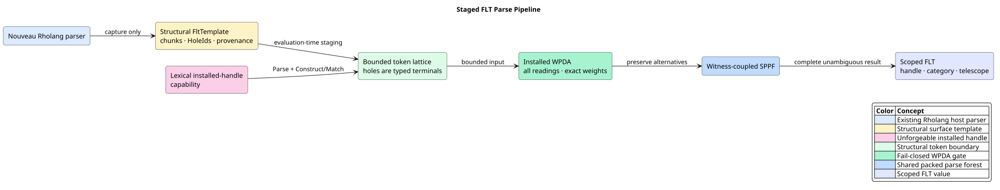
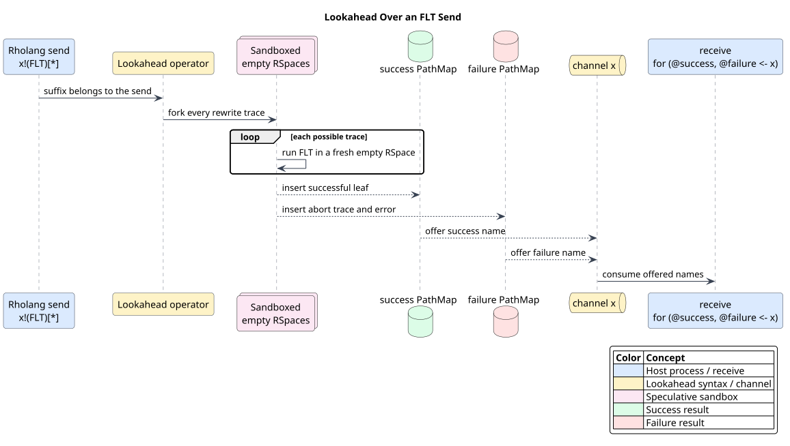

# Foreign Language Terms and Associated Operations

Dylon Edwards
2026-06-26
Status: Under Review

## Abstract

This proposal introduces **Foreign Language Terms** (FLTs): scoped guest-language
terms embedded inside the one existing nouveau Rholang host language. A guest
language may be defined at compile time with `language!` or at run time by any
Rholang process using the companion *MeTTaIL Language Specifications in
Rholang* FIPS. FLTs provide:

1. author-chosen delimiters for bounded guest source;
2. optional language and category qualification;
3. context-indexed structural holes for capture-avoiding construction and a
   decidable typed pattern-matching fragment;
4. composition with Rholang sends, receives, joins, guards, and the approved
   Lookahead FIPS; and
5. native in-Rho reduction for guest languages, with a uniform bridge to
   external virtual-host runtimes specified in the companion FIPS *Virtual Host
   Bridges for FLTs*.

The central invariant is **structural substitution**. The host lexer records
guest chunks and hole tokens as a token lattice; the selected guest parser
consumes holes as typed terminals and produces a scoped template. A host value
fills that template only after handle, sort, scope, and capability checks. No
operation rewrites source text or reparses interpolated text.

## Status and Evidence

This FIPS is normative design under review. It contains no revision diary;
history belongs in Git. [Implementation Evidence](#implementation-evidence) is
non-normative and names only reproducible code facts. Conformance requires the
surface, staging, installed-handle, structural-hole, matching, reflection,
reduction, bridge, capability, resource, and formal-verification requirements
as one integrated feature. A partial legacy ABI is evidence, not permission to
weaken the specified boundary.

## Motivation

Rholang and MeTTaIL need to express domain-specific languages, virtual-machine
states, and externally hosted computations without reducing them to unsafe
strings. The syntax should let an author write a guest language in its own
notation while still giving the host enough structure to:

- identify the embedded region;
- know which guest language and category to parse;
- substitute host terms into guest holes without injection;
- destructure guest terms in receive patterns and match expressions;
- inspect speculative futures through the approved lookahead operator; and
- execute external runtimes without confusing host semantics with guest
  semantics.

The design deliberately avoids a special outer escape bracket. The delimiter is
the marker that a foreign region begins, and the parser carries possible readings
until host context, language tags, category tags, or disambiguation policy
selects one.

## Terminology

- **Host language**: the surrounding Rholang or MeTTaIL language.
- **Guest language**: the immutable installed language named by an opaque handle
  in the current lexical environment.
- **Installed-language handle**: an unforgeable, policy-bound capability
  committing to a language fingerprint, categories, observations, effects,
  limits, and allowed operations.
- **Foreign Language Term (FLT)**: a scoped term carrying its installed-language
  identity and result category. Surface source and spans are optional provenance,
  not semantic identity.
- **Category**: a guest grammar sort such as `Proc`, `Name`, `Str`, or `Int`.
- **Hole**: a stable context-indexed metavariable written `${x}` or `${x:Cat}`;
  internally $`x:(\Delta\vdash Cat)`$, with every occurrence carrying an
  explicit renaming or substitution from its declaration telescope.
- **Construction position**: a term-producing context where a hole is filled
  from an environment.
- **Pattern position**: a matching context where a hole captures a subtree into
  an environment.
- **Virtual host**: an external runtime bound through a `semantics <Host>`
  declaration. Its semantics are implemented outside the Rholang interpreter and
  reached through a bridge.
- **Bridge terminology**: the bridge signature, canonical bridge type, type
  profile, and codec that convert values between Rholang and a virtual host are
  defined in the companion FIPS *Virtual Host Bridges for FLTs*, which specifies
  the virtual-host execution strategy in full.
- **Template context**: a scoped term with construction or pattern holes.
- **Hypercube displayed site**: a distinguished source occurrence with index,
  rely, and ambient profile; it is not a template hole.
- **Observer context**: a context admitted by the language's observation
  profile; it is not automatically entitled to reflect raw syntax.
- **Minimal evaluation context**: the smallest context that witnesses a rewrite
  or virtual-host step without carrying irrelevant state.
- **Reified-space capability**: an opaque reference to a stateful tuple-space
  instance indexed by an installed language handle and a committed theorem,
  storage, matching, qualifier, and replay profile. It is authority, not an FLT
  value.

## Surface Syntax

This section gives the surface fragment in BNFC notation for readability. The
implementation consists of terms, tokens, modes, and bound-term lowering added
directly to the existing nouveau Rholang `language!` definition at
`languages/src/rholang.rs`. It must not modify the legacy Rholang 1.3
tree-sitter grammar. The fragment assumes the existing host grammar provides
`Proc`, `Name`, `ProcPat`, `NamePat`, `Guard`, `Ident`, and `Integer`.

```bnfc
-- Existing host categories assumed by this FIPS fragment:
-- Proc, Name, ProcPat, NamePat, Guard, Ident, Integer.

entrypoints Proc, Flt, FltPattern ;

-- FLTs are process terms. In pattern position they lower to host process or
-- name patterns according to their category.
FltProc.       Proc       ::= Flt ;
FltProcPat.    ProcPat    ::= FltPattern ;
FltNamePat.    NamePat    ::= "@" FltPattern ;

TaggedFlt.     Flt        ::= FltTag FltBody ;
ContextFlt.    Flt        ::= FltBody ;
TaggedPat.     FltPattern ::= FltTag FltBody ;
ContextPat.    FltPattern ::= FltBody ;

LangTag.       FltTag     ::= Ident ;
CatTag.        FltTag     ::= Ident ":" Ident ;

-- The modal lexer emits the delimiter/body tokens named here. Equality of
-- symmetric delimiters, fence run length, heredoc words, and bracket depth are
-- lexical-mode obligations, not context-free BNFC obligations.
InlineBody.    FltBody ::= "`" [FltBodyItem] "`" ;
FenceBody.     FltBody ::= FenceDelim [FltBodyItem] FenceDelim ;
SymBody.       FltBody ::= SymmetricDelim [FltBodyItem] SymmetricDelim ;
RunBody.       FltBody ::= SymmetricRunDelim [FltBodyItem] SymmetricRunDelim ;
ParenBody.     FltBody ::= "(" [FltBodyItem] ")" ;
BracketBody.   FltBody ::= "[" [FltBodyItem] "]" ;
BraceBody.     FltBody ::= "{" [FltBodyItem] "}" ;
AngleBody.     FltBody ::= "<" [FltBodyItem] ">" ;
HeredocBody.   FltBody ::= HeredocOpen [FltBodyItem] HeredocClose ;

GuestPart.     FltBodyItem ::= GuestChunk ;
HolePart.      FltBodyItem ::= Hole ;
terminator FltBodyItem "" ;

HoleUntyped.   Hole ::= "${" Ident "}" ;
HoleTyped.     Hole ::= "${" Ident ":" Ident "}" ;

-- Sends may be ordinary sends or sends with the approved Lookahead suffix.
SendPlain.     Proc ::= Name "!" "(" [Proc] ")" ;
SendMultiple.  Proc ::= Name "!!" "(" [Proc] ")" ;
SendLookahead. Proc ::= Name "!" "(" [Proc] ")" LookaheadSuffix ;
LookaheadN.    LookaheadSuffix ::= "[" Integer "]" ;
LookaheadAll.  LookaheadSuffix ::= "[" "*" "]" ;

-- Existing Rholang receive surfaces, repeated here only where FLTs compose.
Receive.        Proc ::= "for" "(" [Receipt] ")" "{" Proc "}" ;
ReceiptGuard.   Receipt ::= [Bind] "where" Guard ;
ReceiptNoGuard. Receipt ::= [Bind] ;

LinearBind.     Bind ::= [NamePat] "<-" NameSource ;
RepeatedBind.   Bind ::= [NamePat] "<=" Name ;
PeekBind.       Bind ::= [NamePat] "<<-" Name ;

separator nonempty Bind "&" ;
separator nonempty Receipt ";" ;
separator Proc "," ;
separator NamePat "," ;

SimpleSource.      NameSource ::= Name ;
ReceiveSendSource. NameSource ::= Name "?!" ;
SendReceiveSource. NameSource ::= Name "!?" "(" [Proc] ")" ;

-- Existing Rholang let surfaces. This FIPS does not introduce a new let.
LetLinear.      Proc ::= "let" [Decl] "in" Proc ;
LetConcurrent.  Proc ::= "let" [ConcDecl] "in" Proc ;
DeclBind.       Decl ::= [Name] "<-" [Proc] ;
DeclVar.        Decl ::= Ident "=" Proc ;
ConcDeclBind.   ConcDecl ::= [Name] "<-" [Proc] ;
ConcDeclVar.    ConcDecl ::= Ident "=" Proc ;
separator nonempty Decl ";" ;
separator nonempty ConcDecl "/\\" ;
separator Name "," ;

-- The virtual-host `semantics <Host> bridge { ... }` declaration and the
-- language-neutral BridgeType algebra live in the sibling FIPS
-- "Virtual Host Bridges for FLTs". They are not part of the native-FLT surface.

-- Delimiter/body lexeme names emitted by the modal lexer. These are NOT
-- context-free token classes: a fence closes on the run length that opened it,
-- a symmetric run closes on the run that opened it, and a heredoc closes on the
-- word that opened it. Those closers are DATA-DEPENDENT — the lexer must
-- remember the opening lexeme — so their discipline is a lexical-mode
-- obligation of the modal lexer (a mode stack for depth-counted brackets, a
-- register automaton for the data-dependent closers), not a BNFC production.
-- Only GuestChunk is a genuine context-free token. The other delimiter lexemes
-- are enforced by lexical modes (listed as comments), not by token rules; the
-- per-form mechanism status is given after the grammar.
token GuestChunk (char)+ ;
-- Modal-lexer delimiter lexemes (each enforced by a lexical mode):
--   FenceDelim        : fixed-length backtick fence; arbitrary run length is a register-mode closer
--   InlineBacktick    : single backtick; fixed closer
--   SymmetricDelim    : one of ["/#!|"]; next unescaped occurrence
--   SymmetricRunDelim : run over ["/#!|"]; register-mode closer on the same run
--   ReservedBracket   : "{" or "[", opened only under a reserved guest tag; mode-stack depth counter
--   HeredocDelim      : "<<" WORD ... WORD; register-mode closer on the WORD
```

Lexical conventions (modal-lexer mode obligations, not context-free tokens):

- A **fixed-length** backtick fence and the **inline backtick** close on a
  statically known lexeme; the modal lexer emits them with an ordinary mode
  push/pop.
- An **arbitrary-run-length** fence closes only on the same backtick run length
  that opened it. Because the closer depends on the opener, the modal lexer must
  store the admission-bounded opening run in a register and match it.
- A **symmetric character** closes on the next unescaped occurrence, and a
  **symmetric run** closes only on the same character and run length that opened
  it; both modes track escaping and the bounded opener.
- **Paired brackets** are depth-counted by the modal lexer's mode stack before
  the enclosed `[FltBodyItem]` stream is handed to the parser. Only `{` and `[`
  are admitted after contextual FLT recognition; `(` and `<` require live-parser
  contextual token admission so they do not collide with host casts and sends
  (`int(`, `n!(`), binds, or comparisons (`<-`, `<=`, `==`).
- A **word heredoc** records the word after `<<` and accepts a close only on a
  line equal to that word; the opener length is admission-bounded.
- `GuestChunk` is guest-language text in the current delimiter mode. `${...}` is
  emitted as a `Hole`, not as guest text, unless the language declares a
  different antiquote token.

The hole lexeme `${...}` is the **braced spelling of the host's already-landed
`$`-metavariable**: the tokenizer already recognizes the `$` metavariable sigil,
so a hole reuses an implemented lexeme rather than introducing a new one. The
brace pair delimits the metavariable name (and optional `:Cat`) from adjacent
guest text.

An identifier tag resolves only in the current lexical environment and must map
to an installed-language handle carrying the required operation right. It is
not a global registry lookup. A tag without a category selects the handle's
declared primary category; `L:Cat` selects both.

An omitted tag is accepted only when the host context supplies exactly one
handle and result category, or one handle with an unambiguous primary category.
The runtime must not enumerate all installed or registered languages to guess:
that would create denial-of-service, information-disclosure, cache-timing, and
consensus-order hazards. Zero or multiple contextual candidates is an explicit
`UnresolvedFltLanguage` or `AmbiguousFltLanguage` error.

```text
perl:Str`"hello"`      language pinned, category pinned
perl`print(1)`         language pinned, category inferred
`print(1)`             language and category inferred
```

## Delimiters

An FLT body is bounded by an author-chosen delimiter. The author should choose a
delimiter that does not collide with the guest body.

All delimiter forms below are normative. The **Mechanism** column states the
required bounded lexer mechanism, not an implementation phase.

| Form | Example | Closing rule | Mechanism | Notes |
| --- | --- | --- | --- | --- |
| Inline backtick | `` L`body` `` | next unescaped backtick | fixed modal lexer | Default for short terms |
| Backtick block | `` L````body```` `` | same run length as opener | bounded register mode | Default for multiline terms |
| Symmetric character | `L/body/`, `L#body#`, `L!body!` | next unescaped occurrence | escape-tracking mode | Useful when backticks occur in the body |
| Symmetric run | `L###body###` | same character and run length | bounded register mode | Generalizes fenced blocks |
| Paired bracket | `L{body}`, `L[body]` | matching closer at depth zero | bounded mode stack | Enabled only after a resolved FLT tag or expected handle |
| Paired bracket | `L(body)`, `L<body>` | matching closer at depth zero | contextual token admission | Must not steal host casts, sends, binds, or comparisons |
| Word heredoc | `L<<WORD` ... `WORD` | line exactly equal to the opener word | bounded register mode | The word length is admission-bounded |

When the default delimiter collides with the body, authors escalate to another
delimiter:

```text
perl`print("hi")`
perl/print("a`b")/
perl<<PL
  my $u = "a/b`c";
  print "$u";
PL
```

## Staged Parsing and Elaboration

The host parser cannot assume that a runtime-authored guest grammar is installed
when it parses the surrounding deploy. It therefore produces a structural
`FltTemplate` containing delimiter metadata, ordered guest chunks, stable hole
identifiers, declared categories, source provenance, and an optional lexical
handle reference. It does not produce guest source with `${...}` rewritten.

During process evaluation, after the handle binding exists, the FLT evaluator:

1. resolves the lexical handle and checks `Parse` plus the operation-specific
   `Construct` or `Match` right;
2. converts guest chunks and holes to a bounded token lattice in which each hole
   is a typed terminal carrying its stable identifier and telescope;
3. runs the installed WPDA and retains every viable derivation in an SPPF with
   its exact witness weight;
4. rejects resource exhaustion or unresolved ambiguity without choosing by
   hash-map, registry, cache, or declaration traversal order; and
5. builds a scoped guest template or pattern only from a complete successful
   alternative.

A statically installed handle may enable eager guest parsing, but the eager and
staged paths must pass differential equivalence tests and yield identical scoped
terms, diagnostics, weights, fingerprints, and costs. First-match composition
is forbidden.



PlantUML source:
[diagrams/01-parse-pipeline.puml](diagrams/01-parse-pipeline.puml).

### Holes

`Hole` has one syntax with two roles:

| Context | Meaning | Result |
| --- | --- | --- |
| Construction position | Fill the hole from an existing binding | AST graft |
| Pattern position | Capture the matched subtree into a binding | Pattern variable |

The category of a hole is inferred from its guest grammar position. If inference
is ambiguous, the author writes `${x:Cat}`.

#### Indexed syntax and the template monad

For installed language $`L`$, host-variable context $`\Gamma`$, binder
telescope $`\Delta`$, and result category $`s`$, a closed FLT is an element of
$`T_L(\Gamma;\Delta\vdash s)`$. A template with metavariables $`X`$ is an
element of the free substitution monad $`T_L(X)`$. Every hole declaration has a
stable identifier and judgment

```math
h : (\Delta_h \vdash s_h).
```

An occurrence beneath a different telescope is $`h[\sigma]`$, where
$`\sigma`$ is an explicit weakening, renaming, or substitution from the
declaration telescope to the occurrence telescope. Matching a display name is
never sufficient to establish scope.

Construction is Kleisli substitution and must satisfy identity, associativity,
alpha-equivalence, reindexing, sort preservation, and capture avoidance:

```math
t[\eta] = t, \qquad
\eta(x)[f] = f(x), \qquad
t[f][g] = t[x \mapsto f(x)[g]].
```

Construction holes are positive substitution sites. Pattern holes are negative
binding and capture sites. Under binders, FLT matching is limited to typed
Miller-pattern or nominal-unification constraints with explicit freshness and
linearity rules [Miller 1991; Urban, Pitts, and Gabbay 2004]. General
higher-order unification and unrestricted unification modulo user equations are
rejected. Associative, commutative, or unit matching is admitted only for a
bounded fragment whose canonical-form or matcher proof is installed with the
language.

#### The reflected wire model and the hereditary-ground marker

The lowering target is the reflected tagged-`Par` graph, not a bare AST. A guest
constructor whose label is a **marked object** — a binder-bearing constructor,
such as a lambda — reflects to a tagged list whose index-1 element is a
*hereditary-ground marker*:

```text
EList[ ⌜C⌝, m, ⟦t0⟧, ⟦t1⟧, ... ]
```

The marker `m` is a reserved `GPrivate` token: `^gnd` when the whole subtree is
hereditarily free of bound-variable leaves, and `^nog` otherwise. It is derived,
conservative metadata whose only purpose is to let the in-Rho substitution and
shift drivers skip a subtree they cannot change. Its soundness is the `oground`
invariant, proved as `oground_subst_id` and `oground_shift_id` in
`InRhoCreeperTrace.v`:

```math
\mathrm{oground}(t) \;\iff\; (t\ \text{has no}\ \texttt{bound}\ \text{leaf, hereditarily}) \;\iff\; \bigl(\forall\, j\, a.\ \mathrm{osubst}(j, a, t) = t\bigr) \,\wedge\, \bigl(\forall\, c.\ \mathrm{oshift}(c, t) = t\bigr).
```

In words: a node is marked ground exactly when no bound-variable leaf occurs
anywhere beneath it, which is exactly the condition under which substitution and
shift act as the identity on it. Two rules for holes follow from this invariant,
and both are load-bearing.

- **Marker-slot wildcard (pattern position).** A hole inside a marked-object node
  lowers to a pattern that places an *unconstrained wildcard* at the index-1
  marker slot. A pattern must never pin the marker byte, because the received
  subterm's marker is computed from its own contents and need not equal any
  statically chosen marker. Wildcarding the slot reuses the landed
  tagged-pattern combinators; it is not new machinery.
- **Forced `^nog` over a filled hole (construction position).** When construction
  grafts a value into a hole, the enclosing marked-object node's marker is
  recomputed **bottom-up**, and a node that still contains a hole — or that
  receives a fill carrying a bound-variable leaf — is emitted as `^nog`. This is
  *necessary*, not merely conservative: by the `oground` invariant, a stale
  `^gnd` marker left over a `^bound`-carrying fill would let the substitution
  driver treat the node as identity-under-substitution and skip a substitution
  that a later β-step requires, silently producing a wrong reduction.
  Construction therefore never keeps a `^gnd` marker over a hole.

#### Elaboration in construction position

The elaboration algorithm is presented in literate form: a root fragment names
the phases, and each phase is defined and explained below it. `T` is the scoped
reflected template and `ρ` maps stable hole identifiers to scoped,
handle-typed FLT values.

```text
⟨Elaborate an FLT in construction position⟩ ≡
  plan ← []
  for each hole occurrence h[σ] at position π in T:
    ⟨Resolve the hole's category Cat⟩
    ⟨Check handle, telescope, freshness, and capability⟩
    append (π, h, σ, v) to plan
  return ⟨Apply the complete substitution plan atomically⟩
```

The first fragment fixes the guest sort the slot expects. The category is read
off the hole's grammar position; an explicit `${x:Cat}` annotation constrains
and must equal that category. A slot whose category cannot be determined is a
fail-closed error rather than a guess.

```text
⟨Resolve the hole's category Cat⟩ ≡
  if h is written ${x:Cat}: require the explicit Cat
  else: Cat ← the guest category of position π in T
  require Cat = sort(h) and the occurrence reindexing σ is well typed
  otherwise raise a fail-closed scoped-category error
```

The second fragment binds the value and checks it against the resolved category.
Because `ρ(id(h))` is already a scoped reflected term — never source text — the
check is a structural category and arity gate, and its failure grafts nothing.

```text
⟨Check handle, telescope, freshness, and capability⟩ ≡
  v ← ρ(id(h))                    -- a scoped FLT value, never source text
  require Construct(handle(T), Cat)
  require handle(v) = handle(T) or an authorized morphism F maps v to Cat
  require telescope(v) fits telescope(h) and all freshness constraints hold
  otherwise fail without changing T
```

The third fragment applies the complete plan to a new immutable value. Every
hole leaf is replaced in one simultaneous capture-avoiding substitution, then
enclosing marker metadata is recomputed bottom-up. No partially filled term is
observable, and no node outside a hole or its derived-marker ancestry is moved
or retagged.

```text
⟨Apply the complete substitution plan atomically⟩ ≡
  T' ← simultaneous_capture_avoiding_substitution(T, plan)
  for each marked-object ancestor a of any planned π, innermost first:
    marker_T'(a) ← ^gnd if subtree_T'(a) is hereditarily bound-free, else ^nog
  return T'
```

In pattern position, the same hole syntax marks a typed capture. Matching against
a received value binds only the subtree occupying the hole's grammar position,
and — by the marker-slot wildcard rule — the marker byte of that subtree is left
free rather than pinned.


PlantUML source:
[diagrams/02-hole-elaboration.puml](diagrams/02-hole-elaboration.puml).

## Contextual and Observational Semantics

An FLT is not a string literal; it is a scoped term in the fiber indexed by its
installed handle and category. The total FLT space is the dependent sum

```math
\mathsf{FLT} = \sum_{h:\mathsf{InstalledHandle}}
               \sum_{s:\mathsf{Sort}(h)} T_h(\Gamma;\Delta\vdash s),
```

equivalently the Grothendieck construction over installed-language syntax
fibers. Ordinary operations stay inside one fiber. Moving between fibers
requires an explicit verified language morphism.

Following *Behavior in Higher-Order Languages*, every handle commits to base
observations and an admissible observer subcategory $`D_h`$. Behavioral
equivalence is the greatest relation preserved by those contexts. `Match` is an
observation right; it is not synonymous with `ReflectAst`. In reflective
Rholang, quotation of a hole `@[-]` may distinguish behaviorally equivalent
processes and is therefore not generally admissible. Admissibility is checked
for the whole observer context and profile.

For a reducible guest language, the FLT registration must define:

- the guest sorts and operation arities;
- equations and rewrites that form the guest theory;
- which guest subterms are active in rewrites;
- the observations and admissible contexts that witness behavior; and
- the host categories into which guest values can be embedded.

The minimal context principle is normative for native and virtual guests: a guest runtime
must receive the smallest evaluation context needed to evaluate the FLT and
bridge values. It must not receive unrelated Rholang process state merely because
that state is available.

![Contextual semantics: an FLT hole is a typed subterm inside a context C[-], and only the minimal active context is passed to the guest semantics](diagrams/09-contextual-semantics.svg)

PlantUML source:
[diagrams/09-contextual-semantics.puml](diagrams/09-contextual-semantics.puml).

## Reduction

An FLT is a process term. Without lookahead, it is injected unreduced and reduces
where ordinary process reduction is enabled.

A native guest language reduces by **tag-keyed in-Rho
drivers compiled by the set automaton**. Each guest language's rewrite theory
compiles to a family of drivers — one per rewrite family — and every driver is
keyed by the language fingerprint. A reflected subterm reduces under the driver
keyed by its *own* fingerprint, on a real RSpace. Substitution and shift are
themselves in-Rho term-rewriting drivers, gated by the hereditary-ground marker
so that they skip subtrees the `oground` invariant proves they cannot change.
The corresponding implementation seam is `rho_net_drive.rs` and
`rho_net_subst_trs.rs`.

A composite whose subterms belong to distinct guest languages dispatches each
active child through that child's handle. A virtual-host guest reduces by
calling its declared runtime through the bridge specified in the sibling FIPS
*Virtual Host Bridges for FLTs*. If the caller lacks `Reduce` or `Bridge`, the
FLT remains inert data; an explicit attempt to step it returns a capability
error and performs no effect.

## Interlanguage Communication

A central goal of FLTs is that two guest languages, and a guest language and its
Rholang host, can communicate without confusing coincidentally similar syntax.
Sharing a reflected `Par` carrier does not make two theories compatible. Every
cross-handle operation requires an explicit installed language morphism or
bridge; absence of one fails closed.

Throughout, let $`\mathit{fp}_A`$ and $`\mathit{fp}_B`$ be the fingerprints of
two guest languages, $`[\![\,t\,]\!]`$ the reflection of a guest term $`t`$ into
a tagged `Par`, and $`\ulcorner \mathit{fp} \cdot C \urcorner`$ the reflected
head tag for a constructor labelled $`C`$ under fingerprint $`\mathit{fp}`$. Each
head tag is an unforgeable `GPrivate` derived from the fingerprint.

### Cross-language matching is identity-safe

Language A's constructor patterns are lowered as tag-scoped patterns
`pat_tagged(fp_A)`; such a pattern matches a node only when
the node's head tag is $`\ulcorner \mathit{fp}_A \cdot C \urcorner`$. Because the
tag is an unforgeable `GPrivate` keyed by the fingerprint, a language-B head can
never be mistaken for a language-A constructor:

```math
\mathrm{head\text{-}tag}([\![\,t\,]\!]) = \ulcorner \mathit{fp}_B \cdot C \urcorner \;\wedge\; \mathit{fp}_A \neq \mathit{fp}_B \;\Longrightarrow\; \neg\,\mathrm{match}_A(p,\, [\![\,t\,]\!]) \quad\text{for every } A\text{-pattern } p.
```

The consequence is that coincidental structure never produces a cross-language
match. To match a B-term using an A-pattern, the caller must supply an authorized
morphism $`(F,\Phi):B\to A`$ that maps terms and observer contexts, preserves
binding, transitions, and observations, and satisfies plugging equivariance:

```math
F(c[t]) \simeq \Phi(c)[F(t)].
```

The translated A-term is then matched under A's profile. A category,
fingerprint, authority, or proof mismatch is a non-firing with no partial
capture.

### Native-to-native interpolation uses a morphism

Interpolating a language-B term into a language-A slot is valid in exactly two
cases: both terms have the same installed handle and category, or an authorized
morphism maps the B category and scoped term into the required A category. Host
carrier agreement such as `Proc` with `Proc` is necessary but not sufficient.
The morphism must preserve scopes, substitution, structural equations,
observations, effects, and resource grades. Translation occurs before the graft;
the original B-term is never relabelled as an A-term in place.

### Composite reduction: R2, not R1

Reducing a composite $`A[B]`$ uses R2, per-child handle dispatch. Each active
child carries its immutable language fingerprint and is submitted to the driver
selected by the corresponding installed handle after a `Reduce` check. The
parent waits on an explicit success, failure, or bounded-exhaustion result; no
wildcard channel can reinterpret the child.

R1, root interleaving under the parent's fingerprint, is forbidden because it
cannot reach an interior foreign redex without a permissive passthrough and
would conflate authority and dispatch. R2 must prove separation: an A driver
never fires on a B node, and a B result re-enters A only at the exact typed child
position that issued the request. Cancellation, revocation, and fuel exhaustion
complete the join with a fail-closed result rather than leaving a half-consumed
RSpace protocol.

### Cross-language substitution and shift are scope-directed

Substitution and shift inspect the scoped child boundary, not an unrecognized
constructor wildcard. An opaque foreign child whose telescope proves it closed
with respect to the host binder is passed unchanged and acknowledged. A child
connected by a language morphism is reindexed through that morphism. A child
that mentions the host telescope without a valid scope map is rejected before
reduction. Thus traversal is capture-free, stall-free, and explicit about the
only two legal cases; it never silently treats an unknown reflected head as
closed.

### Cross-language guards, fuel, and the AC carrier

Three further obligations govern co-installed languages.

- **Behavioral guards are the only off-interpreter work.** A cross-language guard
  `where sub |= φ` is evaluated off the interpreter and must be **reject-safe**
  (a failed or diverging guard consumes and emits nothing), **fuel-bounded**, and
  must **name the guest fingerprint** it evaluates against, so that $`\varphi`$
  is checked in the intended language's theory.
- **Fuel must be cross-language.** Termination is **not modular**: the direct sum
  of two terminating rewrite systems need not terminate (Toyama, IPL 25, 1987),
  so a per-language fuel budget does not bound the number of interleave rounds. A
  single cross-language fuel budget is required. Confluence, by contrast, **is**
  modular for disjoint direct sums (Toyama, JACM 34(1), 1987), which is what
  makes a cross-language normal-form *set* well-defined once termination is
  separately bounded. An effect- or capability-bearing FLT category must also be
  filled **linearly**: a non-linear or discarding host rule would duplicate or
  drop an unreduced effectful foreign subterm.
- **The associative-commutative (AC) bag carrier must be fingerprint-keyed.** The
  AC operand soup is carried on a channel named `ac:op` — a `GString` keyed only
  by the constructor `op`, the one carrier name that is not fingerprint-keyed.
  Two co-installed languages that name the same bag constructor would share
  `ac:PPar`, so language A's bare-variable AC pattern could absorb a language-B
  element. The fix is to fingerprint-key the carrier as `ac:{fp}.{op}`. A
  `GString` channel is **forgeable**, unlike an unforgeable `GPrivate`, so this
  keying is **defense-in-depth**: the AC receiver's unforgeable outer rendezvous
  already contains the leak, and the fingerprint-keyed name additionally removes
  the accidental-collision surface.

A conforming implementation proves the cross-language operational-
correspondence corollary: separation over disjoint fingerprints, translation
equivariance for declared morphisms, and termination under the shared logical
work bound. Toyama's modular-confluence result may discharge only its applicable
disjoint fragment; it does not replace the handle, effect, or fuel proof.


PlantUML source:
[diagrams/10-interlanguage-communication.puml](diagrams/10-interlanguage-communication.puml).

## Lookahead Composition

[Approved] This proposal does not introduce a new lookahead operator. It composes
with the approved Lookahead FIPS syntax:

```text
x!(P)[n]
x!(P)[*]
```

The bracket suffix belongs to the send. The process `P`, which may be an FLT, is
speculatively executed in sandboxed empty RSpaces according to the Lookahead
FIPS. `n` is a `uint64`; `*` means run to completion as defined there. The names
of the resulting success and failure `PathMap`s are placed on `x`.



PlantUML source:
[diagrams/03-lookahead-sandbox.puml](diagrams/03-lookahead-sandbox.puml).

The receive side must not pretend that a trace is sent directly. It receives
PathMap values or names and queries them with the PathMap API implemented in
`f1r3node-rust-mettail`.


PlantUML source:
[diagrams/05-lookahead-pathmap-query.puml](diagrams/05-lookahead-pathmap-query.puml).

## Receive Patterns and Guards

FLT patterns compose with the nouveau Rholang receives defined in
`languages/src/rholang.rs`: linear `<-`,
persistent `<=`, and peek `<<-` binds, `&` joins, `;`-separated receipts,
receive-send sources `?!`, send-receive sources `!?`, and optional `where`
guards. The parser represents receive bind left sides as names/patterns, with
quoted process patterns written as `@ Proc`.

```text
for ( @PATTERN <- channel where GUARD ) { CONTINUATION }
```

| Arrow | Meaning | RSpace behavior |
| --- | --- | --- |
| `<-` | Linear receive | Consume datum and continuation |
| `<=` | Persistent receive | Keep continuation for later matches |
| `<<-` | Peek receive | Read datum without removing it |

A joined receive fires only when all joined patterns match atomically. A failed
guard consumes nothing and emits nothing. This is confirmed by the mettail guard
documentation and by tests that run real Rholang source with `where` guards.


PlantUML source:
[diagrams/08-guarded-receive-atomicity.puml](diagrams/08-guarded-receive-atomicity.puml).

An FLT in receive position must lower to a host pattern that the Rholang parser
and matcher can represent. For a process-valued FLT, that means a quoted process
pattern:

```text
for ( @perl{ print(${bar:Str}) } <- x where bar |= AG safe ) {
  ...
}
```

Here `bar` is the captured AST argument of `print`; the guard sees a typed AST
subtree, not text.

Two rules make an FLT receive pattern lower correctly and match soundly.

- **Marker-slot wildcard.** When the received value is a marked-object node, the
  lowered pattern places an unconstrained wildcard at the index-1
  hereditary-ground marker slot, exactly as in construction-position holes. A
  receive pattern must never pin the marker byte: the datum's marker is derived
  from the datum's own contents and need not equal any statically chosen marker,
  so pinning it would make an otherwise-matching datum rest unmatched.
- **`|= φ` is the only off-interpreter work.** Everything else in an FLT
  receive — the structural match, the join atomicity, the consume/emit
  discipline — is ordinary in-Rho spatial matching on the reflected ABI. Only the
  behavioral guard `|= φ` is evaluated off the interpreter.

The equality primitive interacts with the marker, and this is why the
ground-subpattern form is preferred over an equality guard. An equality guard
such as `a == ⟦K⟧` compares reflected `Par` values as **whole values**, including
the index-1 marker byte, so `a == ⟦K⟧` holds only when the compared term's
markers are byte-identical to the captured subterm's. Because a captured
subterm's marker is derived from its contents, an author-written right-hand side
`⟦K⟧` can carry a different marker and the guard can spuriously fail. The
**ground-subpattern form** avoids this: it rides the marker-wildcarded pattern
rather than an equality over whole values, so the marker is left free and the
match is robust. Prefer the ground-subpattern form; use a whole-value equality
guard only when the right-hand side is known to be marker-canonical.

## Security

The no-injection property is normative. The existing reflected ABI supplies the
structural graft target, but conformance additionally requires removal of every
source-rewrite path named in Implementation Evidence. Write $`T|_q`$ for the
reflected subterm at position $`q`$,
$`\mathrm{holes}(T)`$ for the hole positions of a template $`T`$, and
$`q \succeq \pi`$ for "$`q`$ is at or below $`\pi`$". Let $`M(\pi)`$ be the
index-1 marker slots of the marked-object ancestors of $`\pi`$ — the derived
metadata the graft recomputes bottom-up. Then for every template $`T`$, hole
$`\pi \in \mathrm{holes}(T)`$, and environment $`\rho`$:

```math
\forall\, q.\ \bigl(q \not\succeq \pi \;\wedge\; q \notin M(\pi)\bigr) \;\Longrightarrow\; \mathrm{elab}_\rho(T)\big|_{q} = T\big|_{q},
```

and at $`\pi`$ the subtree becomes $`\rho(x)`$, a typed reflected AST value —
never source text. In words: elaboration may replace the hole subtree and
recompute the derived hereditary-ground markers on the path to it, but it must
not add, move, retag, split, or delete any node outside that hole, and it
introduces no guest content from rendered text.

This is the FLT analogue of parameterized queries. A malicious value whose
rendered text contains a closing delimiter, statement separator, or guest syntax
cannot escape its slot because rendered text is never concatenated into the guest
source. The security kernel is a **tag-identity compare**: a host constructor
pattern matches a datum only when their reflected head tags are *identical*
`GPrivate` tokens, so a foreign tag can never satisfy a host pattern and a
rendered delimiter can never re-open the guest grammar. The guarded-commit
soundness of this compare is proved in `RhoGuardedCommSoundness.v`: a receive
commits only when the pattern matches and the guard passes, and a failed match or
a failed guard consumes and emits nothing.


PlantUML source:
[diagrams/04-no-injection-boundary.puml](diagrams/04-no-injection-boundary.puml).

If a guest language already uses `${...}` for its own syntax, that language may
declare an alternate antiquote token for host holes. A fully opaque text guest
with no parseable grammar cannot securely support `${...}` holes.

### Threat model and rights

The attacker may supply a deploy, DDL value, module graph, grammar, token regex,
FLT body, delimiter, hole environment, pattern, reflected datum, parser image,
registry record, bridge response, and adversarial scheduling. The attacker may
also trigger concurrent install, parse, match, reduce, revoke, publish, and
bridge operations. Node configuration, injected capabilities, trusted roots,
and hard host limits are outside attacker control.

An installed handle grants independent rights: `Parse`, `Construct`, `Match`,
`Observe`, `ReflectAst`, `Reduce`, `Bridge`, `Publish`, and `Introspect`. Rights
are checked at the operation boundary and are never inferred from possession of
source, a fingerprint, registry URI, alias, reflected tag, or term. A DDL may
request rights; only the host may grant them. Composition joins requirements and
cannot amplify authority.

| Threat | Required control |
| --- | --- |
| source or delimiter injection | structural hole terminals; no interpolation or reparse |
| scope capture or binder escape | indexed telescopes, explicit reindexing, alpha-aware substitution |
| parser amplification | grammar admission limits plus per-parse logical work, lattice, GSS, SPPF, stack, memory, and output limits |
| catastrophic token matching | compile admitted regular patterns to bounded automata; no backtracking regex engine |
| ambiguity laundering | retain witness-coupled SPPF alternatives; reject unresolved ambiguity |
| handle confusion | opaque identity plus semantic fingerprint and category checks |
| unauthorized observation | admissible observer profile; `ReflectAst` separate from `Match` |
| registry or image poisoning | signed exact graph; canonical spec authoritative; image completely verified |
| cross-language wrong firing | fingerprint-scoped tags/channels and explicit verified morphisms |
| effect duplication or loss | linear effect grades, atomic RSpace commit, shared logical work budget |
| bridge compromise | minimal context, typed codec, capability check, timeout/cancellation, no partial effect |
| reified-space privilege confusion | distinct language, factory, and space capabilities; theory data never creates storage authority |
| consensus divergence | exact integer weights; deterministic ordering; no filesystem, network, clock, randomness, float, or external bridge |

Grammar-declared bounds can only tighten host policy. Parser weights are not gas
and cannot grant authority. Consensus cost uses a deterministic logical work
meter; host memory and stack limits are an independent hard backstop. Any bound
failure aborts the whole parse, match, receive, reduction, or install without a
partial capture, consumption, emission, alias, or effect.

### Atomic pattern operations

FLT receive matching is a transaction. Guest parsing, scoped matching,
freshness, observer checks, guards, bridge translations, and cost accounting
complete before RSpace commits. On failure, cancellation, revocation, or
exhaustion, the datum remains and no hole binding escapes. Persistent and peek
receives preserve their ordinary RSpace semantics only after the same gate.

Reflected terms are decoded by a depth-, length-, arity-, and allocation-bounded
sectioned decoder. Whole-image deserialization into attacker-sized recursive
containers is forbidden. Every fingerprint-visible channel, constructor tag,
AC carrier, native-handler rendezvous, and bridge identity is scoped by the
semantic language fingerprint.

## Execution Strategies

### Native Guest

A native guest language is defined either at compilation time by `language!` or
at run time by a Rholang `Module`, `Theory`, or canonical `language/2` value.
Both paths install the same handle shape. FLTs parse to scoped terms, holes are
filled and captured structurally, and reductions happen inside the
MeTTaIL/Rholang reduction machinery.

```text
perl{ print(${foo}) }
```

### Virtual Host and Bridges

A virtual-host guest is a language whose semantics are implemented by
an external runtime rather than by native in-Rho drivers. The virtual-host
execution strategy — the `semantics <Host> bridge { ... }` declaration, the
language-neutral canonical `BridgeType` algebra, the four-layer bridge model, the
deterministic bridge algorithm, and the minimal-cell observation discipline — is
specified in the sibling FIPS **Virtual Host Bridges for FLTs**
([`../2026-06-26-Virtual-Host-Bridges-for-FLTs/2026-06-26-Virtual-Host-Bridges-for-FLTs.md`](../2026-06-26-Virtual-Host-Bridges-for-FLTs/2026-06-26-Virtual-Host-Bridges-for-FLTs.md)).
That FIPS shares this one's terminology and reuses the same hole,
No-Injection, and lookahead machinery; only the reduction target differs — an
external runtime reached through ordinary Rholang sends and receives, instead of
a tag-keyed in-Rho driver. Native guests, above, remain fully specified here.

### Reified RSpace compatibility boundary

The approved *Reifying RSpaces* FIPS proposes a `SpaceAgent` / `SpaceFactory`
interface whose constructor accepts a MeTTaIL theory. That theory does more
than describe a grammar: its theorems type channels, admissible data, patterns,
and synchronizations. This FIPS fills in the representation boundary: the
constructor receives an installed language handle with declared judgments,
proof rules, matching, observation, and effect profiles, not source text, a
module URI, a fingerprint, or an uninstalled DDL value.

The factory argument `free Theory(args)` is therefore a structural reference
and instantiation request. It must resolve in the current capability environment
to an exact installed theory handle with checked arguments before space
creation; its name or reflected `EFree` value is never authority by itself.

For a theory installed as $`h`$, the space interface is governed by judgments
of the following shape; the exact judgment vocabulary belongs to the theory:

```math
\Gamma \vdash_h c : \mathsf{Channel}(A)
\qquad
\Gamma \vdash_h d : A
\qquad
\Gamma \vdash_h p : \mathsf{Pattern}(A)
\qquad
\Gamma \vdash_h p \mathrel{\mathsf{matches}} d \Downarrow (\theta,\pi).
```

Here $`\theta`$ is the capture environment and $`\pi`$ is evidence that the
match is admitted by the theory. Syntactic well-formedness or membership in an
FLT category is necessary but not sufficient for any of these judgments.

The approved factory construction supplies a **space-wide** installed theory
and admission profile. Channels inherit it by default. A channel-specific
theorem $`\varphi_c`$ may refine the space theorem $`\varphi_s`$ only when the
checker accepts evidence for $`h \vdash \varphi_c \Rightarrow \varphi_s`$.
Producing $`d`$ on that channel then requires evidence
$`\pi : h \vdash \varphi_c(d)`$. A verified WPDA derivation may discharge a
grammar- or category-membership theorem; stronger behavioral, dependent, or
refinement theorems require an explicit certificate, or separately authorized
bounded deterministic proof search followed by certificate checking.

This FIPS does **not** decide whether the generalized FLT interface will
eventually supersede that agent/factory surface, adapt to it, or coexist with
it. The compatibility seam is semantic rather than API-specific:

- FLTs carry immutable, scoped syntax indexed by a language handle;
- a reified space is a separate stateful capability indexed by the same handle;
- a host-injected factory capability, never a grammar, creates the space;
- `produce` accepts a datum only with checked evidence that it has the type
  assigned to the channel, and `consume` accepts a scoped pattern only with
  checked channel/pattern compatibility evidence;
- guest parsing, matching, guards, observations, and any morphism translation
  complete before the space commits; and
- checkpoints, replay, persistence, and qualifier behavior belong to the space
  capability and are not inferred from FLT possession.

Consequently, a future implementation may expose reified-space operations as
capability-scoped FLT operations while retaining `SpaceAgent` as a backend
adapter. It may instead keep the approved public agent interface and use FLTs
only for typed terms and patterns. Neither choice changes the post-operation
invariant: after a successful `produce` or `consume`, no stored datum and
waiting continuation for which the theory can derive an admissible matching
theorem remain able to synchronize.

Proof checking is total, deterministic, bounded, and part of the atomic space
transaction. Proof search, when supplied, is a separately authorized and
bounded service; consensus execution never invokes open-ended theorem search.
Certificates and derivations are decoded with the same depth, size, and
allocation discipline as reflected terms. Failure to derive or check a theorem
is a non-firing with no consumption, capture, or leaked partial proof.

A proof cache is a pure acceleration keyed by the installed language identity,
the theorem/profile identity, the canonical term hash, the checker ABI, and the
limit profile. A cache hit never conveys a language, factory, space, or
proof-search right. The transaction rechecks capability scope and the revocation
epoch after preparation and immediately before commit.

Language-handle rights (`Parse`, `Construct`, `Match`, `Observe`,
`ReflectAst`, `Reduce`, `Bridge`, `Publish`, and `Introspect`) remain distinct
from space rights such as `Gensym`, `Produce`, `Consume`, `InstallContinuation`,
`Checkpoint`, `Replay`, and `InspectSpace`. A language morphism does not move a
live space or its history. Such transport requires a separately verified space
morphism preserving matching, qualifier restrictions, transition order,
checkpoint roots, and replay evidence.

The future revival of the Reified RSpaces feature branch is therefore an
integration task, not a prerequisite of this FIPS. It should preserve the
approved storage and collection invariants behind this seam and compare the
three interface outcomes above before committing to one.

## Examples

### Construction and Pattern Matching

```text
let foo = perl:Str{ "hello" } in {
  x!( perl{ print(${foo:Str}) } )
  | for ( @perl{ print(${bar:Str}) } <- x where bar |= AG safe ) {
      // bar is bound to the captured Str AST.
    }
}
```

### Lookahead Over FLTs

```text
let myVar = fooLang`5` in {
  foo!( fooLang`some-foo-term` )[*]
  | foo!( fooLang```
      some-foo-${myVar:Int}-term
    ``` )[*]
  | for ( @success, @failure <- foo ) {
      let leaf = success.readZipper().atPath(["trace", 0, "leaf"]) in {
        bar!(leaf)
      }
    }
}
```

This example is schematic Rholang surface: the important point is that lookahead
offers success/failure PathMaps, and the continuation queries a path from the
success PathMap. It does not receive a bare future trace directly.

### Virtual Host with Explicit Bridge

A worked virtual-host example — a `semantics TypeScript.Node bridge { ... }`
declaration invoked through an ordinary send with a return channel, replying
`(true, value)` or `(false, BridgeError)` — appears in the sibling FIPS *Virtual
Host Bridges for FLTs*. It is kept there so the bridge syntax and its example
stay together.

## Implementation Evidence

This section is non-normative. It records the implementation facts used to
constrain the proposal.

| Construct | Evidence |
| --- | --- |
| Nouveau Rholang grammar, receive/guard terms, lexer modes, and current FLT captures | `mettail-rust/languages/src/rholang.rs` |
| Reified RSpace foundation: space agents, qualifiers, factories, storage/collection variants, use-block routing, tests, and Rocq models | `f1r3node-reified-rspaces/rholang/src/rust/interpreter/spaces/`; `f1r3node-reified-rspaces/formal/rocq/reified_rspaces/` |
| Current Reified RSpace theory gate is transitional rather than MeTTaIL theorem-based | `spaces/types/theory.rs::Theory::validate(&str)`; `SimpleTypeTheory` is labelled a placeholder, while `spaces/factory/theory.rs` rejects MeTTaIL file, inline, and URI loading as not implemented |
| Current theory admission is representation-unsafe and cannot carry proof evidence | `spaces/generic_rspace.rs::GenericRSpace::produce` uses `TypeId`, an unsafe cast for `ListParWithRandom`, validation strings, and a `Debug`-text fallback |
| Current matcher is Boolean and its captures are not language- or theorem-indexed | `spaces/matcher.rs::Match::matches` returns `bool`; `Match::extract_bindings` returns `HashMap<String, A>` and defaults to an empty map after a successful match |
| Current formal RSpace state does not yet encode theorem-indexed messages or match certificates | `formal/rocq/reified_rspaces/theories/GenericRSpace.v` stores unindexed values and Boolean matches; `Checkpoint.v` and `PathMapQuantale.v` retain documented parameters/axioms |
| Current FLT runtime node requiring conversion from source offsets to structural pieces, stable hole IDs, telescopes, handle, and goal category | `mettail-rust/runtime/src/flt_node.rs` |
| Prototype source-rewrite function prohibited by this FIPS and replaced by structural token-lattice parsing | `mettail-rust/rholang-runtime/src/rholang_ast.rs::flt_body_to_guest_syntax` |
| Current lowering-time FLT resolver seam to replace with staged evaluation-time handle resolution | `mettail-rust/rholang-runtime/src/rholang_ast.rs` |
| Current name/tag registry maps to unify into a fingerprint-keyed installed table with scoped aliases | `mettail-rust/repl/src/registry.rs` |
| Guard atomicity | `mettail-rust/docs/architecture/semantic-predicates/08-runtime-comm-enforcement.md` |
| Guard syntax | `mettail-rust/docs/architecture/semantic-predicates/06-guard-syntax-and-extensions.md` |
| External system process seam | `mettail-rust/docs/architecture/rho-native-integration/10-adaptive-evaluation-model.md` |
| Injected deterministic system process shape | `mettail-rust/rholang-runtime/src/fold_contract.rs` |
| PathMap protobuf shape | `f1r3node-rust-mettail/models/src/main/protobuf/RhoTypes.proto` |
| PathMap conversion and keying | `f1r3node-rust-mettail/models/src/rust/pathmap_integration.rs` |
| PathMap query methods | `f1r3node-rust-mettail/rholang/src/rust/interpreter/reduce.rs` |
| Reflected tagged-`Par` wire format and hereditary-ground marker | `mettail-rust/rholang-codegen/src/rho_net_lower.rs` |
| In-Rho de Bruijn substitution and shift TRS (the `^subst`/`^shift` drivers and their stall behavior) | `mettail-rust/rholang-codegen/src/rho_net_subst_trs.rs` |
| Tag-keyed in-Rho reduction drivers and the AC operand carrier | `mettail-rust/rholang-codegen/src/rho_net_drive.rs` |
| FLT ABI-over-RSpace harness (reflect, match, drive on a real RSpace) | `mettail-rust/rholang-runtime/tests/flt_abi_over_rspace.rs` |
| In-Rho set-automaton matching | `mettail-rust/docs/architecture/rho-native-integration/15-in-rho-set-automaton-matching.md` |
| Set-automaton optimization theory | `mettail-rust/docs/architecture/rho-native-integration/21-set-automata-optimization-theory.md` |
| Guest-language-to-Rholang (OSLF) compilation | `mettail-rust/docs/architecture/rho-native-integration/27-oslf-language-to-rholang-compilation.md` |
| Guarded-commit soundness (match-and-guard-then-commit) | `mettail-rust/formal/rocq/rho_bridge/theories/RhoGuardedCommSoundness.v` |
| `oground` invariant: substitution and shift are identity on hereditarily-ground terms | `mettail-rust/formal/rocq/rho_bridge/theories/InRhoCreeperTrace.v` |

## Compatibility and Conformance

The feature is additive to existing nouveau Rholang syntax and reuses approved
lookahead. Compile-time grammars retain their typed generated parser hot path;
adding runtime-authored languages must not add VM dispatch to those parsers.

A conforming implementation includes all of the following:

1. all delimiter mechanisms and contextual tag rules in this FIPS;
2. structural `FltTemplate` capture and evaluation-time handle resolution;
3. hole terminals in the token lattice, scoped templates, capture-avoiding fill,
   and typed Miller/nominal pattern matching;
4. all-readings WPDA/SPPF behavior with witness-coupled exact weights and hard
   ambiguity/resource bounds;
5. one fingerprint-keyed installed table with opaque handles, lexical aliases,
   independent rights, atomic install, publication, and revocation;
6. native reduction, R2 per-child handle dispatch, scope-directed foreign
   traversal, and fingerprint-scoped machinery channels;
7. observation-profile enforcement, structural reflection, effect grades,
   bridge morphisms, lookahead, and atomic receive integration;
8. proof-carrying translations and fail-closed behavior when no translation is
   installed;
9. the Reified RSpace compatibility seam, with distinct language, factory, and
   space authority and no commitment yet to supersession, adaptation, or
   coexistence; and
10. the formal and empirical verification matrix below.

### Formal and empirical verification

| Layer | Required checks |
| --- | --- |
| indexed syntax | scoping, weakening, reindexing, alpha, substitution, monad laws |
| staged parsing | eager/staged differential equivalence; WPDA soundness/completeness; image/core equivalence |
| patterns | matcher soundness, capture completeness for admitted fragment, no partial environment |
| reflection | reflect/decode round trip, hereditary-ground soundness, bounded decoder |
| behavior | admissible-context preservation and explicit `ReflectAst` separation |
| interlanguage | fingerprint separation, morphism equivariance, R2 operational correspondence |
| capability | no authority amplification, revoke races, bridge cancellation, effect linearity |
| RSpace | match/guard/commit atomicity for linear, persistent, peek, join, and lookahead forms |
| reified RSpace | theorem-admission and certificate-checker soundness; match-free post-operation invariant; qualifier and replay preservation; capability separation; adapter-versus-supersession differential tests |
| consensus | determinism under allocation, traversal, cache, and scheduling variations |
| robustness | property tests, compile-time differential tests, fuzzing, adversarial grammars, Miri, Loom, sanitizers, stack and allocation caps |
| performance | existing typed-parser before/after regression gate; dynamic cold/warm install; VM parse throughput/tail latency and memory |

The concurrent lifecycle model covers install/install single flight,
install/revoke, parse/revoke, match/revoke, receive commit, bridge cancellation,
and publication races. All machine proofs for the supported fragment must be
free of admissions.

## References

- Approved Reifying RSpaces FIPS — space agents, storage and collection
  strategies, qualifiers, replay, and the match-free post-operation invariant:
  [`../../approved/2025-09-26-Reifying-RSpaces/Reifying RSpaces.md`](../../approved/2025-09-26-Reifying-RSpaces/Reifying%20RSpaces.md)
- Approved Lookahead FIPS:
  `../../approved/2026-01-08-Lookahead/2026-01-08-Lookahead.md`
- Guard syntax and runtime enforcement:
  `mettail-rust/docs/architecture/semantic-predicates/06-guard-syntax-and-extensions.md`
  and
  `mettail-rust/docs/architecture/semantic-predicates/08-runtime-comm-enforcement.md`
- Adaptive evaluation and external semantics:
  `mettail-rust/docs/architecture/rho-native-integration/10-adaptive-evaluation-model.md`
- Nouveau Rholang 1.4 `language!` specification:
  `mettail-rust/languages/src/rholang.rs`
- f1r3node PathMap model and methods:
  `f1r3node-rust-mettail/models/src/main/protobuf/RhoTypes.proto`,
  `f1r3node-rust-mettail/models/src/rust/pathmap_integration.rs`, and
  `f1r3node-rust-mettail/rholang/src/rust/interpreter/reduce.rs`
- Stay, Mike, and C. B. Wells. "Bisimulation for lambda-theories."
- Bonchi, Filippo, Fabio Gadducci, and Gianluca V. Monreale. "A General Theory
  of Barbs, Contexts, and Labels." ACM Transactions on Computational Logic
  15(4), 2014. DOI:
  [`10.1145/2631916`](https://doi.org/10.1145/2631916).
- Leifer, James J., and Robin Milner. "Deriving Bisimulation Congruences for
  Reactive Systems." CONCUR 2000. DOI:
  [`10.1007/3-540-44618-4_19`](https://doi.org/10.1007/3-540-44618-4_19).
- Sassone, Vladimiro, and Paweł Sobociński. "Reactive Systems over Cospans."
  *Theoretical Computer Science* 333(1–2), 2005, pp. 203–232. DOI:
  [`10.1016/j.tcs.2004.10.025`](https://doi.org/10.1016/j.tcs.2004.10.025).
- Fiore, Marcelo; Gordon Plotkin; and Daniele Turi. "Abstract Syntax and
  Variable Binding." *LICS 1999*. DOI:
  [`10.1109/LICS.1999.782615`](https://doi.org/10.1109/LICS.1999.782615).
- Miller, Dale. "A Logic Programming Language with Lambda-Abstraction,
  Function Variables, and Simple Unification." *Journal of Logic and
  Computation* 1(4), 1991. DOI:
  [`10.1093/logcom/1.4.497`](https://doi.org/10.1093/logcom/1.4.497).
- Urban, Christian; Andrew Pitts; and Murdoch Gabbay. "Nominal Unification."
  *Theoretical Computer Science* 323(1–3), 2004. DOI:
  [`10.1016/j.tcs.2004.06.016`](https://doi.org/10.1016/j.tcs.2004.06.016).
- Goodman, Joshua. "Semiring Parsing." *Computational Linguistics* 25(4), 1999.
  [ACL Anthology J99-4004](https://aclanthology.org/J99-4004/).
- Scott, Elizabeth, and Adrian Johnstone. "GLL Parsing." *Electronic Notes in
  Theoretical Computer Science* 253(7), 2010. DOI:
  [`10.1016/j.entcs.2010.08.041`](https://doi.org/10.1016/j.entcs.2010.08.041).
- Meredith, L. G., and Matthias Radestock. "A Reflective Higher-order Calculus."
  Electronic Notes in Theoretical Computer Science 141(5), 2005. DOI:
  [`10.1016/j.entcs.2005.05.016`](https://doi.org/10.1016/j.entcs.2005.05.016).
- Williams, Christian, and Michael Stay. "Native Type Theory." EPTCS 372, 2022.
  DOI: [`10.4204/EPTCS.372.9`](https://doi.org/10.4204/EPTCS.372.9).
- Toyama, Yoshihito. "On the Church-Rosser Property for the Direct Sum of Term
  Rewriting Systems." Journal of the ACM 34(1), 1987, pp. 128–143. DOI:
  [`10.1145/7531.7534`](https://doi.org/10.1145/7531.7534). Confluence is modular
  for disjoint direct sums.
- Toyama, Yoshihito. "Counterexamples to Termination for the Direct Sum of Term
  Rewriting Systems." Information Processing Letters 25(3), 1987, pp. 141–143.
  DOI:
  [`10.1016/0020-0190(87)90122-0`](https://doi.org/10.1016/0020-0190(87)90122-0).
  Termination is not modular.
- Stay, Michael, *et al.* *Hypercube* drafts:
  `publications-hypercube/drafts/Hypercube/hypercube_beamer_deck.tex` and
  `hypercube_v6.tex`. Supplies displayed sites and index/rely/ambient profiles.
- Meredith, L. G., and Michael Stay. *Behavior in Higher-Order Languages*:
  `publications/behavior-in-higher-order-languages/main.tex`. Supplies the
  observation relation, admissible observer category, context multicategory,
  relative pushouts, and structure-preserving language translations.
- The virtual-host bridge type algebra and its supporting references — the
  ECMAScript and TypeScript profiles, the WebAssembly Component Model analogy,
  and the K-Framework minimal-cell discipline — are cited in the sibling FIPS
  *Virtual Host Bridges for FLTs*
  (`../2026-06-26-Virtual-Host-Bridges-for-FLTs/2026-06-26-Virtual-Host-Bridges-for-FLTs.md`).
