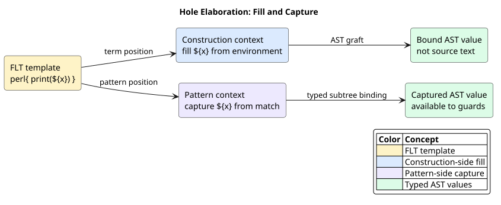

# Foreign Language Terms and Associated Operations

Dylon Edwards
2026-06-26
Status: Under Review

## Abstract

This proposal introduces **Foreign Language Terms** (FLTs): terms of a guest
language embedded inside a host Rholang process. FLTs provide:

1. author-chosen delimiters for guest source;
2. optional language and category qualification;
3. typed AST holes for safe construction and pattern matching;
4. ordinary reduction as process terms;
5. composition with receive patterns, guards, joins, and the existing Lookahead
   FIPS; and
6. a single surface syntax for native guest languages and external virtual-host
   runtimes.

The central invariant is that holes are structural AST parameters, not text
interpolation. A value crossing into a guest body is parsed and typechecked as a
term before it is substituted into a hole.

## Motivation

Rholang and MeTTaIL need to express domain-specific languages, virtual-machine
states, and externally hosted computations without reducing them to unsafe
string fragments. The syntax should let an author write a guest language in its
own notation while still giving the host parser enough structure to:

- identify the embedded region;
- know which guest language and category to parse;
- substitute host terms into guest holes without injection;
- destructure guest terms in receive patterns; and
- inspect speculative futures through the existing lookahead operator.

The design deliberately avoids a special outer escape bracket. The delimiter is
the marker that a foreign region begins, and the ambiguity-preserving parser
carries possible readings until ordinary disambiguation resolves them.

## Terminology

- **Host language**: the surrounding Rholang or MeTTaIL language in which the
  FLT appears.
- **Guest language**: the language named by the FLT tag, or inferred when the tag
  is omitted.
- **Foreign Language Term (FLT)**: a guest-language body plus its delimiter,
  optional language tag, optional category tag, and any typed holes.
- **Category**: a guest grammar sort such as `Proc`, `Name`, `Str`, or `Int`.
- **Hole**: a typed structural parameter written `${x}` or `${x:Cat}`.
- **Construction position**: a term-producing context where a hole is filled
  from an environment.
- **Pattern position**: a matching context where a hole captures a subtree into
  an environment.
- **Virtual host**: an external runtime, such as TypeScript or Perl, bound to a
  guest language through a `semantics <Host>` declaration.

## Proposed Syntax

This section gives the FIPS surface fragment in BNFC notation. It is not a full
Rholang grammar. It assumes the existing host grammar already provides `Proc`,
`Name`, `Guard`, `Ident`, and `Integer`; this fragment specifies only the syntax
introduced by this proposal, plus the host surfaces with which FLTs compose.

```bnfc
-- Existing host categories assumed by this FIPS fragment:
-- Proc, Name, Guard, Ident, Integer.

entrypoints Proc, Flt, Pattern, Semantics ;

-- FLTs are process terms and may also appear as receive/match patterns.
FltProc.       Proc ::= Flt ;
FltPattern.    Pattern ::= Flt ;
NativePattern. Pattern ::= Proc ;

TaggedFlt.     Flt ::= FltTag FltBody ;
InferredFlt.   Flt ::= FltBody ;

LangTag.       FltTag ::= Ident ;
CatTag.        FltTag ::= Ident ":" Ident ;

-- The modal lexer emits the delimiter/body tokens named here. Equality of
-- symmetric delimiters, run length, heredoc words, and bracket depth are lexical
-- mode obligations, not context-free BNFC obligations.
InlineBody.    FltBody ::= "`" [FltBodyItem] "`" ;
FenceBody.     FltBody ::= FenceDelim [FltBodyItem] FenceDelim ;
SymBody.       FltBody ::= SymmetricDelim [FltBodyItem] SymmetricDelim ;
RunBody.       FltBody ::= SymmetricRunDelim [FltBodyItem] SymmetricRunDelim ;
ParenBody.     FltBody ::= "(" [FltBodyItem] ")" ;
BracketBody.   FltBody ::= "[" [FltBodyItem] "]" ;
BraceBody.     FltBody ::= "{" [FltBodyItem] "}" ;
AngleBody.     FltBody ::= "<" [FltBodyItem] ">" ;
HeredocBody.   FltBody ::= HeredocOpen [FltBodyItem] HeredocClose ;

GuestPart.     FltBodyItem ::= GuestChunk ;
HolePart.      FltBodyItem ::= Hole ;
terminator FltBodyItem "" ;

HoleUntyped.   Hole ::= "${" Ident "}" ;
HoleTyped.     Hole ::= "${" Ident ":" Ident "}" ;

-- Value binding. This is separate from lookahead and from `new`.
LetValue.      Proc ::= "let" Ident "<-" Proc "in" "{" Proc "}" ;

-- Sends may be ordinary sends or sends with the approved Lookahead suffix.
SendPlain.     Proc ::= Name "!" "(" [Proc] ")" ;
SendLookahead. Proc ::= Name "!" "(" [Proc] ")" LookaheadSuffix ;
LookaheadN.    LookaheadSuffix ::= "[" Integer "]" ;
LookaheadAll.  LookaheadSuffix ::= "[" "*" "]" ;

-- Receive heads accept native or FLT patterns, all three arrows, joins, and an
-- optional guard.
Receive.        Proc ::= "for" "(" ReceiveHead ")" "{" Proc "}" ;
ReceiveGuard.   ReceiveHead ::= JoinPattern "where" Guard ;
ReceiveNoGuard. ReceiveHead ::= JoinPattern ;

LinearJoin.     JoinPattern ::= [LinearBind] ;
RepeatedJoin.   JoinPattern ::= [RepeatedBind] ;
PeekJoin.       JoinPattern ::= [PeekBind] ;

LinearFltBind.   LinearBind ::= "@" Pattern "<-" NameSource ;
RepeatedFltBind. RepeatedBind ::= "@" Pattern "<=" Name ;
PeekFltBind.     PeekBind ::= "@" Pattern "<<-" Name ;

separator nonempty LinearBind "&" ;
separator nonempty RepeatedBind "&" ;
separator nonempty PeekBind "&" ;

SimpleSource.      NameSource ::= Name ;
ReceiveSendSource. NameSource ::= Name "?!" ;
SendReceiveSource. NameSource ::= Name "!?" "(" [Proc] ")" ;

-- Virtual-host binding and calls.
SemanticsDecl. Semantics ::= "semantics" DottedPath ;
HostCall.      Proc ::= Flt "(" [Proc] ")" ;

PathOne.       DottedPath ::= Ident ;
PathMore.      DottedPath ::= Ident "." DottedPath ;

separator Proc "," ;

-- Token names used by the modal lexer. These declarations describe the parser
-- interface; the lexical conventions below give the extra delimiter invariants.
token GuestChunk (char - ["$"])+ ;
token FenceDelim ('`' '`' '`' '`'*) ;
token SymmetricDelim ["/#!|"] ;
token SymmetricRunDelim ["/#!|"] ["/#!|"]+ ;
token HeredocOpen ('<' '<' letter (letter | digit | '_')*) ;
token HeredocClose (letter (letter | digit | '_')*) ;
```

Lexical conventions:

- `FenceDelim` closes only on the same backtick run length that opened it.
- `SymmetricDelim` and `SymmetricRunDelim` close only on the same character or
  run that opened the body.
- Paired delimiters are depth-counted by the modal lexer before the enclosed
  `[FltBodyItem]` stream is handed to the parser.
- `HeredocOpen` records the word after `<<`; `HeredocClose` is accepted only on
  a line equal to that word.
- `GuestChunk` is guest-language text in the current delimiter mode. `${...}` is
  emitted as a `Hole`, not as guest text, unless the language declares a
  different antiquote token.

An omitted tag asks the parser to infer both language and category. A tag
without a category pins the language and asks the guest parser to use that
language's primary category. `L:Cat` pins both.

```text
perl:Str`"hello"`      language pinned, category pinned
perl`print(1)`         language pinned, category inferred
`print(1)`             language and category inferred
```

### Delimiters

An FLT body is bounded by an author-chosen delimiter. The author should choose a
delimiter that does not collide with the guest body.

| Form | Example | Closing rule | Notes |
| --- | --- | --- | --- |
| Inline backtick | `` L`body` `` | next backtick | Default for short terms |
| Backtick block | ```` L```body``` ```` | next fence of same length | Default for multiline terms |
| Symmetric character | `L/body/`, `L#body#`, `L!body!` | next unescaped occurrence | Useful when backticks occur in the body |
| Symmetric run | `L###body###` | next run of same character and length | Generalizes markdown fences |
| Paired bracket | `L{body}`, `L[body]`, `L(body)`, `L<body>` | matching closer | Depth-counted and nestable |
| Word heredoc | `L<<WORD` ... `WORD` | line equal to `WORD` | Useful for bodies with many delimiter characters |

When the default delimiter collides with the body, authors escalate to another
delimiter:

```text
perl`print("hi")`
perl/print("a`b")/
perl<<PL
  my $u = "a/b`c";
  print "$u";
PL
```

### Holes

`Hole` is one syntax with two roles:

| Context | Meaning | Result |
| --- | --- | --- |
| Construction position | Fill the hole from an existing binding | AST graft |
| Pattern position | Capture the matched subtree into a binding | Pattern variable |

The category of a hole is inferred from its guest grammar position. If inference
is ambiguous, the author writes `${x:Cat}`.

## Semantics

### Parsing

Opening an FLT delimiter enters a guest parsing mode. If a language tag is
present, only that guest grammar is considered. If the tag is omitted, the parser
may consider every registered language whose delimiter and grammar admit the
body.

The result of parsing is a typed guest AST with hole nodes. Ambiguous parses are
carried as ordinary parser ambiguity until the surrounding host context,
expected category, guard, or disambiguation policy resolves them.


PlantUML source:
[diagrams/01-parse-pipeline.puml](diagrams/01-parse-pipeline.puml).

### Hole Elaboration

Holes are elaborated structurally. They are never converted into guest source
text and re-parsed.

```text
Algorithm: Elaborate an FLT in construction position

Input:
  T, a guest AST containing typed hole nodes
  ρ, an environment mapping names to typed AST values

For each hole h = ${x:Cat?} in T:
  1. Infer Cat from h's grammar position unless Cat is explicit.
  2. Look up x in ρ.
  3. Typecheck ρ(x) against Cat.
  4. Replace only h's node with ρ(x).

Output:
  T with each filled hole replaced by an AST subtree.
```

In pattern position, the same hole syntax marks a typed capture. Matching
against a received value binds only the subtree occupying the hole's grammar
position.



PlantUML source:
[diagrams/02-hole-elaboration.puml](diagrams/02-hole-elaboration.puml).

### Reduction

An FLT is a process term. Without lookahead, it is injected unreduced and reduces
where ordinary process reduction is enabled. Native guest languages reduce
inside the MeTTaIL/Rholang reduction machinery. Virtual-host guests reduce by
calling their declared runtime through the semantics binding described below.

### Lookahead

This proposal does not introduce a new lookahead operator. It composes with the
approved Lookahead FIPS syntax:

```text
x!(P)[n]
x!(P)[*]
```

The bracket suffix belongs to the send. The process `P`, which may be an FLT, is
speculatively executed in sandboxed RSpaces according to the Lookahead FIPS. The
names of the resulting success and failure `PathMap`s are placed on `x`.


PlantUML source:
[diagrams/03-lookahead-sandbox.puml](diagrams/03-lookahead-sandbox.puml).

### Value Binding

This proposal also standardizes a value-binding surface:

```text
let v <- E in { P }
```

`E` is evaluated, the result is bound to `v`, and `P` runs with `v` in scope.
This is not lookahead, and it does not bind a fresh name as `new` does.

### Receive Patterns and Guards

An FLT may appear in a receive pattern:

```text
for ( @PATTERN <- channel where GUARD ) { CONTINUATION }
```

The supported receive arrows are:

| Arrow | Meaning | RSpace behavior |
| --- | --- | --- |
| `<-` | Linear receive | Consume datum and continuation |
| `<=` | Persistent receive | Keep continuation for later matches |
| `<<-` | Peek receive | Read datum without removing it |

Joins use `&`:

```text
for ( @perl{ get(${k}) } <- cache & @rho:Bool`true` <<- ready ) {
  ...
}
```

A joined receive fires only when all joined patterns match atomically. A failed
guard consumes nothing and emits nothing. Guard expressions may use captured AST
values because holes capture typed AST subtrees, not text.

```text
for ( @perl{ print(${bar}) } <- x where bar |= AG safe ) {
  ...
}
```

Here `bar` is the captured AST argument of `print`, so behavioral satisfaction is
well-defined.

## Security

The no-injection property is normative:

`For every FLT template T and environment ρ, elaborating T under ρ may replace a
hole node with a typed AST subtree, but it must not add, move, retag, split, or
delete any node outside that hole.`

This is the FLT analogue of parameterized queries. A malicious value whose
rendered text contains a closing delimiter, statement separator, or guest syntax
cannot escape its slot because rendered text is not concatenated into the guest
source.


PlantUML source:
[diagrams/04-no-injection-boundary.puml](diagrams/04-no-injection-boundary.puml).

If a guest language already uses `${...}` for its own syntax, that language may
declare an alternate antiquote token for host holes. A fully opaque text guest
with no parseable grammar cannot securely support `${...}` holes.

## Execution Strategies

### Native Guest

A native guest language is defined by a `language!` specification. Its FLTs parse
to typed ASTs, holes are filled and captured structurally, and reductions happen
inside the MeTTaIL/Rholang reduction machinery.

```text
perl{ print(${foo}) }
```

### Virtual Host

A virtual-host guest is a language whose semantics are implemented by an
external runtime:

```text
semantics TypeScript.Node
```

The guest still needs a front-end grammar if it supports holes. The parsed
template and hole bindings are passed to the external runtime as separate
parameters. The runtime must not receive host values by source concatenation.

```text
ts<<TS
  export default (n: number) => Array.from({ length: n }, (_, i) => i * i)
TS (${n})
```

The value bound to `${n}` is delivered as a parameter to the TypeScript runtime,
not inserted into the TypeScript source.

## Examples

### Construction and Pattern Matching

```text
let foo <- perl:Str{ "hello" } in {
  x!( perl{ print(${foo}) } )
  | for ( @perl{ print(${bar}) } <- x where bar |= AG safe ) {
      // bar is bound to the captured Str AST.
    }
}
```

### Lookahead Over FLTs

~~~~text
let myVar <- fooLang`5` in {
  foo!( fooLang`some-foo-term` )[*]
  | foo!( fooLang```
      some-foo-${myVar}-term
    ``` )[*]
  | for ( @{| t, ..._ |}, _ <- foo ) {
      bar!(t)
    }
}
~~~~

Each `foo!(P)[*]` sends the names of success and failure `PathMap`s on `foo`.
The receive consumes one such offer and forwards one possible future `t`.

## Implementation Notes

This section is non-normative. It records the intended implementation mapping.

| Construct | Existing machinery or target seam |
| --- | --- |
| Ambiguity-preserving host parse | `prattail/src/wpda_walker.rs`, `prattail/src/sppf.rs`, `parse_via_wpda_all` |
| Language inference | `compose_languages!` parser delegation and disambiguation docs |
| Bracket delimiters | modal lexer mode stack |
| Symmetric delimiter runs | parameterized close-token extension |
| Word heredocs | stateful token-source mode |
| Category inference | grammar term parameters and typechecker |
| Hole fill | AST-level substitution, not textual pre-substitution |
| Hole capture | pattern variables over typed AST subtrees |
| Guard parsing | `prattail/src/parser/predicate_pratt.rs` |
| Guard enforcement | classify-at-compile and RSpace consume-time enforcement |
| Lookahead | approved FIPS `2026-01-08-Lookahead` |
| Virtual host | injected system process / external semantics binding |

The smallest complete implementation should support tagged FLTs, bracket
delimiters, typed holes, construction fill, pattern capture, and composition with
lookahead. Full delimiter freedom may be implemented incrementally.

## Compatibility

This proposal is additive. Existing Rholang syntax remains valid. Existing
lookahead syntax is reused unchanged. Implementations may initially require an
explicit language tag; untagged FLT inference is a power feature and may be
gated until parser policy is stable.

## Future Work

- Specify the exact declaration syntax for per-language antiquote overrides.
- Specify module-system integration for `language`, `import`, `extender`,
  `space`, and `semantics <Host>` declarations.
- Complete symmetric-run and word-heredoc delimiter support.
- Define conformance tests for structured receive patterns over FLTs.
- Define policy for how aggressively untagged delimiters are inferred against
  host-language operators.

## References

- Approved Lookahead FIPS:
  `../../approved/2026-01-08-Lookahead/2026-01-08-Lookahead.md`
- Guard syntax and runtime enforcement:
  `mettail-rust/docs/architecture/semantic-predicates/06-guard-syntax-and-extensions.md`
  and
  `mettail-rust/docs/architecture/semantic-predicates/08-runtime-comm-enforcement.md`
- Term-level reduction split:
  `mettail-rust/docs/architecture/rho-native-integration/09-term-level-reduction-split.md`
- Adaptive evaluation and external semantics:
  `mettail-rust/docs/architecture/rho-native-integration/10-adaptive-evaluation-model.md`
- Parser disambiguation:
  `mettail-rust/prattail/docs/design/disambiguation/README.md`
