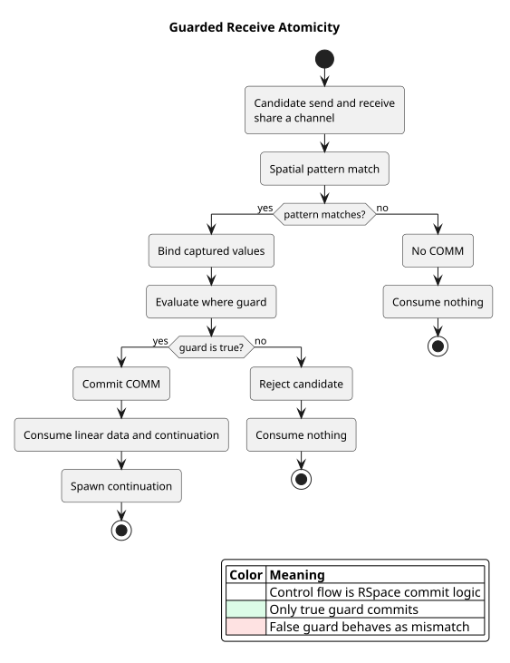
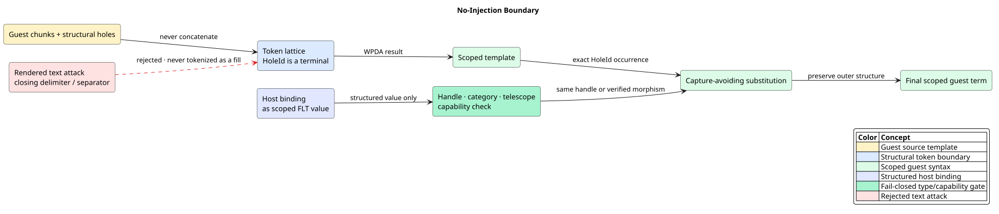
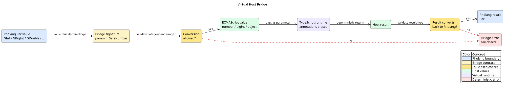
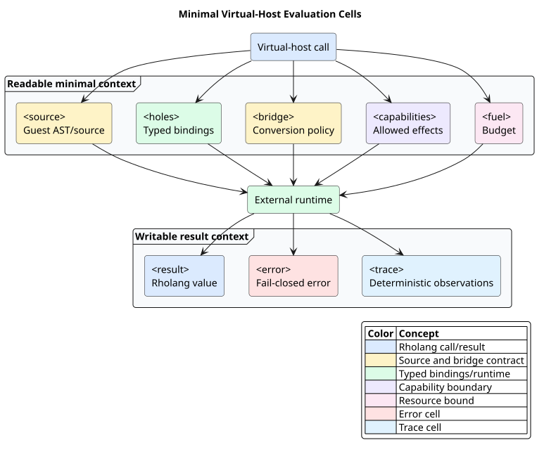

# Foreign Language Terms and Associated Operations

Dylon Edwards
2026-06-26
Status: Under Review

## Abstract

This proposal introduces **Foreign Language Terms** (FLTs): typed guest-language
terms embedded inside a host Rholang process. FLTs provide:

1. author-chosen delimiters for bounded guest source;
2. optional language and category qualification;
3. typed structural holes for construction and pattern matching;
4. composition with Rholang sends, receives, joins, guards, and the approved
   Lookahead FIPS; and
5. a uniform bridge for native guest languages and external virtual-host
   runtimes.

The central invariant is **structural substitution**: a value crossing into a
guest body is parsed and typechecked as an abstract syntax tree (AST) value
before it fills a hole. It is never spliced as source text.

## Status and Evidence

This FIPS is a proposal. It is deliberately explicit about which semantics are
already present in the implementation and which semantics are newly specified
here.

| Badge | Meaning |
| --- | --- |
| [Implemented] | Confirmed in the referenced `mettail-rust`, `f1r3node-rust-mettail`, or `rholang-rs-cost-accounting-transpiler` sources. |
| [Approved] | Defined by another approved FIPS and reused here. |
| [Proposed] | New behavior introduced by this FIPS. |

No existing implementation of FLTs was found in the three worktrees reviewed for
this FIPS. The proposal therefore specifies FLT behavior normatively and
references the concrete seams with which it composes.

## Motivation

Rholang and MeTTaIL need to express domain-specific languages, virtual-machine
states, and externally hosted computations without reducing them to unsafe
strings. The syntax should let an author write a guest language in its own
notation while still giving the host enough structure to:

- identify the embedded region;
- know which guest language and category to parse;
- substitute host terms into guest holes without injection;
- destructure guest terms in receive patterns and match expressions;
- inspect speculative futures through the approved lookahead operator; and
- execute external runtimes without confusing host semantics with guest
  semantics.

The design deliberately avoids a special outer escape bracket. The delimiter is
the marker that a foreign region begins, and the parser carries possible readings
until host context, language tags, category tags, or disambiguation policy
selects one.

## Terminology

- **Host language**: the surrounding Rholang or MeTTaIL language.
- **Guest language**: the language named by the FLT tag, or inferred when the tag
  is omitted.
- **Foreign Language Term (FLT)**: a guest-language body plus its delimiter,
  optional language tag, optional category tag, and typed holes.
- **Category**: a guest grammar sort such as `Proc`, `Name`, `Str`, or `Int`.
- **Hole**: a typed structural parameter written `${x}` or `${x:Cat}`.
- **Construction position**: a term-producing context where a hole is filled
  from an environment.
- **Pattern position**: a matching context where a hole captures a subtree into
  an environment.
- **Bridge signature**: the typed contract for converting values between
  Rholang and a virtual host.
- **Virtual host**: an external runtime, such as an ECMAScript or TypeScript
  runtime, bound through a `semantics <Host>` declaration.
- **Context**: a one-hole term `C[-]`; filling the hole with `p` is written
  `C[p]`.
- **Minimal evaluation context**: the smallest context that witnesses a rewrite
  or virtual-host step without carrying irrelevant state.

## Proposed Syntax

This section gives the FIPS surface fragment in BNFC notation. It is **not** a
complete Rholang grammar. It assumes the existing host grammar already provides
`Proc`, `Name`, `ProcPat`, `NamePat`, `Guard`, `Ident`, and `Integer`.

The current Rust Rholang parser is tree-sitter based, not BNFC based. BNFC is
used here because it is the team's preferred specification notation.

```bnfc
-- Existing host categories assumed by this FIPS fragment:
-- Proc, Name, ProcPat, NamePat, Guard, Ident, Integer.

entrypoints Proc, Flt, FltPattern, SemanticsDecl ;

-- FLTs are process terms. In pattern position they lower to host process or
-- name patterns according to their category.
FltProc.       Proc       ::= Flt ;
FltProcPat.    ProcPat    ::= FltPattern ;
FltNamePat.    NamePat    ::= "@" FltPattern ;

TaggedFlt.     Flt        ::= FltTag FltBody ;
InferredFlt.   Flt        ::= FltBody ;
TaggedPat.     FltPattern ::= FltTag FltBody ;
InferredPat.   FltPattern ::= FltBody ;

LangTag.       FltTag     ::= Ident ;
CatTag.        FltTag     ::= Ident ":" Ident ;

-- The modal lexer emits the delimiter/body tokens named here. Equality of
-- symmetric delimiters, fence run length, heredoc words, and bracket depth are
-- lexical-mode obligations, not context-free BNFC obligations.
InlineBody.    FltBody ::= "`" [FltBodyItem] "`" ;
FenceBody.     FltBody ::= FenceDelim [FltBodyItem] FenceDelim ;
SymBody.       FltBody ::= SymmetricDelim [FltBodyItem] SymmetricDelim ;
RunBody.       FltBody ::= SymmetricRunDelim [FltBodyItem] SymmetricRunDelim ;
ParenBody.     FltBody ::= "(" [FltBodyItem] ")" ;
BracketBody.   FltBody ::= "[" [FltBodyItem] "]" ;
BraceBody.     FltBody ::= "{" [FltBodyItem] "}" ;
AngleBody.     FltBody ::= "<" [FltBodyItem] ">" ;
HeredocBody.   FltBody ::= HeredocOpen [FltBodyItem] HeredocClose ;

GuestPart.     FltBodyItem ::= GuestChunk ;
HolePart.      FltBodyItem ::= Hole ;
terminator FltBodyItem "" ;

HoleUntyped.   Hole ::= "${" Ident "}" ;
HoleTyped.     Hole ::= "${" Ident ":" Ident "}" ;

-- Sends may be ordinary sends or sends with the approved Lookahead suffix.
SendPlain.     Proc ::= Name "!" "(" [Proc] ")" ;
SendMultiple.  Proc ::= Name "!!" "(" [Proc] ")" ;
SendLookahead. Proc ::= Name "!" "(" [Proc] ")" LookaheadSuffix ;
LookaheadN.    LookaheadSuffix ::= "[" Integer "]" ;
LookaheadAll.  LookaheadSuffix ::= "[" "*" "]" ;

-- Existing Rholang receive surfaces, repeated here only where FLTs compose.
Receive.        Proc ::= "for" "(" [Receipt] ")" "{" Proc "}" ;
ReceiptGuard.   Receipt ::= [Bind] "where" Guard ;
ReceiptNoGuard. Receipt ::= [Bind] ;

LinearBind.     Bind ::= [NamePat] "<-" NameSource ;
RepeatedBind.   Bind ::= [NamePat] "<=" Name ;
PeekBind.       Bind ::= [NamePat] "<<-" Name ;

separator nonempty Bind "&" ;
separator nonempty Receipt ";" ;
separator Proc "," ;
separator NamePat "," ;

SimpleSource.      NameSource ::= Name ;
ReceiveSendSource. NameSource ::= Name "?!" ;
SendReceiveSource. NameSource ::= Name "!?" "(" [Proc] ")" ;

-- Existing Rholang let surfaces. This FIPS does not introduce a new let.
LetLinear.      Proc ::= "let" [Decl] "in" Proc ;
LetConcurrent.  Proc ::= "let" [ConcDecl] "in" Proc ;
DeclBind.       Decl ::= [Name] "<-" [Proc] ;
DeclVar.        Decl ::= Ident "=" Proc ;
ConcDeclBind.   ConcDecl ::= [Name] "<-" [Proc] ;
ConcDeclVar.    ConcDecl ::= Ident "=" Proc ;
separator nonempty Decl ";" ;
separator nonempty ConcDecl "/\\" ;
separator Name "," ;

-- Virtual-host declaration and invocation.
SemanticsPath. SemanticsDecl ::= "semantics" DottedPath ;
BridgeDecl.    SemanticsDecl ::= "semantics" DottedPath "bridge" "{" [BridgeItem] "}" ;
BridgeParam.   BridgeItem ::= "param" Ident ":" BridgeType ;
BridgeResult.  BridgeItem ::= "result" ":" BridgeType ;
separator BridgeItem ";" ;

HostCall.      Proc ::= Flt "(" [Proc] ")" ;

BridgeBool.    BridgeType ::= "Bool" ;
BridgeString.  BridgeType ::= "String" ;
BridgeBytes.   BridgeType ::= "ByteArray" ;
BridgeSafeNum. BridgeType ::= "SafeNumber" ;
BridgeBigInt.  BridgeType ::= "BigInt" ;
BridgeFloat.   BridgeType ::= "FiniteFloat64" ;
BridgeProc.    BridgeType ::= "Proc" ;
BridgeName.    BridgeType ::= "Name" ;
BridgeList.    BridgeType ::= "[" BridgeType "]" ;
BridgePathMap. BridgeType ::= "PathMap" "<" BridgeType ">" ;

PathOne.       DottedPath ::= Ident ;
PathMore.      DottedPath ::= Ident "." DottedPath ;

-- Token names used by the modal lexer. These declarations describe the parser
-- interface; the lexical conventions below give the delimiter invariants.
token GuestChunk (char)+ ;
token FenceDelim ('`' '`' '`' '`'*) ;
token SymmetricDelim ["/#!|"] ;
token SymmetricRunDelim ["/#!|"] ["/#!|"]+ ;
token HeredocOpen ('<' '<' letter (letter | digit | '_')*) ;
token HeredocClose (letter (letter | digit | '_')*) ;
```

Lexical conventions:

- `FenceDelim` closes only on the same backtick run length that opened it.
- `SymmetricDelim` and `SymmetricRunDelim` close only on the same character or
  run that opened the body.
- Paired delimiters are depth-counted by the modal lexer before the enclosed
  `[FltBodyItem]` stream is handed to the parser.
- `HeredocOpen` records the word after `<<`; `HeredocClose` is accepted only on
  a line equal to that word.
- `GuestChunk` is guest-language text in the current delimiter mode. `${...}` is
  emitted as a `Hole`, not as guest text, unless the language declares a
  different antiquote token.

An omitted tag asks the parser to infer both language and category. A tag without
a category pins the language and asks the guest parser to use that language's
primary category. `L:Cat` pins both.

```text
perl:Str`"hello"`      language pinned, category pinned
perl`print(1)`         language pinned, category inferred
`print(1)`             language and category inferred
```

## Delimiters

An FLT body is bounded by an author-chosen delimiter. The author should choose a
delimiter that does not collide with the guest body.

| Form | Example | Closing rule | Notes |
| --- | --- | --- | --- |
| Inline backtick | `` L`body` `` | next backtick | Default for short terms |
| Backtick block | ```` L```body``` ```` | next fence of same length | Default for multiline terms |
| Symmetric character | `L/body/`, `L#body#`, `L!body!` | next unescaped occurrence | Useful when backticks occur in the body |
| Symmetric run | `L###body###` | next run of same character and length | Generalizes markdown fences |
| Paired bracket | `L{body}`, `L[body]`, `L(body)`, `L<body>` | matching closer | Depth-counted and nestable |
| Word heredoc | `L<<WORD` ... `WORD` | line equal to `WORD` | Useful for bodies with many delimiter characters |

When the default delimiter collides with the body, authors escalate to another
delimiter:

```text
perl`print("hi")`
perl/print("a`b")/
perl<<PL
  my $u = "a/b`c";
  print "$u";
PL
```

## Parsing and Elaboration

[Proposed] Opening an FLT delimiter enters a guest parsing mode. If a language
tag is present, only that guest grammar is considered. If the tag is omitted,
the parser may consider every registered language whose delimiter and grammar
admit the body.

The result of parsing is a typed guest AST with hole nodes. Ambiguous parses are
carried as ordinary parser ambiguity until host context, expected category,
guard, or disambiguation policy resolves them.


PlantUML source:
[diagrams/01-parse-pipeline.puml](diagrams/01-parse-pipeline.puml).

### Holes

`Hole` has one syntax with two roles:

| Context | Meaning | Result |
| --- | --- | --- |
| Construction position | Fill the hole from an existing binding | AST graft |
| Pattern position | Capture the matched subtree into a binding | Pattern variable |

The category of a hole is inferred from its guest grammar position. If inference
is ambiguous, the author writes `${x:Cat}`.

```text
Algorithm: Elaborate an FLT in construction position

Input:
  T, a guest AST containing typed hole nodes
  rho, an environment mapping names to typed AST values

For each hole h = ${x:Cat?} in T:
  1. Infer Cat from h's grammar position unless Cat is explicit.
  2. Look up x in rho.
  3. Typecheck rho(x) against Cat.
  4. Replace only h's node with rho(x).

Output:
  T with each filled hole replaced by an AST subtree.
```

In pattern position, the same hole syntax marks a typed capture. Matching against
a received value binds only the subtree occupying the hole's grammar position.


PlantUML source:
[diagrams/02-hole-elaboration.puml](diagrams/02-hole-elaboration.puml).

## Contextual Semantics

[Proposed] An FLT is not just a string literal; it is a typed term that may be
placed into host and guest contexts. This proposal uses the contextual view from
the bisimulation paper: a transition labelled by context `C[-]` means that
`C[p]` can rewrite to a result. Behavioral equivalence is meaningful only when
it is stable under contexts.

For a reducible guest language, the FLT registration must define:

- the guest sorts and operation arities;
- equations and rewrites that form the guest theory;
- which guest subterms are active in rewrites;
- the observable contexts that witness behavior; and
- the host categories into which guest values can be embedded.

The minimal context principle is normative for virtual hosts: a host runtime
must receive the smallest evaluation context needed to evaluate the FLT and
bridge values. It must not receive unrelated Rholang process state merely because
that state is available.

![Contextual semantics: an FLT hole is a typed subterm inside a context C[-], and only the minimal active context is passed to the guest semantics](diagrams/09-contextual-semantics.svg)

PlantUML source:
[diagrams/09-contextual-semantics.puml](diagrams/09-contextual-semantics.puml).

## Reduction

[Proposed] An FLT is a process term. Without lookahead, it is injected unreduced
and reduces where ordinary process reduction is enabled.

Native guest languages reduce inside the MeTTaIL/Rholang reduction machinery.
Virtual-host guests reduce by calling their declared runtime through a bridge
that is specified below. If no reducer or bridge is registered for the guest
category, the FLT is inert data.

## Lookahead Composition

[Approved] This proposal does not introduce a new lookahead operator. It composes
with the approved Lookahead FIPS syntax:

```text
x!(P)[n]
x!(P)[*]
```

The bracket suffix belongs to the send. The process `P`, which may be an FLT, is
speculatively executed in sandboxed empty RSpaces according to the Lookahead
FIPS. `n` is a `uint64`; `*` means run to completion as defined there. The names
of the resulting success and failure `PathMap`s are placed on `x`.


PlantUML source:
[diagrams/03-lookahead-sandbox.puml](diagrams/03-lookahead-sandbox.puml).

The receive side must not pretend that a trace is sent directly. It receives
PathMap values or names and queries them with the PathMap API implemented in
`f1r3node-rust-mettail`.


PlantUML source:
[diagrams/05-lookahead-pathmap-query.puml](diagrams/05-lookahead-pathmap-query.puml).

## Receive Patterns and Guards

[Implemented] The current Rholang parser supports receives with linear `<-`,
persistent `<=`, and peek `<<-` binds, `&` joins, `;`-separated receipts,
receive-send sources `?!`, send-receive sources `!?`, and optional `where`
guards. The parser represents receive bind left sides as names/patterns, with
quoted process patterns written as `@ Proc`.

```text
for ( @PATTERN <- channel where GUARD ) { CONTINUATION }
```

| Arrow | Meaning | RSpace behavior |
| --- | --- | --- |
| `<-` | Linear receive | Consume datum and continuation |
| `<=` | Persistent receive | Keep continuation for later matches |
| `<<-` | Peek receive | Read datum without removing it |

A joined receive fires only when all joined patterns match atomically. A failed
guard consumes nothing and emits nothing. This is confirmed by the mettail guard
documentation and by tests that run real Rholang source with `where` guards.



PlantUML source:
[diagrams/08-guarded-receive-atomicity.puml](diagrams/08-guarded-receive-atomicity.puml).

An FLT in receive position must lower to a host pattern that the Rholang parser
and matcher can represent. For a process-valued FLT, that means a quoted process
pattern:

```text
for ( @perl{ print(${bar:Str}) } <- x where bar |= AG safe ) {
  ...
}
```

Here `bar` is the captured AST argument of `print`; the guard sees a typed AST
subtree, not text.

## Security

[Proposed] The no-injection property is normative:

`For every FLT template T and environment rho, elaborating T under rho may replace
a hole node with a typed AST subtree, but it must not add, move, retag, split, or
delete any node outside that hole.`

This is the FLT analogue of parameterized queries. A malicious value whose
rendered text contains a closing delimiter, statement separator, or guest syntax
cannot escape its slot because rendered text is not concatenated into the guest
source.



PlantUML source:
[diagrams/04-no-injection-boundary.puml](diagrams/04-no-injection-boundary.puml).

If a guest language already uses `${...}` for its own syntax, that language may
declare an alternate antiquote token for host holes. A fully opaque text guest
with no parseable grammar cannot securely support `${...}` holes.

## Execution Strategies

### Native Guest

[Proposed] A native guest language is defined by a `language!` specification. Its
FLTs parse to typed ASTs, holes are filled and captured structurally, and
reductions happen inside the MeTTaIL/Rholang reduction machinery.

```text
perl{ print(${foo}) }
```

### Virtual Host

[Proposed] A virtual-host guest is a language whose semantics are implemented by
an external runtime:

```text
semantics TypeScript.Node bridge {
  param n: SafeNumber;
  result: [SafeNumber];
}
```

The guest still needs a front-end grammar if it supports holes. The parsed
template and hole bindings are passed to the external runtime as separate
parameters. The runtime must not receive host values by source concatenation.

```text
ts<<TS
  export default (n) => Array.from({ length: n }, (_, i) => i * i)
TS (${n})
```

The value bound to `${n}` is delivered as a parameter to the TypeScript runtime,
not inserted into the TypeScript source.

### Bridge Types

TypeScript annotations are not a runtime contract. The TypeScript Handbook
describes type annotations as erased; therefore this FIPS requires an explicit
bridge signature. The bridge signature is the authority for conversion.

| Rholang value | Default bridge type | ECMAScript/TypeScript value | Failure cases |
| --- | --- | --- | --- |
| `GBool` | `Bool` | `boolean` | non-bool |
| `GString` | `String` | `string` | invalid declared category |
| `GByteArray` | `ByteArray` | `Uint8Array` | unsupported host runtime |
| `GInt`, signed/unsigned typed ints | `SafeNumber` | `number` | outside `[-(2^53 - 1), 2^53 - 1]` |
| `GInt`, `GBigInt` | `BigInt` | `bigint` | host lacks BigInt |
| `GDouble` | `FiniteFloat64` | `number` | NaN or Infinity unless explicitly allowed |
| `GBigRat` | no implicit default | bridge-declared rational object | no declared representation |
| `GFixedPoint` | no implicit default | bridge-declared decimal object | scale or precision mismatch |
| `EList`, `ETuple` | `[T]` | frozen array | element conversion failure |
| `EPathMap` | `PathMap<T>` | opaque bridge object | path/value conversion failure |
| `Proc`, `Name` | `Proc`, `Name` | opaque structural object | host asks for source-only value |

The ECMAScript `Number` type is IEEE 754 binary64 and includes NaN and infinities.
The ECMAScript `BigInt` type represents arbitrary-size integers. Because Rholang
has exact integer and rational forms, a bridge must never silently narrow an exact
value to a lossy `number`.

```text
Algorithm: Convert a Rholang value to a virtual-host parameter

Input:
  v, a Rholang Par value
  T, a declared BridgeType

If T is SafeNumber:
  1. Require v to be an integer value.
  2. Require -(2^53 - 1) <= v <= 2^53 - 1.
  3. Return the ECMAScript number with that integer value.

If T is BigInt:
  1. Require v to be an exact integer value.
  2. Return an ECMAScript bigint with the same mathematical value.

If T is FiniteFloat64:
  1. Require v to be GDouble.
  2. Decode the stored f64 bits.
  3. Reject NaN and Infinity unless the bridge explicitly declares them.
  4. Return the ECMAScript number with the same f64 value.

For composite T:
  1. Convert every child recursively.
  2. If any child fails, fail the whole conversion.

Output:
  a host value or a bridge error; errors are deterministic and fail closed.
```



PlantUML source:
[diagrams/06-virtual-host-bridge.puml](diagrams/06-virtual-host-bridge.puml).

### Minimal Cells for Virtual Hosts

K Framework cells are applicable here as a specification discipline, not as an
implementation requirement. f1r3node already contains K definitions with cells
such as `<k>`, `<In>`, `<Out>`, and `<subst>`. This FIPS uses the same idea to
define the minimum context a virtual host may observe.

| Cell | Contents | Rationale |
| --- | --- | --- |
| `<source>` | guest source or parsed guest AST | program text/structure under evaluation |
| `<holes>` | typed hole bindings | structural parameters, not source splices |
| `<bridge>` | bridge signature and conversion policy | Rholang/host type boundary |
| `<capabilities>` | permitted host effects | prevents ambient authority |
| `<fuel>` | gas, step, or time budget | deterministic resource bound |
| `<result>` | successful host return value | conversion back to Rholang |
| `<error>` | deterministic bridge/runtime error | fail-closed behavior |
| `<trace>` | optional deterministic observations | lookahead/debug evidence |

The minimal-cell rule is:

`A virtual-host call may read only the cells required by its bridge signature,
capabilities, and evaluation budget. It may write only <result>, <error>, and
<trace>.`



PlantUML source:
[diagrams/07-virtual-host-cells.puml](diagrams/07-virtual-host-cells.puml).

## Examples

### Construction and Pattern Matching

```text
let foo = perl:Str{ "hello" } in {
  x!( perl{ print(${foo:Str}) } )
  | for ( @perl{ print(${bar:Str}) } <- x where bar |= AG safe ) {
      // bar is bound to the captured Str AST.
    }
}
```

### Lookahead Over FLTs

```text
let myVar = fooLang`5` in {
  foo!( fooLang`some-foo-term` )[*]
  | foo!( fooLang```
      some-foo-${myVar:Int}-term
    ``` )[*]
  | for ( @success, @failure <- foo ) {
      let leaf = success.readZipper().atPath(["trace", 0, "leaf"]) in {
        bar!(leaf)
      }
    }
}
```

This example is schematic Rholang surface: the important point is that lookahead
offers success/failure PathMaps, and the continuation queries a path from the
success PathMap. It does not receive a bare future trace directly.

### Virtual Host with Explicit Bridge

```text
semantics TypeScript.Node bridge {
  param n: SafeNumber;
  result: [SafeNumber];
}

let n = 5 in {
  out!(
    ts<<TS
      export default (n) => Array.from({ length: n }, (_, i) => i * i)
    TS (${n})
  )
}
```

If `n` is a `GBigInt` larger than `2^53 - 1`, this program must fail conversion
for `SafeNumber`. The author must instead declare `param n: BigInt` and use a
host implementation that accepts `bigint`.

## Implementation Evidence

This section is non-normative. It records the implementation facts used to
constrain the proposal.

| Construct | Evidence |
| --- | --- |
| Rholang send, receive, let, guards | `rholang-rs-cost-accounting-transpiler/rholang-tree-sitter/grammar.js` |
| Parser AST for receive receipts and guards | `rholang-rs-cost-accounting-transpiler/rholang-parser/src/ast.rs` |
| Guard atomicity | `mettail-rust/docs/architecture/semantic-predicates/08-runtime-comm-enforcement.md` |
| Guard syntax | `mettail-rust/docs/architecture/semantic-predicates/06-guard-syntax-and-extensions.md` |
| External system process seam | `mettail-rust/docs/architecture/rho-native-integration/10-adaptive-evaluation-model.md` |
| Injected deterministic system process shape | `mettail-rust/rholang-runtime/src/fold_contract.rs` |
| PathMap protobuf shape | `f1r3node-rust-mettail/models/src/main/protobuf/RhoTypes.proto` |
| PathMap conversion and keying | `f1r3node-rust-mettail/models/src/rust/pathmap_integration.rs` |
| PathMap query methods | `f1r3node-rust-mettail/rholang/src/rust/interpreter/reduce.rs` |
| K-style Rholang cells | `f1r3node-rust-mettail/rholang/src/main/k/rholang/configuration.k` |

The smallest complete implementation should support tagged FLTs, bracket
delimiters, typed holes, construction fill, pattern capture, explicit bridge
signatures, and composition with approved lookahead. Full delimiter freedom and
untagged inference may be implemented later.

## Compatibility

This proposal is additive. Existing Rholang syntax remains valid. Existing
lookahead syntax is reused. Implementations may initially require an
explicit language tag; untagged FLT inference is a power feature and may be gated
until parser policy is stable.

## Future Work

- Specify declaration syntax for per-language antiquote overrides.
- Specify module-system integration for `language`, `import`, `extender`,
  `space`, and `semantics <Host>` declarations.
- Complete symmetric-run and word-heredoc delimiter support.
- Define conformance tests for structured receive patterns over FLTs.
- Define policy for how aggressively untagged delimiters are inferred against
  host-language operators.
- Specify deterministic host-runtime sandboxes for concrete runtimes such as
  Node.js, Deno, WASI, or embedded V8.

## References

- Approved Lookahead FIPS:
  `../../approved/2026-01-08-Lookahead/2026-01-08-Lookahead.md`
- Guard syntax and runtime enforcement:
  `mettail-rust/docs/architecture/semantic-predicates/06-guard-syntax-and-extensions.md`
  and
  `mettail-rust/docs/architecture/semantic-predicates/08-runtime-comm-enforcement.md`
- Adaptive evaluation and external semantics:
  `mettail-rust/docs/architecture/rho-native-integration/10-adaptive-evaluation-model.md`
- Rholang parser grammar:
  `rholang-rs-cost-accounting-transpiler/rholang-tree-sitter/grammar.js`
- Rholang parser AST:
  `rholang-rs-cost-accounting-transpiler/rholang-parser/src/ast.rs`
- f1r3node PathMap model and methods:
  `f1r3node-rust-mettail/models/src/main/protobuf/RhoTypes.proto`,
  `f1r3node-rust-mettail/models/src/rust/pathmap_integration.rs`, and
  `f1r3node-rust-mettail/rholang/src/rust/interpreter/reduce.rs`
- f1r3node K configuration:
  `f1r3node-rust-mettail/rholang/src/main/k/rholang/configuration.k`
- Stay, Mike, and C. B. Wells. "Bisimulation for lambda-theories."
  `/home/dylon/Downloads/Bisimulation_for_lambda_theories.pdf`
- Bonchi, Filippo, Fabio Gadducci, and Gianluca V. Monreale. "A General Theory
  of Barbs, Contexts, and Labels." ACM Transactions on Computational Logic
  15(4), 2014. DOI:
  [`10.1145/2631916`](https://doi.org/10.1145/2631916).
- Leifer, James J., and Robin Milner. "Deriving Bisimulation Congruences for
  Reactive Systems." CONCUR 2000. DOI:
  [`10.1007/3-540-44618-4_19`](https://doi.org/10.1007/3-540-44618-4_19).
- Meredith, L. G., and Matthias Radestock. "A Reflective Higher-order Calculus."
  Electronic Notes in Theoretical Computer Science 141(5), 2005. DOI:
  [`10.1016/j.entcs.2005.05.016`](https://doi.org/10.1016/j.entcs.2005.05.016).
- Williams, Christian, and Michael Stay. "Native Type Theory." EPTCS 372, 2022.
  DOI: [`10.4204/EPTCS.372.9`](https://doi.org/10.4204/EPTCS.372.9).
- ECMAScript Language Specification, Number type:
  <https://tc39.es/ecma262/#sec-ecmascript-language-types-number-type>
- ECMAScript Language Specification, BigInt type:
  <https://tc39.es/ecma262/#sec-ecmascript-language-types-bigint-type>
- TypeScript Handbook, erased types:
  <https://www.typescriptlang.org/docs/handbook/2/basic-types.html#erased-types>
- K Framework User Manual:
  <https://kframework.org/docs/user_manual/>
