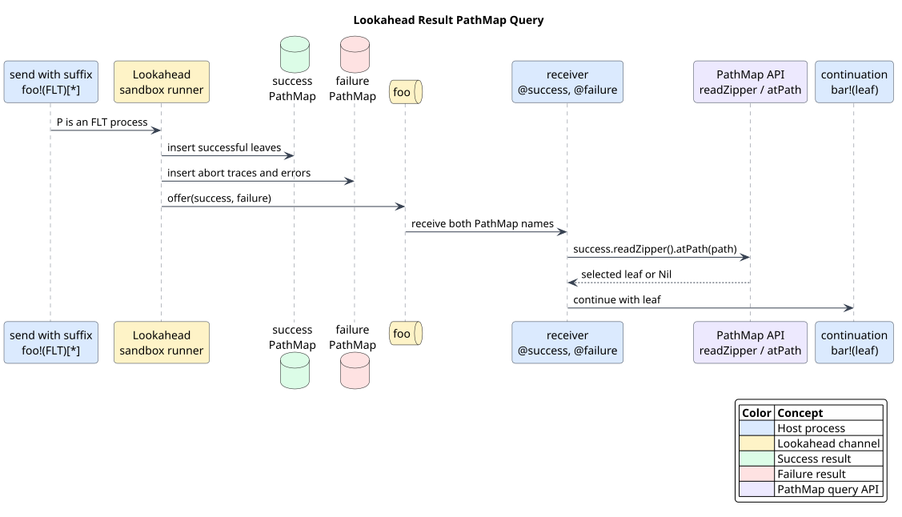

# Foreign Language Terms and Associated Operations

Dylon Edwards
2026-06-26
Status: Under Review

## Abstract

This proposal introduces **Foreign Language Terms** (FLTs): typed guest-language
terms embedded inside a host Rholang process. FLTs provide:

1. author-chosen delimiters for bounded guest source;
2. optional language and category qualification;
3. typed structural holes for construction and pattern matching;
4. composition with Rholang sends, receives, joins, guards, and the approved
   Lookahead FIPS; and
5. native in-Rho reduction for guest languages, with a uniform bridge to
   external virtual-host runtimes specified in the companion FIPS *Virtual Host
   Bridges for FLTs*.

The central invariant is **structural substitution**: a value crossing into a
guest body is parsed and typechecked as an abstract syntax tree (AST) value
before it fills a hole. It is never spliced as source text.

## Status and Evidence

This FIPS is a proposal. It is deliberately explicit about which semantics are
already present in the implementation and which semantics are newly specified
here.

| Badge | Meaning |
| --- | --- |
| [Implemented] | Confirmed in the referenced `mettail-rust`, `f1r3node-rust-mettail`, or `rholang-rs-cost-accounting-transpiler` sources. |
| [Approved] | Defined by another approved FIPS and reused here. |
| [Proposed] | New behavior introduced by this FIPS. |

FLTs are realized in two layers, and this FIPS badges the layers separately.

- The **application binary interface (ABI) layer** is **[Implemented]**. It is
  the reflected tagged-`Par` wire format, hole capture into that format, the
  fail-closed hereditary-ground guard, single-language in-Rho reduction, and the
  No-Injection boundary. This layer is the substrate onto which the `mettail-rust`
  production flip moved every non-semantic-predicate operation: a guest term is
  reflected into a tagged Rholang process, matched by the spatial matcher, and
  reduced by tag-keyed in-Rho drivers on a real RSpace. Its evidence is recorded
  in the Implementation Evidence table.
- The **surface layer** — the author-facing delimiters, tags, and `${...}` holes
  of the grammar below — is **[Proposed]**. Its lowering target is the
  implemented ABI, but the surface parser that produces the ABI is specified
  here, not yet built.
- **Native-to-native reduction** — reducing a composite whose subterms belong to
  two distinct guest languages on one RSpace — is **[Proposed]**. Single-language
  reduction is implemented; the cross-language driver topology it needs is not
  (see Interlanguage Communication).

An earlier revision of this FIPS reported that no FLT implementation existed.
That statement predated the production flip onto the Rholang interpreter. The
ABI layer is now the live realization substrate, and the per-layer badges above
supersede the earlier claim.

## Motivation

Rholang and MeTTaIL need to express domain-specific languages, virtual-machine
states, and externally hosted computations without reducing them to unsafe
strings. The syntax should let an author write a guest language in its own
notation while still giving the host enough structure to:

- identify the embedded region;
- know which guest language and category to parse;
- substitute host terms into guest holes without injection;
- destructure guest terms in receive patterns and match expressions;
- inspect speculative futures through the approved lookahead operator; and
- execute external runtimes without confusing host semantics with guest
  semantics.

The design deliberately avoids a special outer escape bracket. The delimiter is
the marker that a foreign region begins, and the parser carries possible readings
until host context, language tags, category tags, or disambiguation policy
selects one.

## Terminology

- **Host language**: the surrounding Rholang or MeTTaIL language.
- **Guest language**: the language named by the FLT tag, or inferred when the tag
  is omitted.
- **Foreign Language Term (FLT)**: a guest-language body plus its delimiter,
  optional language tag, optional category tag, and typed holes.
- **Category**: a guest grammar sort such as `Proc`, `Name`, `Str`, or `Int`.
- **Hole**: a typed structural parameter written `${x}` or `${x:Cat}`.
- **Construction position**: a term-producing context where a hole is filled
  from an environment.
- **Pattern position**: a matching context where a hole captures a subtree into
  an environment.
- **Virtual host**: an external runtime bound through a `semantics <Host>`
  declaration. Its semantics are implemented outside the Rholang interpreter and
  reached through a bridge.
- **Bridge terminology**: the bridge signature, canonical bridge type, type
  profile, and codec that convert values between Rholang and a virtual host are
  defined in the companion FIPS *Virtual Host Bridges for FLTs*, which specifies
  the virtual-host execution strategy in full.
- **Context**: a one-hole term `C[-]`; filling the hole with `p` is written
  `C[p]`.
- **Minimal evaluation context**: the smallest context that witnesses a rewrite
  or virtual-host step without carrying irrelevant state.

## Proposed Syntax

This section gives the FIPS surface fragment in BNFC notation. It is **not** a
complete Rholang grammar. It assumes the existing host grammar already provides
`Proc`, `Name`, `ProcPat`, `NamePat`, `Guard`, `Ident`, and `Integer`.

The current Rust Rholang parser is tree-sitter based, not BNFC based. BNFC is
used here because it is the team's preferred specification notation.

```bnfc
-- Existing host categories assumed by this FIPS fragment:
-- Proc, Name, ProcPat, NamePat, Guard, Ident, Integer.

entrypoints Proc, Flt, FltPattern ;

-- FLTs are process terms. In pattern position they lower to host process or
-- name patterns according to their category.
FltProc.       Proc       ::= Flt ;
FltProcPat.    ProcPat    ::= FltPattern ;
FltNamePat.    NamePat    ::= "@" FltPattern ;

TaggedFlt.     Flt        ::= FltTag FltBody ;
InferredFlt.   Flt        ::= FltBody ;
TaggedPat.     FltPattern ::= FltTag FltBody ;
InferredPat.   FltPattern ::= FltBody ;

LangTag.       FltTag     ::= Ident ;
CatTag.        FltTag     ::= Ident ":" Ident ;

-- The modal lexer emits the delimiter/body tokens named here. Equality of
-- symmetric delimiters, fence run length, heredoc words, and bracket depth are
-- lexical-mode obligations, not context-free BNFC obligations.
InlineBody.    FltBody ::= "`" [FltBodyItem] "`" ;
FenceBody.     FltBody ::= FenceDelim [FltBodyItem] FenceDelim ;
SymBody.       FltBody ::= SymmetricDelim [FltBodyItem] SymmetricDelim ;
RunBody.       FltBody ::= SymmetricRunDelim [FltBodyItem] SymmetricRunDelim ;
ParenBody.     FltBody ::= "(" [FltBodyItem] ")" ;
BracketBody.   FltBody ::= "[" [FltBodyItem] "]" ;
BraceBody.     FltBody ::= "{" [FltBodyItem] "}" ;
AngleBody.     FltBody ::= "<" [FltBodyItem] ">" ;
HeredocBody.   FltBody ::= HeredocOpen [FltBodyItem] HeredocClose ;

GuestPart.     FltBodyItem ::= GuestChunk ;
HolePart.      FltBodyItem ::= Hole ;
terminator FltBodyItem "" ;

HoleUntyped.   Hole ::= "${" Ident "}" ;
HoleTyped.     Hole ::= "${" Ident ":" Ident "}" ;

-- Sends may be ordinary sends or sends with the approved Lookahead suffix.
SendPlain.     Proc ::= Name "!" "(" [Proc] ")" ;
SendMultiple.  Proc ::= Name "!!" "(" [Proc] ")" ;
SendLookahead. Proc ::= Name "!" "(" [Proc] ")" LookaheadSuffix ;
LookaheadN.    LookaheadSuffix ::= "[" Integer "]" ;
LookaheadAll.  LookaheadSuffix ::= "[" "*" "]" ;

-- Existing Rholang receive surfaces, repeated here only where FLTs compose.
Receive.        Proc ::= "for" "(" [Receipt] ")" "{" Proc "}" ;
ReceiptGuard.   Receipt ::= [Bind] "where" Guard ;
ReceiptNoGuard. Receipt ::= [Bind] ;

LinearBind.     Bind ::= [NamePat] "<-" NameSource ;
RepeatedBind.   Bind ::= [NamePat] "<=" Name ;
PeekBind.       Bind ::= [NamePat] "<<-" Name ;

separator nonempty Bind "&" ;
separator nonempty Receipt ";" ;
separator Proc "," ;
separator NamePat "," ;

SimpleSource.      NameSource ::= Name ;
ReceiveSendSource. NameSource ::= Name "?!" ;
SendReceiveSource. NameSource ::= Name "!?" "(" [Proc] ")" ;

-- Existing Rholang let surfaces. This FIPS does not introduce a new let.
LetLinear.      Proc ::= "let" [Decl] "in" Proc ;
LetConcurrent.  Proc ::= "let" [ConcDecl] "in" Proc ;
DeclBind.       Decl ::= [Name] "<-" [Proc] ;
DeclVar.        Decl ::= Ident "=" Proc ;
ConcDeclBind.   ConcDecl ::= [Name] "<-" [Proc] ;
ConcDeclVar.    ConcDecl ::= Ident "=" Proc ;
separator nonempty Decl ";" ;
separator nonempty ConcDecl "/\\" ;
separator Name "," ;

-- The virtual-host `semantics <Host> bridge { ... }` declaration and the
-- language-neutral BridgeType algebra live in the sibling FIPS
-- "Virtual Host Bridges for FLTs". They are not part of the native-FLT surface.

-- Delimiter/body lexeme names emitted by the modal lexer. These are NOT
-- context-free token classes: a fence closes on the run length that opened it,
-- a symmetric run closes on the run that opened it, and a heredoc closes on the
-- word that opened it. Those closers are DATA-DEPENDENT — the lexer must
-- remember the opening lexeme — so their discipline is a lexical-mode
-- obligation of the modal lexer (a mode stack for depth-counted brackets, a
-- register automaton for the data-dependent closers), not a BNFC production.
-- Only GuestChunk is a genuine context-free token. The other delimiter lexemes
-- are enforced by lexical modes (listed as comments), not by token rules; the
-- per-form mechanism status is given after the grammar.
token GuestChunk (char)+ ;
-- Modal-lexer delimiter lexemes (each enforced by a lexical mode):
--   FenceDelim        : fixed-length backtick fence; arbitrary run length is a register-mode closer
--   InlineBacktick    : single backtick; fixed closer
--   SymmetricDelim    : one of ["/#!|"]; next unescaped occurrence
--   SymmetricRunDelim : run over ["/#!|"]; register-mode closer on the same run
--   ReservedBracket   : "{" or "[", opened only under a reserved guest tag; mode-stack depth counter
--   HeredocDelim      : "<<" WORD ... WORD; register-mode closer on the WORD
```

Lexical conventions (modal-lexer mode obligations, not context-free tokens):

- A **fixed-length** backtick fence and the **inline backtick** close on a
  statically known lexeme; the modal lexer emits them with an ordinary mode
  push/pop. These are the version-1 (v1) fence forms.
- An **arbitrary-run-length** fence closes only on the same backtick run length
  that opened it. Because the closer depends on the opener, the modal lexer must
  store the opening run in a register and match it — a register-automaton
  obligation, deferred to version 2 (v2).
- A **symmetric character** closes on the next unescaped occurrence, and a
  **symmetric run** closes only on the same character and run length that opened
  it; the run form is likewise a register-automaton obligation (v2).
- **Paired brackets** are depth-counted by the modal lexer's mode stack before
  the enclosed `[FltBodyItem]` stream is handed to the parser. Only `{` and `[`
  are admitted, and only under a reserved guest tag (v1); `(` and `<` are
  excluded because they collide with host casts and sends (`int(`, `n!(`) and
  with host binds and comparisons (`<-`, `<=`, `==`).
- A **word heredoc** records the word after `<<` and accepts a close only on a
  line equal to that word — again a register-automaton obligation (v2).
- `GuestChunk` is guest-language text in the current delimiter mode. `${...}` is
  emitted as a `Hole`, not as guest text, unless the language declares a
  different antiquote token.

The hole lexeme `${...}` is the **braced spelling of the host's already-landed
`$`-metavariable**: the tokenizer already recognizes the `$` metavariable sigil,
so a hole reuses an implemented lexeme rather than introducing a new one. The
brace pair delimits the metavariable name (and optional `:Cat`) from adjacent
guest text.

An omitted tag asks the parser to infer both language and category. A tag without
a category pins the language and asks the guest parser to use that language's
primary category. `L:Cat` pins both.

```text
perl:Str`"hello"`      language pinned, category pinned
perl`print(1)`         language pinned, category inferred
`print(1)`             language and category inferred
```

## Delimiters

An FLT body is bounded by an author-chosen delimiter. The author should choose a
delimiter that does not collide with the guest body.

All six delimiter forms are part of this proposal. They are not all part of the
same implementation increment: the **Mechanism status** column marks which forms
version 1 (v1 ✅) can lex with a plain mode stack and which forms version 2
(v2 ✶) defer to the register-automaton extension described under Parsing and
Elaboration.

| Form | Example | Closing rule | Mechanism status | Notes |
| --- | --- | --- | --- | --- |
| Inline backtick | `` L`body` `` | next backtick | v1 ✅ | Default for short terms; fixed closer |
| Backtick block (fixed length) | ```` L```body``` ```` | fence of the same, statically fixed length | v1 ✅ | Default for multiline terms |
| Backtick block (arbitrary run) | `` L````body```` `` | fence of the same run length as the opener | v2 ✶ | Data-dependent closer; register automaton |
| Symmetric character | `L/body/`, `L#body#`, `L!body!` | next unescaped occurrence | v2 ✶ | Needs escape-tracking mode; useful when backticks occur in the body |
| Symmetric run | `L###body###` | next run of the same character and length | v2 ✶ | Data-dependent closer; register automaton; generalizes markdown fences |
| Paired bracket | `L{body}`, `L[body]` | matching closer | v1 ✅ | `{`/`[` only, under a reserved guest tag; depth-counted and nestable |
| Paired bracket | `L(body)`, `L<body>` | matching closer | v2 ✶ | Excluded from v1: `(`/`<` collide with host casts, sends, binds, comparisons |
| Word heredoc | `L<<WORD` ... `WORD` | line equal to `WORD` | v2 ✶ | Data-dependent closer; register automaton; useful for bodies with many delimiter characters |

Legend: **v1 ✅** is lexable now with the landed modal-lexer mode stack;
**v2 ✶** requires the register-automaton delimiter extension and is queued as
follow-up work after the first FLT increment. Every form remains specified so
that the v2 forms are implemented against a fixed contract rather than
redesigned later.

When the default delimiter collides with the body, authors escalate to another
delimiter:

```text
perl`print("hi")`
perl/print("a`b")/
perl<<PL
  my $u = "a/b`c";
  print "$u";
PL
```

## Parsing and Elaboration

[Proposed] Opening an FLT delimiter enters a guest parsing mode. If a language
tag is present, only that guest grammar is considered. If the tag is omitted,
the parser may consider every registered language whose delimiter and grammar
admit the body.

The result of parsing is a typed guest AST with hole nodes. At the weighted
push-down automaton (WPDA) layer, ambiguous parses are carried as ordinary
parser ambiguity: the parser does not disambiguate early, and every reading the
guest grammar admits is retained at that layer. The composition operator that
combines registered guest grammars is, however, **first-match** today — it
commits to the first admitting reading rather than preserving all readings under
a budget. Version 1 therefore **requires a language tag**, which selects a single
guest grammar and makes the reading unique; untagged all-readings inference is
gated to version 2, where the composition operator must be upgraded to carry
every reading under an ambiguity budget (see Compatibility and Future Work).
Host context, expected category, guard, or disambiguation policy then resolves
any residual ambiguity.


PlantUML source:
[diagrams/01-parse-pipeline.puml](diagrams/01-parse-pipeline.puml).

### Holes

`Hole` has one syntax with two roles:

| Context | Meaning | Result |
| --- | --- | --- |
| Construction position | Fill the hole from an existing binding | AST graft |
| Pattern position | Capture the matched subtree into a binding | Pattern variable |

The category of a hole is inferred from its guest grammar position. If inference
is ambiguous, the author writes `${x:Cat}`.

#### The reflected wire model and the hereditary-ground marker

The lowering target is the reflected tagged-`Par` graph, not a bare AST. A guest
constructor whose label is a **marked object** — a binder-bearing constructor,
such as a lambda — reflects to a tagged list whose index-1 element is a
*hereditary-ground marker*:

```text
EList[ ⌜C⌝, m, ⟦t0⟧, ⟦t1⟧, ... ]
```

The marker `m` is a reserved `GPrivate` token: `^gnd` when the whole subtree is
hereditarily free of bound-variable leaves, and `^nog` otherwise. It is derived,
conservative metadata whose only purpose is to let the in-Rho substitution and
shift drivers skip a subtree they cannot change. Its soundness is the `oground`
invariant, proved as `oground_subst_id` and `oground_shift_id` in
`InRhoCreeperTrace.v`:

```math
\mathrm{oground}(t) \;\iff\; (t\ \text{has no}\ \texttt{bound}\ \text{leaf, hereditarily}) \;\iff\; \bigl(\forall\, j\, a.\ \mathrm{osubst}(j, a, t) = t\bigr) \,\wedge\, \bigl(\forall\, c.\ \mathrm{oshift}(c, t) = t\bigr).
```

In words: a node is marked ground exactly when no bound-variable leaf occurs
anywhere beneath it, which is exactly the condition under which substitution and
shift act as the identity on it. Two rules for holes follow from this invariant,
and both are load-bearing.

- **Marker-slot wildcard (pattern position).** A hole inside a marked-object node
  lowers to a pattern that places an *unconstrained wildcard* at the index-1
  marker slot. A pattern must never pin the marker byte, because the received
  subterm's marker is computed from its own contents and need not equal any
  statically chosen marker. Wildcarding the slot reuses the landed
  tagged-pattern combinators; it is not new machinery.
- **Forced `^nog` over a filled hole (construction position).** When construction
  grafts a value into a hole, the enclosing marked-object node's marker is
  recomputed **bottom-up**, and a node that still contains a hole — or that
  receives a fill carrying a bound-variable leaf — is emitted as `^nog`. This is
  *necessary*, not merely conservative: by the `oground` invariant, a stale
  `^gnd` marker left over a `^bound`-carrying fill would let the substitution
  driver treat the node as identity-under-substitution and skip a substitution
  that a later β-step requires, silently producing a wrong reduction.
  Construction therefore never keeps a `^gnd` marker over a hole.

#### Elaboration in construction position

The elaboration algorithm is presented in literate form: a root fragment names
the phases, and each phase is defined and explained below it. `T` is the
reflected template — the tagged-`Par` graph with hole leaves — and `ρ` maps hole
names to typed reflected AST values.

```text
⟨Elaborate an FLT in construction position⟩ ≡
  for each hole h at position π in T:
    ⟨Resolve the hole's category Cat⟩
    ⟨Look up and typecheck the binding ρ(x)⟩
    ⟨Graft the reflected value into the marked Par graph⟩
  return T
```

The first fragment fixes the guest sort the slot expects. The category is read
off the hole's grammar position; an explicit `${x:Cat}` annotation overrides the
inference, and a slot whose category cannot be determined is a fail-closed error
rather than a guess.

```text
⟨Resolve the hole's category Cat⟩ ≡
  if h is written ${x:Cat}: use the explicit Cat
  else: Cat ← the guest category of position π in T
  if Cat is undetermined: raise a fail-closed category error
```

The second fragment binds the value and checks it against the resolved category.
Because `ρ(x)` is already a typed reflected AST value — never source text — the
check is a structural category and arity gate, and its failure grafts nothing.

```text
⟨Look up and typecheck the binding ρ(x)⟩ ≡
  v ← ρ(x)                        -- a typed reflected AST value
  if category(v) ≠ Cat: raise a fail-closed BridgeType error
```

The third fragment performs the substitution as a **reflected-`Par` graft**: the
hole leaf at position π is replaced by `v` in the tagged-`Par` graph, and every
enclosing marked-object node on the path from π to the root has its index-1
marker recomputed bottom-up. No node off that path is read, moved, or retagged —
the No-Injection property below is exactly this locality.

```text
⟨Graft the reflected value into the marked Par graph⟩ ≡
  T ← replace the leaf at π with v
  for each marked-object ancestor a of π, innermost first:
    marker(a) ← ^gnd if subtree(a) is hereditarily bound-free, else ^nog
```

In pattern position, the same hole syntax marks a typed capture. Matching against
a received value binds only the subtree occupying the hole's grammar position,
and — by the marker-slot wildcard rule — the marker byte of that subtree is left
free rather than pinned.


PlantUML source:
[diagrams/02-hole-elaboration.puml](diagrams/02-hole-elaboration.puml).

## Contextual Semantics

[Proposed] An FLT is not just a string literal; it is a typed term that may be
placed into host and guest contexts. This proposal uses the contextual view from
the bisimulation paper: a transition labelled by context `C[-]` means that
`C[p]` can rewrite to a result. Behavioral equivalence is meaningful only when
it is stable under contexts.

For a reducible guest language, the FLT registration must define:

- the guest sorts and operation arities;
- equations and rewrites that form the guest theory;
- which guest subterms are active in rewrites;
- the observable contexts that witness behavior; and
- the host categories into which guest values can be embedded.

The minimal context principle is normative for virtual hosts: a host runtime
must receive the smallest evaluation context needed to evaluate the FLT and
bridge values. It must not receive unrelated Rholang process state merely because
that state is available.

![Contextual semantics: an FLT hole is a typed subterm inside a context C[-], and only the minimal active context is passed to the guest semantics](diagrams/09-contextual-semantics.svg)

PlantUML source:
[diagrams/09-contextual-semantics.puml](diagrams/09-contextual-semantics.puml).

## Reduction

An FLT is a process term. Without lookahead, it is injected unreduced and reduces
where ordinary process reduction is enabled.

[Implemented] A single native guest language reduces by **tag-keyed in-Rho
drivers compiled by the set automaton**. Each guest language's rewrite theory
compiles to a family of drivers — one per rewrite family — and every driver is
keyed by the language fingerprint. A reflected subterm reduces under the driver
keyed by its *own* fingerprint, on a real RSpace. Substitution and shift are
themselves in-Rho term-rewriting drivers, gated by the hereditary-ground marker
so that they skip subtrees the `oground` invariant proves they cannot change.
This is the live single-language reduction path (`rho_net_drive.rs`,
`rho_net_subst_trs.rs`).

[Proposed] Reducing a composite whose subterms belong to two distinct guest
languages requires a cross-language driver topology that does not yet exist. It
is specified under Interlanguage Communication, immediately below.

[Proposed] A virtual-host guest reduces by calling its declared runtime through
the bridge specified in the sibling FIPS *Virtual Host Bridges for FLTs*. If no
driver or bridge is registered for the guest category, the FLT is inert data.

## Interlanguage Communication

A central goal of FLTs is that two guest languages, and a guest language and its
Rholang host, can *communicate* — an author can match a language-A term against a
language-B pattern where their shapes agree, and can interpolate a term of one
language into a slot of another. Because every guest lowers to the same reflected
tagged-`Par` ABI on one RSpace, this communication is expressible without a
translation pass. This section defines what is sound today and what remains
[Proposed].

Throughout, let $`\mathit{fp}_A`$ and $`\mathit{fp}_B`$ be the fingerprints of
two guest languages, $`[\![\,t\,]\!]`$ the reflection of a guest term $`t`$ into
a tagged `Par`, and $`\ulcorner \mathit{fp} \cdot C \urcorner`$ the reflected
head tag for a constructor labelled $`C`$ under fingerprint $`\mathit{fp}`$. Each
head tag is an unforgeable `GPrivate` derived from the fingerprint.

### Cross-language matching is tag-identity dispatch

[Implemented] Cross-language matching succeeds by **structural shape plus
unforgeable tag-identity dispatch**. Language A's constructor patterns are lowered
as tag-scoped patterns `pat_tagged(fp_A)`; such a pattern matches a node only when
the node's head tag is $`\ulcorner \mathit{fp}_A \cdot C \urcorner`$. Because the
tag is an unforgeable `GPrivate` keyed by the fingerprint, a language-B head can
never be mistaken for a language-A constructor:

```math
\mathrm{head\text{-}tag}([\![\,t\,]\!]) = \ulcorner \mathit{fp}_B \cdot C \urcorner \;\wedge\; \mathit{fp}_A \neq \mathit{fp}_B \;\Longrightarrow\; \neg\,\mathrm{match}_A(p,\, [\![\,t\,]\!]) \quad\text{for every } A\text{-pattern } p.
```

The consequence is that cross-language matching fires *only* where both languages
intend a shared structural shape, and never by one language's tag forging
another's. A category or fingerprint mismatch is therefore never a *wrong*
firing; it is only a *non*-firing.

### Native-to-native interpolation is typed by reflected category

[Proposed] Interpolating a language-B term into a language-A slot is admitted by
**compatible reflected category**, not by a canonical-bridge pivot. The
canonical-bridge type algebra is reserved for virtual hosts and lives in the
sibling FIPS; native-to-native interpolation is a value-identity graft of one
reflected `Par` into another. A fill at slot $`\pi`$ is sound exactly when three
conditions hold:

1. **Host-category agreement** — the slot and the value agree on the host
   category (`Proc` with `Proc`, `Name` with `Name`).
2. **Opacity at $`\pi`$** — language A uses the slot's guest category
   parametrically, treating the filled subterm as opaque. This is *forced*
   whenever $`\mathit{fp}_B \neq \mathit{fp}_A`$: A's constructor patterns are
   `pat_tagged(fp_A)` and cannot match an $`\mathit{fp}_B`$ head, so A can only
   carry the foreign subterm, never destructure it.
3. **Well-formed shape** — the reflected value is a structurally valid inhabitant
   of the slot's arity.

A `${x:Cat}` annotation is the admission check for condition 1: it is
**fail-closed**, admitting the fill only when the category agrees. Because
condition 2 is forced by tag-keying, an incompatible category can only cause a
term never to reduce; it can never cause a wrong reduction.

### Composite reduction: R2, not R1

[Proposed] Reducing a composite $`A[B]`$ — a language-A term with a language-B
subterm — requires a driver topology that does not yet exist. Two designs were
considered; the sound one is unbuilt.

- **R1 (root interleave) is rejected.** R1 would seed a driver `^drive:fp_B` at
  the root of $`A[B]`$ and interleave the two languages' drivers to a fixpoint.
  It is **incomplete for interior foreign subterms**: language A's congruence arm
  re-drives each child under A's own hard-coded fingerprint, so a driver seeded
  at the root cannot descend past an $`\mathit{fp}_A`$ wrapper to reach an
  interior $`\mathit{fp}_B`$ redex — $`A_C[\,B_{\mathrm{redex}}\,]`$ freezes.
  Worse, the passthrough discriminant it needs (a node whose fingerprint is not
  mine) is not expressible as an unforgeable-identity match, and a permissive
  passthrough would fail *open*, defeating the `^drive-err` cross-check that
  makes a stuck term observable.
- **R2 (per-child fingerprint dispatch) is the sound and complete direction —
  and is unbuilt.** Under R2 the congruence arm re-dispatches each foreign child
  to the driver keyed by *that child's own* fingerprint, either through a shared
  non-fingerprint `^drive` channel or through per-child fingerprint dispatch,
  replacing the fail-closing wildcard arm with a yield. This is a
  **driver-topology restructure**, not a local change.

Today the single-language driver **fail-closes** on a foreign node: a
`^drive:fp_A` driver that descends into a language-B child matches nothing, rests
on `^drive-err:fp_A`, and its parent join stalls. The composite is therefore
**safe but incomplete** — $`A[B]`$ is stuck, never mis-reduced. Making R2
complete carries a discharge obligation: a lemma, to be authored, that the
$`\mathit{fp}_A`$ driver never fires on an $`\mathit{fp}_B`$ node.

### Cross-language substitution and shift must be foreign-inert

[Proposed] The foreign-node gap also afflicts the substitution and shift drivers,
and this blocks cross-language *binder crossing*. The `^subst` and `^shift`
drivers have **no wildcard arm** — `rho_net_subst_trs.rs` documents that they
silently stall on an unrecognized head. In $`A_\lambda[B]`$ — a language-A lambda
whose body holds a language-B term — A's β-cascade drives `^subst` and `^shift`
into the B-subterm, finds no $`\mathit{fp}_A`$ arm and no wildcard, and silently
stalls; the join never completes and the β-cascade hangs. The stall is *caused
by* the correct marker fold: the B-child reads `^nog` under A's fingerprint, so
the ground-guard never short-circuits and substitution always descends into it.

Capture-freedom is not the difficulty. It holds by the invariant
`foreign_subterm_closed_wrt_host_binders`: a language-B term has no syntax to
name a language-A binder, so no `^bound` leaf scoped to A occurs inside it, and
the wrong-depth substitution path is unreachable. The remaining requirement is
that the traversal also be **stall-free**. Cross-language binder crossing
therefore requires **foreign-inert traversal** in `^subst` and `^shift` — a
traversal that is both capture-free and stall-free, passing an unrecognized
foreign node through unchanged. That extension is unbuilt; it blocks phase-3
cross-language binder crossing, not the single-language path.

### Cross-language guards, fuel, and the AC carrier

[Proposed] Three further obligations govern co-installed languages.

- **Behavioral guards are the only off-interpreter work.** A cross-language guard
  `where sub |= φ` is evaluated off the interpreter and must be **reject-safe**
  (a failed or diverging guard consumes and emits nothing), **fuel-bounded**, and
  must **name the guest fingerprint** it evaluates against, so that $`\varphi`$
  is checked in the intended language's theory.
- **Fuel must be cross-language.** Termination is **not modular**: the direct sum
  of two terminating rewrite systems need not terminate (Toyama, IPL 25, 1987),
  so a per-language fuel budget does not bound the number of interleave rounds. A
  single cross-language fuel budget is required. Confluence, by contrast, **is**
  modular for disjoint direct sums (Toyama, JACM 34(1), 1987), which is what
  makes a cross-language normal-form *set* well-defined once termination is
  separately bounded. An effect- or capability-bearing FLT category must also be
  filled **linearly**: a non-linear or discarding host rule would duplicate or
  drop an unreduced effectful foreign subterm.
- **The associative-commutative (AC) bag carrier must be fingerprint-keyed.** The
  AC operand soup is carried on a channel named `ac:op` — a `GString` keyed only
  by the constructor `op`, the one carrier name that is not fingerprint-keyed.
  Two co-installed languages that name the same bag constructor would share
  `ac:PPar`, so language A's bare-variable AC pattern could absorb a language-B
  element. The fix is to fingerprint-key the carrier as `ac:{fp}.{op}`. A
  `GString` channel is **forgeable**, unlike an unforgeable `GPrivate`, so this
  keying is **defense-in-depth**: the AC receiver's unforgeable outer rendezvous
  already contains the leak, and the fingerprint-keyed name additionally removes
  the accidental-collision surface.

A cross-language operational-correspondence corollary — a separation lemma over
disjoint fingerprints, composed with Toyama modular confluence and a
cross-language fuel-termination bound — is stateable and provable, but is
currently **unproven**. It is the formal endpoint of the D7 co-install work in
Future Work.


PlantUML source:
[diagrams/10-interlanguage-communication.puml](diagrams/10-interlanguage-communication.puml).

## Lookahead Composition

[Approved] This proposal does not introduce a new lookahead operator. It composes
with the approved Lookahead FIPS syntax:

```text
x!(P)[n]
x!(P)[*]
```

The bracket suffix belongs to the send. The process `P`, which may be an FLT, is
speculatively executed in sandboxed empty RSpaces according to the Lookahead
FIPS. `n` is a `uint64`; `*` means run to completion as defined there. The names
of the resulting success and failure `PathMap`s are placed on `x`.


PlantUML source:
[diagrams/03-lookahead-sandbox.puml](diagrams/03-lookahead-sandbox.puml).

The receive side must not pretend that a trace is sent directly. It receives
PathMap values or names and queries them with the PathMap API implemented in
`f1r3node-rust-mettail`.



PlantUML source:
[diagrams/05-lookahead-pathmap-query.puml](diagrams/05-lookahead-pathmap-query.puml).

## Receive Patterns and Guards

[Implemented] The current Rholang parser supports receives with linear `<-`,
persistent `<=`, and peek `<<-` binds, `&` joins, `;`-separated receipts,
receive-send sources `?!`, send-receive sources `!?`, and optional `where`
guards. The parser represents receive bind left sides as names/patterns, with
quoted process patterns written as `@ Proc`.

```text
for ( @PATTERN <- channel where GUARD ) { CONTINUATION }
```

| Arrow | Meaning | RSpace behavior |
| --- | --- | --- |
| `<-` | Linear receive | Consume datum and continuation |
| `<=` | Persistent receive | Keep continuation for later matches |
| `<<-` | Peek receive | Read datum without removing it |

A joined receive fires only when all joined patterns match atomically. A failed
guard consumes nothing and emits nothing. This is confirmed by the mettail guard
documentation and by tests that run real Rholang source with `where` guards.


PlantUML source:
[diagrams/08-guarded-receive-atomicity.puml](diagrams/08-guarded-receive-atomicity.puml).

An FLT in receive position must lower to a host pattern that the Rholang parser
and matcher can represent. For a process-valued FLT, that means a quoted process
pattern:

```text
for ( @perl{ print(${bar:Str}) } <- x where bar |= AG safe ) {
  ...
}
```

Here `bar` is the captured AST argument of `print`; the guard sees a typed AST
subtree, not text.

Two rules make an FLT receive pattern lower correctly and match soundly.

- **Marker-slot wildcard.** When the received value is a marked-object node, the
  lowered pattern places an unconstrained wildcard at the index-1
  hereditary-ground marker slot, exactly as in construction-position holes. A
  receive pattern must never pin the marker byte: the datum's marker is derived
  from the datum's own contents and need not equal any statically chosen marker,
  so pinning it would make an otherwise-matching datum rest unmatched.
- **`|= φ` is the only off-interpreter work.** Everything else in an FLT
  receive — the structural match, the join atomicity, the consume/emit
  discipline — is ordinary in-Rho spatial matching on the reflected ABI. Only the
  behavioral guard `|= φ` is evaluated off the interpreter.

The equality primitive interacts with the marker, and this is why the
ground-subpattern form is preferred over an equality guard. An equality guard
such as `a == ⟦K⟧` compares reflected `Par` values as **whole values**, including
the index-1 marker byte, so `a == ⟦K⟧` holds only when the compared term's
markers are byte-identical to the captured subterm's. Because a captured
subterm's marker is derived from its contents, an author-written right-hand side
`⟦K⟧` can carry a different marker and the guard can spuriously fail. The
**ground-subpattern form** avoids this: it rides the marker-wildcarded pattern
rather than an equality over whole values, so the marker is left free and the
match is robust. Prefer the ground-subpattern form; use a whole-value equality
guard only when the right-hand side is known to be marker-canonical.

## Security

[Implemented] The no-injection property is normative, and it holds at the ABI
layer. Write $`T|_q`$ for the reflected subterm at position $`q`$,
$`\mathrm{holes}(T)`$ for the hole positions of a template $`T`$, and
$`q \succeq \pi`$ for "$`q`$ is at or below $`\pi`$". Let $`M(\pi)`$ be the
index-1 marker slots of the marked-object ancestors of $`\pi`$ — the derived
metadata the graft recomputes bottom-up. Then for every template $`T`$, hole
$`\pi \in \mathrm{holes}(T)`$, and environment $`\rho`$:

```math
\forall\, q.\ \bigl(q \not\succeq \pi \;\wedge\; q \notin M(\pi)\bigr) \;\Longrightarrow\; \mathrm{elab}_\rho(T)\big|_{q} = T\big|_{q},
```

and at $`\pi`$ the subtree becomes $`\rho(x)`$, a typed reflected AST value —
never source text. In words: elaboration may replace the hole subtree and
recompute the derived hereditary-ground markers on the path to it, but it must
not add, move, retag, split, or delete any node outside that hole, and it
introduces no guest content from rendered text.

This is the FLT analogue of parameterized queries. A malicious value whose
rendered text contains a closing delimiter, statement separator, or guest syntax
cannot escape its slot because rendered text is never concatenated into the guest
source. The security kernel is a **tag-identity compare**: a host constructor
pattern matches a datum only when their reflected head tags are *identical*
`GPrivate` tokens, so a foreign tag can never satisfy a host pattern and a
rendered delimiter can never re-open the guest grammar. The guarded-commit
soundness of this compare is proved in `RhoGuardedCommSoundness.v`: a receive
commits only when the pattern matches and the guard passes, and a failed match or
a failed guard consumes and emits nothing.


PlantUML source:
[diagrams/04-no-injection-boundary.puml](diagrams/04-no-injection-boundary.puml).

If a guest language already uses `${...}` for its own syntax, that language may
declare an alternate antiquote token for host holes. A fully opaque text guest
with no parseable grammar cannot securely support `${...}` holes.

## Execution Strategies

### Native Guest

[Proposed] A native guest language is defined by a `language!` specification. Its
FLTs parse to typed ASTs, holes are filled and captured structurally, and
reductions happen inside the MeTTaIL/Rholang reduction machinery.

```text
perl{ print(${foo}) }
```

### Virtual Host and Bridges

[Proposed] A virtual-host guest is a language whose semantics are implemented by
an external runtime rather than by native in-Rho drivers. The virtual-host
execution strategy — the `semantics <Host> bridge { ... }` declaration, the
language-neutral canonical `BridgeType` algebra, the four-layer bridge model, the
deterministic bridge algorithm, and the minimal-cell observation discipline — is
specified in the sibling FIPS **Virtual Host Bridges for FLTs**
([`../2026-06-26-Virtual-Host-Bridges-for-FLTs/2026-06-26-Virtual-Host-Bridges-for-FLTs.md`](../2026-06-26-Virtual-Host-Bridges-for-FLTs/2026-06-26-Virtual-Host-Bridges-for-FLTs.md)).
That FIPS shares this one's terminology and reuses the same hole,
No-Injection, and lookahead machinery; only the reduction target differs — an
external runtime reached through ordinary Rholang sends and receives, instead of
a tag-keyed in-Rho driver. Native guests, above, remain fully specified here.

## Examples

### Construction and Pattern Matching

```text
let foo = perl:Str{ "hello" } in {
  x!( perl{ print(${foo:Str}) } )
  | for ( @perl{ print(${bar:Str}) } <- x where bar |= AG safe ) {
      // bar is bound to the captured Str AST.
    }
}
```

### Lookahead Over FLTs

```text
let myVar = fooLang`5` in {
  foo!( fooLang`some-foo-term` )[*]
  | foo!( fooLang```
      some-foo-${myVar:Int}-term
    ``` )[*]
  | for ( @success, @failure <- foo ) {
      let leaf = success.readZipper().atPath(["trace", 0, "leaf"]) in {
        bar!(leaf)
      }
    }
}
```

This example is schematic Rholang surface: the important point is that lookahead
offers success/failure PathMaps, and the continuation queries a path from the
success PathMap. It does not receive a bare future trace directly.

### Virtual Host with Explicit Bridge

A worked virtual-host example — a `semantics TypeScript.Node bridge { ... }`
declaration invoked through an ordinary send with a return channel, replying
`(true, value)` or `(false, BridgeError)` — appears in the sibling FIPS *Virtual
Host Bridges for FLTs*. It is kept there so the bridge syntax and its example
stay together.

## Implementation Evidence

This section is non-normative. It records the implementation facts used to
constrain the proposal.

| Construct | Evidence |
| --- | --- |
| Rholang send, receive, let, guards | `rholang-rs-cost-accounting-transpiler/rholang-tree-sitter/grammar.js` |
| Parser AST for receive receipts and guards | `rholang-rs-cost-accounting-transpiler/rholang-parser/src/ast.rs` |
| Guard atomicity | `mettail-rust/docs/architecture/semantic-predicates/08-runtime-comm-enforcement.md` |
| Guard syntax | `mettail-rust/docs/architecture/semantic-predicates/06-guard-syntax-and-extensions.md` |
| External system process seam | `mettail-rust/docs/architecture/rho-native-integration/10-adaptive-evaluation-model.md` |
| Injected deterministic system process shape | `mettail-rust/rholang-runtime/src/fold_contract.rs` |
| PathMap protobuf shape | `f1r3node-rust-mettail/models/src/main/protobuf/RhoTypes.proto` |
| PathMap conversion and keying | `f1r3node-rust-mettail/models/src/rust/pathmap_integration.rs` |
| PathMap query methods | `f1r3node-rust-mettail/rholang/src/rust/interpreter/reduce.rs` |
| Reflected tagged-`Par` wire format and hereditary-ground marker | `mettail-rust/rholang-codegen/src/rho_net_lower.rs` |
| In-Rho de Bruijn substitution and shift TRS (the `^subst`/`^shift` drivers and their stall behavior) | `mettail-rust/rholang-codegen/src/rho_net_subst_trs.rs` |
| Tag-keyed in-Rho reduction drivers and the AC operand carrier | `mettail-rust/rholang-codegen/src/rho_net_drive.rs` |
| FLT ABI-over-RSpace harness (reflect, match, drive on a real RSpace) | `mettail-rust/rholang-runtime/tests/flt_abi_over_rspace.rs` |
| In-Rho set-automaton matching | `mettail-rust/docs/architecture/rho-native-integration/15-in-rho-set-automaton-matching.md` |
| Set-automaton optimization theory | `mettail-rust/docs/architecture/rho-native-integration/21-set-automata-optimization-theory.md` |
| Guest-language-to-Rholang (OSLF) compilation | `mettail-rust/docs/architecture/rho-native-integration/27-oslf-language-to-rholang-compilation.md` |
| Guarded-commit soundness (match-and-guard-then-commit) | `mettail-rust/formal/rocq/rho_bridge/theories/RhoGuardedCommSoundness.v` |
| `oground` invariant: substitution and shift are identity on hereditarily-ground terms | `mettail-rust/formal/rocq/rho_bridge/theories/InRhoCreeperTrace.v` |

The smallest complete implementation should support tagged FLTs, the version-1
delimiters (fixed-length backtick fence, inline backtick, and reserved-tag `{`/`[`
brackets), typed holes, construction fill, pattern capture, single-language
in-Rho reduction, and composition with approved lookahead. The version-2
delimiters and untagged inference may be implemented later; virtual-host bridge
signatures are specified in the sibling FIPS *Virtual Host Bridges for FLTs*.

## Compatibility

This proposal is additive. Existing Rholang syntax remains valid, and existing
lookahead syntax is reused. **Version 1 requires an explicit language tag** — the
tag selects a single guest grammar, which makes the parse unique against the
first-match composition operator in use today. This is a firm v1 rule, not a
temporary limitation: untagged FLT inference is a power feature that is unsound to
ship against a first-match composer and is therefore gated to version 2 (see
Future Work).

## Future Work

- **Untagged inference (v2 unlock).** Untagged FLTs require upgrading the
  composition operator from first-match to **all-readings** under an
  `AmbiguityBudget`, together with the evidence-gate and cohort-merge that a naive
  fan-out lacks — a naive fan-out was empirically shown to explode the cursor set
  and regress. The v1 tag-required rule is the sound analog until that upgrade
  lands.
- **Register-automaton delimiters.** Complete the version-2 data-dependent closers
  — the arbitrary-run-length backtick fence, the symmetric character and
  symmetric run, and the word heredoc — with the register-automaton extension to
  the modal lexer, which stores the opening lexeme and matches the closer against
  it.
- **Guest-parser registry lift.** Lift the guest-parser registry into a reusable,
  fingerprint-keyed crate seam, so a language registers its parser and drivers
  once and both matching and reduction dispatch on the same fingerprint.
- **Graft-economy and set-automaton FLT matching (phase 3).** Realize FLT matching
  through the graft economy and the set automaton — holes as buds, quotation as
  scion, filling as graft. The set automaton interns *fixed* rule sets at codegen
  today, so FLT matching additionally needs **runtime pattern interning**; this is
  a matching-layer extension that reuses the landed graft proof kit, not a v1
  dependency.
- **D7: two languages on one RSpace (co-install).** Sequence after the phase-now
  native demo and the phase-2 surface, and implement principled: **R2** per-child
  fingerprint dispatch (the congruence arm re-dispatches a foreign child to the
  child's own driver), **foreign-inert traversal** in `^subst`/`^shift`
  (capture-free and stall-free), the **fingerprint-keyed AC carrier**
  `ac:{fp}.{op}`, a **co-install harness**, and the **cross-language
  operational-correspondence corollary** (a separation lemma over disjoint
  fingerprints, composed with Toyama modular confluence and a cross-language
  fuel-termination bound).
- **Per-language antiquote overrides.** Specify declaration syntax for a
  language's alternate antiquote token (and the `$${` literal escape) so a guest
  that uses `${...}` for its own syntax can still host holes.
- **Module-system integration.** Specify integration for `language`, `import`,
  `extender`, and `space` declarations, and the `semantics <Host>` declaration of
  the sibling FIPS.
- **Conformance tests.** Define conformance tests for structured receive patterns
  over FLTs.

## References

- Approved Lookahead FIPS:
  `../../approved/2026-01-08-Lookahead/2026-01-08-Lookahead.md`
- Guard syntax and runtime enforcement:
  `mettail-rust/docs/architecture/semantic-predicates/06-guard-syntax-and-extensions.md`
  and
  `mettail-rust/docs/architecture/semantic-predicates/08-runtime-comm-enforcement.md`
- Adaptive evaluation and external semantics:
  `mettail-rust/docs/architecture/rho-native-integration/10-adaptive-evaluation-model.md`
- Rholang parser grammar:
  `rholang-rs-cost-accounting-transpiler/rholang-tree-sitter/grammar.js`
- Rholang parser AST:
  `rholang-rs-cost-accounting-transpiler/rholang-parser/src/ast.rs`
- f1r3node PathMap model and methods:
  `f1r3node-rust-mettail/models/src/main/protobuf/RhoTypes.proto`,
  `f1r3node-rust-mettail/models/src/rust/pathmap_integration.rs`, and
  `f1r3node-rust-mettail/rholang/src/rust/interpreter/reduce.rs`
- Stay, Mike, and C. B. Wells. "Bisimulation for lambda-theories."
  `/home/dylon/Downloads/Bisimulation_for_lambda_theories.pdf`
- Bonchi, Filippo, Fabio Gadducci, and Gianluca V. Monreale. "A General Theory
  of Barbs, Contexts, and Labels." ACM Transactions on Computational Logic
  15(4), 2014. DOI:
  [`10.1145/2631916`](https://doi.org/10.1145/2631916).
- Leifer, James J., and Robin Milner. "Deriving Bisimulation Congruences for
  Reactive Systems." CONCUR 2000. DOI:
  [`10.1007/3-540-44618-4_19`](https://doi.org/10.1007/3-540-44618-4_19).
- Meredith, L. G., and Matthias Radestock. "A Reflective Higher-order Calculus."
  Electronic Notes in Theoretical Computer Science 141(5), 2005. DOI:
  [`10.1016/j.entcs.2005.05.016`](https://doi.org/10.1016/j.entcs.2005.05.016).
- Williams, Christian, and Michael Stay. "Native Type Theory." EPTCS 372, 2022.
  DOI: [`10.4204/EPTCS.372.9`](https://doi.org/10.4204/EPTCS.372.9).
- Toyama, Yoshihito. "On the Church-Rosser Property for the Direct Sum of Term
  Rewriting Systems." Journal of the ACM 34(1), 1987, pp. 128–143. DOI:
  [`10.1145/7531.7534`](https://doi.org/10.1145/7531.7534). Confluence is modular
  for disjoint direct sums.
- Toyama, Yoshihito. "Counterexamples to Termination for the Direct Sum of Term
  Rewriting Systems." Information Processing Letters 25(3), 1987, pp. 141–143.
  DOI:
  [`10.1016/0020-0190(87)90122-0`](https://doi.org/10.1016/0020-0190(87)90122-0).
  Termination is not modular.
- The virtual-host bridge type algebra and its supporting references — the
  ECMAScript and TypeScript profiles, the WebAssembly Component Model analogy,
  and the K-Framework minimal-cell discipline — are cited in the sibling FIPS
  *Virtual Host Bridges for FLTs*
  (`../2026-06-26-Virtual-Host-Bridges-for-FLTs/2026-06-26-Virtual-Host-Bridges-for-FLTs.md`).
