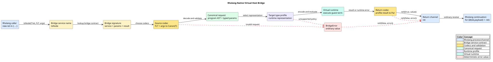
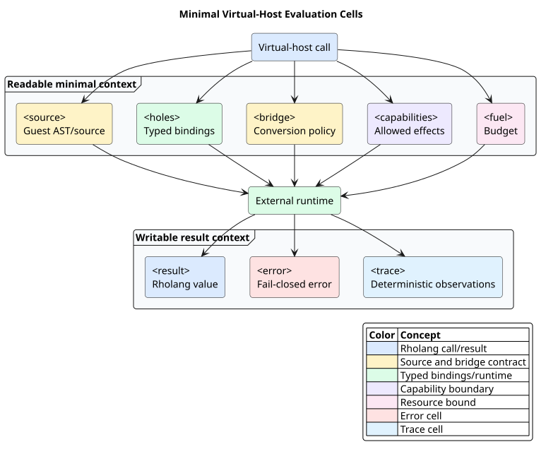

# Virtual Host Bridges for Foreign Language Terms

Dylon Edwards
2026-06-26
Status: Under Review

## Abstract

This proposal specifies the **virtual-host** execution strategy for Foreign
Language Terms (FLTs): the mechanism by which an FLT whose semantics are
implemented by an *external* runtime — rather than by native in-Rho reduction
drivers — is bridged to Rholang. A virtual host is reached through ordinary
Rholang sends and receives on a declared service name, and every value crossing
the boundary passes through a **language-neutral canonical type algebra** before
any runtime-specific representation is chosen. The bridge is **fail-closed**:
every conversion is a deterministic partial function whose failure is reported as
an ordinary `BridgeError` value, never an out-of-band exception, and no guest
step runs on an invalid request.

This FIPS is the companion to *Foreign Language Terms and Associated Operations*
(the "FLT FIPS"). It reuses that document's terminology and its hole,
No-Injection, and lookahead machinery unchanged; it specifies **only** the
virtual-host path. Native guest languages — those that reduce in-Rho — are
specified entirely in the FLT FIPS.

## Relationship to the Foreign Language Terms FIPS

The FLT FIPS defines what an FLT is: a typed guest-language term embedded in a
host Rholang process, with author-chosen delimiters, optional language and
category tags, and typed structural holes. It defines two execution strategies
and specifies one of them fully:

- **Native guest** — the guest reduces inside the Rholang interpreter through
  tag-keyed in-Rho drivers. Specified in the FLT FIPS.
- **Virtual host** — the guest reduces in an external runtime reached through a
  bridge. Specified here.

Everything the two strategies share — the surface syntax, holes, the No-Injection
property, receive patterns and guards, and composition with the approved
Lookahead FIPS — lives in the FLT FIPS and is not restated here. This FIPS adds
only the bridge declaration, the canonical type algebra, the bridge algorithm,
the Rholang-native invocation protocol, and the minimal-cell observation
discipline.

The two documents cross-reference each other:

- FLT FIPS:
  [`../2026-06-26-Foreign-Language-Terms/2026-06-26-Foreign-Language-Terms.md`](../2026-06-26-Foreign-Language-Terms/2026-06-26-Foreign-Language-Terms.md)

## Status and Evidence

This FIPS is a proposal. The bridge model it specifies is new behavior; the
Rholang seams it composes with — sends, receives, `match`, and the PathMap model
— already exist.

| Badge | Meaning |
| --- | --- |
| [Implemented] | Confirmed in the referenced `mettail-rust`, `f1r3node-rust-mettail`, or `rholang-rs-cost-accounting-transpiler` sources. |
| [Approved] | Defined by another approved FIPS and reused here. |
| [Proposed] | New behavior introduced by this FIPS. |

The entire bridge model — the `semantics <Host> bridge { ... }` declaration, the
canonical `BridgeType` algebra, the type-profile discipline, the bridge
algorithm, and the minimal-cell rule — is **[Proposed]**. The transport it rides
on — ordinary Rholang communication and the deterministic single-reply service
shape — is **[Implemented]** and referenced in the Implementation Evidence table.
No concrete virtual-host runtime (Node.js, Deno, WASI, or embedded V8) is
specified as implemented; deterministic host sandboxes are Future Work.

## Terminology

The FLT FIPS defines **host language**, **guest language**, **Foreign Language
Term**, **category**, **hole**, **construction position**, and **pattern
position**. This FIPS adds the bridge-specific vocabulary:

- **Virtual host**: an external runtime bound to a guest language through a
  `semantics <Host>` declaration. Its semantics are *not* expressed as in-Rho
  rewrites.
- **Bridge signature**: the typed, author-facing contract for converting values
  between Rholang and a virtual host — a service name, an ordered list of
  parameter types, and a result type.
- **Canonical bridge type** (written $`\mathrm{Canon}(T)`$): a language-neutral
  type — such as `Integer`, `Record`, or `Variant` — that describes the *meaning*
  of a value before any runtime-specific representation is chosen. The canonical
  types form a small closed algebra, given below.
- **Type profile**: a per-language mapping from canonical bridge types to the
  concrete value domain of one runtime, together with the validation and
  canonicalization rules that runtime imposes.
- **Codec**: a deterministic encoder or decoder for one direction of one bridge
  mapping. A codec may be partial, but every failure must be explicit and
  reported as a bridge error.
- **Bridge policy**: a refinement attached to a canonical type — for example
  `loss = reject` or `range = nonnegative` — that constrains conversion without
  changing the core type algebra.
- **Minimal evaluation context**: the smallest set of observation cells a virtual
  host may read to evaluate an FLT and bridge its values; it must not carry
  unrelated host state.
- **`BridgeError`**: the deterministic, fail-closed error value a bridge returns
  when decoding, validation, or encoding is undefined for a given input.

## Proposed Syntax

[Proposed] This section gives the bridge-declaration fragment in BNFC notation.
It extends the FLT surface with a `semantics <Host> bridge { ... }` declaration
and the canonical `BridgeType` algebra. As in the FLT FIPS, BNFC is used as the
team's preferred specification notation; the production Rholang parser is
tree-sitter based. The fragment assumes the host grammar already provides
`Ident` and `Integer`.

```bnfc
entrypoints SemanticsDecl ;

-- Virtual-host declaration. BridgeType is language-neutral; runtime-specific
-- representations are selected by profile declarations. Invocation uses ordinary
-- Rholang sends and receives on the declared service name.
SemanticsPath.     SemanticsDecl ::= "semantics" DottedPath ;
BridgeDecl.        SemanticsDecl ::= "semantics" DottedPath "bridge" "{" [BridgeItem] "}" ;
BridgeServiceItem. BridgeItem ::= "service" Ident ;
BridgeProfileItem. BridgeItem ::= "profile" DottedPath ;
BridgeParamItem.   BridgeItem ::= "param" Ident ":" BridgeType ;
BridgeResultItem.  BridgeItem ::= "result" ":" BridgeType ;
separator BridgeItem ";" ;

BridgeUnit.    BridgeType ::= "Unit" ;
BridgeBool.    BridgeType ::= "Bool" ;
BridgeText.    BridgeType ::= "Text" ;
BridgeBytes.   BridgeType ::= "Bytes" ;
BridgeInteger. BridgeType ::= "Integer" BridgePolicyOpt ;
BridgeRational. BridgeType ::= "Rational" BridgePolicyOpt ;
BridgeDecimal. BridgeType ::= "Decimal" BridgePolicyOpt ;
BridgeBinaryFloat32. BridgeType ::= "BinaryFloat32" BridgePolicyOpt ;
BridgeBinaryFloat64. BridgeType ::= "BinaryFloat64" BridgePolicyOpt ;
BridgeProc.    BridgeType ::= "Proc" ;
BridgeName.    BridgeType ::= "Name" ;
BridgeAst.     BridgeType ::= "GuestAst" "<" Ident ">" ;
BridgeList.    BridgeType ::= "List" "<" BridgeType ">" ;
BridgeSet.     BridgeType ::= "Set" "<" BridgeType ">" ;
BridgeMap.     BridgeType ::= "Map" "<" BridgeType "," BridgeType ">" ;
BridgeTuple.   BridgeType ::= "(" [BridgeType] ")" ;
BridgeRecord.  BridgeType ::= "Record" "{" [BridgeField] "}" ;
BridgeVariant. BridgeType ::= "Variant" "{" [BridgeVariantCase] "}" ;
BridgeOption.  BridgeType ::= "Option" "<" BridgeType ">" ;
BridgeResultType. BridgeType ::= "Result" "<" BridgeType "," BridgeType ">" ;
BridgePathMap. BridgeType ::= "PathMap" "<" BridgeType ">" ;
BridgeOpaque.  BridgeType ::= "Opaque" "<" DottedPath ">" ;

BridgeFieldItem. BridgeField ::= Ident ":" BridgeType ;
BridgeVariantEmpty. BridgeVariantCase ::= Ident ;
BridgeVariantPayload. BridgeVariantCase ::= Ident "(" BridgeType ")" ;

NoBridgePolicy.   BridgePolicyOpt ::= ;
SomeBridgePolicy. BridgePolicyOpt ::= "{" [BridgePolicy] "}" ;
BridgePolicyFlag. BridgePolicy ::= Ident ;
BridgePolicyPair. BridgePolicy ::= Ident "=" BridgePolicyValue ;
BridgePolicyIdent. BridgePolicyValue ::= Ident ;
BridgePolicyInt.   BridgePolicyValue ::= Integer ;

separator BridgeType "," ;
separator BridgeField ";" ;
separator BridgeVariantCase "|" ;
separator BridgePolicy "," ;

PathOne.       DottedPath ::= Ident ;
PathMore.      DottedPath ::= Ident "." DottedPath ;
```

A bridge declaration names a Rholang **service**, an optional **profile** path, an
ordered list of typed **params**, and a **result** type. Invocation is ordinary
Rholang communication on the service name; there is no new send or receive form.

## The Four-Layer Bridge

[Proposed] A bridge maps values between languages through a canonical, typed
middle domain. It is deliberately **not** a table of ad hoc pairs such as
"Rholang integer to a foreign numeric type". Separating meaning from
representation is what lets one canonical type serve many runtimes, and what lets
a single validation policy be stated once rather than re-derived per runtime. The
bridge has four layers:

| Layer | Purpose | Example |
| --- | --- | --- |
| Bridge signature | Author-facing service contract in the FIPS syntax | `service tsNode; param n: Integer { loss = reject }` |
| Rholang codec | Converts between `Par` values and canonical values | `GInt` to canonical `Integer` |
| Canonical bridge type | Language-neutral value meaning | `Record`, `Variant`, `Decimal`, `PathMap<T>` |
| Type profile | Runtime-specific representation and validation | `Integer` as a host `i64`, `bigint`, decimal object, or ABI integer |

The canonical bridge domain is the **pivot**. A mapping from Rholang to a language
$`L`$ factors through it, and so does the reverse:

```math
\text{Rholang } \mathrm{Par} \;\rightharpoonup\; \mathrm{Canon}(T) \;\rightharpoonup\; L
\qquad\qquad
L \;\rightharpoonup\; \mathrm{Canon}(T) \;\rightharpoonup\; \text{Rholang } \mathrm{Par}
```

Here $`\rightharpoonup`$ denotes a **deterministic partial function**. Partiality
is acceptable only when failure is explicit, stable, and reported as a
`BridgeError`; a bridge never silently coerces. Writing the whole source-to-target
mapping as a composition makes the fail-closed discipline precise:

```math
\mathrm{bridge}_{S \to L} \;=\; \mathrm{encode}_{P,\,T} \,\circ\, \mathrm{validate}_{T} \,\circ\, \mathrm{decode}_{S,\,T},
```

where $`\mathrm{decode}_{S,T}`$ is the source codec into $`\mathrm{Canon}(T)`$,
$`\mathrm{validate}_{T}`$ enforces every policy attached to $`T`$, and
$`\mathrm{encode}_{P,T}`$ is the target profile $`P`$'s codec out of
$`\mathrm{Canon}(T)`$. If any of the three is undefined at its input, the
composition is undefined and the bridge yields a `BridgeError` without taking a
guest step.

This shape is intentionally close to interface-type systems such as the
WebAssembly Component Model: authors name structural value contracts, while
profiles own the concrete ABI or runtime representation.

## Canonical Bridge Types

[Proposed] The canonical types form a small closed algebra, grouped into
families. Each family fixes the *meaning* of its values and the obligations a
profile must discharge to represent them.

| Family | Canonical bridge types | Semantics | Profile obligations |
| --- | --- | --- | --- |
| Unit and booleans | `Unit`, `Bool` | Absence of value and truth values | Preserve exact truth domain |
| Text and bytes | `Text`, `Bytes` | Unicode text and uninterpreted byte sequences | Declare encoding, normalization, and invalid-input policy |
| Exact numbers | `Integer`, `Rational`, `Decimal` | Mathematical numeric values | Declare range, precision, scale, and overflow policy |
| Binary floats | `BinaryFloat32`, `BinaryFloat64` | IEEE-style finite or non-finite binary floats | Declare NaN, infinity, signed-zero, and rounding policy |
| Products | `List<T>`, `Set<T>`, `Map<K,V>`, tuples, `Record{...}` | Structured values with child types | Define ordering, equality, mutability, and duplicate-key policy |
| Sums | `Variant{...}`, `Option<T>`, `Result<T,E>` | Tagged alternatives | Preserve tag identity and payload type |
| Rholang structures | `Proc`, `Name`, `PathMap<T>`, `GuestAst<L>` | Host process, name, trace map, or guest AST values | Keep structural form; never require source rendering |
| Opaque handles | `Opaque<P>` | Capability or runtime-owned resource | Define lifetime, authority, serialization, and revocation policy |

Bridge policies refine canonical types without changing the core type algebra.
The default policy is `loss = reject`. Any lossy conversion — rounding,
canonicalization, range truncation, mutation, or the grant of ambient authority —
must be named explicitly in the bridge declaration or the runtime profile. The
default therefore fails closed: a conversion that would lose information is
rejected unless the author has opted in.

## Type Profiles

[Proposed] A **type profile** binds the canonical algebra to one runtime. For
every canonical type it supports, a profile must define:

1. the concrete runtime representation;
2. the codec from canonical values into that representation;
3. the codec from runtime values back into canonical values;
4. equality and canonicalization rules;
5. ownership, aliasing, and mutability rules for structured values; and
6. a deterministic `BridgeError` for every unsupported or invalid value.

For every loss-rejecting type $`T`$, the Rholang codec must satisfy the
**round-trip law**:

```math
\mathrm{fromCanon}_{T}\bigl(\mathrm{toCanon}_{T}(v)\bigr) = v \qquad \text{for every Rholang value } v \in \mathrm{dom}(T).
```

A profile may canonicalize target-language values, but only if the
canonicalization is declared and is stable under the equality declared for $`T`$ —
otherwise the round-trip law would fail and the bridge would silently alter
values.

TypeScript and ECMAScript are **one possible profile**, not the bridge model.
Such a profile may map `Integer { range = safeNumber }` to an ECMAScript
`number`, `Integer { representation = bigint }` to a `bigint`, and
`BinaryFloat64` to a `number` with an explicit NaN and infinity policy.
TypeScript annotations are not a runtime contract; the bridge signature remains
authoritative. This is why the canonical algebra is language-neutral: the same
`Integer` type serves a `number`, a `bigint`, a decimal object, or an ABI integer
by choosing a different profile, with no change to the author-facing signature.

## The Bridge Algorithm

[Proposed] Bridging a single value is a three-phase pipeline that realizes the
composition $`\mathrm{encode}_{P,T} \circ \mathrm{validate}_T \circ
\mathrm{decode}_{S,T}`$. The algorithm is presented in literate form: a root
fragment names the phases, and each phase is defined and explained below it.
`v` is the value to bridge, `S` the source language, `T` the declared canonical
type, and `P` the target profile.

```text
⟨Bridge v from source S to target profile P through canonical type T⟩ ≡
  ⟨Decode v into a canonical value c⟩
  ⟨Validate c against every policy of T⟩
  ⟨Encode c into the target runtime⟩
  return the encoded runtime value
```

The first phase moves the value out of the source language and into the canonical
domain. It is the only phase that reads a source-language representation, and it
is partial: a source value outside $`\mathrm{dom}(T)`$ has no canonical image.

```text
⟨Decode v into a canonical value c⟩ ≡
  c ← decode(S, T, v)
  if decode is undefined at v: return BridgeError and take no guest step
```

The second phase enforces the policies attached to $`T`$ — range, precision,
overflow, NaN handling, duplicate-key policy, and so on. Validation is where
`loss = reject` bites: a canonical value that would only survive a lossy encoding
is rejected here, before any runtime is touched.

```text
⟨Validate c against every policy of T⟩ ≡
  for each policy p attached to T:
    if c violates p: return BridgeError and take no guest step
```

The third phase moves the validated canonical value into the target runtime's
representation through the profile's codec. It is again partial: a profile that
cannot represent `c` returns a deterministic error rather than an approximation.

```text
⟨Encode c into the target runtime⟩ ≡
  r ← encode(P, T, c)
  if encode is undefined at c: return BridgeError and take no guest step
  the encoded value is r
```

Every failure path returns the *same* deterministic `BridgeError` discipline: the
caller observes failure as an ordinary Rholang value, and the foreign runtime
never runs on an invalid request. This is the fail-closed property in operational
form.

## Rholang-Native Invocation

[Proposed] A bridge is invoked by **ordinary Rholang communication** — there is
no bespoke call form. Code sends to the declared service name and receives the
reply:

- the **first argument** is a return channel;
- the **second argument** is the parsed FLT or program term;
- the **remaining arguments** follow the declared `param` order.

The bridge replies **exactly once** on the return channel with `(true, value)` on
success or `(false, BridgeError)` on failure. Parsed templates, hole bindings, and
Rholang arguments are passed as **separate typed values**; the runtime must never
receive host values by source concatenation. This is the FLT No-Injection
property carried across the bridge boundary: because the guest program and its
arguments arrive as distinct typed values, a hostile argument whose rendered text
contains guest syntax cannot escape into the program text. (The No-Injection
property is stated and proved at the ABI layer in the FLT FIPS; the bridge
inherits it by never rendering.)



PlantUML source:
[diagrams/06-virtual-host-bridge.puml](diagrams/06-virtual-host-bridge.puml).

## Minimal Cells for Virtual Hosts

[Proposed] K Framework cells are used here as a **specification discipline**, not
as an implementation requirement. f1r3node already contains K definitions with
cells such as `<k>`, `<In>`, `<Out>`, and `<subst>`; this FIPS reuses the idea to
bound the context a virtual host may observe. Bounding the observable context is a
capability-security measure: a host that can read only what its signature needs
cannot exfiltrate unrelated process state.

| Cell | Contents | Rationale |
| --- | --- | --- |
| `<source>` | guest source or parsed guest AST | program text/structure under evaluation |
| `<holes>` | typed hole bindings | structural parameters, not source splices |
| `<bridge>` | bridge signature and conversion policy | Rholang/host type boundary |
| `<capabilities>` | permitted host effects | prevents ambient authority |
| `<fuel>` | gas, step, or time budget | deterministic resource bound |
| `<result>` | successful host return value | conversion back to Rholang |
| `<error>` | deterministic bridge/runtime error | fail-closed behavior |
| `<trace>` | optional deterministic observations | lookahead/debug evidence |

The **minimal-cell rule** is normative:

> A virtual-host service invocation may read only the cells required by its
> bridge signature, capabilities, and evaluation budget. It may write only
> `<result>`, `<error>`, and `<trace>`.



PlantUML source:
[diagrams/07-virtual-host-cells.puml](diagrams/07-virtual-host-cells.puml).

## Security

[Proposed] The bridge preserves the two security properties of the FLT FIPS and
adds one of its own.

- **No-Injection (inherited).** Host values cross the boundary only as separate
  typed values, never concatenated into guest source. A rendered-text attack —
  a value whose printed form contains a closing delimiter or guest syntax —
  cannot escape, because nothing is ever rendered to source. This is the same
  property proved at the ABI layer in the FLT FIPS.
- **Fail-closed conversion.** Every codec and validation step is a deterministic
  partial function; an undefined step returns a `BridgeError` before the runtime
  executes. There is no path on which a virtual host runs on an out-of-domain or
  policy-violating value.
- **Least authority (new).** The minimal-cell rule confines a virtual host to the
  cells its signature names and lets it write only results, errors, and traces.
  A bridge cannot acquire ambient authority merely because host state happens to
  be in scope.

## Worked Example: TypeScript.Node

[Proposed] A `TypeScript.Node` bridge declares a service, a profile, one typed
parameter, and a result type, then is invoked by an ordinary send with a return
channel:

```text
semantics TypeScript.Node bridge {
  service tsNode;
  profile ECMAScript.Strict;
  param n: Integer { range = nonnegative, loss = reject };
  result: List<Integer { loss = reject }>;
}

new ret, out, err in {
  tsNode!(
    *ret,
    ts:Module```
      export default (n) => Array.from({ length: n }, (_, i) => i * i)
    ```,
    5
  ) |
  for (@(ok, payload) <- ret) {
    match ok {
      true => out!(payload)
      false => err!(payload)
    }
  }
}
```

If the selected profile cannot represent `n` as a nonnegative exact integer, the
bridge sends `(false, BridgeError)` on `ret` **before** the foreign runtime
executes. The caller observes failure through ordinary Rholang communication
instead of through an out-of-band exception. On success, `payload` is the
`List<Integer>` result, decoded from the runtime back through the canonical
domain and validated against `loss = reject`.

## Implementation Evidence

This section is non-normative. It records the implementation facts that constrain
the bridge model. The bridge itself is [Proposed]; the transport and observation
seams it composes with exist.

| Construct | Evidence |
| --- | --- |
| Rholang send, receive, `match` | `rholang-rs-cost-accounting-transpiler/rholang-tree-sitter/grammar.js` |
| Deterministic single-reply system-process shape | `mettail-rust/rholang-runtime/src/fold_contract.rs` |
| External system process seam | `mettail-rust/docs/architecture/rho-native-integration/10-adaptive-evaluation-model.md` |
| PathMap protobuf shape | `f1r3node-rust-mettail/models/src/main/protobuf/RhoTypes.proto` |
| PathMap conversion and keying | `f1r3node-rust-mettail/models/src/rust/pathmap_integration.rs` |
| PathMap query methods | `f1r3node-rust-mettail/rholang/src/rust/interpreter/reduce.rs` |
| K-style Rholang cells (minimal-cell discipline) | `f1r3node-rust-mettail/rholang/src/main/k/rholang/configuration.k` |

## Compatibility

This proposal is additive. It introduces one new declaration form,
`semantics <Host> bridge { ... }`, and no new send or receive syntax; invocation
reuses ordinary Rholang communication. A native FLT that never declares a bridge
is unaffected. The canonical type algebra is closed and versioned with this FIPS;
adding a canonical type is a change to this FIPS, not to any individual profile.

## Future Work

- Specify deterministic host-runtime sandboxes for concrete runtimes such as
  Node.js, Deno, WASI, or embedded V8, including their capability and fuel
  models.
- Specify standard type profiles for the ECMAScript, WebAssembly Component Model,
  and PathMap runtimes, each discharging the six profile obligations.
- Define conformance tests for the round-trip law across every loss-rejecting
  canonical type.
- Specify a revocation and lifetime protocol for `Opaque<P>` handles.
- Integrate the `semantics <Host>` declaration with the FLT module system
  (`language`, `import`, `extender`, `space`).

## References

- Foreign Language Terms and Associated Operations (companion FIPS):
  [`../2026-06-26-Foreign-Language-Terms/2026-06-26-Foreign-Language-Terms.md`](../2026-06-26-Foreign-Language-Terms/2026-06-26-Foreign-Language-Terms.md)
- Approved Numeric Types FIPS:
  `../../approved/2025-11-13-Numeric-Types/Numeric Types.md`
- Adaptive evaluation and external semantics:
  `mettail-rust/docs/architecture/rho-native-integration/10-adaptive-evaluation-model.md`
- Injected deterministic system process shape:
  `mettail-rust/rholang-runtime/src/fold_contract.rs`
- Rholang parser grammar:
  `rholang-rs-cost-accounting-transpiler/rholang-tree-sitter/grammar.js`
- f1r3node PathMap model and methods:
  `f1r3node-rust-mettail/models/src/main/protobuf/RhoTypes.proto`,
  `f1r3node-rust-mettail/models/src/rust/pathmap_integration.rs`, and
  `f1r3node-rust-mettail/rholang/src/rust/interpreter/reduce.rs`
- f1r3node K configuration:
  `f1r3node-rust-mettail/rholang/src/main/k/rholang/configuration.k`
- Meredith, L. G., and Matthias Radestock. "A Reflective Higher-order Calculus."
  Electronic Notes in Theoretical Computer Science 141(5), 2005. DOI:
  [`10.1016/j.entcs.2005.05.016`](https://doi.org/10.1016/j.entcs.2005.05.016).
- Williams, Christian, and Michael Stay. "Native Type Theory." EPTCS 372, 2022.
  DOI: [`10.4204/EPTCS.372.9`](https://doi.org/10.4204/EPTCS.372.9).
- ECMAScript Language Specification, Number type:
  <https://tc39.es/ecma262/#sec-ecmascript-language-types-number-type>
- ECMAScript Language Specification, BigInt type:
  <https://tc39.es/ecma262/#sec-ecmascript-language-types-bigint-type>
- TypeScript Handbook, erased types:
  <https://www.typescriptlang.org/docs/handbook/2/basic-types.html#erased-types>
- WebAssembly Component Model, WIT and Canonical ABI:
  <https://component-model.bytecodealliance.org/design/wit.html> and
  <https://component-model.bytecodealliance.org/design/canonical-abi.html>
- K Framework User Manual:
  <https://kframework.org/docs/user_manual/>
