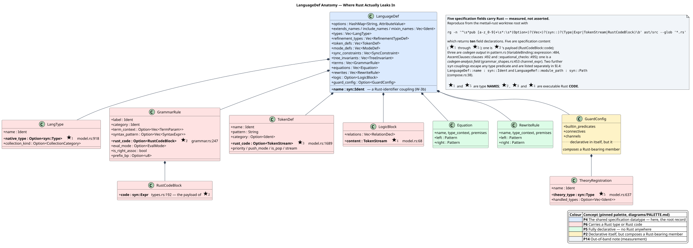
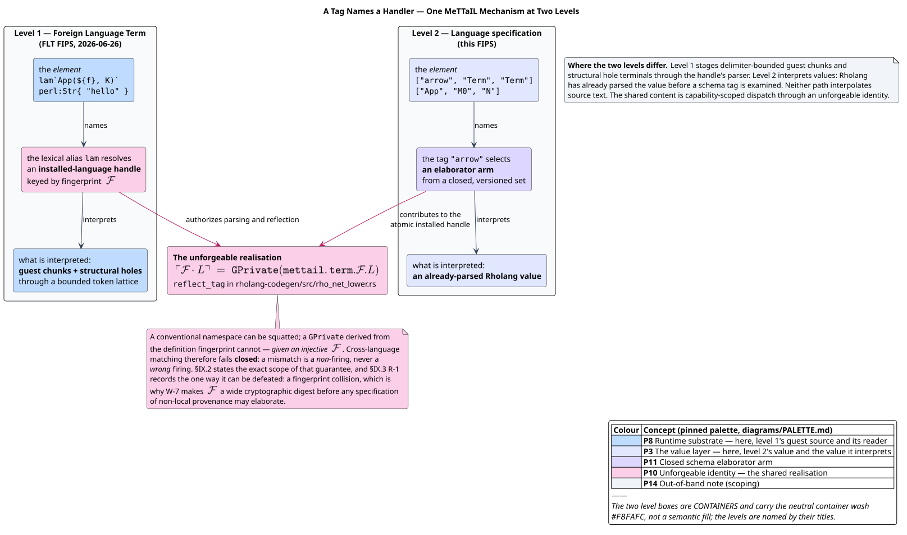
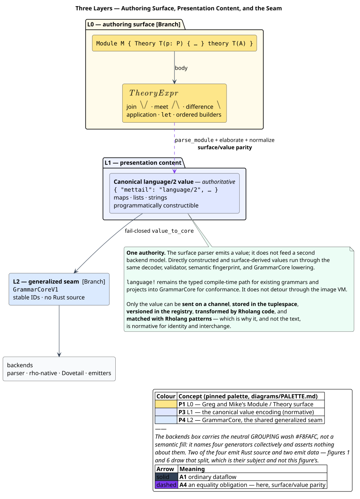
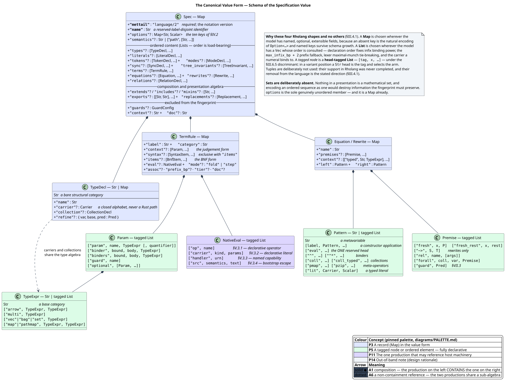
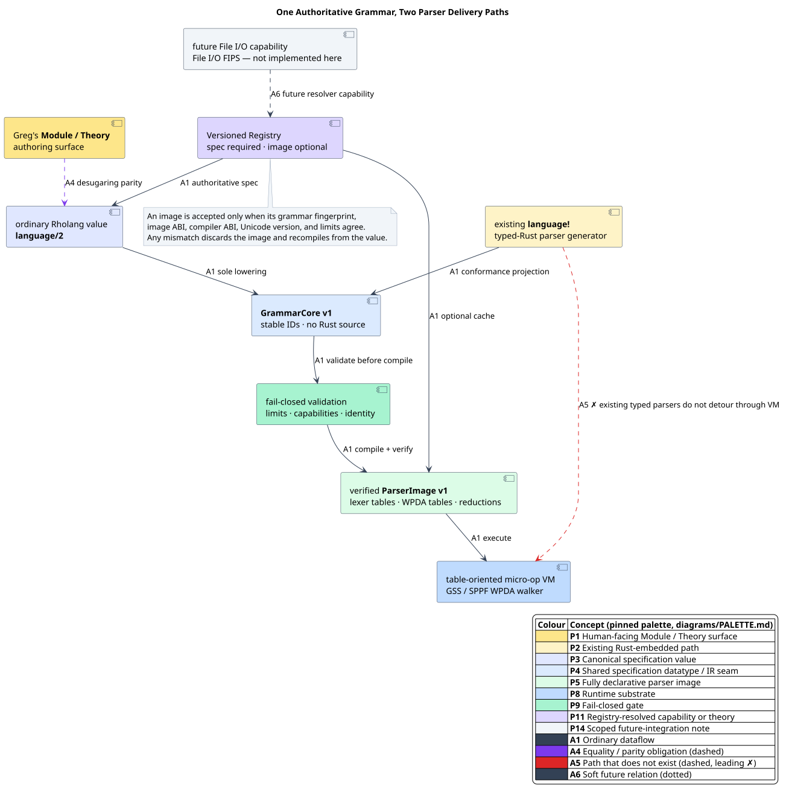
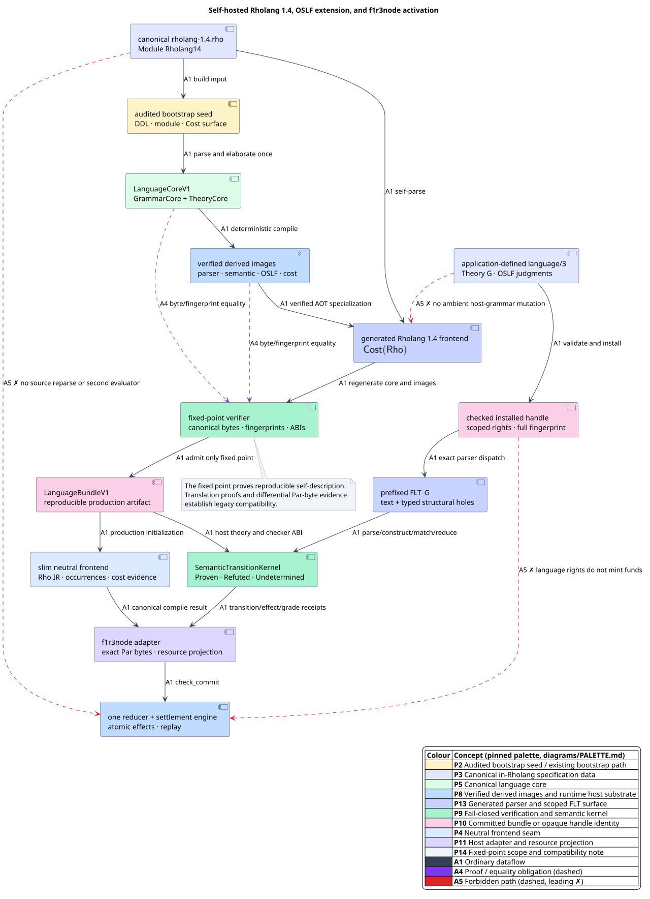

# MeTTaIL Language Specifications in Rholang

Dylon Edwards ([dylon.devo@gmail.com](mailto:dylon.devo@gmail.com))  
2026-07-25  
Status: Under Review

> **How to read this document.** It is a **FIPS** — a F1R3FLY Improvement Proposal
> Specification, the normative change-proposal format of this repository. Every
> acronym, symbol, and key term it uses is defined in the [Terminology](#terminology)
> table below, which is deliberately placed before Part I; the Abstract, Scope, and
> Motivation sections that precede it use six terms — **MeTTaIL**, **Rholang**,
> **FLT**, **OSLF**, **GSLT**, and **Rho machine** — whose one-line glosses are given
> inline at first use and in full in that table. Normative statements use *must*, *must
> not*, and *may*; everything marked "non-normative" is context.
>
> **The measurements are checkable, and the instruments are not in here.** Every
> count, census and structural claim below has a runnable check in
> [`verification/`](verification/), a sibling of this file; each one records what
> it measured, at which revision, and — the part worth reading — the specific
> mutation that makes it fail. The apparatus is kept beside the specification
> rather than inside it, because a reviewer needs the claim and an implementer
> needs neither the claim's scaffolding nor a fence scanner.
> [`verification/README.md`](verification/README.md) is the index.

## Abstract

**MeTTaIL** — the codename of Rholang 1.4, and the name of the language-definition
framework this proposal concerns — specifies a language today by invoking a Rust
procedural macro, `language!`. This proposal specifies an **in-Rholang
specification language** for the same content, so that a language definition stops
being Rust source consumed by `rustc` and becomes an artifact a **Rholang** node —
a node running the reflective higher-order concurrent calculus of
[Meredith & Radestock 2005] — can accept, carry, version, and install.

The objective, in L. G. Meredith's and Michael Stay's framing of it:

> The Rholang interpreter needs to be able to accept **units of code to
> interpret**, namely collections of modules. In a module, language specs get
> defined, and **Foreign Language Terms can use those specs**. Whether that is
> implemented using Rust macros or not is an **implementation issue**. We need
> to move away from a required dependency on Rust.
> — Michael Stay, design discussion, 2026-07

Three properties follow, and they are the point of the change.

1. **A specification becomes data.** It can be built by a contract, sent on a
   channel, stored in the tuplespace, versioned in the registry, transformed by
   Rholang code, and matched with Rholang patterns. None of that is possible
   for a macro invocation.
2. **Rholang can specify the languages it embeds.** Nouveau Rholang is already
   the MeTTaIL language defined by `languages/src/rholang.rs`. This FIPS extends
   that existing `language!` specification with `Module` and `Theory` process
   forms; it does not define a second Rholang, a standalone module language, or
   a tree-sitter grammar. Any Rholang process can construct one or more guest
   language specifications, install them, and use the resulting opaque handles
   through the **Foreign Language Term (FLT)** surface.
3. **The Rust compiler leaves the specification-authoring critical path.** This
   is a necessary — though, as §VIII establishes honestly, not sufficient —
   precondition for a non-Rust target such as a bare-metal RISC-V (Reduced
   Instruction Set Computer, fifth generation) **Rho machine** — an
   implementation of the Rholang runtime: RSpace, the spatial matcher, and the
   reducer.

The proposal rests on one premise, which §I **verifies rather than assumes**:
that `LanguageDef` is already the sole input to every backend generator. It also builds on the exhaustive MeTTaIL grammar, Greg Meredith's and
Michael Stay's `Module` / `Theory` notation, and the data-faithful Rholang DDL.
The surface and value forms converge on one normalized specification before
validation or backend generation (§III).

The problem of native `![{ … }]` blocks — the one place a specification embeds
Rust — is resolved by a declarative semantic-target field, and §V specifies
that boundary.

The acknowledged design inspiration for making specifications ordinary values
is Clojure's **code-is-data** tradition [Hickey 2020], itself descended from
McCarthy's S-expression [McCarthy 1960]. The notation proposed here is designed
to be idiomatic **Rholang**, not a transliteration of any other format.

**Novelty.** There is no prior specification of how an **OSLF** (Operational
Semantics in Logical Form) language presentation should be represented in
Rholang. In particular the omnibus **GSLT** (Generalised Structured Language
Theory) specification — Meredith, Stay *et al.*, `publications/GSLT-intro/omnibus.tex`
and its rendered `omnibus.pdf`, cited throughout as [Omnibus] — gives the
normative syntax and the mathematical presentation of a GSLT but says nothing
about a Rholang representation of one. This FIPS is the first to specify that
representation.

## Status and Evidence

This FIPS is normative design under review. It intentionally contains no
revision diary; review history belongs in Git. Claims about the current branch
are confined to [Implementation Evidence](#implementation-evidence), where each
claim names a symbol or a reproducible verification command.

The implementation is conforming only when all of these layers are present and
their equivalence obligations pass:

- the `Module` / `Theory` surface in the existing nouveau Rholang grammar;
- the backward-compatible ordinary Rholang `language/2` value, the
  generalized `language/3` value, and their one versioned schema decoder;
- validation, canonicalization, GrammarCore lowering, parser-image generation,
  image verification, and atomic installation;
- opaque installed-language handles and scoped registry publication;
- structural FLT construction, matching, reflection, and reduction; and
- the consensus, capability, resource, and observational-security gates in
  Parts IX and XVII.

## Scope

**In scope.** The language-specification language itself: how `Module`,
`Theory`, `Types`, `Exports`, `Replacements`, `Terms`, `Equations`, and
`Rewrites` express a grammar without Rust; how theory join, meet, difference,
application, and local binding compose presentations; and how the result maps
to the exhaustive `language/2` or `language/3` value. The generalized
`language/3` form additionally carries checked interactive, continued,
operational-logic, and semantic-resource structure. Identity, validation, FLT
integration, security, registry loading, runtime backend generation, and the
cost-accounted Rholang projection are also in scope.

Registry modules are resolved now through an injected Versioned Registry
capability. Filesystem references are recognized but remain unavailable until
the Rholang File I/O FIPS defines and implements the capability they require.
This proposal specifies that adapter boundary and does not implement direct
filesystem access.

## Motivation

### Why a macro is the wrong sole frontend

`language!` is a good frontend, and nothing here proposes removing it. It gives
compile-time diagnostics with source spans, composes with Rust's module system,
and lets a specification embed Rust where Rust is genuinely the right answer.

But a macro invocation is *source text consumed by a compiler*, which forecloses
all three objectives above.

- **It is not a value.** A running node cannot construct, receive, or store one.
- **It requires `rustc` at authoring time.** Every new language is a rebuild of
  the node binary; a network cannot install a domain-specific language by deploy.
- **It is Rust-shaped by construction.** Identifiers are `syn::Ident`, carriers
  are `syn::Type`, evaluation blocks are `syn::Expr` — even where nothing
  Rust-specific is meant.

### Why retain the data-faithful form

Rholang already has the literal forms a structured specification needs: maps
with arbitrary keys, lists, strings, integers, and `Nil`. Reusing
them buys three things at once.

- **One semantic decoder.** The ergonomic DDL is new Rholang syntax, but it
  elaborates to the same ordinary value that a process can construct directly.
  It therefore adds no second schema decoder, validator, identity function, or
  backend path.
- **Programmatic manipulation.** Rholang's `match` works on maps and lists,
  so a contract can take a specification, add a rewrite rule, and hand
  back a new specification without a serialization round trip.
- **Composition with everything else.** Sends, receives, joins, guards,
  lookahead, and the registry already work on values.

This is the **code-is-data** discipline: when the artifacts a system must
manipulate are expressed in the system's own data notation, the manipulation
tooling is the language itself. §III applies that principle *in Rholang*,
judged by what reads naturally in Rholang.

## Terminology

Every acronym, mathematical symbol, and key term this document uses is defined
here, grouped by the layer it belongs to. Where a term is used earlier — in the
Abstract, Scope, or Motivation — it carries an inline gloss at that first use and
its full definition is here.

The claim is stated at a generality that can be **checked rather than trusted**,
because "everything is defined" is exactly the kind of assertion that decays
silently as a document grows. Its scope and its check are both explicit.

- **Scope.** Every acronym; every non-ASCII mathematical symbol; every term this
  proposal coins or gives a non-obvious reading. **Not** in scope, and not
  claimed: ordinary English; identifiers quoted from the codebase, which are
  defined by the code they name and cited to it; the venue abbreviations inside
  reference-list entries (*ACM*, *EPTCS*, *HOPL*), which are part of the citation
  string rather than this document's vocabulary; and three abbreviations assumed
  universal — *ASCII*, *RFC* (used only as a document number, "RFC 3986"), and
  the Part numerals.
- **Check.** [`verification/02-acronym-coverage.sh`](verification/02-acronym-coverage.sh)
  is the maintenance instrument. It detects an acronym by a rule that needs no word
  list and so runs anywhere: **an acronym is an all-caps prose token that never
  occurs lower-cased anywhere in the prose.** All-caps *emphasis* — this
  document uses it — always does occur lower-cased elsewhere, and an acronym
  essentially never does, which separates the two exactly. It reports **48**
  acronyms and none undefined.

> **★ Two properties of that instrument are load-bearing, and a naive version
> has neither.** They are recorded because a check that passes for the wrong
> reason is worse than the overreaching sentence it replaces: a sentence invites
> checking, a passing check invites trust.
>
> 1. **Its fence remover is nesting-aware and indent-tolerant.** The obvious
>    one-liner — `awk '/^```/{f=!f; next} !f'` — is a *parity toggle*, and this
>    document contains a four-backtick block whose **content** includes a bare
>    three-backtick line (§VII.2's FLT fence example, which must quote a fence to
>    show one). A toggle flips on that content line, inverts permanently, and
>    from there silently drops every remaining line of prose while feeding code
>    in as prose. It also never matches this document's four **indented** fences.
> 2. **Its oracle is definition, not mention.** Comparing against *every*
>    all-caps token in the Terminology section lets a term pass by being
>    *mentioned* inside somebody else's row — `AST` passed that way by appearing
>    in the `rhoapi::Par` gloss while being expanded nowhere. The oracle is the
>    set of **row keys**, plus one short allow-list whose every entry carries its
>    reason, so what is waived is visible rather than implicit.

Two of the entries below carry more than a gloss because the symbol is
**overloaded in the literate algorithms the fingerprint depends on**, where an
imprecise reading changes the specified behaviour rather than merely the prose:
$`\uplus`$ and $`\setminus`$.

### The proposal's own vocabulary

| Term | Definition |
| --- | --- |
| **FIPS** | F1R3FLY Improvement Proposal Specification — the normative change-proposal format of this repository. A FIPS moves through `under-review/` and then `approved/`. |
| **MeTTaIL** | The codename of **Rholang 1.4** and the name of its language-definition framework. Named for SingularityNET's *MeTTa*, an experimental artificial-intelligence language whose requirements drive the new features. |
| **Rholang** | The reflective, higher-order concurrent process calculus f1r3fly nodes execute [Meredith & Radestock 2005]. |
| **DDL** | Data Definition Language — the `Module` / `Theory` authoring notation and its canonical `language/2` or `language/3` value representation. They are two surfaces over one data model; see §III.2. |
| **BNF** | Backus–Naur Form — the classical production notation `Label . Category ::= Item Item ;`. `language!`'s original term syntax is a BNF variant, and the value form keeps it under the `"items"` key (§IV.7). |
| **BNFC** | BNF Converter — the grammar toolkit and labelled-production notation used by `metta_venus.cf`. |
| **EBNF** | Extended BNF — BNF plus the repetition, option, and grouping metasyntax `{ … }`, `[ … ]`, `( … )`. §III.3's L0 surface grammar is written in EBNF. |
| **DFA** | Deterministic finite automaton — the bounded table form used for admitted regular token patterns. |
| **TUF** | The Update Framework — the signed metadata design whose rollback, freeze, mix-and-match, and equivocation protections are required for registry modules. |
| **Presentation** | A language specification's content — types, literals, terms, equations, relations, rewrites — before it is named. The mathematical object $`(\Sigma, E, R)`$: a signature, a set of equations, and a set of rewrite rules. |
| **Theory abstraction** | A functor between validated presentation categories, declared `Theory N(p: T) { TheoryExpr }`. It maps both objects and structure-preserving morphisms; §XVII gives the preservation laws. |
| **Installed-language handle** | An opaque, unforgeable local capability returned by an atomic successful install. It commits to grammar identity, categories, observation profile, effects, limits, and granted operations. |
| **Language morphism** | A mapping of categories, constructors, binding structure, equations, rewrites, observations, effects, and resource grades that satisfies the preservation laws of §XVII. |
| **Displayed site** | A distinguished occurrence in a Hypercube operational presentation. It records where contextual behavior is generated; it is not an FLT substitution hole. |
| **Observer context** | A context admitted by a language's observation profile. It may test behavior without receiving unrestricted AST-reflection authority. |
| **Effect grade** | A monotone summary of required authority and observable effects. Composition joins grades and can never manufacture authority. |
| **Semantic resource grade** | The language-theoretic cost attached to a transition of $`\mathsf{Cost}(G)`$. It is distinct from parser ranking, logical work, validator funding, and actual settlement. |
| **Located purse** | A finite token stack indexed by the interaction surface allowed to draw from it. Location makes authority explicit and factors a global funding proof into local obligations. |
| **Reject-safe decision** | One of `Proven`, `Refuted`, or `Undetermined`. Exhausting a bound yields `Undetermined`; no consensus, admission, spending, or effectful operation may treat it as proof. |
| **Language bundle** | The canonical, versioned deployment artifact containing one `LanguageCore`, its verified parser, semantic, OSLF, and cost images, their separate fingerprints and ABI identifiers, limits, provenance, and checker certificates. Source text is not executable bundle content. |
| **Bootstrap seed** | The minimized, audited frontend used only to parse and check the canonical Rholang 1.4 self-specification during a staged build. It is neither a second production parser nor a second evaluator. |
| **Bootstrap fixed point** | Equality of the canonical core and derived artifact bytes after the generated Rholang frontend parses the same canonical self-specification and regenerates them. It proves reproducible self-description, not equivalence of arbitrary context-free grammars. |
| **Occurrence identity** | A stable identity for one syntactic occurrence in a parse derivation. Source maps index occurrences rather than semantic term hashes, so identical subterms at different locations retain distinct spans without changing semantic identity. |
| **Cost plan** | A checked, immutable description of the semantic resource transitions required by a cost-decorated term. It remains paired with the lowered Rho term and resource certificate; lowering never erases it into an unsigned `Par`. |
| **Spec value** | A Rholang value denoting a presentation or a whole specification, in the notation of §III.4. Written $`v`$. |
| **Native block** | A `![ … ]` or `![{ … }]` region carrying an expression in the active `semantics` language. §V. |
| **Fold / step** | The two evaluation modes for a native block: `fold` (constant folding only) and `step` (congruence-driven single steps). A native block with neither keyword is a *mode-less* block — see the census in §V.2. |
| **Carrier** | The native type backing a declared category, e.g. `i64` for `![i64] as Int`. |
| **Island** | A tagged, delimiter-bounded foreign region whose tag selects the parser and capability policy for its body. |
| **Installation-pure** | Said of a specification whose every `NativeEval` avoids `["src", …]`: it is elaborable and installable with no compiler in the loop. §V.3.4. |
| **Pure-declarative subset** | The subset of `language!` using no native block at all, no `literals{}` eval body, no `relations{}` rule body, and no theory type path. §V.7. |
| **Provenance** | A property of the **call site** that invokes `install!`, *not* of the specification value. `Provenance::Local` may be passed only by a locally privileged entry point — an operator console, a build step, a test harness — running with the node operator's own authority. Every path reachable from a **deploy** passes `Provenance::NonLocal` unconditionally. §III.6.4 makes it a parameter of `⟨install⟩`; §V.3.4, §IX.3 R-1, and `⟨G4⟩` are the three clauses that turn on it. |

### Symbols and mathematical notation

| Symbol | Definition |
| --- | --- |
| $`(\Sigma, E, R)`$ | A presentation: signature, equations, rewrite rules. |
| $`v`$ | A candidate specification value. |
| $`\pi`$ | A **value path** — a list of map keys and list indices locating a node inside $`v`$, e.g. `["terms", 3, "context", 0]`. |
| **Elaborator** $`\mathcal{E}`$ | The partial function $`\mathcal{E} : \mathrm{Value} \rightharpoonup \texttt{LanguageDef}`$. Fail-closed, and — under §III.2 — the **sole** decoder. |
| **Encoder** $`\mathsf{enc}`$ | The function $`\mathsf{enc} : \texttt{LanguageDef} \rightharpoonup \mathrm{Value}`$ specified in §III.6.3, a right inverse of $`\mathcal{E}`$ on its stated domain — which is not all of `LanguageDef`; §III.6.3 gives the domain and requires an error outside it. |
| **Validator** $`\mathcal{V}`$ | `validate_language` plus composition, auto-injection, and stratification analysis. |
| **Fingerprint** $`\mathcal{F}`$ | `language_definition_fingerprint` — the versioned stable identity of an augmented `LanguageDef` (`ast/src/identity.rs`). |
| **Reflected tag** $`\ulcorner \mathcal{F} \cdot L \urcorner`$ | The unforgeable `GPrivate` naming constructor $`L`$ of the language with fingerprint $`\mathcal{F}`$; equals `GPrivate("mettail.term." + F + "." + L)`. §IX.5.2 makes that string's grammar normative. |
| $`\Vert`$ | String concatenation. |
| $`[\![\,t\,]\!]`$ | The reflection of a guest term $`t`$ into a `rhoapi::Par`. |
| $`\bigstar_1 \ldots \bigstar_5`$ | The five specification fields of `LanguageDef` that carry a Rust type or Rust code. Enumerated in §I.4. |
| $`\backslash/`$ (written `\/`) | Theory **join** — a pushout over a shared presentation parameter, not a right-biased record merge. §III.3, §XVI.4. |
| $`\uplus`$ (written `⊎`) | **Disjoint union.** It carries two readings in this document and they agree on the only property either one is used for — that nothing is merged, coalesced, or reordered. On *types* it is the **sum**: `Value ⊎ {absent}` is the type of a value-or-the-distinguished-absence marker, the two summands never confused (§III.5). On *ordered sequences* it is **order-preserving concatenation**: `d.types ⊎ d.refinement_types` is the `Vec` whose elements are those of `d.types` in their declared order followed by those of `d.refinement_types` in theirs, with no de-duplication (§III.6.3). The two are disjoint by construction — the categories and the refinement types are drawn from disjoint model fields — which is what licenses the same symbol. |
| $`\setminus`$ (written `∖`) | **Sequence difference, order-preserving.** `xs ∖ ys` is the subsequence of `xs` obtained by deleting every element that occurs in `ys`, leaving the *relative order of the survivors exactly as it was in* `xs`. It is written as a difference and not as a filter because the removed set is characterised extensionally (`auto_injected(d)` — the rules the augmentation pass appended), not by a predicate on elements. Order preservation is load-bearing: §III.6.3's right-inverse property $`\mathcal{E} \circ \mathsf{enc} = \mathrm{id}`$ holds only if re-running the augmentation pass over `xs ∖ ys` reproduces `xs` positionally, which it does because augmentation appends. |
| $`\models`$ (written `\|=`) | The **satisfaction predicate** of a behavioral-type guard: `t \|= φ` reads "the term `t` satisfies the behavioral type `φ`". §VII.3. |
| $`\langle K \rangle \varphi`$ | The modal operator of the OSLF logic: "some rewrite matching $`K`$ leads to a state satisfying $`\varphi`$". §VII.3 records Meredith's richer indexed form. |
| $`\mathsf{Cost}(G)`$ | The cost-accounting endofunctor applied to a checked continued interactive language theory $`G`$. It adds signatures, temporal token stacks, wrapped terms, located stacks, graded transitions, and their laws. |
| $`\eta_G`$, $`\mu_G`$ | Respectively the unit embedding unsigned $`G`$ terms into $`\mathsf{Cost}(G)`$ and the multiplication flattening nested cost structure. They satisfy the monad laws in §XVIII. |
| $`\Delta_s`$, $`\Sigma_s`$, $`\kappa`$ | Semantic resource demand, host-visible supply, and the protocol-pinned projection from semantic grades to validator funding demand. They are distinct from parse weights and logical work. |
| $`\preceq`$ | The resource preorder. $`a \preceq b`$ means $`b`$ provides at least the resource represented by $`a`$; a conservative host projection may over-approximate demand but never undercount it. |

### The implementation surface this FIPS builds on

| Term | Definition |
| --- | --- |
| **`language!`** | The MeTTaIL procedural macro turning Rust tokens into a `LanguageDef` (`macros/src/lib.rs`). |
| **`LanguageDef`** | The parsed, composed, augmented specification record (`ast/src/language/model.rs`); the sole input to every backend generator. |
| **GrammarCore** | The versioned, source-neutral grammar intermediate representation consumed by backend compilers and fingerprinted for parser-image verification. |
| **LanguageCore** | The versioned source-neutral pair of a `GrammarCore` and a `TheoryCore`. Its full fingerprint commits to syntax, dynamics, OSLF judgments, effects, resource profiles, limits, and checker ABIs. |
| **TheoryCore** | The closed, canonical semantic projection of a language: sorts, constructors, binding, equations, rewrites, observations, interaction structure, morphisms, effects, OSLF judgments, limits, and optional checked $`\mathsf{Cost}(G)`$ structure. |
| **Interactive GSLT** | A GSLT equipped with a checked interaction cut and observation structure. A plain GSLT need not be interactive. |
| **Continued interactive GSLT** | An interactive GSLT additionally equipped with the continuation, near, compute, canonical-section, wrappability, and quote-faithfulness witnesses needed to define $`\mathsf{Cost}(G)`$. Interactivity alone does not imply this structure. |
| **Semantic transition kernel** | The one bounded transition interface used by both execution and OSLF checking. It returns checked next terms, effects, observations, and resource grades; OSLF never reinterprets rewrite rules in a second evaluator. |
| **PraTTaIL** | MeTTaIL's parser generator: Pratt parsing (precedence climbing over prefix/infix binding powers) plus recursive descent, compiled to a weighted push-down automaton. |
| **WPDA** | Weighted Push-Down Automaton — a push-down automaton whose transitions carry semiring weights, used here as the parser backend PraTTaIL emits. Weights drive ambiguity resolution. |
| **WFST** | Weighted Finite-State Transducer — the finite-state device, weighted over a semiring, used in MeTTaIL's lexical and disambiguation analyses. |
| **GLR** | Generalised **LR** parsing, where LR abbreviates *left-to-right scan, rightmost derivation*: the family of shift-reduce algorithms, generalised to pursue every live parse in parallel rather than committing to one. Used here only to name the *cost model*: two rules accepting the same surface fork the parse, and forks multiply (§IX.3 R-2). |
| **GLL** | Generalised **LL** parsing, where LL abbreviates *left-to-right scan, leftmost derivation*: a generalized top-down family that shares calls in a graph-structured stack and results in a shared packed parse forest. §XVI.8 uses it as a comparison, not as a replacement backend. |
| **GSS** | Graph-Structured Stack — a directed graph that shares common stack prefixes among concurrent generalized-parser branches. The existing WPDA walker uses this representation, and §XVI requires the image VM to reuse it. |
| **SPPF** | Shared Packed Parse Forest — a compact graph sharing common subparses while packing ambiguous alternatives. It lets the generalized parser preserve alternatives without duplicating a full tree for each one. |
| **VM** | Virtual Machine — in this FIPS, the bounded interpreter for verified parser-image micro-operations. It has no general memory, host-call, operating-system, or arbitrary-code instruction. |
| **JSON** | JavaScript Object Notation. It appears in this document only as one of the file formats `emit_blockly` / `emit_simulator` write **at macro-expansion time** (§IV.2); no part of this proposal uses it as a specification encoding. |
| **Dovetail** | MeTTaIL's substrate-neutral rewrite engine (e-graph, set automaton, weighted tree automata). |
| **TRS** | Term-Rewriting System — a set of oriented rewrite rules over terms. The **substitution TRS** is the reserved in-Rho rule family (`^subst`, `^shift`, …) that performs capture-avoiding substitution on reflected de Bruijn terms. |
| **LHS** | Left-Hand Side — the pattern half of a rewrite rule $`l \to r`$, the part a matcher matches against. §IX.6.1's first attack construction turns on two languages sharing an LHS pattern's *text*, because the σ-receiver's channel is derived by hashing that text. |
| **DAG** | Directed Acyclic Graph. Two structures in this document are DAGs: the interned **set-automaton pattern DAG** the rho-native backend emits, and §XIII.4's work-item dependency graph. |
| **API** | Application Programming Interface — the *source-level* contract a caller compiles against, as distinct from the **ABI** below, which is the byte-level contract an artifact is read under. §VI.2's semantic-versioning discussion turns on the difference. |
| **CI** | Continuous Integration — the automated test run over the repository. "Fails CI rather than shipping" means the obligation in question is a test, not a convention. |
| **UTF-8** | The variable-width Unicode encoding. Used here only to fix a **total order on strings**: §III.5's canonical key order is the lexicographic order on UTF-8 code-point sequences, which is stable across implementations in a way "alphabetical" is not. |
| **NFC / NFD / NFKC / NFKD** | The four Unicode normalization forms of Unicode Standard Annex (UAX) #15 [UAX15] — respectively canonical composition, canonical decomposition, compatibility composition, and compatibility decomposition. They appear here only as the accepted values of the `unicode_normalization` option (§IV.2); this FIPS assigns them no new meaning. |
| **DOI** | Digital Object Identifier — the persistent identifier each entry in the reference list carries where one exists. |
| **ABI** | Application Binary Interface — here, the byte-level contract a *consumer outside the emitter* depends on: the reflected-tag string grammar, the reserved `body_ref` bands, and the fingerprint that keys both. "An ABI break" means an artifact emitted by one version stops being readable by another, which is why §VI.3 versions the fingerprint prefix rather than silently changing the encoding. |
| **REPL** | Read–Eval–Print Loop — MeTTaIL's interactive driver binary (`repl/`). §IX.3 R-2's point is that its `MAX_ITERS` / `MAX_NODES` are constants *of that binary*, so nothing enforces them on a library caller. |
| **FLT** | **Foreign Language Term** — a tagged, delimiter-bounded guest-language term embedded in a host process, e.g. `` lam`App(f, K)` ``. |
| **GSLT** | **Generalised Structured Language Theory** — the triple $`(\Sigma, E, R)`$ a `language!` block presents. |
| **OSLF** | **Operational Semantics in Logical Form** — the framework that generates a language's logic from its rewrite theory. |
| **URI** | **Uniform Resource Identifier** — the general RFC 3986 identifier syntax. Rholang's `new x(\`rho:io:stdout\`)` binds a name from a **system-channel URI**; that is the sense every "URI" in this document carries. |
| **URN** | **Uniform Resource Name** — the *location-independent* subspecies of URI. Here, the `mtl:native:{fingerprint}:{label}` band naming a registered native evaluator. A URN names *what* without saying *where*, which is why a handler URN is resolvable only against a registry. |
| **Spread automaton** | The in-Rho set automaton that locates redexes by broadcasting a match frontier across a reflected term. |

### Rholang and f1r3node runtime vocabulary

| Term | Definition |
| --- | --- |
| **Rho machine** | An implementation of the Rholang runtime — RSpace, the spatial matcher, and the reducer — considered independently of the host it runs on. "A bare-metal RISC-V Rho machine" is that same runtime cross-compiled to a target with no operating system and no Rust toolchain. §VIII.3 inventories what one needs. |
| **COMM** | Rholang's **communication event**: the rendezvous of a send `x!(P)` with a matching receive `for (y <- x) { Q }` on the same channel. It is the *only* way a Rholang process observes or changes tuplespace state, which is why §III.9's requirement that specification construction and elaboration perform **no COMM** is what makes §IX short. |
| **RSpace** | The f1r3node **tuplespace**: the content-addressed store of sends and receives against which COMM events are matched. A "space" in `space s: L` is an RSpace. |
| **AST** | Abstract Syntax Tree — a term's structure with its surface punctuation discarded. Three distinct ASTs appear in this document and conflating them is the reading error to avoid: the **macro** AST (`syn`'s, over Rust tokens), the **generated** AST (the Rust enums a backend emits for a guest language's terms), and the **Rholang** AST (`rhoapi::Par`, below). |
| **`rhoapi::Par`** | The protobuf-defined normalized Rholang AST — a *parallel composition* of sends, receives, news, expressions, and unforgeables. It is the data type a Rholang program **is**, once normalized, and therefore the type in which an installed language's semantics are shipped. |
| **`GPrivate`** | An **unforgeable name**: a `rhoapi` name whose identity is a byte string that cannot be constructed by a Rholang program that was not given it. Reflected tags are `GPrivate`s, which is what makes them unsquattable. |
| **`GString`** | An ordinary *string-valued* Rholang name. Unlike a `GPrivate`, any process that can write the string can address the channel — which is why §IX.6 owes an argument for the machinery channels that are `GString`s today. |
| **AC** | **Associative–Commutative** — said of an operator whose arguments form a *multiset* rather than a sequence, so that `f(a,b) = f(b,a)` and `f(f(a,b),c) = f(a,f(b,c))`. A MeTTaIL collection constructor declared over a `HashBag` is AC. Matching an AC operand is multiset matching, which the rho-native backend performs by publishing the bag as an unordered **process soup** — one send per element on a shared carrier channel — and letting the spatial matcher assign elements to pattern slots in any order inside one atomic `consume`. §IX.6.1 is about the naming of that carrier. |
| **`Definition`** | An f1r3node **system process**: a host-provided contract bound to a reserved channel and `body_ref`, invoked by the reducer as if it were ordinary Rholang. Native handlers are injected as `Definition`s. |
| **`DeterministicCall`** | The `Definition` classification asserting that a system process is a pure function of its arguments, so that block replay reproduces it bit-identically. |
| **Versioned Registry** | The approved `rho:lib:` / `rho:serve:` namespace and its `insertVersion` / `deprecateVersion` / `approveVersion` calls. §VI.2. |
| **FNV-1a** | Fowler–Noll–Vo hash, variant 1a — a fast, **non-cryptographic** multiplicative hash. `ast/src/identity.rs` uses the 64-bit variant today; §IX.3 R-1 explains why that is not adequate once specifications cross a network, and W-7 replaces it. |
| **BLAKE3** | A cryptographic hash function with a 256-bit default output, used by GrammarCore fingerprints and adopted by W-7 for the shared language identity. Written **BLAKE3-256** where the output width is the point of the sentence. |

## Part I — The Decoupling Verdict

The whole proposal rests on one premise: that the backend generators are
already decoupled from the macro frontend and require only the specification.
This section verifies it and reports the qualification the verification turned
up.


PlantUML source: [diagrams/01-two-frontends.puml](diagrams/01-two-frontends.puml).

### I.1 What `language!` does, step by step

[Implemented] `macros/src/lib.rs` performs exactly this sequence, and nothing
else:

1. capture the verbatim body text into `definition_source_str`;
2. `parse_macro_input!(input as LanguageDef)` — Rust tokens to `LanguageDef`;
3. `registry::register_language` — store raw tokens for later composition;
4. `apply_extends`, `apply_includes`, `apply_mixins` — composition;
5. `validate_language` — well-formedness;
6. `emit_auto_injection_rules` — append synthetic cast and congruence rules;
7. `logic::stratification::analyze` — reject negation cycles;
8. call the generators.

Steps 3–7 live in `mettail-ast`, not the macro crate, and all operate on
`&mut LanguageDef`. Step 2 is the only step that consumes Rust tokens.
Everything after it is frontend-agnostic by construction.

### I.2 Every generator takes `&LanguageDef` and nothing else

[Implemented] The generator calls in `macros/src/lib.rs`, with their inputs:

| Generator | Call | Extra input beyond `&LanguageDef` |
| --- | --- | --- |
| AST types + WFST analysis | `generate_all(&language_def)` | none |
| Freshness functions | `generate_freshness_functions(&language_def)` | none |
| Metadata | `generate_metadata(&language_def, &definition_source_str)` | **the verbatim source string** |
| `Language` impl | `generate_language_impl(&language_def)` | none |
| WPDA parser engine | `generate_wpda_engine_module(&language_def)` | none |
| Test file | `write_test_file(&language_def, &pipeline_analysis)` | analysis derived from `&language_def` |
| Simulator binary | `write_simulation_binary_if_enabled(&language_def)` | none |
| Blockly | `generate_blockly_definitions(&language_def)` | none |
| Proptest strategies | `generate_public_strategies(&language_def)` | none |

The rho-native and Dovetail backends are reached the same way and are cleaner
still, because they are reachable **at runtime**:

- `lower_language_def(&LanguageDef) -> RhoLowering` (`rholang-codegen/src/lower.rs`);
- `plan_rho_default_backend(&LanguageDef, requirements)` (`rholang-codegen/src/backend.rs`);
- `derive_guard_qualities(&LanguageDef)` (`rholang-codegen/src/guard_quality.rs`).

PraTTaIL is decoupled one step further **as a dataflow**, though not as a
datatype, and the distinction must be stated precisely because it is easy to
overclaim.

`macros/src/gen/syntax/parser/prattail_bridge.rs::language_def_to_spec` projects
`LanguageDef` into `mettail_prattail::LanguageSpec`. For the *guard* sub-record
that projection is total in the intended sense, and the crate says so:

> All `syn` types are resolved to plain strings so the pipeline crate has zero
> dependency on `syn`.
> — `prattail/src/lib.rs:830-834`, documenting `GuardConfigSpec`

For **rule** bodies it is not. `prattail_bridge.rs:568-571` populates
`RuleSpec::rust_code : Option<TokenStream>` from the rule's `syn::Expr`:

```rust
has_rust_code: rule.rust_code.is_some(),
rust_code: rule.rust_code.as_ref().map(|rc| {
    let expr = &rc.code;
    quote::quote! { #expr }
}),
```

and `:309` / `:356` copy `td.rust_code` into `constructor_code`. So
`LanguageSpec` **does** carry `proc_macro2::TokenStream`, and
`prattail/Cargo.toml:95-97` depends on `proc-macro2`, `quote`, and `syn` as
ordinary (non-dev) dependencies. What *is* true — and it is the load-bearing
claim — is that the field is **carried and never read**:

> Single pass over `spec.rules` builds all collections needed by both the lexer
> and parser pipelines. The `rust_code: Option<TokenStream>` field on `RuleSpec`
> is intentionally not copied — it is never used by the recursive descent
> handler generator.
> — `prattail/src/pipeline/state.rs:245-250`, documenting `extract_from_spec`

**The dataflow claim survives; the datatype claim does not.** PraTTaIL's
*pipeline* never consumes a Rust expression, so a specification that carries no
Rust expression loses nothing on that path. Removing `proc_macro2` from
`LanguageSpec`'s *type* is a separate, additional piece of work, and it is
folded into W-3a rather than assumed away.

### I.3 The seam is already exercised without the macro — twice

[Implemented] The strongest evidence is not the call graph but the fact that the
seam is *already used from non-macro callers*. `ast/src/auto_inject.rs` exposes

```rust
pub fn reconstruct_language_def(raw_source: &str) -> syn::Result<LanguageDef>
```

which parses a stored source string, replays composition and auto-injection,
and yields a `LanguageDef` that fingerprints identically to the macro-time one.
`repl/src/rho_backends.rs::planned_rho_backend_for` and
`repl/src/bin/flt_demo.rs::lambda_backend` both do exactly this:

```text
LanguageMetadata::definition_source()   -- a &'static str
  |> reconstruct_language_def           -- LanguageDef
  |> lower_language_def                 -- rhoapi::Par program
  |> plan_rho_default_backend           -- PlannedRhoBackend, installed on a real RSpace
```

[Branch] The second exercise is the `mettail-elab` review crate. It parses a
`Module` / `Theory` file, elaborates the selected theory to the canonical
`language/2` value, and lowers that value to validated GrammarCore. No
procedural macro is required on this path.

This FIPS replaces the *first* arrow — source-string in, `LanguageDef` out —
with an implementation that takes a Rholang value instead. Everything
downstream is untouched.

### I.4 Where Rust actually leaks in — a reproducible account

The decoupling is clean as a *dataflow* seam. It is not clean as a *datatype*:
`LanguageDef` is spelled in `syn` types. How many, and where, is a question that
must be **measured**, not estimated — and the measurement must be stated in a
form a reviewer can re-run.

**Method.** The predicate is "a `pub` struct **field** whose declared type
mentions `syn`, `proc_macro2`, or one of the aliases those crates are imported
under in `ast/` (`Type`, `Expr`, `TokenStream`, `RustCodeBlock`)." Aliasing is
why a literal search for `Option<syn::Type>` is not sufficient: `ast/src` does
`use super::*` and spells the carrier field `Option<Type>`. The sweep that
applies that predicate is
[`verification/09-star-fields-and-variants.sh`](verification/09-star-fields-and-variants.sh);
it returns **ten** field declarations, which fall into three groups.

**Group 1 — the five specification fields.** These are the ones this FIPS must
answer for.

| # | Field | Site | Type | What it holds | Is it *code*? |
| --- | --- | --- | --- | --- | --- |
| $`\bigstar_1`$ | `LangType::native_type` | `language/model.rs:918` | `Option<Type>` (i.e. `syn::Type`) | the carrier of `![i64] as Int` | No — a type **name** |
| $`\bigstar_2`$ | `GrammarRule::rust_code` | `grammar.rs:247` | `Option<RustCodeBlock>` | the `![a + b]` fold body | **Yes** |
| $`\bigstar_3`$ | `TokenDef::rust_code` | `language/model.rs:1689` | `Option<TokenStream>` | the `literals{}` `eval:` block | **Yes** |
| $`\bigstar_4`$ | `LogicBlock::content` | `language/model.rs:68` | `TokenStream` | verbatim Datalog rules with host bodies | **Yes** |
| $`\bigstar_5`$ | `TheoryRegistration::theory_type` | `language/model.rs:637` | `syn::Type` | e.g. `PresburgerAlgebra` | No — a type **name** |

**Group 2 — one payload field.** `RustCodeBlock::code : syn::Expr`
(`types.rs:192`) is not an independent coupling; it is what $`\bigstar_2`$
*contains*. Removing $`\bigstar_2`$ removes it.

**Group 3 — four fields that are not specification content at all.** Three are
codegen **output** — `VariableBinding::expression` (`pattern.rs:484`),
`AscentClauses::clauses` (`pattern.rs:492`), `AscentClauses::equational_checks`
(`pattern.rs:495`) — and one is a codegen **analysis** field,
`FoldAliasSendShape::channel_expr : syn::Expr` (`grammar_shapes.rs:453`; the
struct is declared at `:438`, one of the four in that file alongside
`UnaryPrefixShape`, `SimpleProjectionShape` and `FoldAliasShape`), which lifts a
channel argument verbatim out of a rule body so the macro side can splice it
back. None is written by a specification author, and none needs a value
spelling.

Two further `syn` couplings **escape any type predicate** and must therefore be
named explicitly rather than swept for:

- **`LanguageDef::name : syn::Ident`** (`language/model.rs:28`). A
  specification's name must be a legal Rust identifier. The
  `[A-Za-z_][A-Za-z0-9_]*` gate of §III.6 is **necessary but not sufficient**:
  `proc_macro2::Ident::new` accepts Rust *keywords* such as `match`, `crate`,
  `self`, and `Self`, which construct without panicking but cannot be used as
  generated type or module names. The gate must therefore also exclude the Rust
  keyword set. This is work item **W-3b**.
- **`LanguageRef::module_path : syn::Path`** (`compose.rs:38`), which holds the
  `calculator` prefix of `calculator::Calculator` in a `compose_languages!`
  composite. It is out of scope because composites are gap **G-2**.

Everything else in the model is `Ident` (a name), `String`, a numeric, a `bool`,
or a closed enum. That shortness is what makes this proposal tractable.



PlantUML source: [diagrams/02-langdef-anatomy.puml](diagrams/02-langdef-anatomy.puml).

One further Rust-shaped coupling is real even though it is not a specification
field at all.

- **`ValidationError` carries `proc_macro2::Span`.** All **seventeen** variants in
  `ast/src/validation/error.rs` do, and `ValidationError::span()` is how the
  macro produces a source-located diagnostic. §III.7 specifies the replacement,
  as work item **W-2**. Reproduce the count with

  reproduced by the variant-head sweep in [`verification/09-star-fields-and-variants.sh`](verification/09-star-fields-and-variants.sh),

  which enumerates the variant heads. Note that grepping `span: Span` instead
  over-counts, because some occurrences are `Span::call_site()` constructions
  inside `impl` blocks rather than variant fields; the variant-head sweep is the
  correct one.

  > **★ The seventeenth variant is this FIPS's own §IX.5.1 requirement,
  > landed.** `ReservedReflectLabel { label, kind, span }`
  > (`error.rs:123-130`) and its checker
  > `validate_reserved_reflect_names` (`validation/validator.rs:57-145`) exist
  > because of the reserved-label defect §IX.5.1 states, and `validate_language`
  > runs the check as its first statement (`validator.rs:147-150`). It is
  > recorded here rather than only in §IX.5.1 because it is the one place where
  > a requirement of this proposal is already **[Implemented]** at the
  > verification base, and because §IX.5.1 is written around the predicate that
  > landed — a **prefix rule**, `label.starts_with('^')`, and deliberately not an
  > enumeration of labels.

### I.5 The load-bearing surprise: the Rholang backend never reads the native body

[Implemented] The rho-native lowering does **not** consult `rust_code` for its
semantics. `rholang-codegen/src/lower.rs::lower_rule` reads the rule's *syntax
pattern*, extracts the operator terminal, and maps it through

```rust
fn rho_binop(terminal: &str, lhs: RhoScalarType, rhs: RhoScalarType, result: RhoScalarType)
    -> Option<RhoBinaryOp>
```

with arms such as `("+", Int, Int) => RhoBinaryOp::Add` and
`("and", Bool, Bool) => RhoBinaryOp::And`. The Rust expression `![a + b]` is
never inspected.

Across the whole of `rholang-codegen`, `rust_code` appears in exactly three
places, and in all three it is a **boolean flag**, never an expression:

| Site | Use |
| --- | --- |
| `rho_net.rs:971` `term_requires_native_system_process` | `term.rust_code.is_some()` — route to a native system process |
| `backend.rs:825` `classify_rejected_rule` | `rule.rust_code.is_some()` — classify the rejection reason |
| `rho_net_subst_trs.rs:1131` `object_congruence_constructors` | `term.rust_code.is_some()` — skip scalar constructors in the substitution traversal |

On the path this FIPS most cares about — the Rholang backend, and therefore the
bare-metal one — the native block is already surplus for operator rules and a
mere presence flag for the rest.

### I.6 Verdict

**The decoupling is complete as a dataflow seam and partial as a datatype.**

- Every backend generator's sole semantic input is `LanguageDef`. **Verified.**
- The seam is already exercised from a non-macro caller,
  `reconstruct_language_def`, and the review branch exercises the source-neutral
  GrammarCore seam from `Module` / `Theory` and `language/2`. **Verified**, with
  one qualification:
  `reconstruct_language_def` is `syn::parse_str::<LanguageDef>(raw_source)`, so
  it is evidence for *pipeline replay from a non-macro caller*, not for a
  `syn`-free producer. The GrammarCore projection is the source-neutral
  producer and is coverage-tested against the canonical value schema.
- PraTTaIL's *pipeline* never consumes a Rust expression. **Verified** — see
  §I.2 for the precise scope: the dataflow is decoupled, the datatype is not,
  because `LanguageSpec::rust_code` is a `TokenStream` that is carried and never
  read.
- The rho-native backend never reads a native block's contents. **Verified.**
- `LanguageDef` nonetheless carries Rust in exactly five specification fields,
  three of which are executable code. **This is the qualification**, and §V is
  its resolution.
- Diagnostics are `Span`-based and the name must be a Rust identifier. **Two
  named work items**, W-2 and W-3b.

So this FIPS proposes a second producer over an existing clean seam. It does
not need to restructure the backends. It needs to answer one question honestly —
what a Rholang-authored specification puts where a Rust expression used to be —
and to add one artifact: a parse table that is data rather than source.

## Part II — A Tag Names a Handler

One structural observation shapes every choice that follows.

### II.1 The observation

MeTTaIL already has a construct in which **a tag names a handler that
interprets the following element**: the Foreign Language Term. In
`` lam`App(f, K)` ``, the tag `lam` selects a registered guest grammar and
reflector, and that handler interprets the delimiter-bounded body. The FLT FIPS
makes the resolution fingerprint-keyed: a guest constructor $`L`$ of a language
with fingerprint $`\mathcal{F}`$ reflects under the head tag

```math
\ulcorner \mathcal{F} \cdot L \urcorner \;=\; \texttt{GPrivate}\bigl(\texttt{"mettail.term."} \Vert\, \mathcal{F} \,\Vert\, \texttt{"."} \,\Vert\, L\bigr),
```

where $`\Vert`$ is string concatenation. This is `reflect_tag` in
`rholang-codegen/src/rho_net_lower.rs`, and `REFLECTED_TERM_ABI_PREFIX` is the
single constant that both the emitter and the runtime decoder key on.

The same dispatch discipline applies inside the canonical value. A tagged
list selects one closed elaborator arm, while a declared capability URN selects
one allow-listed semantic handler. `Module` / `Theory` builders normalize to
those tagged values; they do not introduce a parallel handler registry.

The value notation of §III.4 uses the same discipline a third time: a
specification node is a list whose first element is a tag string, and the tag
selects an elaborator arm that interprets the remaining elements. All three
share the resolution rule

```math
\tau \cdot e \;\longmapsto\; H(\tau)(e),
```

read "the tag $`\tau`$ applied to the element $`e`$ resolves to the handler
$`H(\tau)`$ applied to $`e`$."



PlantUML source: [diagrams/03-tag-names-a-handler.puml](diagrams/03-tag-names-a-handler.puml).

### II.2 What the correspondence buys, and where it stops

It buys two things that are not decorative.

- **One installed identity, separated authorities.** A specification contributes
  to the fingerprinted record from which an opaque handle is installed. A
  lexical alias may then name that handle for an FLT. Registry loading,
  installation, alias binding, and publication are distinct authority checks.
- **Unforgeable, not conventional, namespacing.** Naming schemes that rely on
  convention can be squatted; a `GPrivate` derived from the fingerprint cannot.
  The consequence, established in the FLT FIPS, is that a mismatch is always a
  *non*-firing and never a *wrong* firing.

It stops in one place: an FLT handle parses delimiter-bounded guest chunks and
structural hole terminals, while a value tag interprets an already-parsed value.
The FLT therefore inherits bounded modal-lexer obligations; the value notation
does not. Neither path concatenates an interpolated value into source.

### II.3 Consequence for extensibility

The practical payoff is that **adding a MeTTaIL feature adds a tag, not a
keyword**. Where `language!` has grown blocks and modifiers — `literals`,
`tokens`, `guards`, `sync`, `tree_invariants`, `connectives`, `theories`,
`channels` — the value notation grows one admissible tag in one elaborator arm,
with no change to the Rholang grammar and no change to how a specification is
transported, stored, or matched.

## Part III — The In-Rholang Specification Language

### III.1 Design inputs

The proposal combines three complementary artifacts.

1. Greg Meredith's and Michael Stay's `Module` / `Theory` notation defines the
   normative authoring surface: typed theory parameters, `Empty`, `free`, local
   `let`, theory application, join / meet / difference, ordered builders,
   imports, and one or more `theory` entry expressions.
2. The data-faithful Rholang DDL defines the canonical construction and
   analysis form. Its maps, lists, strings, integers, booleans, and `Nil` encode
   every field of `LanguageDef` without requiring a second content parser.
3. `GSLT/src/main/bnfc/metta_venus.cf` supplies the exhaustive MeTTaIL grammar
   against which the surface and value forms are checked for coverage.

The surface is syntactic sugar over the value form. Both elaborate through the
same validator and lower to the same versioned GrammarCore. Consequently,
automatic grammar construction operates on ordinary Rholang values while
human authors use the concise module notation.

### III.2 Three layers, and what this FIPS adds

Separating the surface from the content resolves what would otherwise look like
a conflict between "a bespoke `.rho` grammar" and "a specification is a Rholang
value." They are different layers.

| Layer | What it is | Status | Owner |
| --- | --- | --- | --- |
| **L0 — Rholang surface** | `Module` / `Theory` nodes injected into the existing `Proc` grammar in `languages/src/rholang.rs` | normative in §III.3 | Greg and Mike's notation, refined by this FIPS |
| **L1 — canonical presentation** | the immutable ordinary-Rholang `language/2` value, including the exhaustive data-faithful schema | normative in §III.4 | this FIPS |
| **L2 — shared grammar core** | validated, normalized GrammarCore and a verified parser image | normative in Parts VIII and XVI | compile-time and runtime frontends |
| **L3 — installed capability** | an opaque, policy-bound `InstalledLanguageHandle` used by FLTs | normative in Parts VII, IX, and XVII | the Rholang runtime |

> **L1 is a superset of the convenience builders in L0.** `options`,
> `literals`, `tokens`, `modes`, `sync`, `tree_invariants`, `guards`,
> `relations`, and backend metadata remain constructible in the exhaustive
> value schema even when the initial `Theory` grammar has no dedicated builder.
> L0 is the ergonomic composition surface; L1 is the complete programmatic
> substrate and authority.

#### One decoder from a value, and what that does and does not settle

A presentation has **two admissible *surfaces*** and **exactly one decoder from
a value**. This is normative, and the qualification in it is load-bearing.

```math
\mathrm{elaborate}_{DDL} : \mathrm{RholangAst} \rightharpoonup \mathrm{Value}, \qquad
\mathcal{E} : \mathrm{Value} \rightharpoonup \mathrm{GrammarCore}.
```

`elaborate_DDL` is a **desugarer** over already parsed Rholang AST nodes: it
reads `Module` / `Theory` nodes and produces a specification value.
$`\mathcal{E}`$ is the **sole** function from a value to a `LanguageDef`: there
is no second elaborator, no second validator, and no second fingerprint
computation **on the value path**.

> **★ What this does not claim, stated before the benefit rather than after
> it.** `language!` still exists (§XIII.1 makes its retention normative), and its
> step 2 is `parse_macro_input!(input as LanguageDef)` — Rust tokens straight
> into `LanguageDef`, not through a value. The `Module` / `Theory` parser
> **desugars a whole surface module to `language/2`**; it is a third function
> beside the two that exist, not a
> replacement for the macro's whole-definition parser. So figure 1 draws two
> arrows into `LanguageDef` because there **are** two, and the one-decoder
> property is scoped to the arrow this FIPS adds.
>
> That scoping is forced, not chosen. Routing `language!` through the value form
> would mean every construct the macro accepts must have a value spelling **in
> v1**, and §IV.12 names three that do not:
>
> | Gap | What has no v1 value spelling | Which shipped language stops compiling |
> | --- | --- | --- |
> | **G-1** | a `relations` rule with a host body | `Rholang` |
> | **G-3** | *introducing* an opaque carrier — `Rholang` declares `![Arc<…ReadZipperLit>] as ReadZipper` rather than naming a registered one | `Rholang` |
> | **G-2** | `compose_languages!` | `CalcLambda` |
>
> Note which languages are **not** in that table, because the boundary is
> narrower than "everything with Rust in it": `Calculator` and `LedTest` carry
> 127 and 7 native bodies respectively and would route through the value form
> perfectly well, as `["src", "Rust", …]` — a form that is admissible at
> macro-expansion time, which is by definition local (§III.6.4). What blocks
> `Rholang` and `CalcLambda` is not embedded Rust; it is two constructs the value
> form has no production for at all.
>
> Two shipped languages stopping compilation contradicts normative §XIII.1. The
> honest arrangement is therefore two decoders with **one of them frozen**: the
> macro path is not extended, and every new capability lands on the value path.

**The residual drift risk, on the open-risk list rather than declared closed.**
Because two arrows into `LanguageDef` survive, the five-step drift scenario
below **applies verbatim to the macro path**: `parse.rs` gains field $`N+1`$,
$`\mathcal{E}`$ does not, and the two frontends fingerprint differently with no
diagnostic. It is bounded — not eliminated — by three things, and they are
requirements, not observations:

1. the macro parser is **frozen** as of the v2 notation: a new block kind is
   added to §III.4.2 and to $`\mathcal{E}`$ first, and to `parse.rs` only if the
   macro must also accept it;
2. the frontend-independence obligation of §VI.3 —
   $`\mathcal{F}(\mathcal{E}(v)) = \mathcal{F}(\texttt{reconstruct\_language\_def}(s))`$
   — is a **corpus test over every shipped language**, so a field added on one
   side and not the other fails CI rather than shipping;
3. the metacircular check of §III.7 (**W-6**) catches a tag added to
   $`\mathcal{E}`$ but not to the schema, in the other direction.

This is weaker than "closed by construction", and saying so is the point: a
design that says a risk is impossible, when its own lead figure draws the
mechanism by which it happens, has converted a managed risk into an unmanaged
one.

**Why the value path has one decoder and not two.** The obvious alternative —
keep `desugar_module` producing a `Presentation` directly, and add
$`\mathcal{E}_{\mathrm{pres}}`$ beside it — institutionalizes exactly the
failure this repository has been burned by before, and which the standing
*no dual runtime paths* discipline forbids. Concretely, two decoders targeting
one identity fail like this. Suppose
`desugar_module` gains field $`N+1`$ — and it demonstrably does grow: `#[tier(...)]`,
`*flt(...)`, `pathmap`, `#opt`, guards, connectives, channels, theories, modal
lexing, `sync`, and tree invariants all arrived after the first version — and
$`\mathcal{E}_{\mathrm{pres}}`$ does not. Then

1. the value still **elaborates**, because a shape gate rejects *unknown* keys,
   never *missing* ones;
2. it still **validates**, because the missing field is optional in the model;
3. it **fingerprints differently**, because the augmented `LanguageDef` differs;
4. the installed language's constructors therefore get a different `GPrivate`
   band; and
5. **every FLT written against that language silently never fires.**

No stage emits a diagnostic. Worse, the strongest security property in this FIPS
— §IX.2's "a mismatch is a non-firing, never a wrong firing" — is precisely what
*guarantees the silence*. A fail-closed identity discipline turns an encoder
drift into an undiagnosable dead language.

Under the one-decoder rule that class of bug cannot be written down **between
Module / Theory text and a value**. Within the value path, encoding parity stops being a
test obligation and becomes a **type**: `desugar_module` cannot disagree with
$`\mathcal{E}`$ about a `LanguageDef`, because `desugar_module` never produces one.

##### `desugar_module`'s obligation, with the correct sign

The obligation is emphatically **not** that `desugar_module` be *total*. Totality
would be the wrong requirement, and stating it would license the wrong
behaviour: a total function must produce *something* for every token stream,
which permits it to drop a field it does not understand and forbids the loud
alternative. `desugar_module` gets the same discipline §III.6.3 gives
$`\mathsf{enc}`$ — **a stated domain, and an error outside it**:

- **Domain.** $`\mathrm{dom}(\mathrm{desugar\_module})`$ is exactly the token
  sequences the corresponding `mettail-ast` fragment parser accepts —
  `parse_types_fragment`, `parse_terms_fragment`, `parse_literals_fragment`,
  `parse_equations_fragment`, `parse_rewrites_fragment`,
  `parse_relations_fragment` — restricted to those whose content lies in
  §III.4.2's grammar.
- **Outside it, `desugar_module` errors.** A `types { … }` body naming a construct
  with no value spelling — a `theory` path, a host-bodied `relations` rule, an
  `![{ … }]` under a non-`Rust` semantics — is a hard `Err`, reported at the
  offending token, and **never** an approximation, a dropped field, or a
  best-effort partial value.

The property that actually has to hold is an **equality of two paths**, and it
is a parity obligation in the ordinary sense:

```math
\mathcal{E} \circ \mathrm{desugar\_module} \;=\; \left[\!\left[\; \texttt{Module / Theory text} \longrightarrow \texttt{LanguageDef} \;\right]\!\right] \quad \text{on } \mathrm{dom}(\mathrm{desugar\_module}),
```

read: desugaring a block body to a value and elaborating it yields the same
`LanguageDef` today's fragment parser yields from the same text.

**Its check is a new corpus test, not §III.8's round trip.** This must be said
plainly, because §III.8's loop is
$`\mathsf{enc} \to \mathcal{W} \to \mathcal{R} \to \mathcal{E} \to \mathcal{F}`$
and **`desugar_module` does not appear in it** — that loop starts from a
`LanguageDef`, so it cannot witness a property of a function that starts from
text. Naming it as the check would be naming an instrument that cannot take the
measurement. The obligation's check is:

> **RT4 — DDL parity.** For every `language!` body in `languages/src/*.rs`, and
> for each of its block bodies $`b`$: assert
> $`\mathcal{E}(\mathrm{desugar\_module}(b))`$ agrees with the corresponding
> sub-record of `syn::parse_str::<LanguageDef>` applied to the whole body. Where
> $`b \notin \mathrm{dom}(\mathrm{desugar\_module})`$, assert that `desugar_module`
> **errors** — a block that silently produced a smaller value would pass a
> weaker test and is exactly what this one exists to catch.

RT4 joins RT1–RT3 in §III.8 and is part of the L1 encoder/decoder work item.

One risk a two-decoder *value* design would carry — silent drift between two
arrows out of one text form — is therefore closed on the value path. The risk of
drift between the **macro** parser and $`\mathcal{E}`$ is *not* closed; it is
bounded by the three requirements above and remains on the open-risk list.

**Cost.** One refactor of `ast/src/language/parse.rs`'s output type on the
fragment path, plus RT4. That is the whole of it, and it is folded into the L1
encoder/decoder work item.

**What Stay's "Both" actually settles.** Michael Stay's answer to whether the
frontend should be a macro preprocessor or new Rholang syntax was *"Both."*
Under this layering that is not a compromise and not a fork: both **surfaces**
remain — a Rust-embedded DDL for people who are already editing Rust, and a
Rholang value for everything a running node must do — over **one decoder from a
value**, one presentation, and one identity. The qualifier is the one this
section spent its length establishing and must not be dropped in the summary:
`language!` still parses Rust tokens straight into a `LanguageDef`, so two
arrows terminate on `LanguageDef` and one of them is frozen. What a human diffs
can be a *generated view* rendered from the value; what the machine trusts is
the value.

#### Surfaces are plural by design; the decoder is not

This FIPS proposes a **value** form and expects it to be read as *the* authoring
notation. That expectation should not be built into the design, and under the
layering above it is not. The property is worth stating explicitly rather than
leaving it to be rediscovered, because the question "should a language
specification have its own bespoke syntax?" is a live one and the answer this
design gives is *"it may, and that costs nothing structurally."*

**The two roles, which are not a menu.**

| Role | What plays it | Status |
| --- | --- | --- |
| **1. Programmatic substrate** | the canonical Rholang **value** (§III.4) | **not optional** |
| **2. Human authoring surface** | Greg and Mike's capitalized `Module` / `Theory` syntax, or the value written directly | **settled by §III.3 and §XVI** |

Role 1 is not a preference. The Motivation's central use — *"a contract can take
a specification, add a rewrite rule, and hand back a new specification"* — is a
statement about **values**: map and list surgery is a few lines of Rholang
`match`, whereas emitting well-formed text in a bespoke grammar from inside a
contract, and re-parsing it on receipt, is a compiler embedded in a contract.
Every property Parts VI, IX and XIII establish attaches to the value: the
registry stores it, $`\mathcal{E}`$ decodes it, $`\mathcal{F}`$ fingerprints it,
the gates run over it, and the security argument quantifies over it. **Role 1 is
where the design's weight rests, and it does not move.**

Role 2 is `Module` / `Theory`. Another future surface remains possible
only if it desugars to the same value and passes the same parity obligation; it
does not create another semantic pipeline.

**Why adding a surface is cheap — a design property, not an accident.** §III.2's
retreat to *one decoder from a value* already introduced a second arrow
terminating on `Value`: `desugar_module` desugars a non-value surface into the value
form, and `desugar_module` is not $`\mathcal{E}`$. A bespoke specification syntax is
**the same shape**: a third arrow
$`\mathrm{parse}_S : \mathrm{Text} \rightharpoonup \mathrm{Value}`$
that inherits $`\mathcal{E}`$, the five gates, the fingerprint, the registry,
and every property downstream of the value — because it never produces a
`LanguageDef`.

> **★ The discriminator, stated so this cannot be mistaken for re-opening the
> dual-path question.** Count the arrows terminating on **`LanguageDef`**, not
> the arrows terminating on **`Value`**.
>
> - **Many surfaces → one value → one decoder** is **sugar**. A surface can be
>   *wrong* — and its parity obligation catches that — but it cannot be
>   *divergent*, because there is nothing for it to diverge *about*: it does not
>   own an elaborator, a validator, or a fingerprint.
> - **Many decoders → one `LanguageDef`** is a **fork**, and is what the
>   standing *no dual runtime paths* discipline forbids. §III.2's five-step
>   drift scenario is a proof about that second shape, not about surfaces.
>
> Two arrows terminate on `LanguageDef` today, and §XIII.1 freezes one of them.
> A bespoke surface adds **zero**.

**The adoption contract.** A surface $`S`$ is admissible when its author
supplies three things — and nothing else is required of them:

1. $`\mathrm{parse}_S : \mathrm{Text} \rightharpoonup \mathrm{Value}`$, with a
   **stated domain and a hard error outside it**, exactly the discipline
   §III.2 gives `desugar_module` and §III.6.3 gives $`\mathsf{enc}`$;
2. a parity obligation of RT4's shape,
   $`\mathcal{E} \circ \mathrm{parse}_S = [\![\,S \rightarrow \texttt{LanguageDef}\,]\!]`$
   on $`\mathrm{dom}(\mathrm{parse}_S)`$, discharged by a corpus test;
3. if — and only if — that surface is ever **accepted over a network**, the
   install-path fences of §IX.

**★ The price, stated honestly, because point 3 is not a formality.** §IX's
whole model leans on one sentence: *a specification is an already-parsed
Rholang value*. A bespoke surface accepted on the install path **puts a parser
back on it**, and this repository has measured what that costs when the grammar
is the input rather than a constant: §IX.3 R-2 records 14 ms → 256 ms → 2.2 s →
15.4 s → 109 s for $`k = 0 \ldots 4`$ **extra `&`-segments of input**
(`formal/rocq/prattail_wpda_runtime/theories/ForRowPersistentRuleRedundancy.v:23-33`).
The independent variable is the input's size, not the rule count — the rules are
fixed and it is the *ambiguity they induce per segment* that compounds.
Under this FIPS the grammar is the **attacker's**. Accepting a text surface on
that path therefore requires all three of:

- `⟨G5a⟩` to run **before parsing**, which is not where it runs today — it runs
  before *decoding*, and a text surface interposes a phase between them;
- a **backtrack-free** parser for $`S`$, on the same argument §III.6.4's
  `UnboundedRegex` clause already makes for token patterns;
- **runtime parse fuel**, because a static admission bound cannot bound the work
  a grammar induces on an input it also supplies.

**★ Required publishing discipline.** None of that
arises if the bespoke surface is **authoring-only**: author in whatever notation
reads best, desugar **locally**, and publish the **value**. The parser then
never faces an adversary, `⟨G5a⟩` keeps its current position, and the choice of
surface becomes local tooling rather than a consensus decision. This FIPS
**recommends** that arrangement and does not require it — *author in the
surface, publish the value* — and it is the same discipline §V.3.4 already
applies to `["src", …]`: a form may be perfectly reasonable locally and
inadmissible over a network, and the two need not be the same form.

Role 2 is therefore Greg and Mike's `Module` / `Theory` surface. Local tooling
desugars it to `language/2`; the registry publishes the value. This is a
requirement, not a choice between textual syntaxes.



PlantUML source: [diagrams/08-three-layers.puml](diagrams/08-three-layers.puml).
Palette and toolchain: [diagrams/PALETTE.md](diagrams/PALETTE.md).

### III.3 L0 — `Module` and `Theory` inside Rholang

The grammar below is an extension of the `Proc` entrypoint in the existing
nouveau Rholang `language!` definition. `DdlModule` and `DdlTheory` are bound
terms carried by `Proc`; they are not a file entrypoint and do not create a new
language. A process may send, receive, store, pattern-match, transform, install,
or publish them like other immutable Rholang data. A source unit may contain any
number of these terms. A module may export any number of language
specifications, and a standalone theory needs no enclosing module.

The grammar combines Greg's prototype with the explicit context, collection,
observation, capability, and resource features required by the data-faithful
DDL. Keywords are contextual after `Module` or `Theory`; they must not become
global Rholang lexer reservations.

```ebnf
Proc          ::= DdlModule | DdlTheory ;
DdlModule     ::= { Import } "Module" Ident "{" { ModuleItem } "}" ;
DdlTheory     ::= "Theory" Ident "(" [ TheoryParam { "," TheoryParam } ] ")"
                  "{" TheoryExpr "}" ;

ModuleItem    ::= TheoryDecl | TheoryStmt | Proc ;
Import        ::= "import" String "as" Ident
                | "import" Ident "from" String ;
TheoryDecl    ::= DdlTheory ;
TheoryParam   ::= Ident ":" Path ;
TheoryStmt    ::= "theory" TheoryExpr ;
Path          ::= Ident { "." Ident } ;

TheoryExpr    ::= TheoryJoin [ "\\" TheoryExpr ] ;
TheoryJoin    ::= TheoryMeet { "\\/" TheoryMeet } ;
TheoryMeet    ::= TheoryBuild { "/\\" TheoryBuild } ;
TheoryBuild   ::= TheoryAtom { Builder } | Builder { Builder } ;
TheoryAtom    ::= "Empty"
                | "free" "(" Path ")"
                | Path [ "(" [ TheoryExpr { "," TheoryExpr } ] ")" ]
                | "let" Ident "=" TheoryExpr "in" "(" TheoryExpr ")"
                | "{" TheoryExpr "}"
                | "(" TheoryExpr ")" ;

Builder       ::= Types | Exports | Replacements | Terms | Equations | Rewrites | Data ;
Types         ::= "Types" "{" { Ident ";" } "}" ;
Exports       ::= "Exports" "{" { Ident [ "=>" Ident ] ";" } "}" ;
Replacements  ::= "Replacements" "{" { Ident "=>" TermRule } "}" ;
Terms         ::= "Terms" "{" { TermRule } "}" ;

TermRule      ::= Ident "." [ Binding { "," Binding } ] "|-"
                  { SyntaxItem } ":" Ident ";" ;
Binding       ::= Ident ":" Sort
                | "^" Ident "." Ident ":" "[" Ident "->" Ident "]" ;
Sort          ::= Ident
                | ( "HashBag" | "Set" | "List" ) "(" Ident ")" ;
SyntaxItem    ::= String | Ident | Ident "." "*" "sep" "(" String ")" ;

Equations     ::= "Equations" "{" { Equation } "}" ;
Equation      ::= { "if" Ident "#" Ident "then" } Ast "==" Ast ";" ;
Rewrites      ::= "Rewrites" "{" { Rewrite } "}" ;
Rewrite       ::= Ident ":" { "if" Ident "~>" Ident "then" }
                  Ast "~>" Ast ";" ;
Data          ::= "Data" "(" RholangValueLiteral ")" ;

Ast           ::= Ident
                | "(" Ident { Ast } ")"
                | "(" "subst" Ast Ast ")"
                | "^" Ident "." Ast
                | "{" [ Ast { "," Ast } ] "}"
                | "..." Ident ;
```

#### III.3.1 Surface provenance and parity

The spelling and precedence above are Greg Meredith's and Michael Stay's DDL,
as instantiated by the `feature/module-syntax` prototype, with exhaustive
construct coverage checked against `GSLT/src/main/bnfc/metta_venus.cf`.

| Surface family | Prototype / BNFC source | Rholang refinement |
| --- | --- | --- |
| imports | `import String as Ident`; `import Ident from String` | the string is classified by the injected resolver |
| module | `Module Name { [Prog] }` | the complete node is one Rholang `Proc` value |
| declaration | `Theory Name([VariableDecl]) { TheoryInst }` | also admitted as a standalone Rholang `Proc` |
| entry result | `theory TheoryInst` | several statements may return several specifications |
| atoms | `Empty`, `free(Path)`, reference, application, `let`, braces | unchanged |
| algebra | postfix builders, `/\`, `\/`, `\` | unchanged precedence and associativity |
| builders | `Types`, `Exports`, `Replacements`, `Terms`, `Equations`, `Rewrites` | `Data(v)` is the sole additive bridge to exhaustive L1 fields |
| term rule | `Label . bindings \|- syntax : Cat ;` | unchanged judgment form |
| equations and rewrites | freshness premise, `==`, named `~>`, conditional premise | unchanged |
| AST | variables, S-expressions, substitution, abstraction, collections, remainder | unchanged |

The implementation must run Greg's accepted and rejected prototype corpus
unchanged, except that the root is parsed through nouveau Rholang's `Proc`
entrypoint. A production-by-production coverage test compares this grammar to
`metta_venus.cf`; a surface-to-value parity test asserts that every accepted
surface form and its direct `language/2` construction have identical canonical
bytes, GrammarCore, and semantic fingerprint.

The precedence from tightest to loosest is postfix builder application,
`/\`, `\/`, and `\`. Builder-only bodies have implicit base `Empty`. A module
must contain at least one `theory` entry expression and may contain several;
each produces a distinct language specification result in source order.
Declaration order inside each theory retains the order required by its grammar.
An implementation must reject forward references, undeclared categories,
duplicate labels, unshared names at a join, replacement shadowing, import
cycles, and any use of an argument outside the rule context.

The import string is classified before resolution. A `rho:` URI resolves
through the injected registry resolver. A file URI or relative path addresses
the future Rholang File I/O capability boundary: until that FIPS is implemented
and an authorized resolver is injected, evaluation returns
`FileIoUnavailable` without touching the host filesystem. A specification never
acquires authority merely by naming either location.

`Data(v)` applies a canonical partial-specification value `v` to the current
presentation. `v` must be a Rholang value literal containing only keys from
§III.4; sequence fields append in source order, map fields merge recursively,
and unequal scalar collisions are errors. `"mettail"` and `"name"` are
not permitted in a partial value. This builder makes every exhaustive value
field available even when it has no dedicated convenience builder. A program
may also construct and publish a complete `language/2` value directly. Both
paths have identical canonical bytes and GrammarCore fingerprints.

#### III.3.2 Ordinary module processes are staged, not installed

An ordinary `Proc` in `ModuleItem` is Rholang orchestration colocated with the
language declarations. It is not a theory expression, canonical module
content, grammar input, parser-image input, or authority grant. In particular,
installing a module must never execute such a process and must never let it
implicitly capture an installed-language handle.

The nouveau Rholang parser has already parsed the complete module at this
boundary. Its structural lowerer visits module items in source order and emits
each top-level ordinary process as the normalized `rhoapi::Par` leaf of a
tagged `module-program` item. The installer first charges the complete envelope
under §III.6.4's whole-candidate bounds. It then moves each process leaf into an
ordered staging vector and replaces the leaf with the exact pair
`(slot, source-ordinal)`. This is structural ownership transfer, not
serialization to source and not a call to another parser. Recursive DDL and
embedded value structure use the bounded explicit worklists of §III.4.1; the
fixed module framing pass is a single iterative scan.

```text
⟨Stage ordinary module processes⟩ ≡
  require the complete candidate has passed whole-candidate admission
  staged ← []
  for each (source_ordinal, item) in module.items:
    if item is ModuleProgram(process):
      require process is closed
      slot ← length(staged)
      move process into staged[slot]
      replace item with ModuleProgramRef(slot, source_ordinal)
  require references form an exact bijection with staged entries
  return module-with-references, staged
```

The elaborator preserves every reference's source position but ignores it when
constructing canonical `module/1` data, GrammarCore, semantic fingerprints, and
parser images. This makes grammar identity depend only on the language
presentation. The installer releases the staged vector only after every module
export has committed atomically. The caller receives each process as an inert
quoted Rholang value with its source ordinal and must explicitly dereference it
under ordinary Rholang authority. A rejected installation returns neither
handles nor staged processes, and schedules nothing.

Staged processes are local inline orchestration and are not part of a Registry
module record. Registry resolution installs the signed canonical module and its
exports but returns no startup process. Publishing executable orchestration
would require a separately specified, signed, capability-gated package format;
grammar publication alone must not become remote-code execution.

### III.4 L1 — the canonical value form

#### III.4.1 Which Rholang shape carries which meaning

The notation uses four Rholang literal forms. Three carry exactly one job
each, so a reader can tell what kind of thing a node is from its brackets; the
list carries two, and the two are told apart by the head and by the schema
position, never by guessing.

| Rholang form | Role | Why this form |
| --- | --- | --- |
| Map `{"k": v, …}` | **Record** — a declaration with named, optional, extensible fields | Named keys survive schema growth; an absent key is the natural encoding of `Option<…>` |
| List `[a, b, c]` | **Ordered sequence**, or the canonically ordered finite rights request at `Spec["rights"]` | Every declaration sequence in `LanguageDef` is a `Vec`; the one set-valued field has a closed alphabet and a unique normative order |
| List `[tag, x, …]`, head-tagged | **Tagged node** — a variant of a sum type | The head is a tag string from a closed alphabet; one component count per `(tag, arity)` pair; schema-directed and `match`-friendly |
| String `"…"` | **Name or terminal** — label, category, parameter, grammar terminal, regex | All `Ident` or `String` in the model |
| Integer / Boolean / `Nil` | **Scalar** — binding power, priority, flag, explicit absence | Direct correspondence |

Two choices deserve their reasons stated.

**Rholang sets are deliberately not used.** `types`, `terms`, `equations`,
`rewrites`, `token_defs`, `mode_defs`, and every syntax pattern are `Vec`s whose
order is consulted. Declaration order fixes infix binding power, the prefix
binding-power fallback (`max_infix_bp + 2`), lexer maximal-munch tie-breaking,
and the carrier a numeral binds to. Encoding any of those sequences as a set
would destroy information the fingerprint must preserve. The sole finite-set
field, `rights`, is represented as a list because it has a closed alphabet and
canonical enumeration order; `options` is the other unordered member, and it
is a map already.

**Tuples are deliberately not used.** The canonical value needs one uniform
zero-or-more-arity tagged-node representation and remainder patterns for schema
evolution. Head-tagged lists provide both without a one-element special case.
This choice depends only on the nouveau Rholang value model in
`languages/src/rholang.rs`, not on a legacy parser.

A tagged node is therefore a **head-tagged list**: `[tag, x, …]`, the head a
string drawn from the closed admissible-tag alphabet of §III.4.2. In a
presentation, tagged nodes and plain sequences nest constantly — a syntax
pattern is a *sequence* of *tagged* items — and the discriminant is stated
once and used everywhere: **a list in a variant position whose head is a
string is a tagged node** (§III.6.5). That rule is sound only because the
decoder is schema-driven — the elaborator always knows from the schema whether
a position expects a sequence or a node, so the head is a check, never a
guess. The value form is expressible using existing nouveau Rholang literals;
the L0 DDL surface is separately added to the same `Proc` grammar as specified
in §III.3.

##### Sectioned depth and whole-value resource admission

Transport framing is not language recursion. The versioned structural envelope
used to carry an already-parsed L0 `Module` or `Theory` contains fixed tagged
lists around the DDL tree; a `Data(v)` builder additionally contains an opaque
canonical value. An implementation must not subtract those fixed lists and tag
strings from either semantic depth budget.

Let $`D_{\mathrm{ddl}}`$ bound recursive DDL constructors and let
$`D_{\mathrm{value}}`$ bound canonical maps and lists. A structural envelope is
depth-admissible exactly when

```math
\operatorname{depth}_{\mathrm{ddl}}(r) \le D_{\mathrm{ddl}}
\quad\land\quad
\forall v \in \operatorname{data}(r),\quad
\operatorname{depth}_{\mathrm{value}}(v) \le D_{\mathrm{value}},
```

where $`r`$ is the decoded DDL root and $`\operatorname{data}(r)`$ is the
sequence of `Data(v)` payloads. A direct L1 `language/2` value is checked from
its own root against $`D_{\mathrm{value}}`$. In particular, a legal DDL tree at
its exact bound may contain a legal `Data(v)` at its exact bound; neither spends
the other's depth allowance.

Depth separation does not exempt framing or payloads from denial-of-service
limits. Before schema projection, one explicit worklist scans the complete
value and charges every node, collection item, map-key byte, string byte, byte
array, and allocation against host limits. Schema projection then uses a second
section-typed worklist for semantic depth:

```text
⟨Admit one structural DDL envelope⟩ ≡
  require exact envelope version, root tag, and arity
  scan every envelope node iteratively and charge whole-value resources
  work ← [(DdlStructure, root, 1)]
  while work is not empty:
    (section, node, depth) ← pop(work)
    require depth ≤ limit(section)
    if node is Data(v):
      scan v iteratively from depth 1 under CanonicalData
    else:
      push semantic children at depth + 1 in deterministic reverse source order
  return the already-parsed structural declaration
```

The decoder may fuse these worklists, but it must preserve both judgments and
their diagnostics. It must use checked counters and heap-resident work storage;
attacker-selected depth must never consume the native call stack. Failure of
either whole-value resources or a section-local depth bound rejects the entire
candidate before installation, with no partial declaration, alias, handle, or
effect.

##### One string-literal transducer

Every Greg/Mike `String` position—import references, grammar terminals, and
separator text—uses nouveau Rholang's `StringLiteral` token semantics. Every
path that lexes textual DDL—inline L0 today and a future capability-backed file
resolver—must call the same deterministic transducer. A canonical Registry
record contains already-decoded Rholang values, so production installation
must not lex or parse its optional source oracle. These paths must not maintain
two escape tables.

The transducer has normal and escaped states. Only escaped double quote and
escaped backslash contract; every other pair retains its leading backslash.
Thus `\"` denotes a double quote, `\\` denotes one backslash, and the source
spellings `\n`, `\t`, and `\x` denote two literal characters each rather than a
newline, tab, or implementation-specific escape. Unicode scalar values pass
through unchanged.

```text
⟨Decode a Rholang string token⟩ ≡
  require one opening and one unescaped closing double quote
  output ← empty string
  cursor ← first character inside the quotes
  while cursor is not at the closing quote:
    if cursor is not backslash:
      append cursor; advance once
    else:
      require a following character e
      if e is double quote or backslash: append e
      else: append backslash; append e
      advance twice
  return output
```

The loop is linear in Unicode scalar values, never recursive, and never expands
the decoded output beyond the token body. Conformance includes an encoder/
decoder round trip, unknown-escape preservation, malformed-frame rejection,
and differential equality between inline lowering and direct decoding of the
equivalent canonical Registry value.

#### III.4.2 The grammar of the value form



PlantUML source: [diagrams/09-value-form-schema.puml](diagrams/09-value-form-schema.puml).
Palette and toolchain: [diagrams/PALETTE.md](diagrams/PALETTE.md).

Below, $`\mathrm{Str}`$ ranges over Rholang strings and $`\mathrm{Int}`$ over
integers. A trailing `?` marks an optional map key. Every tag is a lower-case
string; user-supplied names are written as given.

**The grammar has no dangling symbol, and exactly one forward reference.** Every
nonterminal named on a right-hand side is given a production — all but one of
them in this section, and the exception is named rather than glossed over:
**`NativeEval`** is used at three sites here (`TermRule`'s `"eval"` key,
`LiteralDecl`, `TokenDecl`) and produced in **§V.3**, because its four forms are
the subject of that Part and splitting them from their tier argument would make
both harder to read. Each of the three uses carries an inline `-- §V` pointer.
The closure is checkable by
[`verification/03-grammar-closure.sh`](verification/03-grammar-closure.sh), which
prints `NativeEval` and nothing else. One detail of that
instrument is worth knowing even without running it: several productions are
written with the nonterminal on one line and `::=` on the next, so a sweep that
does not join those lines falsely reports `BehavioralPred`, `RefinementPred` and
`TreeConstraint` — all three of which **are** produced here.

> **What "an elaborator can be written from this grammar alone" does and does not
> mean.** The grammar fixes every *shape*: which Rholang form each production
> takes, which keys a record admits, which arm each `(tag, arity)` selects. It
> does **not** fix behaviour that the grammar has no vocabulary for, and three
> such obligations are stated elsewhere and are load-bearing:
>
> - the **decode order** of §III.6, which is semantically significant because
>   `guards { connectives { … } }` installs a thread-local that changes how guard
>   premises lex;
> - the four **sugar lowerings** of §III.4.3, which have no model variant behind
>   them;
> - the **position** of the name-and-label gate — after composition, per §III.6.
>
> An implementer needs §III.4.2 *and* §III.6. Claiming otherwise would invite
> exactly the omission this FIPS is otherwise careful about: a schema is a
> description of shapes, not a specification of a program.

**A whole specification.**

```text
Spec ::= { "mettail"  : "language/2" | "language/3" -- required
         , "name"     : Str                -- an identifier, gated by III.6
         , "options"? : { Str : Scalar, … }
         , "rights"?  : [ LanguageRight, … ] -- request, never authority
         , "semantics"?: Str | ["path", [Str, …]]   -- §V; default "Rust"
         , "types"?   : [ TypeDecl, … ]
         , "literals"?: [ LiteralDecl, … ]
         , "tokens"?  : [ TokenDecl, … ]
         , "modes"?   : [ ModeDecl, … ]
         , "sync"?    : [ SyncDecl, … ]
         , "tree_invariants"? : [ TreeInvariant, … ]
         , "guards"?  : GuardConfig
         , "terms"?   : [ TermRule, … ]
         , "equations"?: [ Equation, … ]
         , "rewrites"?: [ Rewrite, … ]
         , "relations"?: [ RelationDecl, … ]
         , "oslf"?    : OslfDecl             -- language/3 only
         , "extends"? : [ Str, … ]  , "includes"? : [ Str, … ]
         , "mixins"?  : [ Str, … ]
         , "exports"? : [ [Str, Str], … ]  -- category renaming, A => B
         , "replacements"? : [ Replacement, … ]  -- union conflict resolution
         , "context"? : Str                -- host preamble; backend-only,
                                           --   excluded from the fingerprint
         , "doc"?     : Str                -- excluded from the fingerprint
         }

LanguageRight ::= "Parse" | "Construct" | "Match" | "Observe"
                | "ReflectAst" | "Reduce" | "Bridge" | "Publish"
                | "Introspect" | "Check" | "SearchProof" | "Spend"
```

`rights` is a declarative request profile, not a grant. Its default is
`["Parse", "Construct", "Match", "Observe", "ReflectAst", "Reduce"]`;
`Bridge`, `Publish`, `Introspect`, `Check`, `SearchProof`, and `Spend` therefore
require explicit opt-in. `Spend` requests permission to present already-held
resource authority; it never provisions supply. An
explicit empty list requests no operations, whereas an absent key requests the
default profile. A duplicate or unknown name is an error. Canonical order is
the `LanguageRight` production order above, and composition takes set union.
The installer still intersects the result with authority injected by the host,
so adding a name can never create authority. L0 needs no additional keyword:
surface authors use the existing Greg/Mike `Data({"rights": [...]})` content
form when they need a nondefault request.

A **presentation fragment** — the value form of one `Content` block — is the
same map restricted to the block's own key, so `types = [ … ]` and
`types { … }` carry identical information.

The `"mettail"` key is mandatory. It is what lets the elaborator reject a value
that is merely map-shaped. `language/2` forbids the `"oslf"` key and migrates
deterministically to a structural-only `TheoryCore`; `language/3` admits the
closed OSLF schema below. Both versions project their parser-relevant fields to
the same `GrammarCore`, so adding semantic structure cannot perturb the parser
cache identity.

**OSLF and continued-interaction data.** Every string in this schema is either
a stable label declared in the same canonical theory or a versioned handler,
effect, checker, or projection URN admitted by the installer. It is never Rust
source, a host function pointer, a wallet identifier, or ambient authority.
Recursive term and proof structures are decoded with explicit work stacks and
the declared `TheoryLimits`.

```text
OslfDecl ::= { "actions"?    : [ SemanticAction, … ]
             , "judgments"?  : [ JudgmentDecl, … ]
             , "observations"?: [ ObservationDecl, … ]
             , "morphisms"?  : [ TheoryMorphism, … ]
             , "effects"?    : [ EffectDecl, … ]
             , "interactive"?: InteractiveDecl
             , "continued"?  : ContinuedDecl
             , "cost"?       : CostDecl
             , "resource_projection"? : ResourceProjection
             , "limits"?     : TheoryLimits }

SemanticAction ::= { "id": Str, "domain": [Str, …], "codomain": Str
                   , "transition": RuleRef, "effect": Str, "grade": Str }
RuleRef ::= ["rewrite", Str] | ["equation", Str] | ["handler", Str]

JudgmentDecl ::= { "name": Str, "arguments": [Str, …]
                 , "decision": "exact" | "bounded"
                 , "rules": [ JudgmentRule, … ] }
JudgmentRule ::= { "name": Str, "premises": [ JudgmentAtom, … ]
                 , "conclusion": JudgmentAtom }
JudgmentAtom ::= { "judgment": Str, "terms": [ TheoryTerm, … ] }
TheoryTerm ::= ["var", Str] | ["ctor", Str, [TheoryTerm, …]]
             | ["literal", Scalar]

ObservationDecl ::= { "name": Str, "action": Str, "result": Str }
TheoryMorphism ::= { "name": Str, "source": Str, "target": Str
                   , "categories": [[Str, Str], …]
                   , "constructors": [[Str, Str], …]
                   , "actions": [[Str, Str], …]
                   , "grades": [[Str, Str], …] }
EffectDecl ::= { "name": Str, "requires": [Str, …], "emits": [Str, …] }

InteractiveDecl ::= { "cut": Str, "channel_sort": Str, "datum_sort": Str
                    , "continuation_sort": Str }
ContinuedDecl ::= { "k": Str, "kp": Str, "ke": Str, "k_prime": Str
                  , "near": Str, "compute": Str, "section": Str
                  , "wrappability": Str, "quote_faithfulness": Str }
CostDecl ::= { "base": Str, "signature_sort": Str, "stack_sort": Str
             , "wrapped_sort": Str, "located_sort": Str
             , "product": Str, "unit": Str, "rules": [Str, …]
             , "eta": Str, "mu": Str, "map": Str, "laws": [Str, …] }
ResourceProjection ::= { "abi": Str, "grade_sort": Str, "demand_sort": Str
                       , "project": Str, "proof": Str }
TheoryLimits ::= { "max_term_nodes": Int, "max_proof_nodes": Int
                 , "max_frontier": Int, "max_steps": Int
                 , "max_grade_bits": Int }
```

The presence relations are normative. `continued` requires `interactive` plus
checked section, wrappability, and quote-faithfulness witnesses. `cost` requires
`continued`; a decoder must not infer either profile. A
`resource_projection` is usable for consensus only when its protocol-pinned ABI
and proof establish equality with, or a conservative upper bound on, host
demand. A bounded judgment returns `Undetermined` at exhaustion and therefore
cannot authorize admission, spending, or effects.

**Why `"language/2"` and not `"language/1"`.** The declarative `NativeEval`
forms are a **new identity**, not a v1-compatible refactor, for a reason that is
mechanical and not a matter of taste: `ast/src/identity.rs::write_language`
feeds all five $`\bigstar`$ fields into the hashed identity as *verbatim token
text* — `:170` `push_tokens(native)` for $`\bigstar_1`$, `:486-487`
`push_tokens(&code.code)` for $`\bigstar_2`$, `:269` `token.rust_code` for
$`\bigstar_3`$, `:242` `push_tokens(&logic.content)` for $`\bigstar_4`$, `:1069`
`push_tokens(&theory.theory_type)` for $`\bigstar_5`$. Therefore `["op", "add"]`
and `![a + b]` **cannot** produce the same fingerprint, and no encoder can make
them: the operator alphabet is not injective onto the corpus's bodies
(`["op","and"]` is ambiguous between `a && b`, at two sites, and `a & b`, at
three), and the macro's token rendering is not reproducible from a symbol
(`led_test.rs:47` writes `![(-a)] step`, whose token text is `( - a )`, where
`["op","neg"]` would yield `- a`). §VI.3 and §XIII.2 state the consequence for
migration. The notation version is bumped so that the transition is **explicit,
versioned, and diagnosable** rather than a silent non-match under one prefix,
and §IX.2 shows why v1 and v2 tags can never be confused.

**Types and carriers.**

```text
TypeDecl   ::= Str                                   -- a structural category
             | { "name"      : Str
               , "carrier"?  : Carrier
               , "collection"? : CollectionDecl
               , "refine"?   : { "var": Str, "base": Str, "pred": Pred } }

Carrier    ::= "i8"|"i16"|"i32"|"i64"|"i128"|"isize"
             | "u8"|"u16"|"u32"|"u64"|"u128"|"usize"
             | "f32"|"f64"|"bool"|"str"|"String"
             | "BigInt"|"BigRat"|"Fixed"
             | ["vec", Str] | ["bag", Str] | ["set", Str]
             | ["map", Str, Str] | ["pathmap", Str, Str]
             | ["extern", Str]                        -- a registered opaque carrier

CollectionDecl ::= { "kind" : "list"|"bag"|"map"|"set"|"pathmap"
                   , "open"? : Str , "close"? : Str
                   , "sep"?  : Str , "key_val_sep"? : Str }
```

The `Carrier` alphabet is *modelled on* `NativeKind`
(`ast/src/language/model.rs`), the implementation's own typed classification of
a category's native type, with `from_syn_type` as the single string-to-enum
gateway. Encoding the carrier as a *closed alphabet* rather than a Rust type
path is what removes $`\bigstar_1`$.

> **★ Implementation prerequisite, stated plainly: `NativeKind` is not this
> alphabet today, and W-3a is what makes it one.** `NativeKind`
> (`model.rs:933-960`) has twenty variants and **none**
> of them is `vec`, `bag`, `set`, `map`, `pathmap`, or `extern`, and
> `from_syn_type` matches on the **last path segment only**, returning `Other`
> for anything it does not recognize. So `Vec<Proc>`, `HashBag<Proc>`,
> `HashMap<Proc, Proc>`, `PathMapLit`, and `Arc<ReadZipperLit>` **all collapse to
> `Other`** today. Adopting the alphabet above therefore requires *extending*
> `NativeKind` with the six collection and extern kinds first. W-3a carries that
> extension; without it W-3a is not implementable as written, and saying so is
> cheaper than discovering it during implementation.
>
> A second, subtler consequence bounds `["extern", urn]`: a carrier's
> contribution to the fingerprint is its **verbatim type text**, so
> `rholang.rs`'s `![std::sync::Arc<crate::rholang::zipper::ReadZipperLit>]`
> hashes the `crate::`-relative path, and the corpus's carrier spellings are not
> a function of the alphabet symbol at all — `Vec<Proc>` and `HashMap<Proc,Proc>`
> appear unqualified while `mettail_runtime::HashBag`, `HashSetLit`, and
> `PathMapLit` appear qualified. An `["extern", urn]` therefore **cannot
> reproduce a v1 carrier fingerprint**, which is one more reason the notation is
> v2.

**Term rules.**

```text
TermRule ::= { "label"    : Str
             , "category" : Str
             , "context"? : [ Param, … ]        -- judgement form
             , "syntax"?  : [ SyntaxItem, … ]
             , "items"?   : [ BnfItem, … ]      -- BNF form; exclusive with the above
             , "eval"?    : NativeEval          -- §V
             , "mode"?    : "fold" | "step"
             , "assoc"?   : "left" | "right"
             , "prefix_bp"? : Int
             , "tier"?    : { "tier": "t1"|"t2"|"t3"|"t4"
                            , "bound"?: Int, "force"?: Bool }
             , "doc"?     : Str }

-- ★ ONE arity per tag.  ["param", …] takes an OPTIONAL fourth component,
-- the guard quantifier; it is absent for an ordinary parameter and present
-- only inside a guards{} built-in predicate declaration (§IV.6).
Param      ::= ["param",   Str, TypeExpr]              -- n : Name
             | ["param",   Str, TypeExpr, Quantifier]  -- forall/exists marker
             | ["binder",  Str, Str, TypeExpr]         -- ^x.p : [A -> B]
             | ["binders", Str, Str, TypeExpr]         -- ^[xs].p : [A* -> B]
             | ["guard",   Str]                        -- ?g : Guard
             | ["optional", [ Param, … ]]              -- *opt( … )

Quantifier ::= "forall" | "exists"

TypeExpr   ::= Str                                 -- a base category
             | ["arrow", TypeExpr, TypeExpr]       -- [A -> B]
             | ["multi", TypeExpr]                 -- A*
             | ["vec", TypeExpr] | ["bag", TypeExpr] | ["set", TypeExpr]
             | ["map", TypeExpr, TypeExpr]
             | ["pathmap", TypeExpr, TypeExpr]     -- PathMap(K, V)

-- ★ ["sep", …] and ["map", …] take a SyntaxItem source, not a bare name,
-- because PatternOp::Sep carries `source: Option<Box<PatternOp>>` and the
-- corpus chains them:  *zip(ns,xs).*map(|n,x| n "?" x).*sep(",")
-- (class3multi.rs:57, class3opt.rs:55).
SyntaxItem ::= Str                                 -- a parameter reference
             | ["lit", Str]                        -- a quoted terminal
             | ["sep", SyntaxItem, Str]            -- <source>.*sep("|")
             | ["zip", Str, Str]                   -- *zip(a, b)
             | ["map", SyntaxItem, [Str,…], [SyntaxItem,…]]
             | ["opt", [ SyntaxItem, … ]]          -- *opt( … )
             | ["tok", Str, Str | Nil]             -- a declared token kind
             | ["flt", Str, Str, Str]              -- *flt(bind, open, close);
                                                   --   components in THAT order

BnfItem    ::= ["lit", Str] | ["nt", Str] | ["bind", Str]
             | ["coll", Str, Str, Str, Str | Nil, Str | Nil]
                                     -- (kind, elem, sep, open, close)
```

A bare `Str` in `SyntaxItem` position is a parameter reference, mirroring
`language!`, where a bare identifier in a syntax pattern is a parameter and a
quoted string is a terminal. The notation preserves that reading and inverts
the quoting: what is quoted in `language!` is *tagged* here.

> **Surface-sigil note.** The meta-operators are spelled with a leading
> **asterisk** in `language!` — `*opt`, `*zip`, `*map`, `*sep` — because
> `ast/src/grammar.rs:765,875` peeks `Token![*]`. Some prose in the corpus
> writes `#opt` / `#zip` / `#map` / `#sep`; the asterisk form is the accepted
> surface and is the spelling this document uses throughout.

**Patterns, equations, rewrites.** This is where the notation is most faithful,
because `language!`'s pattern syntax is already an S-expression —
`(App (Lam fun) arg)` — so the translation is the identity modulo commas.

```text
Pattern ::= Str                                    -- a metavariable
          | [Str, Pattern, …]                      -- a constructor application
          | ["eval", Pattern, Pattern]             -- (eval f a); the reserved head
          | ["eval", Pattern, Str, Pattern]        -- legacy 3-argument form
          | ["^",  Str, Pattern]                   -- ^x.body
          | ["^*", [ Str, … ], Pattern]            -- ^[xs].body
          | ["coll", [ Pattern, … ], Str | Nil]    -- {P, Q, ...rest}
          | ["coll_typed", Str, [ Pattern, … ], Str | Nil]
          | ["pmap", Pattern, [ Str, … ], Pattern] -- xs.*map(|x| body)
          | ["pzip", Pattern, Pattern]             -- *zip(a, b)
          | ["lit", Carrier, Scalar]               -- ★ a typed literal; see below

Equation ::= { "name": Str, "premises"?: [Premise,…]
             , "context"?: [["typed", Str, TypeExpr], …]
             , "left": Pattern, "right": Pattern }
Rewrite  ::= (as Equation)

Premise  ::= ["fresh", Str, Str]              -- x # P
           | ["fresh_rest", Str, Str]         -- x # ...rest
           | ["~>", Str, Str]                 -- S ~> T (rewrites only)
           | ["rel", Str, [ Str, … ]]         -- env_var(x, v)
           | ["forall", Str, Str, Premise]    -- xs.*map(|x| premise)
           | ["guard", Pred]                  -- a behavioral predicate, §VII.3
```

The reserved constructor head is exactly `eval` — verified against
`ast/src/language/parse.rs::parse_pattern`, whose only special-cased head is
`eval` (`:1468`, `:2893`), with `subst` and `multisubst` reached through its two-
and three-argument forms. Validation rejects a user constructor labelled `eval`,
the same restriction `language!` already imposes.

> **★ `["lit", Carrier, Scalar]` is a deliberate extension, not parity.** The
> omnibus paper's Turing-machine presentation writes transition entries as
> `(Cf (Q 0u32) …)`, embedding a typed literal in a pattern. **`language!`
> cannot parse that.** `parse_pattern` (`ast/src/language/parse.rs:2836-3006`)
> has no literal alternative at all: its terminal branch is
> `input.parse::<Ident>()`, and `languages/tests/omnibus_turing.rs:51` records
> the consequence in the corpus itself — *"`(Q 0u32)` fails at macro-parse time
> (`0u32` is not an identifier)"*, with the shipped digest working around it by
> declaring `Q0` and `Q1` as nullary constants.
>
> The value form **can** express it, because a value is not a token stream. This
> FIPS therefore adopts `["lit", Carrier, Scalar]` as a **named extension** with
> two consequences stated up front: (i) a specification using it has **no
> `language!` projection**, so §III.1's Rust projection must reject it rather
> than emit unparseable source; and (ii) it is one of the reasons the notation
> is v2 rather than v1. The carrier is spelled with the closed `Carrier`
> alphabet rather than folded into the tag, so that one production covers every
> width — `["lit", "u32", 0]`, `["lit", "i64", -1]`, `["lit", "BigInt", 10]` —
> and the elaborator needs one arm rather than one per carrier.
>
> The same honesty applies to **multi-substitution**. `PatternTerm::MultiSubst`
> exists, but `replacements` is only ever constructed as `vec![second]`, so an
> arity of two or more replacements is **unreachable from `language!` source**.
> `["eval", ["^*", […], body], replacements]` is the value spelling of the
> reachable one-replacement case; the general case is a model capability with no
> frontend, in either notation.

**The remaining blocks.**

```text
LiteralDecl ::= { "category": Str, "pattern": Str, "eval": NativeEval }  -- §V
TokenDecl   ::= { "name": Str, "pattern": Str, "category"?: Str
                , "eval"?: NativeEval, "priority"?: Int          -- §V
                , "push"?: Str, "pop"?: Bool, "stream"?: Str }
ModeDecl    ::= { "name": Str, "raw"?: Bool, "tokens": [TokenDecl, …] }
SyncDecl    ::= ["align", Str, Str, Str] | ["track", Str, Str]
RelationDecl ::= { "relation": Str, "params": [Str, …], "doc"?: Str
                 , "rules"?: [ Rule, … ] }        -- §V.5; GAP in v1, §IV.12 G-1
GuardConfig ::= { "predicates"?  : [ BuiltinPredicate, … ]
                , "connectives"? : [ {"role": Str, "keywords": [Str,…]}, … ]
                , "theories"?    : [ {"name": Str, "theory": Str
                                     , "for"?: [Str,…]}, … ]
                , "channels"?    : { "channel"?: [Str,…]
                                   , "join"?: [ {"label": Str
                                                , "params": [[Str,Str],…]}, … ] } }
```

`"theory"` names a **registered theory implementation**, not a Rust type path —
the second place ($`\bigstar_5`$) where a closed registry replaces a `syn::Type`.

#### III.4.3 The remaining productions

Six nonterminals appear on right-hand sides above and are defined here, so that
the grammar has no dangling symbol and an elaborator can be written from it
alone. Two of them — `Pred` and `TreeInvariant` — are the largest, because each
collapses a substantial recursive sub-language.

**Scalars.** The leaves of the whole notation.

```text
Scalar   ::= Str | Int | Float | Bool | Nil
```

> **Coercion is normative, because it reaches the fingerprint.**
> `write_attribute_value` renders an `Int` as its decimal text but a `Float` via
> `to_bits()` — so `2` hashes as `"2"` while `2.0` hashes as
> `"4611686018427387904"`. An elaborator therefore **must not** silently widen
> an `Int` to a `Float` in a `Scalar` position: `{"beam_width": 2}` and
> `{"beam_width": 2.0}` are **different specifications**, and the elaborator must
> reject an `Int` where the model declares a float rather than coerce it.

**Predicates.** `Pred` is the single symbol under which two *different*
predicate languages sit, and conflating them produces overstated parity claims. They are separated here.

```text
Pred     ::= RefinementPred          -- a TYPE refinement, in types{}.refine
           | BehavioralPred          -- a behavioral GUARD, in a premise

-- Refinement predicates constrain the inhabitants of a category.
-- (`RefinementPredicate`, ast/src/language/model.rs:1399 — 9 variants.)
-- Every model variant has a tag; the four SUGAR forms are marked and their
-- lowering is normative.
RefinementPred
         ::= ["linear",  [[Str, Int], …], Rel, Int]   -- 2*x + 3*y <= 7   → Linear
           | ["call",    Str, [PredArg, …]]           -- R(x, C)          → Relation, negated=false
           | ["ncall",   Str, [PredArg, …]]           -- ~R(x, C)         → Relation, negated=true
           | ["quant",   Quantifier, Str, Str | Nil, Int | Nil, RefinementPred]
                                                      -- q v [in D] [_{k=N}]. body → Quantified
           | ["and",     [RefinementPred, …]]         -- → nested And
           | ["or",      [RefinementPred, …]]         -- → nested Or
           | ["not",     RefinementPred]              -- → Not
           | ["implies", RefinementPred, RefinementPred]  -- → Implies
           | ["term_eq",  PredArg, PredArg]           -- → TermEq
           | ["term_neq", PredArg, PredArg]           -- → TermNeq
           -- ── SUGAR: no model variant; lowered by the elaborator, normatively ──
           | ["cmp",     Rel, Term, Term]             -- x > 0
           | ["in",      Term, Domain]                -- x in {0..9}
           | ["true"] | ["false"]

PredArg  ::= ["var", Str] | ["const", Str]            -- PredArg::{Var, Constant}
Rel      ::= "lt" | "le" | "gt" | "ge" | "eq" | "ne"
Domain   ::= ["range", Int, Int] | ["finite", [Int, …]]
Term     ::= Str | Int | ["add"|"sub"|"mul", Term, Term] | ["neg", Term]

-- Behavioral predicates constrain the BEHAVIOUR of a process term, and are
-- the right-hand side of the satisfaction predicate  t |= phi.
-- (`BehavioralPred`, ast/src/language/model.rs:266 — 8 variants.)
BehavioralPred
         ::= ["call",    Str, [PredArg, …]]           -- → RelationQuery, negated=false
           | ["ncall",   Str, [PredArg, …]]           -- → RelationQuery, negated=true
           | ["quant",   Quantifier, Str, Str | Nil, Int | Nil, BehavioralPred]
                                                      -- → Quantified
           | ["and",     [BehavioralPred, …]]         -- → nested And
           | ["or",      [BehavioralPred, …]]         -- → nested Or
           | ["not",     BehavioralPred]              -- → Not
           | ["implies", BehavioralPred, BehavioralPred]  -- → Implies
           | ["ac_match", Str, [Str, …], Str | Nil]   -- bag, elements, rest → AcMatch
           | ["true"]                                 -- → Top, the identity predicate
```

**The normative lowering of the four sugar forms.** Each is a notation
convenience with **no** model variant behind it, so the elaborator must lower it
and must say so when it cannot:

- `["cmp", rel, t1, t2]` — if `rel` is `eq` or `ne` and both terms are `PredArg`
  shaped, lower to `TermEq` / `TermNeq`; otherwise move both sides to the left,
  normalize to $`\sum_i a_i x_i \mathbin{\mathrm{rel}} c`$, and emit `Linear`.
  A comparison that is **not linearizable** — a product of two variables, say —
  is `Err(NonLinearComparison, π)`, never an approximation. This is how
  `refinementsmoke.rs`'s `PosInt = { x: Int | x > 0 }` reaches the model:
  `["cmp", "gt", "x", 0]` becomes `Linear { terms: [("x", 1)], relation: Gt, rhs: 0 }`.
- `["in", t, ["range", lo, hi]]` lowers to
  `["and", [["cmp","ge",t,lo], ["cmp","le",t,hi]]]`; `["in", t, ["finite", vs]]`
  lowers to a disjunction of `["cmp","eq",t,v]`.
- `["true"]` lowers to `Linear { terms: [], relation: Le, rhs: 0 }` (the
  vacuously satisfiable constraint $`0 \le 0`$) and `["false"]` to
  `Linear { terms: [], relation: Le, rhs: -1 }` ($`0 \le -1`$). Both are stated
  explicitly because a lowering that reached the *fingerprint* by an unstated
  route would make two spellings of the same specification hash differently.

> **★ The following shapes are invalid because the model does not have them.**
> A notation that spells a thing the target cannot hold is not a richer
> notation; it is an elaborator arm that must fail at run time.
>
> - **`["sat", Pattern, BehavioralPred]`** — the explicit-subject form
>   $`t \models \varphi`$. `Premise::BehavioralGuard(BehavioralPred)`
>   (`model.rs:122`) carries the predicate **with no subject**: the subject is
>   the rule's own redex. §VII.3 adopts $`\models`$ as the *surface* spelling of
>   a guard, which it is; it does not follow that the subject is stored, and it
>   is not. The value form therefore carries the predicate alone.
> - **`["modal", Str, BehavioralPred]`** — this **contradicted §VII.3**, which
>   deliberately declines to fix an encoding for the modality and reserves
>   `["modal", K, relies, indices, Pred]` for Meredith's indexed form. One of the
>   two had to go; the reservation is the considered position, so the
>   rule-label-only arm is unsupported. `["modal", …]` is **not admissible in v1**
>   and `decode_pred` rejects it with `Err(ModalityNotInV1, π)`.
> - **`["fresh", Str, Str]`** and **`["ground", Pattern]`** — freshness is a
>   `Premise`, not a `BehavioralPred` (`Premise::Freshness`, and the value form's
>   `["fresh", …]` / `["fresh_rest", …]` premise arms already carry it), and
>   groundness is a runtime marker (`^gnd`), not a declarable predicate. Both
>   were duplicate spellings of things the notation already has elsewhere.

> **Scope of the ✅ marks in §IV.3 and §IV.8.** With these productions the
> refinement row and the guard-premise row are earned for the fragment shown:
> `refinementsmoke.rs`'s `PosInt = { x: Int | x > 0 }` lowers as above, and a
> `guard(pred)` premise carries a `BehavioralPred`. The **full** modal layer is
> **not** covered, and is not claimed — §VII.3 records why the notation
> deliberately reserves `["modal", K, relies, indices, Pred]` rather than fixing
> an encoding for Meredith's indexed form.

**Tree invariants.** A recursive constraint language over the parse tree, whose
`language!` surface uses the Unicode quantifier and set forms `∀ ∃ ¬ ∧ ∨ ∈ ↓`.

```text
TreeInvariant ::= { "name": Str, "constraint": TreeConstraint, "doc"?: Str }

TreeConstraint
         ::= ["forall", Str, TreeDomain, TreeConstraint]   -- ∀ n ∈ D . C
           | ["exists", Str, TreeDomain, TreeConstraint]   -- ∃ n ∈ D . C
           | ["and", [TreeConstraint, …]]                  -- C ∧ C
           | ["or",  [TreeConstraint, …]]                  -- C ∨ C
           | ["not", TreeConstraint]                       -- ¬ C
           | ["holds", Str, [TreeNodeRef, …]]              -- a named node pred
           | ["descends", TreeNodeRef, TreeNodeRef]        -- m ↓ n

TreeDomain   ::= ["children", TreeNodeRef] | ["subtree", TreeNodeRef]
               | ["category", Str] | ["label", Str]
TreeNodeRef  ::= Str | ["root"] | ["parent", TreeNodeRef]
```

**Built-in guard predicates.** The `guards { … }` declaration form.

```text
BuiltinPredicate ::= { "name"   : Str
                     , "params" : [ Param, … ]     -- ["param", n, ty [, quant]]
                     , "forms"  : [ [ SyntaxItem, … ], … ]  -- alternatives
                     , "annotations"? : { Str : Scalar, … }
                     , "doc"?   : Str }
```

> The `"annotations"` key carries the `@[selectivity(0.1), cost(4)]` planner
> hints. They are **advisory** — they steer guard-ordering, never truth — but
> they are fingerprinted, because a specification with different hints is a
> different specification and would plan differently.

**Union conflict resolution.** The value form of a `replacements { … }` block.

```text
Replacement ::= { "label"  : Str          -- the conflicting term label
                , "keep"   : "left" | "right"
                , "rename"?: Str }        -- optionally keep BOTH, renaming one
```

**Datalog rules.** Reserved for §V.5; **not** admissible in v1 (gap **G-1**).

```text
Rule     ::= { "head"  : ["rel", Str, [ RuleTerm, … ]]
             , "body"  : [ RuleAtom, … ] }
RuleAtom ::= ["rel", Str, [ RuleTerm, … ]]
           | ["not", ["rel", Str, [ RuleTerm, … ]]]
           | ["guard", Pred]
RuleTerm ::= Str | Scalar | [Str, [ RuleTerm, … ]]
```

> `Rule` is given a production so the grammar has no dangling nonterminal, and
> is then **rejected by G1 in v1**: `"rules"` is an admissible *key* whose only
> admissible *value* is the empty list until `semantics` can name a specified
> language. That is a stricter and more honest arrangement than leaving the
> symbol undefined, because it means the schema does not have to change when
> §V.5 lands — only the gate does.

#### III.4.4 Tag overloading, and the one-tag-one-arm rule

§II.3's claim that "adding a feature adds a tag, not a keyword" carries an
implicit obligation: *one tag, one elaborator arm*. Three tags in the grammar
above are **overloaded across contexts**, and the elaborator resolves them by
**position in the schema**, never by inspecting the payload:

| Tag | Contexts | Disambiguated by |
| --- | --- | --- |
| `"map"` | a `Carrier`, a `TypeExpr`, and a `SyntaxItem` meta-operator | the schema position — a carrier slot, a type slot, or a syntax-item slot |
| `"coll"` | a `Pattern` (elements + rest) and a `BnfItem` (kind, elem, sep, open, close) | the schema position — a pattern slot or an item slot |
| `"lit"` | a `SyntaxItem` terminal `["lit", Str]` and a `Pattern` typed literal `["lit", Carrier, Scalar]` | the schema position, and secondarily the arity |
| `"param"` | with and without a quantifier | arity, within one context |

This is admissible **only because the decoder is schema-driven**: at every point
the elaborator knows which production it is decoding, so it knows which arm a tag
selects. It would be inadmissible in a self-describing, position-free encoding —
and it is the same property that makes §III.6.5's head-tag discriminant a check
rather than a guess. Naming the overloads here is what keeps that reliance
explicit.

### III.5 Canonicalization

Two values may denote the same presentation while differing in map key order or
in whether an optional key is present-with-default. A value is **canonical**
when:

1. every map's keys are sorted by Unicode code point;
2. no key is present with a value equal to the model default;
3. every base type expression is a bare `Str`, never a redundant tag;
4. `Spec["rights"]`, when present, is in the closed enumeration order of
   §III.4.2, with no duplicate;
5. `"doc"` and `"context"` appear only where the model records them.

#### III.5.1 The algorithm

`canonicalize` is presented in literate form, so that "total, idempotent, and
elaboration-preserving" is a checkable claim about a stated procedure rather
than an assertion. It is a **schema-directed** fold: at every node it knows,
from the position, which production it is normalizing.

```text
-- `absent` is NOT a Value: it is the marker rule 5 returns for a node the
-- model does not record, and the ONLY consumer that may observe it is
-- ⟨canon a record⟩, which drops the key. The return type says so.
⟨canon(v, schema) : Value ⊎ {absent}⟩ ≡
  match schema:
    ⟨canon a record⟩
    ⟨canon an ordered sequence⟩
    ⟨canon a tagged node⟩
    ⟨canon a scalar⟩
```

```text
⟨canon a record⟩ ≡                                    -- schema is a Map production
  entries ← [ (k, canon(v[k], schema.field(k)))
            | k ∈ keys(v) ]
  entries ← [ (k, x) ∈ entries | x ≠ absent ]              -- rule 5, DISCHARGED HERE
  entries ← [ (k, x) ∈ entries | x ≠ schema.default(k) ]   -- rule 2
  entries ← sort entries by the UTF-8 code-point sequence of k   -- rule 1
  return Map(entries)
```

The `absent` filter is placed before the default filter and is not optional. Rule
5 — "`"doc"` and `"context"` appear only where the model records them" — is the
only rule that *removes a node rather than rewriting one*, and a record is the
only shape from which a node can be removed without changing the meaning of its
siblings. Hence the three obligations that make the marker safe, all discharged
by inspection of the fragments:

1. **`absent` never escapes.** ⟨canon a record⟩ is the sole caller that can
   receive it, and it filters it out, so `canon` at the top level returns a
   `Value`.
2. **A list element can never be `absent`.** Rule 5 fires only on the `"doc"` and
   `"context"` keys, and no production makes either a list element — so
   ⟨canon an ordered sequence⟩ cannot silently shorten a `Vec` whose length is
   load-bearing.
3. **A tagged node's component can never be `absent`,** for the same reason, so
   ⟨canon a tagged node⟩ cannot change an arm's arity and thereby its
   §III.4.4 disambiguation.

Rule 2 is what makes canonicalization a *normal form* rather than a
pretty-printer: `{"assoc": "left"}` and `{}` denote the same term rule, because
`left` is the model default, so the canonical form is the one that omits it.
`schema.default` is read from the same `LanguageDef` model the decoder targets,
which is why there is exactly one place for a default to be recorded.

```text
⟨canon an ordered sequence⟩ ≡                          -- schema is a List production
  if this is Spec["rights"] then
    require every item is a distinct LanguageRight
    return List(items in the §III.4.2 LanguageRight order) -- finite-set normal form
  return List([ canon(x, schema.element) | x ∈ v ])    -- DECLARATION ORDER IS PRESERVED
```

The absence of a sort for declaration sequences is the point. §III.4.1 argues
that every declaration list is order-load-bearing; canonicalization must not
touch that order. `Spec["rights"]` is the one schema-directed exception: it is
a finite request set, and its fixed order makes permutations denote the same
request and produce the same fingerprint.

```text
⟨canon a tagged node⟩ ≡                            -- schema is a variant production
  [tag, args…] ← v                                 -- head-tagged list; III.4.1
  arm ← schema.arm(tag, arity(v))                  -- schema-directed; III.4.4
  return List([Str(tag)] ++ [ canon(a_i, arm.component(i)) | i ])
```

```text
⟨canon a scalar⟩ ≡
  if schema is TypeExpr and v = (t) with t a base category
     then return t                                     -- rule 3: drop the redundant tag
  if schema.excludes_from_model(v)                     -- rule 4
     then return absent
  return v                                             -- NO numeric widening (III.4.3)
```

#### III.5.2 Its three properties, and why each holds

**Totality on admissible values.** Every fragment recurses only into positions
the schema names, and the schema is finite and acyclic apart from the explicitly
recursive productions `Pattern`, `TypeExpr`, `RefinementPred`, `BehavioralPred`,
and `TreeConstraint`. On those, recursion is structural — each call is on a
proper subterm of a finite value — so the fold terminates. An *inadmissible*
value never reaches `canonicalize`, because G1 runs first.

**Idempotence.** Each rule is a projection onto a set closed under itself:
sorting a sorted list is the identity; removing default-valued keys from a map
with no default-valued keys is the identity; a bare `Str` is already untagged;
an absent key stays absent. Composition of projections onto nested closed sets
is idempotent, so $`\mathrm{canon}(\mathrm{canon}(v)) = \mathrm{canon}(v)`$.

**Elaboration preservation.** $`\mathcal{E}`$ reads a map by *key lookup*, never
by position, so reordering keys is invisible to it; it substitutes
`schema.default(k)` for an absent optional key, which is exactly what rule 2
removed; rules 3 and 4 remove notations $`\mathcal{E}`$ already treats as
synonyms. Hence

```math
\mathcal{E}(\mathrm{canon}(v)) = \mathcal{E}(v), \qquad \mathrm{canon}(\mathrm{canon}(v)) = \mathrm{canon}(v).
```

This mirrors, one layer earlier, what `write_language` in `ast/src/identity.rs`
already does when it sorts `options` before hashing.

#### III.5.3 What canonicalization is *not* — a fixed point of a tuplespace round trip

One clarification prevents a real misreading. Rule 1 sorts map keys **by Unicode
code point**. Rholang's own normalizer sorts an `EMap`'s entries by its
`ScoredTerm` ordering, which is *not* code-point order on the key strings. So a
canonical value that is sent, stored in RSpace, and read back may come back with
its map entries in a different order.

**That is harmless, and the reason is a layering property worth stating
explicitly:** $`\mathcal{F}`$ is computed over the **elaborated `LanguageDef`**,
never over the Rholang map. Map iteration order therefore **cannot reach the
fingerprint at all**. Canonicalization exists to make *values* comparable and
diffable for humans and for `match`, not to make them byte-stable under
transport. RT1 in §III.8 is scoped accordingly.

There is, however, one thing a tuplespace round trip **can** destroy, and it is
a genuine hazard rather than a nuisance: **duplicate map keys collapse before
any gate runs.** Rholang's normalizer deduplicates `EMap` entries, so a contract
that assembles a specification by map union — `{"terms": [...]} ∪ {"terms": [...]}`
— hands the elaborator a map with **one arm already gone**. A shape gate cannot
detect this, because by the time it looks there is no duplicate to see; the
result is a stable, well-formed, *wrong* fingerprint.

**The obligation is therefore on the producer, and no gate in this design
claims otherwise.** A specification **must** be assembled by explicit key-wise
merge with a conflict check, never by map union; §XII.1's authoring guide gives
the safe idiom. It is worth being blunt about the corollary, because a security
table that lists a check the mechanism cannot perform is worse than one that
omits it: **G1 does not reject duplicate keys, and cannot.** By the time
$`\mathcal{E}`$ sees the value, the normalizer has already collapsed the
duplicate and there is nothing left to detect. §IX.1's gate table and figure 9
are worded accordingly.

### III.6 Elaboration

The elaborator is presented in literate form: a root fragment names the phases,
each phase is defined and explained beneath it. Throughout, $`v`$ is the
candidate value and $`\pi`$ is a **value path** — a list of map keys and list
indices locating a node inside $`v`$, e.g.
`["terms", 3, "context", 0, 2]`.

```text
⟨Elaborate a Rholang specification value⟩ ≡
  ⟨Gate the notation version⟩
  ⟨Decode the declaration blocks in model order⟩
  ⟨Replay the macro's post-parse pipeline⟩
  ⟨Compute the identity⟩
  return (LanguageDef, fingerprint)
```

The first fragment is the fail-closed door. It refuses anything not explicitly
in this notation, which is what stops an arbitrary Rholang map from being
mistaken for a language. **Every check in it is normative**, including the three
that close live defects (§IX.5).

```text
⟨Gate the notation version⟩ ≡
  require v is a Map                        else Err(NotASpec,        π = [])
  require v["mettail"] = "language/2"       else Err(UnknownNotation, π = ["mettail"])
  require every key of v ∈ KnownTopLevelKeys
                                            else Err(UnknownKey k,    π = [k])
  require v["name"] is present              else Err(MissingKey,      π = ["name"])
```

**★ The name-and-label gate is deliberately NOT here.** This is the one ordering
decision in the elaborator that a reader is likely to get wrong, so it is stated
before the fragment rather than after it. Gating names on the **raw value**,
first, is unsound, because three later phases *introduce names the raw value
does not contain*:

| Phase | How it introduces a name the gate never saw |
| --- | --- |
| `apply_extends` / `apply_includes` / `apply_mixins` | every constructor, category, token, and mode of the base language enters `def` here — and the base was resolved by *name*, so its contents were never in $`v`$ at all |
| `exports { A => B }` | renames a category **to** `B`; `"exports": [["Foo", "^gnd"]]` is a pair of ordinary strings that a raw-value gate over `types`/`terms`/`tokens` never inspects |
| `replacements { … }` | its `"rename"` key introduces a fresh label for a kept-both conflict resolution |

A specification declaring `"exports": [["Foo", "^gnd"]]` therefore passes a
first-position gate cleanly and lands the reserved marker `^gnd` as a live
category during composition — which is precisely the defect §IX.5.1 exists to
close. The gate must run **after composition**, and
⟨Replay the macro's post-parse pipeline⟩ below is where it is sited — immediately
after composition and immediately before `validate_language`, which is exactly
where the implementation puts it (`validator.rs:147-150`, the first statement of
`validate_language`).

> **★ "After composition" is the exact claim, and "after the names are final" is
> not, because one more phase introduces names.** `emit_auto_injection_rules`
> runs **after** the gate in ⟨Replay the macro's post-parse pipeline⟩ and
> appends synthetic rules, so at the
> moment the gate runs the name set is final *with respect to composition* and
> not with respect to the whole pipeline. Two repairs are available and this FIPS
> takes the first, because it is the one that is discharged by an argument rather
> than paid for by a reordering.
>
> **The closure property, discharged.** *No label `emit_auto_injection_rules`
> can emit begins with `^`.*
> [`verification/05-auto-injection-labels.sh`](verification/05-auto-injection-labels.sh)
> sweeps every string-building site in the pass's production region —
> `ast/src/auto_inject.rs`, whose `#[cfg(test)]` module begins at `:611`. At the
> verification base it returns **thirteen** lines, and every one falls into
> exactly three groups:
>
> | Group | Sites | Form |
> | --- | --- | --- |
> | **New labels** | `:287`, `:297`, `:322`, `:475`, `:509`, `:546` | `{Src}To{Tgt}`, `{label}Cong`, `NormCast{Src}To{Tgt}In{Res}`, `{Src}To{Tgt}Cong` |
> | **References to labels the base already declares** | `:478`, `:479`, `:481`, `:513` | `Cast{Cat}`, `{Src}To{Tgt}` — resolved, not introduced |
> | **Diagnostic message text** | `:134`, `:136`, `:138` | `syn::Error` strings; never a label |
>
> In the first group every hole is a **declared category name** or a label
> already built from them, and every literal fragment — `To`, `Cong`,
> `NormCast`, `In`, `Cast` — is ASCII alphanumeric. A category name that reached
> this point passed `require n matches [A-Za-z_][A-Za-z0-9_]*`, so it contains
> no `^`; a concatenation of such names with alphanumeric literals again matches
> that shape. Hence every emitted label satisfies the gate it did not run
> through, and `is_reserved_reflect_label` is false of all of them.
>
> The argument is valid exactly as long as that thirteen-line sweep partitions
> into those three groups, which makes it a **checkable side condition** rather
> than a standing assumption — and a fourteenth site of a new shape is a change
> that must re-discharge it.
>
> **Why not simply move the gate after augmentation.** That is the second
> repair, it is sound, and it is rejected for a reason worth stating: it would
> put the gate *after* `validate_language`, and the implementation sites the
> gate as `validate_language`'s **first statement** (`validator.rs:147-150`). A
> specification whose *own* declarations are ill-formed would then be diagnosed
> only after an augmentation pass had run over them, which both wastes work and
> reports the defect at a worse position. The ordering in
> ⟨Replay the macro's post-parse pipeline⟩ is therefore
> deliberate, and the closure property above is what makes it safe rather than
> merely convenient.

```text
⟨Gate every declared name and label⟩ ≡          -- ★ NORMATIVE, §IX.5.1
  -- The name set is DERIVED, not enumerated.  A partial sweep is worse than
  -- none: it reads as a complete fence while leaving the uncovered clauses as
  -- the obvious way in — so the membership rule is stated first and the list
  -- below is its EXTENSION at the verification base, checkable by the sweep
  -- given beneath this fragment.
  --
  --   RULE.  n ∈ Names(def)  iff  n occupies an `Ident`-typed field reachable
  --          from `LanguageDef`.  Every such field becomes a `syn::Ident` in
  --          generated code, so a Rust keyword there is a codegen break and a
  --          `^`-prefixed label there is a machinery collision — regardless of
  --          whether the field DECLARES a name or REFERENCES one.  Gating a
  --          reference is redundant, never unsound, so the rule is stated in
  --          the safe direction.
  for each n ∈ Names(def) =
                { def.name }
              ∪ { t.name  | t ∈ def.types }
              ∪ { t.name  | t ∈ def.refinement_types }
              ∪ { r.label | r ∈ def.terms }
              ∪ { e.name  | e ∈ def.equations }
              ∪ { w.name  | w ∈ def.rewrites }
              ∪ { d.name  | d ∈ def.logic?.relations }
              ∪ { k.name  | k ∈ def.token_defs
                              ∪ ⋃{ m.token_defs | m ∈ def.mode_defs } }
              ∪ { m.name  | m ∈ def.mode_defs }
              ∪ { i.name  | i ∈ def.tree_invariants }          -- ★
              ∪ { streams(s) | s ∈ def.sync_constraints }      -- ★
              ∪ { p.name  | p ∈ def.guard_config?.predicates }
              ∪ { h.name  | h ∈ def.guard_config?.theories }   -- ★
              ∪ { j.label | j ∈ def.guard_config?.channels?.join_patterns } :
    require n matches [A-Za-z_][A-Za-z0-9_]*   else Err(BadName,       loc(n))
    require n ∉ RustKeywords                   else Err(RustKeyword,   loc(n))
    require ¬ is_reserved_reflect_label(n)     else Err(ReservedLabel, loc(n))

streams(s) ≡ case s of                     -- SyncConstraint is a two-armed enum
  ["align", a, b, _] → { a, b }            -- `stream_a`, `stream_b`
  ["track", x, y]    → { x, y }            -- `auxiliary`, `primary`
```

**Four families sit outside what an enumeration of the obvious blocks would
reach**, and each is `Ident`-typed, reaches codegen exactly as the other ten do,
and carries a name a *specification author writes*:

| Family | Declared as | Model |
| --- | --- | --- |
| `tree_invariants[].name` | `tree_invariants { no_nested_braces: … }` | `ast/src/language/model.rs:1743` |
| `sync_constraints`' stream identifiers | `sync { align a b at /…/ }` / `sync { track x rel y }` | `:1726-1735` |
| `guard_config.theories[].name` | `guards { theories { … } }` | `:636` |
| `guard_config.channels.join_patterns[].label` | `guards { channels { join PGuardedInput(ch: Name); } }` (§IV.6) | `:657-658`, reachable via `:754` → `:667-669` |

The last is the one that best makes the case for a derivation rule over a list:
it is a **declared label**, so the "bound by or resolved against a name already
gated" escape below does not reach it, and it is buried two optional levels down
(`guard_config?.channels?`) where an author enumerating top-level blocks will not
look. The membership rule above reaches it without being told to, and the
derivation is mechanical:
[`verification/04-ident-field-derivation.sh`](verification/04-ident-field-derivation.sh)
computes the whole set.

At the verification base it emits one row per `Ident`-typed field — including a
`JoinPatternDecl  …  pub label: Ident,` row, which is how the fourth family
above is reached without anyone having thought of it. Alongside the fourteen
declaring families it also returns the parameter and binder occurrences
(`TypedParam.name`, `PredicateParam.name`, `ChannelParam.param_name`,
`FreshnessCondition.var`, `TermParam`'s binder and body, `GrammarItem`'s `ident`)
and the reference occurrences (`TokenDef.category` / `push_mode` / `stream`,
`Premise`'s relation and collection names, `ChannelDecl.category`). Those are
inside the rule and outside the list only because they are *bound by* or
*resolved against* a name the list already gates; an implementation that gates
them too is conformant and is the safer reading.

One field that looks like it belongs and does **not**:
`guard_config.connectives[].role` is `ConnectiveRole`, a closed eight-variant
enum parsed from a fixed keyword set by `ConnectiveRole::from_ident`
(`ast/src/language/model.rs:493-518`). It never becomes an `Ident` and cannot
carry a user-chosen name, so it is outside the rule rather than an omission
from it. Its sibling `connectives[].keywords` is `Vec<String>` — surface
spellings matched as token text, never emitted as an identifier — and is
outside for the same reason.

```text
is_reserved_reflect_label(label) ≡ label starts with "^"      -- §IX.5.1
```

**Three notes, each load-bearing.**

- **The reserved check is a PREFIX predicate, not a list.** `^` is a namespace,
  and it is checkable as one. §IX.5.1 gives the argument in full and records that
  this is the predicate the implementation landed
  (`ast/src/validation/validator.rs:48-50`).
- **The identifier-shape check subsumes it, and the prefix check is still
  required.** `[A-Za-z_][A-Za-z0-9_]*` already excludes a leading `^`, so on a
  well-formed name the third `require` is redundant — deliberately. It is the
  check that survives if the shape rule is ever relaxed (to admit Unicode
  identifiers, say), and it is the one whose *diagnostic* names the actual
  hazard. `RustKeywords` is the Rust 2021 keyword set, required because §I.4
  records that `proc_macro2::Ident::new` accepts keywords without complaint even
  though generated code cannot use them.
- **`loc(n)`, not `π`.** After composition a name may have come from $`v`$ — in
  which case the diagnostic carries the value path, as everywhere else — or from
  a *base language* pulled in by `extends` / `includes` / `mixins`, in which case
  no value path exists and the diagnostic must name the base instead. The
  elaborator therefore threads a `Location` (§III.7) rather than a bare $`π`$
  through composition: `ValuePath([…])` for locally declared names,
  `Inherited(base_name)` for composed ones.

The second fragment walks the blocks in the order `LanguageDef`'s own parser
walks them, so cross-block checks the parser performs at parse time — that
every `literals{}` category was declared in `types{}`, that no token is
duplicated by `(name, pattern)` across `literals{}` and `tokens{}` — happen
here at the same point and produce the same diagnostics.

```text
⟨Decode the declaration blocks in model order⟩ ≡
  options    ← decode_options(v["options"])            -- closed key set, §IV.2
  rights     ← decode_rights(v["rights"])              -- closed set; default in §III.4.2
  extends, includes, mixins ← decode_name_lists(v)
  semantics  ← decode_semantics(v["semantics"])        -- §V; default "Rust"
  types, refinements        ← decode_types(v["types"])
  literals   ← decode_literals(v["literals"], types)   -- map each to its Token family
  tokens, modes, sync, tree ← decode_tokens(v)
  guards     ← decode_guards(v["guards"])
  terms      ← decode_terms(v["terms"], guards.connectives)
  equations  ← decode_equations(v["equations"])
  rewrites   ← decode_rewrites(v["rewrites"])
  relations  ← decode_relations(v["relations"])
  exports      ← decode_exports(v["exports"])          -- category renaming, A => B
  replacements ← decode_replacements(v["replacements"])-- union conflict resolution
  context    ← v["context"] as Str?                    -- backend preamble, verbatim
  doc        ← v["doc"] as Str?                        -- excluded from the fingerprint
  reclassify_token_kinds(terms, declared_kinds(tokens, modes))
```

**★ Every `Spec` key of §III.4.2 is decoded by exactly one line above, and that
is checkable by reading the two lists side by side.** The check is worth stating
as an obligation rather than left as an intention: `KnownTopLevelKeys` in
⟨Gate the notation version⟩ and the left-hand sides above are **two expressions
of one table**, and a key admitted by the first but consumed by neither the
second nor the header gate would be *accepted and silently dropped* — the exact
failure mode §III.6.2 forbids. The metacircular check of §III.7 (**W-6**)
mechanizes it; until it lands, the reviewer's obligation is to diff the two
lists.

**Block order is semantically load-bearing, and this is normative.**
`LanguageDef::parse` is a *strict sequence*, not a set: a `guards { … }` block
appearing after `terms { … }` is silently dropped, and — more consequentially —
`guards { connectives { … } }` installs a thread-local that changes how guard
premises **lex**. The elaborator must therefore decode in exactly the order
above so that a value-authored and a macro-authored specification see the same
connective table at the same moment. The list above *is* that order.

##### III.6.1 The decode fragments, closed

Every `decode_*` is a total function into `Result<_, SpecError>`, and every
failure carries the value path at which it occurred. There is no partial
success: a specification elaborates completely or not at all. The decode phase
names **fifteen** fragments, and every one of them is closed here: two in full,
because they carry all the structure; two by their own definition, because they
are *not* decoders and the uniform rule does not describe them; and the
remaining eleven by that rule.

```text
⟨decode_types(vs) : (Vec<LangType>, Vec<RefinementTypeDef>)⟩ ≡
  for each (i, d) ∈ enumerate(vs) with π = ["types", i] :
    match d:
      Str s                → emit LangType { name: s, native_type: None,
                                             collection_kind: None }
      Map m                →
        require m["name"]                  else Err(MissingKey "name", π)
        carrier ← if m has "carrier"
                    then Some(decode_carrier(m["carrier"], π+["carrier"]))
                    else None
        coll    ← if m has "collection"
                    then Some(decode_collection(m["collection"], π+["collection"]))
                    else None
        require carrier is a collection kind  ⟺  coll is present
                                           else Err(CarrierCollectionMismatch, π)
        emit LangType { name: m["name"], native_type: carrier,
                        collection_kind: coll }
        if m has "refine" then
          emit RefinementTypeDef { var:  m["refine"]["var"],
                                   base: m["refine"]["base"],
                                   pred: decode_pred(m["refine"]["pred"],
                                                     π+["refine","pred"]) }
      _                    → Err(ExpectedTypeDecl, π)
  require every declared name is unique      else Err(DuplicateType n, π)
```

```text
⟨decode_terms(vs, connectives) : Vec<GrammarRule>⟩ ≡
  for each (i, r) ∈ enumerate(vs) with π = ["terms", i] :
    require r is a Map                       else Err(ExpectedTermRule, π)
    require r has "label" and "category"     else Err(MissingKey, π)
    require exactly one of r["syntax"], r["items"] is present
                                             else Err(SyntaxItemsExclusive, π)
    context ← [ decode_param(p, π+["context", j])
              | (j, p) ∈ enumerate(r["context"] ?? []) ]
    body    ← if r has "syntax"
                then Judgement([ decode_syntax_item(s, π+["syntax", j])
                               | (j, s) ∈ enumerate(r["syntax"]) ])
                else Bnf      ([ decode_bnf_item(s, π+["items", j])
                               | (j, s) ∈ enumerate(r["items"]) ])
    eval    ← if r has "eval"
                then Some(decode_native_eval(r["eval"], π+["eval"]))
                else None
    require (eval is a ["op", …])  ⟹  the syntax body has an operator terminal
                                             else Err(OpWithoutTerminal, π)
    emit GrammarRule { label: r["label"], category: r["category"],
                       term_context: context, body,
                       rust_code: eval, eval_mode: r["mode"],
                       is_right_assoc: r["assoc"] = "right",
                       prefix_bp: r["prefix_bp"], tier: r["tier"] }
  -- DECLARATION ORDER IS PRESERVED: the emitted Vec is in list order, which
  -- is what fixes infix binding power and the max_infix_bp + 2 prefix fallback.
```

Two fragments are **not** decoders and are therefore closed by definition rather
than by the uniform rule. They are named because leaving them dangling is
precisely the defect this subsection exists to prevent.

```text
⟨declared_kinds(tokens, modes) : Set<Str>⟩ ≡
  return { k.name | k ∈ tokens }
       ∪ { k.name | m ∈ modes, k ∈ m.tokens }
```

```text
⟨reclassify_token_kinds(terms, kinds) : ()⟩ ≡
  -- A ["tok", name, bind] syntax item is admissible only if `name` was declared
  -- by tokens{} or by a mode's token list.  The macro frontend performs the same
  -- reclassification after parsing, which is why it is replayed here rather than
  -- folded into decode_syntax_item: at decode_terms time the token set is not
  -- yet complete when terms precede tokens in the value's key order.
  for each r ∈ terms, for each ["tok", name, _] ∈ r.body at position π :
    require name ∈ kinds      else Err(UnknownTokenKind name, π)
    mark that item as a DECLARED token kind rather than a nonterminal reference
```

The remaining eleven fragments — `decode_options`, `decode_name_lists`,
`decode_semantics`, `decode_literals`, `decode_tokens`, `decode_guards`,
`decode_equations`, `decode_rewrites`, `decode_relations`, `decode_exports`,
`decode_replacements`, and the shared leaf decoders
`decode_carrier` / `decode_collection` / `decode_param` / `decode_syntax_item` /
`decode_bnf_item` / `decode_pattern` / `decode_premise` / `decode_pred` /
`decode_native_eval` — are **mechanically determined by §III.4.2 and require no
further design**, because each follows one uniform rule:

> **The uniform decode rule.** For a production $`P`$, `decode_P(v, π)` requires
> $`v`$ to have $`P`$'s Rholang shape (Map, List, or Scalar) and errors
> with `Err(ExpectedP, π)` otherwise; for a Map it requires every mandatory key,
> rejects any key outside $`P`$'s key set, and substitutes the model default for
> each absent optional key; for a List in a sequence position it decodes
> elementwise **preserving order**, extending $`π`$ with the index; for a List
> in a variant position it requires a `Str` head — §III.6.5's discriminant —
> selects the arm by $`(tag, arity)`$ — §III.4.4 — rejects an unknown tag or a
> wrong arity, and decodes each component against that arm's component schema,
> extending $`π`$ with the position; for a Scalar it requires the declared
> scalar type with **no widening** (§III.4.3).

That rule is what makes the elaborator *derivable from the schema* rather than
hand-written per block, and it is also the reason the metacircular check of
§III.7 is worth building: a schema and a decoder that are two expressions of one
table can be checked against each other.

Three fragments carry obligations the uniform rule does not:

- **`decode_options`** enforces the closed ten-key set of §IV.2 and hard-errors
  on any other key, matching `parse_options`. It must **not** coerce an `Int` to
  a `Float` (§III.4.3), and it must mark `beam_width` as safety-relevant
  (§IX.3 R-2).
- **`decode_relations`** accepts `"relation"`, `"params"`, and `"doc"`, and
  rejects a non-empty `"rules"` list in v1 with `Err(RuleBodiesNotInV1, π)` —
  gap **G-1**.
- **`decode_semantics`** accepts a bare `Str` naming the semantics language, or
  a `["path", [Str, …]]` for a dotted `M2.Nested.Go` reference (§X), and
  defaults to `"Rust"` when the key is absent. In v1 it accepts **only**
  `"Rust"`: any other target is `Err(SemanticsTargetNotInV1, π)`, matching the
  branch's own fail-closed check (§V.1) rather than admitting a target no
  backend can honour. The key is decoded — rather than ignored — because
  $`\mathsf{enc}`$ emits it (§III.6.3) and an encoded key that no decoder reads
  would break $`\mathcal{E} \circ \mathsf{enc} = \mathrm{id}`$ by silent
  dropping.

##### III.6.2 Why there is no partial success

A partially elaborated specification would have a fingerprint, and a fingerprint
is an ABI commitment. If elaboration could succeed while dropping an
unrecognized rewrite rule, the installed driver network would be keyed by a
fingerprint that no author ever reviewed, and every FLT written against the
*intended* language would silently fail to fire. Fail-closed here is not
conservatism; it is the only discipline compatible with an identity-keyed ABI.

The third fragment is verbatim the macro's own post-parse pipeline, reached
through the *same* `mettail-ast` entry points, so a Rholang-authored
specification and a Rust-authored one **converge on the same augmentation pass,
hence on structurally equal augmented definitions wherever $`\mathsf{enc}`$ is
defined.** The stronger phrasing — *byte-identical* — would be false for a
Rust-bearing language and is not claimed: §VI.3 establishes that a
`["op", "add"]` rule and a `![a + b]` rule differ in `rust_code`, so their
definitions differ in a field and their identity strings differ with them. What
converges is the *pipeline*, not the bytes.

```text
⟨Replay the macro's post-parse pipeline⟩ ≡
  apply_extends(def) ; apply_includes(def) ; apply_mixins(def)
  ⟨Gate every declared name and label⟩          -- ★ NORMATIVE §IX.5.1, AFTER composition
  validate_language(def)                        -- ast/src/validation
  aug ← emit_auto_injection_rules(def)
  def.terms += aug.terms ; def.rewrites += aug.rewrites
  stratification::analyze(def)                  -- reject negation cycles
```

This is exactly `reconstruct_language_def`'s body with `syn::parse_str`
replaced by the decode phase — the concrete sense in which this FIPS adds a
producer rather than a pipeline. The name-and-label gate sits inside
`validate_language` in the implementation, which is the same position: it is
`validate_language`'s first statement.

```text
⟨Compute the identity⟩ ≡
  return language_definition_fingerprint(def)   -- ast/src/identity.rs, under W-7
```

##### III.6.3 The encoder $`\mathsf{enc}`$

$`\mathsf{enc}`$ is the inverse direction: `LanguageDef` to value. It is
load-bearing in two places — the migration procedure of §XIII.2 and the corpus
round trip of §III.8 — so it is specified rather than merely named.

```text
⟨enc(d : LanguageDef) : Value⟩ ≡
  ⟨enc the mandatory header⟩
  ⟨enc each ordered block in model order⟩
  ⟨enc the unordered members⟩
  return canon(the assembled Map, Spec)
```

```text
⟨enc the mandatory header⟩ ≡
  emit "mettail"   ↦ "language/2"
  emit "name"      ↦ Str(d.name.to_string())
  if d.semantics ≠ "Rust" then emit "semantics" ↦ enc_semantics(d.semantics)
```

`"semantics"` is emitted here and nowhere else. It is a declared `Spec` key and
the subject of the whole of Part V, so an encoder that never wrote it would make
$`\mathcal{E} \circ \mathsf{enc} = \mathrm{id}`$ false by silent omission — the
exact failure §III.6.2 rules out. The guard `≠ "Rust"` is canonicalization rule
2, not an exception: `"Rust"` is the model default, so the canonical form omits
it.

```text
⟨enc each ordered block in model order⟩ ≡
  for (key, xs, enc_elem) ∈
       [ ("types",     d.types ⊎ d.refinement_types, enc_type)
       , ("literals",  d.literals,                   enc_literal)
       , ("tokens",    d.token_defs,                 enc_token)
       , ("modes",     d.mode_defs,                  enc_mode)
       , ("sync",      d.sync_constraints,           enc_sync)
       , ("tree_invariants", d.tree_invariants,      enc_tree_invariant)
       , ("terms",     d.terms  ∖ auto_injected(d),  enc_term_rule)
       , ("equations", d.equations,                  enc_equation)
       , ("rewrites",  d.rewrites ∖ auto_injected(d), enc_rewrite)
       , ("relations", d.logic?.relations ?? [],     enc_relation) ] :
    if xs is non-empty then
      emit key ↦ List([ enc_elem(x) | x ∈ xs ])     -- ORDER PRESERVED VERBATIM
```

```text
⟨enc the unordered members⟩ ≡
  if d.options    non-empty then emit "options" ↦ Map(d.options)
  if d.requested_rights ≠ default then
    emit "rights" ↦ List(d.requested_rights in LanguageRight order)
  if d.guard_config present  then emit "guards"  ↦ enc_guard_config(d.guard_config)
  for key ∈ ["extends", "includes", "mixins"] :
    if d.<key>_names non-empty then emit key ↦ List(map to_string d.<key>_names)
  if d.exports      non-empty then emit "exports" ↦ List(pairs)
  if d.replacements non-empty then emit "replacements" ↦ List(enc_replacement …)
  if d.context      present   then emit "context" ↦ Str(d.context)
  if d.doc          present   then emit "doc"     ↦ Str(d.doc)
```

Four properties of $`\mathsf{enc}`$ are worth stating, and one non-property.

- **Totality has a stated domain.** $`\mathsf{enc}`$ is total on
  `LanguageDef`s **whose native bodies lie in the declarative forms of §V.3.1
  and §V.3.2, or are being migrated verbatim as `["src", …]`**. It is *not*
  total on `LanguageDef`s carrying an arbitrary `syn::Expr` under a semantics
  target other than `Rust`, and it is not total on a `LogicBlock` with a
  non-empty `content` token stream (gap **G-1**). Where it is undefined it
  **errors**; it never emits an approximation.
- **★ Its `NativeEval` form choice is fixed, and it is `["src", …]`.** This is a
  decision, not an implementation detail, because the two properties this FIPS
  wants of $`\mathsf{enc}`$ pull in opposite directions and only one choice can
  be made. §XIII.2's migration gate is
  $`\mathcal{E}(\mathsf{enc}(d)) = d`$ — a **structural** equality on the
  augmented definition — and `GrammarRule::rust_code` is one of the fields
  compared. Emitting `["op", "add"]` sets `rust_code = None` on the way back, so
  a language migrated that way **fails its own gate**. Emitting
  `["src", "Rust", "a + b"]` verbatim restores the field and passes. Therefore:

  > **$`\mathsf{enc}`$ emits `["src", semantics, text]` for every native body it
  > encounters, verbatim.** It never infers `["op", …]` or `["carrier", …]` from
  > a Rust expression.

  The consequence must be stated in the same breath, because it is the reason
  §V.7 is split in two: a specification *produced by* $`\mathsf{enc}`$ from a
  Rust-bearing language is **not installation-pure**, even when a hand-authored
  specification of the same language would be. Mechanical migration produces a
  faithful artifact; making it *publishable* is a second, human step — replacing
  each `["src", …]` with the declarative form that expresses it, and re-running
  the gate under the new identity. §V.7's rows measure the second step's
  destination; §XIII.2's gate measures the first step's fidelity; they are not
  the same 25 languages and this FIPS does not pretend they are.
- **The auto-injected rules are subtracted.** `emit_auto_injection_rules`
  appends synthetic cast and congruence rules *after* parsing, and the replay
  phase of $`\mathcal{E}`$ re-derives them. Encoding them would double them, so
  $`\mathsf{enc}`$ removes exactly the rules the augmentation pass added. This is
  what makes $`\mathsf{enc}`$ a **right inverse** of $`\mathcal{E}`$ on augmented
  definitions — i.e. $`\mathcal{E} \circ \mathsf{enc} = \mathrm{id}`$ — rather
  than a growing sequence.
- **Its output is canonical by construction**, because the final step is
  `canon`.
- **Non-property: $`\mathsf{enc}`$ does not preserve $`\mathcal{F}`$ across the
  v1/v2 boundary,** and cannot. §VI.3 and §XIII.2 state that consequence in full
  rather than hiding it in a test that will fail.

##### III.6.4 The installation pipeline

Elaboration is only half of what `install!` does. The whole operation, in the
same literate form, so that §IX's gates have a procedure to attach to:

`SpecInput` means either a direct canonical `language/2` value or the closed
structural envelope produced by nouveau Rholang for an L0 `Module` or `Theory`.

```text
⟨install(candidate : SpecInput, p : Provenance, grants : Authority, ret : Name)⟩ ≡
  v, staged ← ⟨G5a — admission and staging, BEFORE DDL/value decode⟩
  require staged references exactly match staged            -- before commit
  graph ← resolve and pin the complete import graph
  d, F ← ⟨Elaborate a Rholang specification value⟩          -- G1, G2, identity
  requested ← ⟨G4 — resolve every capability reference⟩     -- consumes p
  rights ← intersect(requested, grants)                      -- cannot amplify
  image ← ⟨Build and verify the installable artifacts⟩
  receipt ← atomic_install_all(F, d, image, rights, requested.bindings)
                                                            -- one commit point
  ret!(release_success(receipt, quote(staged)))              -- no execution

Provenance ::= Local | NonLocal
```

Every failing branch sends `{"error": InstallError}` on `ret`; it never sends
a handle-shaped value and never changes installed state. The return channel is
fresh and private. A success-only map pattern therefore cannot consume an error.
For a standalone language, `release_success` retains the existing
`{"ok": handle}` shape. For a module it returns
`{"ok": {"module": name, "exports": [{"name": n, "handle": h}, ...],
"programs": [{"ordinal": i, "program": @{P}}, ...]}}`. The export and program
lists are both in source order. Constructing this response only quotes and sends
data; it neither schedules `P` nor grants any returned handle to `P`.

> **Short forms, bound here so they are never ambiguous.** Three fragment names
> are abbreviated throughout the rest of this document. Each **is** its long
> form; no other fragment shares a name with either spelling.
>
> | Short form | Long form | Defined at |
> | --- | --- | --- |
> | `⟨install⟩` | `⟨install(candidate : SpecInput, p : Provenance, grants : Authority, ret : Name)⟩` | above |
> | `⟨G5a⟩` | `⟨G5a — admission and staging, BEFORE DDL/value decode⟩` | below |
> | `⟨G4⟩` | `⟨G4 — resolve every capability reference⟩` | below |
>
> **★ And `install!` in Rholang IS `⟨install⟩`'s `NonLocal` entry point, by
> construction.** The Rholang examples in §VII.1 and §XI.5 write
> `install!(spec, *ret)` — two arguments, where the host fragment has four. That is
> not an inconsistency to reconcile but the mechanism of §III.6.4 working as
> specified: **provenance and grants are properties of the call site, not
> arguments a caller supplies.** `install!` is the surface of the `Definition` bound to the
> deploy-reachable `rho:mettail:install` system channel, and that `Definition`
> passes `Provenance::NonLocal` and injected deploy policy unconditionally. A
> Rholang-visible `install!` with either parameter would let a caller claim
> authority it does not possess. The two-argument spelling is therefore
> normative, and the four-parameter fragment is the host operation it invokes.

> **★ `Provenance` is a property of the CALL SITE, and it must be, because the
> elaborator cannot compute it.** Three normative clauses in this FIPS turn on
> provenance — §IX.3 R-1's "no specification of non-local provenance may
> elaborate under a v1 fingerprint", `⟨G4⟩`'s `["src", …]` rejection, and
> §V.3.4's categorical ban — and every one of them would be unenforceable if
> provenance were a property of the *value*. At $`\mathcal{E}`$'s input a
> registry-fetched specification and an inline-built one are **the same object**:
> nothing in §III.4.2's grammar carries an origin, no key records one, and
> §III.9 forbids $`\mathcal{E}`$ from performing the receive that would reveal
> one. A predicate the elaborator cannot evaluate cannot fence anything.
>
> The rule is therefore mechanical and lives one layer up:
>
> - `Provenance::Local` may be passed **only** by a locally privileged entry
>   point — an operator console, a build step, a `#[test]` harness — running with
>   the node operator's own authority. Nothing reachable from a deploy may
>   construct it.
> - **Every path reachable from a deploy passes `Provenance::NonLocal`
>   unconditionally**, including the registry-retrieval path of §VI.2. There is
>   no inference, no heuristic, and no "the value looks local" case: the
>   `rho:mettail:install` system channel is deploy-reachable, so the `Definition`
>   bound to it passes `NonLocal` and has no argument by which a caller could say
>   otherwise.
>
> `Provenance` is thus **unforgeable by construction** in the same sense a
> `GPrivate` is: it is not data the attacker supplies, it is which door the
> request came through.

```text
⟨G5a — admission and staging, BEFORE DDL/value decode⟩ ≡     -- §IX.3 R-2
  measure ← iteratively_measure_complete_normalized_Par(candidate)
  require measure.par_nodes    ≤ MAX_SPEC_PAR_NODES else Err(SpecTooLarge)
  require measure.encoded_bytes ≤ MAX_SPEC_BYTES    else Err(SpecTooLarge)
  v, staged ← ⟨Stage ordinary module processes⟩     -- structural ownership move
  v ← decode_canonical_value_with_sectioned_limits(v)
  require |v["terms"]|         ≤ MAX_RULES        else Err(TooManyRules)
  require |v["tokens"]| + |v["modes"]| ≤ MAX_TOKENS else Err(TooManyTokens)
  require every regex in v is BACKTRACK-FREE      else Err(UnboundedRegex)
  require alternation_count(v) ≤ MAX_ALTERNATIONS else Err(TooAmbiguous)
  return v, staged
```

The first traversal covers the original candidate, including every ordinary
module process, before ownership transfer can remove a leaf from the canonical
decoder's view. `measure.par_nodes` is the exact reachable-`Par` count and
`measure.encoded_bytes` is the exact protobuf body length. Both are computed by
linear explicit-stack machines with checked counters. The sectioned decoder
then applies the independent DDL/value depth, collection, string, and byte-array
limits of §III.4.1. Thus staging cannot be used to retain an uncharged process,
and neither size check requires native recursion.

```text
⟨G4 — resolve every capability reference⟩ ≡
  requirements ← collect_callback_requirements(d, F)   -- iterative, ordered set
  for each r ∈ requirements :
    m ← injected_catalog.lookup(r.key)            else Err(MissingCapability r.key)
    require m.key = r.key                         else Err(CapabilityKeyMismatch)
    require r.effect ∈ m.effects                  else Err(UnderdeclaredEffect)
    require valid_abi(m.abi)                      else Err(InvalidCapabilityAbi)
    require valid_exact_cost(m.cost)              else Err(InvalidCapabilityCost)
    bindings[r.key] ← m
  for each (key, committed) ∈ bindings :
    require injected_catalog.lookup(key) = committed
                                                 else Err(CapabilityChanged key)
  for each ["extern", urn] ∈ carrier-positions of d :
    require carrier_registry.contains(urn)       else Err(UnregisteredCarrier urn)
  for each theory name t ∈ d.guard_config :
    require theory_registry.contains(t)          else Err(UnregisteredTheory t)
  if p = NonLocal then
    require d contains no ["src", …]             else Err(SrcNotPublishable)
  return { requests: requested_rights(d), bindings }
```

Here `r.key` is the fingerprint-scoped triple
$`(F,mathsf{kind},mathsf{name})`$, where `kind` distinguishes token decoding,
native evaluation, and foreign bridging. For the current structural foreign
edge, `name` is the domain-separated commitment of its ordered opening and
closing delimiters; a future declared virtual-host bridge identifier occupies
the same component. The complete selected manifest is
$`m=(mathsf{key},mathsf{code},mathsf{abi},epsilon,q)`$, where $`epsilon`$ is
its effect row and $`q`$ is an exact integer logical-cost contract. Installation
commits the canonically ordered manifest map, not merely a free-form ABI label.

> **★ No implementation commitment comes from the specification.** A DDL may
> request a capability name, but it cannot supply `code`, `abi`, effects, cost,
> or the catalog used to resolve that name. Otherwise an attacker would control
> both sides of the admission check. The catalog is an injected host authority.
> Registry retrieval supplies immutable grammar or module *content* only; local
> installation still resolves capabilities under the receiving node's injected
> policy. The second complete pass rejects a changing provider before the table
> lock is taken, so a batch cannot publish a mixture of capability generations.
> A later invocation requires the identical committed manifest both before and
> after the callback. Revocation or replacement therefore discards the result.

`collect_callback_requirements` uses an explicit worklist for nested syntax and
an ordered set for deduplication. Its order and result do not depend on native
stack depth, hash iteration, or scheduler order. Pure built-in operators and
carriers are closed audited semantics, so they add no external manifest lookup;
this preserves the generated compile-time parser path.

```text
⟨Build and verify the installable artifacts⟩ ≡
  core     ← lower_to_grammar_core(d)
  image    ← compile_dfa_wpda_image(core)
  require verify_image(image, core, F, rights)
  lowering ← lower_language_def(d)               -- rhoapi::Par scalar contracts
  net      ← rho_net_build(d, F)                 -- driver network + pattern DAG
  handlers ← native_handler_specs(d, F)          -- fingerprint-scoped, §IX.5.3
  return immutable_staging_record(core, image, lowering, net, handlers)
```

##### III.6.5 The head-tag discriminant

A list serves two roles in the notation (§III.4.1), and the rule that keeps
them from colliding is stated here once, where the decoder lives:

> **The discriminant.** *A list in a variant position whose head is a string
> is a tagged node.* In a sequence position a list is decoded as a sequence;
> in a variant position the decoder requires a `Str` head, reads it as the
> tag, and selects the arm by `(tag, arity)` (§III.4.4). A missing or
> non-string head where a variant is expected is `Err(ExpectedTaggedNode)` —
> fail-closed, like every other shape error of the elaborator.

The discriminant is sound **only because the decoder is schema-driven**: the
position always determines which reading applies, so there is no position at
which a list-of-things and a tagged node could both be admissible. §III.4.4's
tag overloading is the same reliance, stated once.

### III.7 Validation, diagnostics, and a metacircular check

A plain map can be malformed in ways a macro invocation cannot, so *where* the
fail-closed check lives is a real question. It lives in exactly two places.

- **Shape validation** is $`\mathcal{E}`$ itself: unknown tag, wrong arity,
  wrong scalar type, unknown map key. These reject things that are not
  specifications.
- **Language validation** is the existing $`\mathcal{V}`$: undeclared category,
  dangling constructor reference, freshness variable not in the equation,
  negation cycle, tier mismatch. These reject things that are specifications
  but not well-formed ones.

Nothing new is invented for the second; that is the point of routing through
the macro's own pipeline.

**Diagnostics (work item W-2).** `ValidationError`'s `Span` is meaningless for a
value-authored specification. Generalize the error over a location:

```text
Location ::= RustSpan(proc_macro2::Span)      -- a macro-authored declaration
           | ValuePath([Str | Int, …])        -- a value-authored declaration
           | Inherited(Str)                   -- a declaration pulled in by
                                              --   extends / includes / mixins
```

so the macro frontend keeps span-located compile errors, the value frontend
reports `terms[3].context[0]: expected a TypeExpr, found Int`, and a defect in a
*composed* declaration — which has neither a span in this compilation unit nor a
path in this value — reports the base language that supplied it. The third
variant is what §III.6's `loc(n)` needs: the name gate runs after composition,
so some of the names it inspects came from neither surface.

The *shape* of the change is additive — two further `Location` variants beside
the existing one — but calling it "purely additive, no validation logic changes"
would be wrong, and it is worth being precise because W-2's estimate depends on
it. All **seventeen** `ValidationError` variants carry `span: Span` as a
**struct field**, and `ValidationError::span()` and `quote_spanned!` read it.
Every construction site must therefore change from `span` to `location`, and
every consumer must learn to render a `ValuePath`. The logic is unchanged; the
**arity of seventeen variants and all their construction sites** is not.

**A metacircular check (work item W-6).** The notation's admissible tags, their
arities, and their argument sorts are precisely a signature $`\Sigma`$. One may
therefore write a MeTTaIL language `LangSpec` whose categories are `Spec`,
`TermRule`, `Pattern`, `TypeExpr`, and whose constructors are the tags of
§III.4. Then validating a candidate value is *parsing it in `LangSpec`*, using
the same WPDA machinery every other language uses — and the fixpoint obligation
is testable: **`LangSpec`'s own specification, written in the notation, must
validate against `LangSpec`.** This would catch a tag added to the elaborator
but not to the schema, and vice versa. It is a conformance test, not a v1
blocker: the hand-written elaborator is normative and `LangSpec` cross-checks it.

### III.8 Identity, round-tripping, and the two-hash problem

Code-is-data is only useful if reading, transforming, and writing back is
lossless. State the invariants.

Let $`\mathcal{R}`$ be the reader — Rholang source to value, the existing parser
— and $`\mathcal{W}`$ the writer, value to Rholang source. For every canonical
admissible value $`v`$:

**RT1 — syntactic round trip.**

```math
\mathcal{R}\bigl(\mathcal{W}(v)\bigr) = v
```

**RT2 — identity stability.**

```math
\mathcal{F}\bigl(\mathcal{E}(v)\bigr) = \mathcal{F}\bigl(\mathcal{E}(\mathcal{R}(\mathcal{W}(v)))\bigr)
```

and for any Rholang-definable transformation $`t`$ from canonical admissible
values to canonical admissible values:

**RT3 — transformation closure.**

```math
\mathcal{E}(t(v)) \text{ is defined} \iff t(v) \text{ is admissible}
```

and, for every block body $`b`$ of every `language!` invocation in the shipped
corpus:

**RT4 — DDL parity** (§III.2).

```math
\mathcal{E}\bigl(\mathrm{desugar\_module}(b)\bigr) = \left[\!\left[\; b \;\right]\!\right] \quad\text{when } b \in \mathrm{dom}(\mathrm{desugar\_module}), \qquad \mathrm{desugar\_module}(b) = \texttt{Err} \quad\text{otherwise.}
```

RT4 is listed here beside RT1–RT3 because §III.2 owes it a home, and because it
is the **only** one of the four that exercises `desugar_module` at all: RT1 and RT2
begin from $`\mathsf{enc}`$, which begins from a `LanguageDef`, so neither can
witness a property of a function whose domain is text.

> **★ $`\mathcal{W}`$ does not exist yet, and RT1 is a work item, not an
> observation.** This must be said plainly, because RT1 is otherwise an
> invariant about a function nobody has written. There is no
> value-to-Rholang-source writer in the workspace that satisfies RT1. The
> nearest real candidate — f1r3node's `pretty_printer.rs` — is **documented
> lossy**: it renders unforgeables as `Unforgeable(0x…)` and renames variables
> to `x0` / `x1` / `free0`, neither of which re-reads to the original value. A
> conforming $`\mathcal{W}`$ is therefore part of the L1 encoder work item, and
> its obligation is exactly RT1. Its scope is small — it prints maps, lists,
> strings, integers, floats, booleans, and `Nil`, and nothing else,
> because §III.4.1 admits nothing else — but it is *work*, not an inheritance.

RT1 and RT2 are property-test obligations over the shipped corpus: every
language in `languages/src/` inside the pure-declarative subset is encoded,
written, re-read, re-elaborated, and its fingerprint compared against **the
fingerprint of the same specification elaborated from the value form** — not,
per §VI.3, against the v1 macro fingerprint. RT3 states that the elaborator has
no hidden dependency on *how* a value was produced — which §III.9 makes precise.

**One authoritative identity.** The installed language and every derived
parser image are keyed by the BLAKE3-256 GrammarCore fingerprint. Source text,
surface abstract syntax, diagnostic provenance, and parser-image bytes are not
independent semantic identities. A parser image carries the authoritative core
fingerprint and is accepted only after the core has been reconstructed from the
canonical `language/2` value. Work item W-7 replaces the current FNV-1a
`language_definition_fingerprint` with the same length-prefixed identity
discipline so the existing and runtime paths converge.

**Injectivity, and why v1 is not merely weak but broken.** The usual statement
is that a 64-bit digest yields a collision in roughly $`2^{32}`$ trials by the
birthday bound. For FNV-1a that **understates the break by about a factor of
$`2^{32}`$**, and the reason is structural rather than statistical.

FNV-1a's round is $`h \mapsto (h \oplus b)\cdot P \bmod 2^{64}`$ with
$`P = \texttt{0x100000001b3}`$. $`P`$ is **odd**, hence invertible modulo
$`2^{64}`$, so **every round is a bijection** and the hash can be run *backwards*
as easily as forwards. Given a target digest $`H`$, a forced prefix $`A`$, and a
forced suffix $`B`$, an adversary runs $`A`$ forward, runs $`B`$ backward from
$`H`$, and solves for an eight-byte window one state byte at a time — feasible
because $`P \bmod 256 = \texttt{0xb3}`$ is invertible modulo $`256`$. That is on
the order of $`2^{11}`$ operations: **microseconds**, not $`2^{32}`$ trials.

**The precondition — attacker-chosen bytes appearing *raw* in the identity
string — holds pervasively, and the scope matters for W-7.** It is tempting to
name two or three memorable sites (the token regex, the option value) and treat
the exposure as bounded by them. That would be a threefold undercount, and the
undercount is not harmless: it would scope W-7's length-prefixing work to the
wrong surface and leave the widest preimage open. The correct statement is a
**rule**, not a list:

> **Every `push_str` in `ast/src/identity.rs` whose argument is not a
> `syn::Ident`, a numeric rendering, or a fixed structural literal is an
> injection point, and W-7 must length-prefix or escape all of them.**

Sweeping `ast/src/identity.rs` by that rule returns **at least ten** sites, in
five families:

| Family | Sites | What the attacker controls |
| --- | --- | --- |
| Option values | `:153` (key), `:256` (`Str` / `Keyword` value) | `options { log_semiring_model_path: "…" }`, transferred verbatim by §IV.2 |
| Token and sync patterns | `:263` (token **regex**), `:302` (sync boundary pattern) | any `tokens { Pad = /…/ }` declaration |
| **★ Grammar terminal text** | `:515` (`GrammarItem::Terminal`), `:611` (`SyntaxExpr::Literal`) | **every quoted terminal in every `terms { … }` rule** |
| Collection delimiters | `:126`, `:128`, `:402`, `:404`, `:406`, `:409`, `:541`, `:544`, `:546`, `:652` | `open_parts`, `close_parts`, `sep`, `key_val_sep` |
| Predicate, invariant, and connective text | `:236`, `:319`, `:333`, `:340`, `:445`, `:1061` | relation param type text, tree-invariant symbols, connective keywords |

**The consequential omission is the third family.** `:515` and `:611` push the
**literal text of a grammar terminal** — `out.push_str("terminal(")` then
`out.push_str(value)`, and `out.push_str("lit(")` then `out.push_str(value)`.
That means the preimage does **not** require a `tokens { … }` block, an
`options { … }` value, or a `sync` constraint. A specification in the
**pure-declarative subset** — the very subset §V.7 measures at 81% of the corpus
and §V.3.4 leans on as the reason the `["src", …]` fence is affordable — mounts
the identical attack with nothing but a padded terminal in an ordinary term rule:

```text
Pad . |- "«eight chosen bytes»" : Junk;
```

So a hostile specification can land its fingerprint **exactly** on a victim
language's — at which point §IX.2's guarantee is not weakened, it is
**vacuous**, because the adversary has set
$`\mathcal{F}_A = \mathcal{F}_B`$ — and it can do so from the subset the FIPS
otherwise treats as the safe one.

**W-7 therefore carries two changes, not one**, and neither is optional:

1. **A wide cryptographic digest** — BLAKE3-256, under the
   `mettail-langdef-v2:` prefix. This removes the invertibility and the birthday
   margin together.
2. **A length-prefixed, unambiguous identity encoding.** Raw concatenation makes
   the identity string non-injective *on content*, independently of the hash: a
   token pattern containing the field separator can impersonate a different
   field layout. Every free-form string entering `write_language` **must** be
   length-prefixed or escaped.

The `v1` prefix in the existing format is precisely the affordance that makes
the migration *diagnosable*; §IX.2 shows that it also makes v1 and v2 tags
non-confusable, so the transition is safe even though it is not
fingerprint-preserving.

### III.9 Purity and evaluation order

**Constructing a specification must be pure value construction, not a
computation with communication side effects.** This is normative and easy to
satisfy: Rholang's collection literals are expressions, not processes with
rendezvous.

Three consequences follow, all load-bearing.

- **Determinism.** Two processes that build the same specification produce
  equal values, hence equal fingerprints, hence identical machinery. If
  construction could perform a receive, the value would depend on tuplespace
  state and the fingerprint would stop being a function of the program text.
- **Replayability.** The rho-native backend installs native evaluators as
  `DeterministicCall` system processes on reserved `body_ref` bands
  (`0xF000`–`0xF0FF` for held folds, `0xF100`–`0xF1FF` for native handlers),
  explicitly *not* in `non_deterministic_ops()`. A specification whose
  construction consumed data would break that classification.
- **Elaboration is pure too.** $`\mathcal{E}`$ performs no send, no receive,
  and creates no name. It reads a value and returns a `LanguageDef` or an
  error. This is what makes §IX.2 short — though **not** §IX as a whole, because
  *installation* is a different operation with different obligations (§IX.3
  R-5).

The one nuance: a specification value may be *received* — that is the point —
but the received value is already constructed. The purity requirement is on
construction and elaboration, not on transport.

**A fourth consequence, owed to the replay contract: reflected-term encoding
must be canonical.** `DeterministicCall` guarantees that a *handler* replays
identically; it says nothing about the *encoding* of the terms handed to it.
`reflect_ac_bag_par` (`rho_net_lower.rs:2881`) emits one send per child in
`term.children` order, appended into `Par.sends`, which is an ordered `Vec`. If
the source container's iteration order is per-instance, the same logical term
can reflect to `Par`s whose `sends` differ in order.

**Both halves of that conditional are now verified, and the second is verified
*negative*.**

*The antecedent holds.* `HashBag` is `HashMap<T, usize, BuildHasherDefault<FxHasher>>`
(`runtime/src/hashbag.rs:39-43`). `FxHasher` is seed-free, so the hash of a given
key is stable across processes — but `HashMap`'s **iteration order is a property
of the individual map's bucket layout**, which is a function of insertion order
and resize history, not of the multiset the bag denotes. Two bags that are
`==` as multisets can therefore iterate differently.

**That is measured, not reasoned.** The distinction matters, because
seed-freedom and order-stability are independent properties and an argument from
the first does not reach the second. A probe over exactly the declared type —
[`verification/15-hashbag-order-probe/`](verification/15-hashbag-order-probe/), built
against the `rustc-hash` version `runtime/Cargo.toml` resolves to — constructs two bags that
compare **equal as multisets** and shows their iteration orders **differ**, both
when the insertion order is varied and, independently, when the pre-reserved
capacity is. The hazard is real, not hypothetical.

*The consequent does not hold: nothing downstream re-sorts.* Calling this leg
merely "unverified" would **understate** it, and would invite an implementer to
check and wrongly conclude the host does the normalization for them. Against
f1r3node `rust/dev` at `95be4feb`, the whole interpreter contains **six**
`::sort_match(` invocations. `ParSortMatcher::sort_match` accounts for two of
them — `compiler/compiler.rs:118`, the last statement of source compilation, and
`substitute.rs:404` — and the other four are sibling sorters (`Send`, `Receive`,
`New`, `Match`) at `substitute.rs:438`, `:501`, `:529`, `:589`. **Every one of
the six is inside source compilation or inside substitution; none is on the
produce path.**

**Nothing in `rspace++/src`, `reduce.rs`, or `rho_runtime.rs` sorts at all.**
Note the directory is `rspace++/`, not the crate name `rspace_plus_plus`: a
command spelled with the crate name searches no path at all, and `grep` reports
that on stderr while still exiting cleanly — so an empty result reads exactly
like a verified negative when in fact nothing was searched.

MeTTaIL's rho-native backend builds `rhoapi::Par` directly with `new_send_par` /
`new_gstring_par` and never passes through `compiler.rs`, so a reflected term
reaches RSpace **exactly as emitted**. Both counts come from
[`verification/07-sort-match-census.sh`](verification/07-sort-match-census.sh).

The invariant is therefore not merely unassumed — it is **unmet by the host and
must be met by the emitter**: **every reflected `Par` that becomes
consensus-visible must be emitted in a canonical order derived from term
content, never from container iteration order.** It is listed among the
normative requirements of §IX.5.4. The measurement above is what turns that from
a prudent requirement into a necessary one.

## Part IV — Feature Correspondence: Parity and Divergence

Feature parity with `language!` is a hard requirement. Every macro feature has
a canonical `language/2` representation. Frequently used presentation
operations also have a `Module` / `Theory` spelling; the `Data(v)` builder
covers the remaining canonical fields without adding another model.

```math
\operatorname{AcceptedBy}(\mathtt{language!})
\;\subsetneq\;
\operatorname{AcceptedBy}(\mathtt{language/2}).
```

The strict remainder is enumerated in §IV.13. A surface construct and its value
normalization must produce byte-identical canonical values.

### IV.1 Top level and composition

| Feature | `language!` | `Module` / `Theory` | `language/2` value |
| --- | --- | --- | --- |
| Language name | `name: Lambda,` | `Module Lambda { … theory T() }` | `"name": "Lambda"` |
| Notation version | implicit | implicit | `"mettail": "language/2"` |
| Empty presentation | no equivalent | `Empty` | mandatory keys with empty fields |
| Theory abstraction | no equivalent | `Theory N(Base: T) { … }` | eliminated by elaboration |
| Theory application | no equivalent | `N(Arg)` | eliminated by elaboration |
| Local binding | no equivalent | `let x = E in (F)` | eliminated by elaboration |
| Presentation join | `extends` is the closest operation | `A \/ B` | normalized presentation fields |
| Presentation meet | no equivalent | `A /\ B` | normalized presentation fields |
| Presentation difference | no equivalent | `A \ B` | normalized presentation fields |
| Category declaration | `types { … }` | `Types { … }` | `"types": […]` |
| Category export | no equivalent | `Exports { A; A => B; }` | `"exports": […]` |
| Replacement | no equivalent | `Replacements { … }` | `"replacements": […]` |
| Exhaustive field access | macro block or option | `Data({ … })` | corresponding canonical key |

Theory join is a pushout over shared ancestry. Independently introduced names
that collide are errors; common inherited entities retain one identity.
`Replacements` explicitly retargets a named contribution. No composition
operator performs silent right-biased shadowing.

The macro's `extends`, `includes`, and `mixins` keep their existing distinct
merge policies on the compile-time compatibility path. Their canonical value
tags preserve those exact policies. A `Theory` author should use theory
application and the algebra above; `Data(v)` may carry the compatibility tags
when exact macro behavior is required.

### IV.2 `options { … }` — the complete accepted key set

`parse_options` accepts exactly ten keys and hard-errors on any other. All ten
transfer directly; a keyword-valued option becomes a string.

| Key | Accepted values | Value form | Safety-relevant? |
| --- | --- | --- | --- |
| `beam_width` | float, or `none` / `disabled` / `auto` | `"beam_width": 1.5` or `"beam_width": "auto"` | **★ yes** — see below |
| `log_semiring_model_path` | string | `"log_semiring_model_path": "model.json"` | **★ yes** — a path, transferred verbatim into the identity string |
| `dispatch` | `static` / `weighted` / `auto` | `"dispatch": "auto"` | no |
| `emit_tests` | boolean | `"emit_tests": false` | no |
| `emit_blockly` | boolean | `"emit_blockly": false` | no |
| `emit_simulator` | boolean | `"emit_simulator": false` | no |
| `parse_only` | boolean | `"parse_only": true` | no |
| `case_insensitive` | boolean | `"case_insensitive": true` | no |
| `unicode_normalization` | `NFC` / `NFD` / `NFKC` / `NFKD` / `none` | `"unicode_normalization": "NFC"` | no |
| `reserved_keywords` | `auto` / `none` | `"reserved_keywords": "auto"` | no |

> **★ Two keys are safety-relevant and must be marked as such**, because
> spec-as-data means an author who is not the operator gets to set them.
>
> `beam_width` is the **parser's search-pruning knob** (default `Disabled`), so
> transferring it verbatim means a published specification configures the
> *victim's* search budget on every parse of a guest term under that language.
> §IX.3 R-2 makes bounding it an admission-time obligation.
>
> `log_semiring_model_path` is a **path string** that `write_attribute_value`
> pushes **raw and unescaped** into the identity string
> (`ast/src/identity.rs:256`), which is one of the ≥10 injection points that
> make the v1 fingerprint forgeable (§III.8). Under W-7's length-prefixed
> encoding the injection closes; the path is still attacker-chosen and must not
> be dereferenced during elaboration.
>
> **A literal caution for all three float-valued options.** f1r3node issue
> [#75](https://github.com/F1R3FLY-io/f1r3node/issues/75) records that
> *unsuffixed float literals do not parse* in the host today. Writing
> `"beam_width": 1.5` in a Rholang value is therefore **blocked on that fix**;
> this FIPS's examples that do so are normative for the notation and depend on
> f1r3node #75 for the host. Until it lands, the keyword spellings (`"auto"`,
> `"none"`, `"disabled"`) are the usable forms.
>
> `emit_tests`, `emit_blockly`, and `emit_simulator` gate emitters that write
> Rust or JSON **to disk at macro-expansion time**. For a specification
> installed at runtime there is no expansion time and no output directory, so
> §XIV records these three as **no-ops on the runtime path** — accepted and
> fingerprinted, but gating an emitter that is not reachable.

### IV.3 `types { … }`

| Feature | `language!` | Value form | Status |
| --- | --- | --- | --- |
| Structural category | `Proc` | `"Proc"` | ✅ |
| Native carrier | `![i64] as Int` | `{"name":"Int","carrier":"i64"}` | ✅ |
| Arbitrary-precision carrier | `![mettail_runtime::CanonicalBigInt] as BigInt` | `{"name":"BigInt","carrier":"BigInt"}` | ✅ |
| Collection carrier, defaults | `![Vec<Proc>] as List` | `{"name":"List","carrier":["vec","Proc"],"collection":{"kind":"list"}}` | ✅ |
| Collection carrier, delimiters | `![Vec<Proc>] as List { open_parts: ["["], close_parts: ["]"], sep: "," }` | `…,"collection":{"kind":"list","open":"[","close":"]","sep":","}` | ✅ |
| Map key/value separator | `key_val_sep: ":"` | `"key_val_sep": ":"` | ✅ |
| Refinement type | `PosInt = { x: Int \| x > 0 }` | `{"name":"PosInt","refine":{"var":"x","base":"Int","pred":["cmp","gt","x",0]}}` | ✅ — `RefinementPred`, §III.4.3 |
| Opaque foreign carrier | `![std::sync::Arc<…::ReadZipperLit>] as ReadZipper` | `{"name":"ReadZipper","carrier":["extern","mtl:carrier:readzipper"]}` | ⚠ §V.4; **does not preserve a v1 fingerprint**, §III.4.2 |

### IV.4 `literals { … }`

| Feature | `language!` | Value form | Status |
| --- | --- | --- | --- |
| Regex pattern | `pattern: r"[0-9]+i32";` | `"pattern": "[0-9]+i32"` | ✅ |
| Evaluation body | `eval: ![{ parse_int_lit(text, Some(Suffix::I32)) }]` | `"eval": ["carrier","int",{"suffix":"i32"}]` | ✅ §V.3 |
| Token-family mapping | implicit via `NativeKind::standard_token_variant` | identical, computed by the elaborator | ✅ |
| Cross-block duplicate detection | by `(name, pattern)` | identical check | ✅ |

> **Footnote for implementers.** f1r3node issue
> [#75](https://github.com/F1R3FLY-io/f1r3node/issues/75) records that
> unsuffixed float literals do not parse and that every float parses and prints
> as `f64`. Any literal-carrier work touching `f32`/`f64` should be sequenced
> against that fix, since the carrier alphabet above distinguishes the two while
> the host currently does not.

### IV.5 `tokens { … }`, modal lexing, streams, sync, tree invariants

| Feature | `language!` | Value form | Status |
| --- | --- | --- | --- |
| Token definition | `Hex = /0x[0-9a-f]+/;` | `{"name":"Hex","pattern":"0x[0-9a-f]+"}` | ✅ |
| Target category | `Hex = /…/ : Int;` | `…,"category":"Int"` | ✅ |
| Payload constructor | `Hex = /…/ ![ … ];` | `…,"eval": NativeEval` | ✅ §V |
| Explicit priority | `priority(7)` | `"priority": 7` | ✅ |
| Mode push | `push(string_body)` | `"push": "string_body"` | ✅ |
| Mode pop | `pop` | `"pop": true` | ✅ |
| Alternate stream | `-> COMMENTS` | `"stream": "COMMENTS"` | ✅ |
| Named mode | `mode string_body { … }` | `{"name":"string_body","tokens":[ … ]}` | ✅ |
| Raw (whitespace-significant) mode | `raw mode guest { … }` | `…,"raw": true` | ✅ |
| Stream alignment | `align(a, b) on /…/;` | `["align","a","b","…"]` | ✅ |
| Stream tracking | `track(aux, primary);` | `["track","aux","primary"]` | ✅ |
| Tree invariants | `tree_invariants { … }` | `"tree_invariants": [ … ]` | ✅ — `TreeConstraint`, §III.4.3 |

> **Latent, not blocking.** No shipped language uses `sync`, `tree_invariants`,
> `-> stream`, `priority(n)`, `#[tier(…)]`, or a PathMap term parameter, so the
> value spellings above are exercised by no corpus member and their round trip
> is untested. They are specified because parity is a hard requirement and a
> gap discovered later is more expensive than one specified now; they are
> flagged because "✅" against an unexercised feature is a weaker claim than
> "✅" against Lambda.

### IV.6 `guards { … }`

| Feature | `language!` | Value form | Status |
| --- | --- | --- | --- |
| Built-in predicate | `Halts . p:Proc \|- "halts" "(" p ")" ;` | `{"name":"Halts","params":[…],"forms":[[…],…]}` | ✅ — `BuiltinPredicate`, §III.4.3 |
| Predicate alternatives | `\|- form1 \| form2` | `"forms": [[…],[…]]` | ✅ |
| Annotations | `@[selectivity(0.1), cost(4)]` | `"annotations": {"selectivity":0.1,"cost":4}` | ✅ — the `"annotations"` key of `BuiltinPredicate` |
| Parameter quantifier | `forall` / `exists` markers | `["param", name, ty, quantifier]` — the **four-component arm** of `Param`, §III.4.2 | ✅ |
| Connectives | `connectives { and = ["&","and"]; … }` | `[{"role":"and","keywords":["&","and"]}, …]` | ✅ |
| Theory registration | `theories { arith = PresburgerAlgebra for [Int]; }` | `[{"name":"arith","theory":"presburger","for":["Int"]}]` | ⚠ §V.4 |
| Channel category | `channels { channel Name; }` | `"channels": {"channel": ["Name"]}` | ✅ — **L1 only**, §III.3 |
| Join pattern | `join PGuardedInput(ch: Name);` | `"join": [{"label":"PGuardedInput","params":[["ch","Name"]]}]` | ✅ — **L1 only**, §III.3 |

> **The per-instance predicate is not stored, and that is why `["guard", Str]`
> suffices.** A `?guard:Guard` term parameter carries only a *slot name*; the
> actual `BehavioralPred` is parsed from **user source** by PraTTaIL's
> `predicate_pratt` at guest-parse time and never lives in `LanguageDef`. So the
> value form owes only the slot, and §III.4.3's `BehavioralPred` production is
> needed for the *premise* position, not for the parameter position.

### IV.7 `terms { … }`

Both normative rule forms are supported, because both appear in the corpus.

| Feature | `language!` | Value form | Status |
| --- | --- | --- | --- |
| **Judgement form** | `App . fun:Term, arg:Term \|- "(" fun "," arg ")" : Term;` | `{"label":"App","category":"Term","context":[…],"syntax":[…]}` | ✅ |
| **BNF form** | `JNull . Value ::= "null" ;` | `{"label":"JNull","category":"Value","items":[["lit","null"]]}` | ✅ |
| BNF binder | `PNew . Proc ::= "new" <Name> Proc ;` | `"items":[["lit","new"],["bind","Name"],["nt","Proc"]]` | ✅ |
| BNF collection | `PPar . Proc ::= HashBag(Proc) sep "\|" delim "{" "}" ;` | `"items":[["coll","bag","Proc","\|","{","}"]]` | ✅ |
| Plain parameter | `n:Name` | `["param","n","Name"]` | ✅ |
| Single binder | `^x.p:[Name -> Proc]` | `["binder","x","p",["arrow","Name","Proc"]]` | ✅ |
| Multi-binder | `^[xs].p:[Name* -> Proc]` | `["binders","xs","p",["arrow",["multi","Name"],"Proc"]]` | ✅ |
| Guard slot | `?guard:Guard` | `["guard","guard"]` | ✅ |
| Optional group | `*opt( … )` | `["optional",[Param,…]]` / `["opt",[SyntaxItem,…]]` | ✅ |
| Collection parameter | `ps:HashBag(Proc)` | `["param","ps",["bag","Proc"]]` | ✅ |
| Vec / Set / Map parameters | `Vec(T)` / `HashSet(T)` / `HashMap(K,V)` | `["vec","T"]` / `["set","T"]` / `["map","K","V"]` | ✅ |
| Terminal | `"lam "` | `["lit","lam "]` | ✅ |
| Parameter reference | bare `fun` | `"fun"` | ✅ |
| Separated collection render | `ps.*sep("\|")` | `["sep","ps","\|"]` — the `SyntaxItem` source arm, §III.4.2 | ✅ |
| Zip | `*zip(ns, xs)` | `["zip","ns","xs"]` | ✅ |
| **Chained** meta-operators | `*zip(ns,xs).*map(\|n,x\| n "?" x).*sep(",")` | `["sep",["map",["zip","ns","xs"],["n","x"],["n",["lit","?"],"x"]],","]` | ✅ — requires `["sep", SyntaxItem, Str]`, not `["sep", Str, Str]` |
| Declared token kind | `v@Tok` or bare `Tok` | `["tok","Tok","v"]` / `["tok","Tok",Nil]` | ✅ |
| FLT guest-body capture | `*flt(bind, open, close)` | `["flt","bind","open","close"]` | ✅ — components in **that** order |
| Native evaluation body | `![a + b]` | `"eval": NativeEval` | ⚠ §V |
| Evaluation mode | `fold` / `step` | `"mode": "fold"` / `"step"` | ✅ |
| Right associativity | `right` | `"assoc": "right"` | ✅ |
| Explicit prefix binding power | `prefix(9)` | `"prefix_bp": 9` | ✅ |
| Tier override | `#[tier(t3, bound = 8, force)]` | `"tier": {"tier":"t3","bound":8,"force":true}` | ✅ |
| Declaration-order precedence | positional in the block | positional in the `"terms"` **list** | ✅ |

Declaration order survives because `"terms"` is a List. This is the concrete
reason §III.4.1 rules sets out.

### IV.8 `equations { … }`

| Feature | `language!` | Value form | Status |
| --- | --- | --- | --- |
| Named equation | `Assoc . \|- (Mul (Mul X Y) Z) = (Mul X (Mul Y Z)) ;` | `{"name":"Assoc","left":["Mul",["Mul","X","Y"],"Z"],"right":["Mul","X",["Mul","Y","Z"]]}` | ✅ |
| Type context | `P:Proc \|- …` | `"context": [["typed","P","Proc"]]` | ✅ |
| Freshness premise | `\| x # P \|- …` | `"premises": [["fresh","x","P"]]` | ✅ |
| Freshness over a remainder | `\| x # ...rest \|- …` | `"premises": [["fresh_rest","x","rest"]]` | ✅ |
| Relation-query premise | `\| env_var(x, v) \|- …` | `"premises": [["rel","env_var",["x","v"]]]` | ✅ |
| Universal premise | `xs.*map(\|x\| premise)` | `["forall","xs","x",Premise]` | ✅ |
| Behavioral-guard premise | `guard(pred)` | `["guard",Pred]` | ✅ |
| Collection pattern | `{P, Q, ...rest}` | `["coll",["P","Q"],"rest"]` | ✅ |
| Metavariable | `X` | `"X"` | ✅ |
| Nullary constructor | `(PZero)` | `["PZero"]` | ✅ |
| Binder pattern | `^x.P` | `["^","x","P"]` | ✅ |
| Multi-binder pattern | `^[xs].P` | `["^*",["xs"],"P"]` | ✅ |

### IV.9 `rewrites { … }`

| Feature | `language!` | Value form | Status |
| --- | --- | --- | --- |
| Base rewrite | `Beta . \|- (App (Lam fun) arg) ~> (eval fun arg);` | `{"name":"Beta","left":["App",["Lam","fun"],"arg"],"right":["eval","fun","arg"]}` | ✅ |
| Congruence (premised) rewrite | `AppCongL . \| M0 ~> M1 \|- (App M0 N) ~> (App M1 N);` | `"premises":[["~>","M0","M1"]]` plus `left`/`right` | ✅ |
| Substitution | `(subst ^x.p (NQuote q))` | `["eval",["^","x","p"],["NQuote","q"]]` | ✅ |
| Legacy three-argument substitution | `(eval term var repl)` | `["eval",Pattern,"var",Pattern]` | ✅ |
| Multi-substitution, **one** replacement | `(multisubst scope r0)` | `["eval",["^*",[…],body],r0]` | ✅ |
| Multi-substitution, **two or more** replacements | `(multisubst scope r0 r1)` | — | **★ neither form has it.** `PatternTerm::MultiSubst.replacements` is only ever built as `vec![second]`, so arity ≥ 2 is unreachable from `language!` source. Not a parity gap: a model capability with no frontend, in either notation. |
| Remainder in a rewrite | `(PPar {…, ...rest})` | `["PPar",["coll",[…],"rest"]]` | ✅ |
| Typed literal in a pattern | `(Q 0u32)` | `["Q",["lit","u32",0]]` | **★ extension, not parity** — `language!` cannot parse `(Q 0u32)` at all (§III.4.2). The value form gains a capability the macro lacks, so a specification using it has no `language!` projection. |

### IV.10 `relations { … }`

The rename is adopted: **`relations` is the new name for `logic`**, matching
Stay's mockup and `SuffixKind::Relations` on the `modules` branch. `logic` is
retained as a deprecated alias on the macro frontend so existing languages keep
compiling.

| Feature | `language!` | Value form | Status |
| --- | --- | --- | --- |
| Relation declaration | `relation halts(Proc);` | `{"relation":"halts","params":["Proc"]}` | ✅ |
| Relation doc comment | `/// text` | `"doc": "text"` | ✅ |
| **Datalog rule with a host body** | `fold_proc(s.clone(), res) <-- proc(s), if let … , let res = { … };` | `"rules": [ … ]` under a non-Rust `semantics` | ⚠ **GAP in v1**, §V.5 |

The split is precise and decides two shipped languages. `LogicBlock` carries
*both* `relations: Vec<RelationDecl>` (parsed, declarative) *and*
`content: TokenStream` (verbatim). A block containing only `relation`
declarations — exactly what `GuardedRho` and `GuardOptSmoke` contain — is fully
recoverable from the declarative half and has a value spelling. A block
containing Datalog rules with host bodies — what `Rholang` contains — does not,
in v1.

> **A naming caution.** `RelationDecl::param_types` holds **host type text**
> (`"Vec<Proc>"`), not category names, even though the value form presents the
> key as `"params"`. The elaborator must therefore treat a relation's parameter
> list as opaque strings passed through to the model, and must **not** validate
> them against the declared categories — a check that would look natural and
> would reject every shipped relation.

### IV.11 Fragments and composites

| Feature | `language!` | Rholang representation | Status |
| --- | --- | --- | --- |
| `language_fragment!` | types/tokens/modes/terms fragment | a partial canonical value applied with `Data(v)` | parity |
| `compose_languages!` | delegating composite wrapper | theory application and join cover presentation composition, but not the generated wrapper ABI | runtime wrapper gap |

### IV.12 Remaining semantic gaps

Three boundaries remain; none requires a second DDL syntax.

1. **Host-language Datalog bodies.** Relation declarations are data, but an
   arbitrary Rust body is not publishable runtime semantics. It must become a
   declarative rule or an allow-listed handler capability.
2. **Generated composite wrappers.** Theory composition constructs the combined
   presentation. Reproducing `compose_languages!`'s Rust wrapper type and
   metadata ABI at runtime requires a dynamic-term adapter.
3. **New opaque machine implementations.** A value may name a registered
   carrier or theory capability; it cannot publish new native machine code.

Fields without dedicated builders—including options, literals, tokens, modes,
relations, synchronization constraints, tree invariants, and guards—remain
fully expressible through `Data(v)` and through directly constructed
`language/2` values. Adding ergonomic builders for them is additive sugar, not
a schema or backend change.

### IV.13 The non-projectable fragment — the closed set of extensions

The containment of Part IV's preamble is *strict*, and a strictness that is
merely disclosed in prose is unenforced. This section makes it a **closed
enumeration**, so that the divergence has one place to live and one mechanical
consequence.

> **Definition.** A value $`v`$ is **non-projectable** when it uses at least one
> production from the set $`N`$ below. `project_rust(v)` — the L1 → `language!`
> renderer of §III.1's Rust projection — **must** return
> `Err(NonProjectable(π, member))` for exactly the non-projectable values, and
> must succeed for every other admissible $`v`$.

That biconditional is the point: it turns the divergence into a **one-line
property test** over the shipped corpus and over any generated value, rather
than a paragraph a future author may not read.

**$`N`$, in full. It has exactly one member today.**

| # | Production | Why `language!` cannot spell it | Evidence |
| --- | --- | --- | --- |
| **N-1** | `["lit", Carrier, Scalar]` — a typed literal in a `Pattern` | `parse_pattern`'s terminal branch is `input.parse::<Ident>()`, so it has **no literal alternative at all**; `(Q 0u32)` fails at macro-parse time because `0u32` is not an identifier | `ast/src/language/parse.rs:2836-3006`; the corpus records the workaround at `languages/tests/omnibus_turing.rs:51` |

**Why N-1 is kept rather than removed for symmetry.** The tempting alternative —
delete the production, and restore an exact bijection between the two frontends
— would be the wrong trade, and the reason is that the value form is closer to
the **specification of record** here than the macro is. [Omnibus] writes a
Turing-machine transition table as `(Cf (Q 0u32) …)`; that is the normative
syntax this FIPS cross-checks against in §IV. `language!` cannot parse it, and
the shipped digest works around the limitation by declaring `Q0` and `Q1` as
nullary constants — a *workaround for an implementation accident*, not a
modelling decision. Removing `["lit", …]` would propagate a `syn`-inherited
restriction into a notation whose entire purpose is to outlive `syn`.

**Two rules keep $`N`$ from growing quietly.**

1. **Every future addition to §III.4.2 that has no `language!` spelling must be
   added to $`N`$ in the same change**, or `project_rust`'s biconditional fails
   and CI reports it. $`N`$ is where divergence *registers*; a divergence that
   does not register is a bug in this section, not in the notation.
2. **A member of $`N`$ is a reason the notation is v2, not a reason to relax
   parity.** N-1 is one of the two grounds §III.4.2 gives for the version bump;
   the other is the declarative `NativeEval` forms' new identity.

**What $`N`$ is not.** It is not the gap list. §IV.12's G-1 … G-4 run the *other*
direction — constructs `language!` accepts and the value form does not — and
they are tracked separately because they close differently: a gap closes by
*adding* to the value form, a member of $`N`$ closes only if `language!` gains a
capability, which this FIPS does not propose.

**The multi-substitution case is neither, and is worth naming to prevent a
miscount.** `PatternTerm::MultiSubst.replacements` is only ever constructed as
`vec![second]`, so arity ≥ 2 is unreachable from `language!` **and** has no
value spelling either: it is a model capability with **no frontend at all**. It
belongs on neither list.

## Part V — Native Blocks and Semantic Targets

The one place the compile-time specification embeds Rust is a native block:
`![ a + b ]` on a term rule, `eval: ![{ … }]` in `literals`, a payload
constructor in `tokens`, or a Datalog rule body in `relations`. A
registry-published Rholang specification cannot embed Rust source.

### V.1 Semantic-target design

The canonical value's `"semantics"` field states which language gives meaning
to native expressions. The field is available in a theory through `Data(v)`.
It is not a textual directive and does not alter theory-expression parsing.

Runtime installation accepts only declarative operator and carrier plans or an
allow-listed `['handler', urn]` capability. Unknown targets and unauthorized
capabilities fail closed. `['src', 'Rust', text]` exists solely for privileged
local migration of compile-time grammars and is categorically rejected on every
deploy-reachable installation path. The target therefore bootstraps existing
Rust-authored languages without making source compilation part of the runtime
module contract.

### V.2 What the corpus actually contains

Design here should be driven by measurement, not intuition — and a measurement
that a reviewer cannot reproduce is intuition wearing a number. Every figure in
this section is therefore stated with its **counting rule** and its **exact
command**.

#### V.2.1 The counting rule

- **Corpus.** `languages/src/*.rs` — the **31 flat** shipped language modules.
  Recursively, `languages/src/**` holds **35** `language!` blocks: the four
  extra are `composition/{base_lang,extended_lang,grammar_import_lang,mixed_lang}.rs`,
  which — together with `composition/fragments.rs` (2 `language_fragment!`) and
  `composition/composed_lang.rs` (1 `compose_languages!`) — are the **only place
  `extends:` / `includes:` / `mixins:` are exercised anywhere in the tree**. The
  headline denominator is 31 because §V.7 partitions *shipped languages*, but
  the composition evidence lives in the four this excludes, and that is stated
  here rather than left implicit. `languages/tests/` holds a further 7.
- **A native block** is an occurrence of `![` **not preceded by `#` and not
  preceded by an identifier character**, together with its bracket-matched `]`.
  Both exclusions are load-bearing and neither is optional:
  - `#![…]` is a Rust **inner attribute** (`#![allow(…)]` opens most corpus
    files);
  - `ident![…]` is a Rust **bang macro**. `vec![]` alone accounts for **ten**
    occurrences inside `rholang.rs`'s native bodies
    (`mettail_runtime::mk_proc_list(vec![])` and friends), so a sweep that
    counts every `![` reports **24** mode-less blocks where the correct figure
    is **14**. Stating "comments and strings are stripped" without stating this
    exclusion is not a reproducible rule, and the difference is a factor of
    nearly two on the one row it touches.
- **A fold/step native body** is a native block whose closing `]` is
  followed by the mode keyword `fold` or `step`. `![T] as Cat` **carrier
  declarations** are not bodies. A body is counted **once** however many source
  lines it spans — and they do span lines: `rholang.rs` has bodies whose
  closing `}] fold;` is on its own line.
- **Comments and string literals are stripped before counting**, with `//`,
  `/* … */` (nesting), `"…"`, and `r#"…"#` all recognized. A doc-comment that
  *mentions* `![a + b] fold` is not a body — this is not hypothetical, and it is
  the second trap: `rholang.rs` contains comments that discuss a
  `![…]` body in a `//` comment, and counting those three as blocks is exactly
  how a mode-less count of 14 becomes a mode-less count of 17.

#### V.2.2 The method, and what it returns

The language-level counts are `rg` one-liners over `languages/src/`. The
**structural** census is not: `rg` cannot bracket-match a multi-line `![ … ]`, so
the native-block figures come from a short script that applies §V.2.1's rule
directly — strip comments and string and char literals with offsets preserved,
bracket-match each `![`, reject `#![` and `ident![`, then classify the trailer as
a carrier declaration, a mode-carrying body, or mode-less.

The **shape classifier is four regexes applied in a fixed order**, and the order
is part of the rule: `braced` is tested first (a `{ … }` body is a braced block
whatever it contains), then `BINARY`, then `UNARY`, then `METHOD`, and anything
left is `other`. The order matters — `m.iter().map(…).collect()` is a *method
call on a parameter* under `METHOD` and would fall to `other` under a different
ordering, and two corpus bodies turn on exactly that.

The script is
[`verification/01-corpus-census.py`](verification/01-corpus-census.py); it is not
reproduced here because it is an instrument rather than a specification. Run
with no argument — it exports the verification base itself — it prints:

| Native-block kind | Count |
| --- | --- |
| **fold/step bodies** | **245** |
| carrier declarations `![T] as Cat` | 42 |
| mode-less native blocks | **14** — of which **13 are `literals{}` eval bodies** (8 Calculator, 5 Rholang) and 1 is `guardoptsmoke.rs:57`'s `![{ k }]` |
| braced `![{ … }]` blocks, all kinds | 144 — of which **130 carry a fold/step mode** |

Classifying every one of the **245** fold/step bodies by shape:

| Shape | Count | Examples |
| --- | --- | --- |
| Binary operator over the declared parameters | 62 | `a + b`, `a * b`, `a == b`, `a && b`, `a <= b` |
| Unary operator | 7 | `(-a)`, `!a` |
| Method call on a parameter | 27 | `a.bitand_aligned(b)`, `s.len() as i32`, `a.sqrt()`, `a.to_string()` |
| Braced block | 130 | `{ if c != 0 { t } else { e } }`, `{ mettail_runtime::numeric_int_bin_i32(a, w) }` |
| Other expression | 19 | `a & !b`, `[a, b].concat()`, `CanonicalBigInt::from(a.get() - b.get())` |
| **Total** | **245** | |

Per language: Calculator 127, Rholang 108, LedTest 7, and one each in
NativeDemo, NativeFoldDemo, and OptSmoke. That sums to 245 and agrees with
§V.7's partition, which is the internal consistency check any figure quoted here
must pass. A plain `rg '!\['` count does **not** pass it, because it counts
carrier declarations, mode-less blocks, bang macros, and comment mentions alike.

#### V.2.3 The literal-carrier bodies

The `literals { … }` `eval:` bodies — **13 across the whole corpus**, 8 in
Calculator and 5 in Rholang — are near-uniformly a call to one of a *fixed set*
of framework parsers: `mettail_prattail::parse_int_lit`, `parse_rational_lit`,
`parse_fixed_lit`, `mettail_runtime::parse_float_lit`, with a suffix argument.

Two of the thirteen do conditional work, and both conditions are **domain
restrictions on the accepted literal spellings**, not arbitrary computation:

- Calculator's `BigInt` arm accepts the declared `…n` spelling *or* an
  unsuffixed numeral too large for the narrower carrier — a **disjunction**;
- Rholang's `Int` arm is `if text.ends_with('n') { Err(()) } else { … }` — a
  **negative suffix exclusion**.

Both are expressible in `["carrier", …]`'s parameter map (§V.3.2), but only
because that map carries `require_suffix`, `allow_overflow_of`, **and**
`exclude_suffix`; the third was added precisely so this claim is 13 of 13 rather
than 11 of 13. Saying which two arms are non-trivial, and which parameter each
needs, is what makes the claim checkable.

Two conclusions follow.

- **The literal-carrier case is entirely declarative.** 13 of 13 bodies are a
  named parser plus a parameter set. No expression language is needed.
- **The fold case is bimodal.** A declarative core — **69** bodies that are a
  single application of an operator, all 69 of which lie inside the closed
  alphabet of §V.3.1 — sits alongside a long tail that genuinely calls into the
  host, dominated by `mettail_runtime::numeric_*_bin` dispatch helpers and by
  `match` over generated AST enums.

### V.3 The `NativeEval` forms

`NativeEval` is a tagged node with four admissible forms, ordered by how much
they need from the host.

```text
NativeEval ::= ["op",      Str]                       -- V.3.1 declarative operator
             | ["carrier", Str, {Str : Scalar}]       -- V.3.2 declarative literal carrier
             | ["handler", Str]                       -- V.3.3 named capability, by URN
             | ["src",     Str, Str]                  -- V.3.4 source text in the
                                                      --       named semantics language
```

#### V.3.1 `["op", name]` — the declarative operator algebra

**This form needs no `semantics` target at all**, and §I.5 is why: the
rho-native lowering already derives an operator rule's meaning from the
*terminal in its syntax pattern*, through `rho_binop`/`rho_unop`, and never
reads the Rust body. `["op", "add"]` simply *states* what the lowering already
infers, so that the same rule can be lowered without a Rust expression to fall
back on.

The operator alphabet is the closed set the lowering already recognizes,
extended to cover the comparison and logical families the corpus uses:

```text
add sub mul div mod neg
eq  ne  lt  gt  le  ge
and or  xor not
concat len
```

Each is a **total, effect-free function of its declared operands**, and each is
already `SafeArith`-gated on the Rust path — the `safeify` pass in
`macros/src/gen/native/rust_code_rewrite.rs` rewrites `+`, `-`, `*`, `/`, `%`,
and unary `-` into `Option`-returning `SafeArith` calls threaded through `?`,
so an overflow or division by zero *declines* rather than panicking. The
declarative form inherits that discipline by construction rather than by
rewriting.

**Reach: 69 of 245 fold/step bodies** — measured, per §V.2.2 — plus every
operator rule in every language that currently lowers to a Rholang scalar
contract. Every operator-shaped body in the corpus falls inside the alphabet
above; there is no operator-shaped body the alphabet fails to name.

#### V.3.2 `["carrier", kind, params]` — declarative literal carriers

For `literals { … }`, the eval body names a framework parser and its
parameters:

```text
["carrier", "int",   {"suffix": "i32"}]     -- parse_int_lit(text, Some(I32))
["carrier", "int",   {}]                    -- parse_int_lit(text, None)
["carrier", "rat",   {}]                    -- parse_rational_lit(text)
["carrier", "fixed", {}]                    -- parse_fixed_lit(text)
["carrier", "float", {}]   ["carrier","bool",{}]   ["carrier","str",{}]
["carrier", "int",   {"require_suffix": "n", "allow_overflow_of": "i32"}]
["carrier", "int",   {"exclude_suffix": "n"}]
```

The last two forms are what make this claim **13 of 13** rather than 11 of 13,
and each answers one measured corpus arm (§V.2.3):

- `{"require_suffix": …, "allow_overflow_of": …}` expresses Calculator's
  `BigInt` **disjunction** — accept the declared `…n` spelling, *or* an
  unsuffixed numeral too large for the narrower carrier — declaratively rather
  than as a conditional expression;
- `{"exclude_suffix": …}` expresses Rholang's `Int` **negative** restriction,
  `if text.ends_with('n') { Err(()) } else { … }`, which no positive parameter
  can encode.

The parameter map is a closed key set — `suffix`, `require_suffix`,
`exclude_suffix`, `allow_overflow_of` — and `decode_native_eval` hard-errors on
any other key, exactly as `parse_options` does for `options`.

#### V.3.3 `["handler", urn]` — a named capability

[Implemented] For everything the first two forms do not reach, the specification
**names** an evaluator rather than defining one. The registry already exists and
this FIPS does not invent it:

| Element | Where | What it is |
| --- | --- | --- |
| `NativeHandlerEvaluator` | `rholang-codegen/src/native_handler.rs` | `Arc<dyn Fn(&[GroundTerm]) -> Option<GroundTerm> + Send + Sync>` |
| `native_handler_urn(fp, label)` | same | `mtl:native:{fingerprint}:{fired_rule_label}` |
| `NativeHandlerSpec` | same | urn, label, arity $`k`$, fingerprint, rule index, dispatch channel, evaluator |
| Reserved channel | same | `GPrivate{id: [0xF1, rule_index]}` |
| Reserved `body_ref` band | same | `0xF100 + rule_index`, a `DeterministicCall` |
| Injection seam | `rholang-runtime/src/native_contract.rs` | `extra_system_processes`, the same seam the held-fold trampoline uses |

The evaluator's signature is exactly the shape a declarative specification
needs: **a pure function from $`k`$ reflected ground terms to an optional
reflected ground term.** It is not "arbitrary Rust in the specification"; it is
a named, arity-checked capability that the *node* provides and the
*specification* references. This is the same handler discipline the approved
Agents FIPS uses for method dispatch: the caller names a method, the agent
provides it, and an unknown name reaches the `default` arm rather than
deadlocking.

**Three qualifications on what the seam guarantees.** The capability seam is
[Implemented], but three of its properties are weaker than the phrase
"fingerprint-scoped capability" suggests, and each is turned into a normative
requirement in §IX.

1. **The channel is not fingerprint-scoped; only the URN string is.**
   `native_contract_channel(rule_index: u8)` is `GPrivate { id: [0xF1,
   rule_index] }` and `native_contract_body_ref` is `0xF100 + rule_index`. The
   fingerprint appears in the URN **string** and nowhere in the channel. Two
   co-installed native-bearing languages therefore both allocate rule index 0
   and produce two `Definition`s with the **same** `fixed_channel` and
   `body_ref`. §IX.5.3 makes fingerprint-scoping normative.
2. **The URN commits to the *language's* identity, not the *evaluator's*.**
   The evaluator is an `Arc<dyn Fn(&[GroundTerm]) -> Option<GroundTerm>>`
   supplied by the **node**. Two validators may register different evaluators
   under one URN and both pass a "the URN is registered" check. §III.6.4's
   `⟨G4⟩` therefore requires a **third-party content-hash commitment**, not
   merely presence — and the "third-party" is load-bearing: a commitment the
   specification itself supplied would let the attacker supply both sides of the
   equality.
3. **"Unregistered means inert" is true of a *registered handler declining*,
   which is a different case.** When a **registered** evaluator returns `None`,
   the fold declines and the redex is left unreduced — exactly as for a
   non-value operand or a `SafeArith` overflow, and a malicious specification
   cannot conjure behaviour by naming a handler. When **no `Definition` exists**
   on the channel at all, `native_locate_contract_bridge_par` still forwards the
   operands as a **resting produce**, which RSpace persists; a handler installed
   later by a different party can then consume it. §III.6.4's `⟨G4⟩` therefore
   makes an unregistered URN a **hard elaboration error**, which is what makes
   the "inert" reading true.

#### V.3.4 `["src", semantics, text]` — the bootstrap escape

The final form carries source text tagged with the semantics language it is
written in:

```text
["src", "Rust", "mettail_runtime::numeric_int_bin_i32(a, w)"]
```

This is the honest encoding of what a native block *is today*, and it is what
makes migration mechanical: an existing `![ … ]` body becomes
`["src", "Rust", "…"]` with no loss and no reinterpretation. It is also the
form that carries the least: a specification using `["src", "Rust", …]`

- still requires a Rust toolchain **at installation time**, so it cannot be
  installed by deploy on a node that has no compiler;
- still requires the `context { … }` preamble for its `use` declarations;
- is **rejected outright** when the target semantics is not `Rust`, per the
  branch's existing fail-closed check.

> **★ NORMATIVE: `["src", …]` is a local-authoring form only, and must never be
> installed from a non-local source.** This is a categorical restriction, not a
> preference, and the reason is that "requires a compiler" understates what the
> form is. `["src", "Rust", text]` is **Rust source in a registry-published,
> network-transportable artifact**, and installing it means `rustc` *compiles*
> that source with the installer's privileges. A local Rust projection writes source that the Rust compiler executes with
> the installer's privileges; imports, procedural macros, `include!`, `env!`,
> and build scripts can execute during compilation. There is no sandbox in this
> design, and adding one is not in scope.
>
> Therefore: **`⟨install⟩` must reject `["src", …]` unconditionally whenever its
> call site passed `Provenance::NonLocal`** — a hard `Err(SrcNotPublishable)`,
> per §III.6.4's `⟨G4⟩`, never a warning and never a flag. Two properties make
> that fence real rather than nominal.
>
> First, **provenance is not read off the value.** It is a parameter of
> `⟨install⟩`, supplied by whichever entry point was reached, and every
> deploy-reachable path — including the `rho:mettail:install` system channel of
> §VI.2 — passes `NonLocal` with no argument by which a caller could override
> it. An attacker cannot claim to be local, because "local" is not something the
> specification says.
>
> Second, an "installation-purity flag" derived from the specification is **not**
> an adequate substitute, and is inadequate by a category rather than by degree:
> it is *derived from the attacker*, and tells a client only that compilation
> *will be required*, not that compilation is *safe*.
>
> This is what makes the 81% figure of §V.7 load-bearing rather than decorative:
> the fence is affordable precisely because most of the corpus does not need the
> form.

A specification whose every `NativeEval` avoids `["src", …]` is
**installation-pure**: elaborable and installable with no compiler in the loop.
That property, not the absence of the form, is the goal.

### V.4 Carriers and theories are the same capability pattern

`["extern", urn]` for an opaque carrier and `"theory": name` for a constraint
theory are the same discipline as `["handler", urn]`: the specification
references a registered implementation by name, and an unregistered name is a
fail-closed elaboration error rather than a silent fallback. Together with
§V.3.3 these three references are the complete list of places where a
Rholang-authored specification depends on host-provided machine code, and each
is a *name*, never a body.

### V.5 What a specified semantic target means

The destination — Stay's "until we have a description of the semantics in the
spec language itself" — is that `semantics` names a MeTTaIL specification, and
a native block is a term of *that* language. Then:

- `["src", "M1.Go", "…"]` parses with `M1.Go`'s own generated parser, and
  evaluates under `M1.Go`'s own rewrite theory;
- a `relations` rule body becomes a term of the semantics language rather than
  host code, which is what would close gap **G-1**;
- and `["op", …]` becomes a *derived* special case rather than a primitive: the
  operator algebra is simply the fragment of the semantics language whose
  reduction the rho-native lowering can discharge as a single scalar contract.

Three obligations must be discharged before that is sound, and none is
discharged by this FIPS.

1. **Purity.** A native block must be a *function* of its operands. A semantics
   language whose terms can communicate would make the evaluator
   non-deterministic and break the `DeterministicCall` classification the
   replay contract depends on.
2. **Termination.** The evaluator must be fuel-bounded. Termination is **not**
   modular for direct sums of rewrite systems [Toyama 1987b], so a per-language
   budget does not suffice once the semantics language and the object language
   interleave; a single cross-language budget is required. Confluence, by
   contrast, **is** modular for disjoint direct sums [Toyama 1987a], which is
   what makes a cross-language normal-form set well defined once termination is
   separately bounded.
3. **Bootstrapping order.** The semantics language must itself be specifiable
   without a semantics language, i.e. its own native blocks must lie in the
   declarative forms of §V.3.1–V.3.2. Otherwise the definition is circular.

### V.6 Where the predicate substrate already helps

MeTTaIL's semantic-predicate substrate — extended Boolean algebras, symbolic
finite transducers, and tree automata — is declarative, decidable on its
fragments, and already integrated with the guard machinery. Where a native
block is being used to express a *condition* rather than a *computation* —
Calculator's `Tern` rule `{ if c != 0 { t } else { e } }` is the clearest
example — the condition belongs in a guard, not in an evaluation body. This is
not a v1 requirement; it is a note that part of the long tail measured in §V.2
is a modelling artifact rather than an irreducible need for host code.

### V.7 Coverage, measured

The question "what fraction of the shipped languages does the pure-declarative
subset cover?" has a precise answer, obtained by the §V.2.1 counting rule.
A language is classified by whether it carries **any native block that is not a
carrier declaration** — including a *mode-less* one — any `literals` eval, any
theory path, or any `relations` rule body.

> **★ Read this table as "REACHABLE by a hand-authored specification", not
> "PRODUCED by mechanical migration".** The two are different sets and reporting
> one number for both would be the sort of arithmetic that survives review and
> then fails in practice.
>
> | Question | Answer | Where it is settled |
> | --- | --- | --- |
> | Which languages **can be written** in the declarative forms by a human? | the **25** below | this table |
> | Which languages does **`enc` produce** an installation-pure value for? | **0** of the Rust-bearing ones | §III.6.3 |
>
> $`\mathsf{enc}`$ emits `["src", semantics, text]` **verbatim** for every
> native body, because §XIII.2's migration gate is structural equality
> $`\mathcal{E}(\mathsf{enc}(d)) = d`$ and `["op", "add"]` sets
> `rust_code = None`, failing it. So NativeFoldDemo — the language in the third
> row, reachable with `["op", "add"]` by hand — migrates *mechanically* to
> `["src", "Rust", "a + b"]`, which is **not** installation-pure and is not
> registry-publishable under §V.3.4. Migration is therefore two steps:
> $`\mathsf{enc}`$ gives a **faithful** value that passes the gate, and a human
> then replaces each `["src", …]` with the declarative form this table says
> exists, re-running the gate under the new identity. The 25 is the destination,
> not the output of step one.

| Category | Count | Languages |
| --- | --- | --- |
| **Already pure-declarative** | 23 / 31 (74%) | AcBagDemo, AcDemo, AmbDemo, Ambient, AmbNewDemo, AppSubst, BiCongDemo, Class2HashMapSmoke, Class2Multi, Class2OptSmoke, Class2Smoke, Class3Multi, Class3Opt, CommDemo, CtxDemo, FortranModel, InOutDemo, **Lambda**, LambdaDemo, NlAcDemo, RefinementSmoke, ReservedModel, SwapDemo |
| **Pure-declarative once `relation` declarations are separated from rule bodies** | +1 → 24 / 31 (77%) | GuardedRho — its `logic {}` block contains *only* `relation` declarations, and it carries no native block |
| **Reachable with `["op", …]` alone** | +1 → 25 / 31 (81%) | NativeFoldDemo — one fold body, `![a + b]`, in the closed alphabet |
| **Needs `["handler", …]` or `["src", …]`** | 6 / 31 (19%) | Calculator (127 bodies + 8 literal evals), Rholang (108 bodies + 5 literal evals), LedTest (7 bodies, 6 of them operator-shaped ⇒ **one** handler), NativeDemo (`![a.pow(b as u32)]`), OptSmoke (`![{ if cond { t } else { e.unwrap_or(0) } }]`), GuardOptSmoke (`![{ k }]`) |

So **81% of the shipped corpus is reachable as installation-pure under the
declarative forms alone**, and the remaining 19% is six languages, of which two —
Calculator and Rholang — account for 235 of the 245 fold/step bodies. Notably,
**Lambda — the worked example of §XI, and the presentation [Omnibus] gives — is
in the first group**, as are every binder, ambient-calculus,
associative-commutative, and composition demo.

> **★ Why only one language joins the third row.** Four languages carry a single
> small native block each, and it is tempting to read all four as
> operator-reachable. Only one is. The other three are in the fourth row for the
> reasons below, each read off the body itself:
>
> | Language | The body | Why `["op", …]` does not reach it |
> | --- | --- | --- |
> | NativeDemo | `nativedemo.rs:53` `![a.pow(b as u32)] fold` | `pow` is not in the alphabet, **and** the body contains a Rust cast. The file's own header says it needs a native handler. |
> | OptSmoke | `optsmoke.rs:44-50` `![{ if cond { t } else { e.unwrap_or(0) } }] step` | A braced block with a conditional and `Option::unwrap_or` on an `*opt` parameter — §V.2's "braced block" shape. |
> | GuardOptSmoke | `guardoptsmoke.rs:57` `![{ k }] ;` | A projection with **no fold/step mode at all**, so it is invisible to a fold/step census yet is still embedded Rust. Its presence is why the classification rule above says *any* native block, not *any fold/step body*. |
> | NativeFoldDemo | `nativefolddemo.rs:57` `![a + b] fold` | ✅ genuinely operator-reachable — this is the one. |

The honest reading: the *demonstrative* corpus is already reachable, and the
*industrial* corpus (Calculator and Rholang) is not. That is the right place
for the boundary to sit in v1, and §V.5 is how it moves.

## Part VI — Naming, Versioning, and Identity


PlantUML source: [diagrams/04-spec-lifecycle.puml](diagrams/04-spec-lifecycle.puml).
Palette and toolchain: [diagrams/PALETTE.md](diagrams/PALETTE.md).

### VI.1 Three names, kept distinct

A language acquires three names, and confusing them is the main hazard.

| Name | Form | Scope | Purpose |
| --- | --- | --- | --- |
| **Declared name** | `Lambda` — an identifier-shaped string, gated by §III.6 | the declaring module | human reference; becomes `LanguageDef::name` |
| **Registry name** | `rho:lib:1.*:<pk>:<project>:<version>` | the network | retrieval, versioning, deprecation |
| **Fingerprint** $`\mathcal{F}`$ | `mettail-langdef-v2:<64 hex digits>` (v1 was `mettail-langdef-v1:<16 hex digits>`) | global, content-derived | ABI identity; the seed of every reflected tag |

Only $`\mathcal{F}`$ is semantic. The declared name is a label, and two
unrelated languages may share one. The registry name is an address. **Any
surface that resolves a language by declared name alone is unsafe**, for
exactly the reason §IX.2 gives.

### VI.2 Registration through the approved Versioned Registry

[Approved] The approved Versioned Registry FIPS gives the namespace structures

```text
rho:lib:<lib version>:<public key>:<project id>:<project version>
rho:serve:<serve version>:<public key>:<project id>:<project version>
```

and the calls `insertVersion(ret, namespace, deployerId, projectId, version, code)`,
`deprecateVersion(…)`, and `approveVersion(…)`, with asterisk-suffixed version
prefixes (`2.6.*`, `2.*`, `*`) meaning "the latest with this prefix."

A language specification is registered in the **`lib`** namespace, and the fit
is exact rather than convenient. `lib` is defined as *stateless* code —
"a process registered in this namespace is only permitted to create temporary
names" — and §III.9 has already required specification construction and
elaboration to be pure. A specification value creates no names at all, so it
satisfies the `lib` constraint trivially, and the guarantee the registry offers
`lib` clients ("it can't leak any name you give it") holds for specifications by
construction.

Retrieval is ordinary. Every name in the snippet below is bound: `install` is
acquired from the system-channel URI that §III.6.4's pipeline is registered
under, and `ret` is both sent on and received on.

```rholang
new getLambda(`rho:lib:1.*:0xab12cd34:lambda:1.0.*`),
    install(`rho:mettail:install`),
    notify, ret, stdout(`rho:io:stdout`) in {
  for (@spec <- getLambda!?(*notify)) {
    // `spec` is the specification VALUE — matchable, transformable, installable.
    // It re-enters G1 and G2 here; the registry is not a trusted shortcut.
    install!(spec, *ret) |
    for (@{"ok": handle} <- ret) {
      stdout!(["installed", handle])
    }
  }
}
```

Two details of that snippet are load-bearing rather than incidental. **The
registry stores the value, not a `LanguageDef`** — so what comes back is
untrusted data that must be elaborated and validated again, exactly as if a
peer had sent it. And the URI is written out in full: a Unicode ellipsis inside
a URI literal is not a valid Rholang name, so examples in this document use
concrete placeholder keys.

Three consequences worth stating.

- **Semantic versioning acquires a checkable meaning.** A patch or minor bump
  must not change $`\mathcal{F}`$ in a way that invalidates installed terms;
  a major bump may. The Versioned Registry FIPS states its own position
  conditionally — *"**Once we have type information**, the system should enforce
  API stability for minor and patch upgrades instead of having it be merely a
  recommendation"* — and that precondition is the point: a language
  specification **is** type information, so this FIPS supplies exactly what that
  sentence was waiting for, together with a concrete predicate — *the
  constructor set and arities of the new version must extend, not alter, the
  old*. §XV Q-4 records why that predicate is necessary but not sufficient.
- **Deprecation flows to language users.** The registry's notification channel
  delivers a deprecation warning to every importer of a language, which is a
  capability a Rust macro cannot have.
- **Composition becomes network-scoped, and today's resolver has no seam for
  it.** `extends` / `includes` / `mixins` resolve against `ast/src/registry.rs`
  — a `thread_local! { RefCell<HashMap<…>> }` scoped to one compilation unit —
  and `merge.rs`'s `apply_extends` / `apply_includes` / `apply_mixins` take only
  `&mut LanguageDef`, with **no resolver parameter**, each calling
  `registry::lookup_language_def` directly. Two consequences follow: there is
  **no seam** through which the versioned registry can be injected without
  changing those three signatures, and a node elaborating on a worker thread
  sees an **empty** registry, producing the compile-time-shaped message
  *"Language 'B1' not found in registry. Was `language! { name: B1 }` defined in
  a module compiled before this one?"* at **runtime**. Adding the resolver
  parameter is small and mechanical, and is work item **W-11**.

### VI.3 Fingerprint derivation across the version boundary

$`\mathcal{F}`$ is computed by `language_definition_fingerprint` on the
*augmented* `LanguageDef` — after composition and auto-injection — by the same
pipeline for both frontends. Three properties follow. Two are required for the
FLT ABI; the first is a **negative** result, and it is stated first because
everything else depends on reading it correctly.

**★ A v2 fingerprint is not a v1 fingerprint, and no test may demand that it
is.** For a Rust-bearing language, the equation

```math
\mathcal{F}_{v1}\bigl(\mathcal{E}(\mathsf{enc}(d))\bigr) \;=\; \mathcal{F}_{v1}(d)
```

is **unsatisfiable by construction**, and demanding it as a migration gate is a
category error. §III.4.2 gives the mechanism: `write_language` hashes all five
$`\bigstar`$ fields as verbatim token text, so an encoder has exactly two moves
and both fail. Set `rust_code = None` and the identity string gets `":"` where
the macro put `"a + b"`. Synthesize an `Expr` instead and the encoder must
reproduce the macro's *exact* tokens, which it cannot: the operator alphabet is
not injective onto the corpus's bodies (`["op","and"]` covers both `a && b` and
`a & b`), and parenthesization is not recoverable from a symbol
(`led_test.rs:47`'s `![(-a)]` renders as `( - a )`).

**The affected set, enumerated so it can be checked.** It is **eight** of the
31, and each is affected for a stated mechanical reason:

| Language | Why the v1 fingerprint cannot be reproduced |
| --- | --- |
| Calculator | 127 fold/step bodies + 8 `literals{}` evals, hashed as verbatim token text |
| Rholang | 108 fold/step bodies + 5 `literals{}` evals — **and** a `logic{}` block whose `content` token stream is hashed at `identity.rs:242` |
| LedTest | 7 bodies; `led_test.rs:47`'s `![(-a)]` renders as `( - a )`, which no operator symbol reproduces |
| NativeDemo | `![a.pow(b as u32)]` — outside the alphabet, and a Rust cast |
| OptSmoke | a braced conditional over an `*opt` parameter |
| GuardOptSmoke | `![{ k }]` — **and** a `logic{}` block carrying `relation ok(Proc);` |
| **GuardedRho** | carries **no** native block, but its `logic{}` block carries `relation halts(Proc); relation safe(Proc);` as a **token stream**; `enc` writes the declarative `relations` list, so the identity string differs |
| **NativeFoldDemo** | carries one fold body, `![a + b]`. It is reachable with `["op", "add"]` — which is exactly why it is affected: a rule encoded that way has `rust_code = None`, so the identity string gets `":"` where the macro put `"a + b"` |

Two of those rows are easy to get wrong in opposite directions, so they are
called out. **GuardOptSmoke must not be counted twice** — it is a native-block
language *and* a `logic{}`-carrying one, but it is one language.
**NativeFoldDemo must not be omitted** — it is in §V.7's *third* row, the
declaratively reachable one, and that is precisely the mechanism by which its
digest changes; being reachable is not the same as being
fingerprint-preserving. For all eight the encoding is **intrinsically lossy
against a token-text identity**, and that is a property of the identity
function, not a bug in the encoder.

Hence the version bump. The declarative forms are declared a **new identity**;
`mettail-langdef-v2:` is the prefix; installed tags are re-keyed. §XIII.2 states
the migration gate that replaces the unsatisfiable one.

**Frontend-independence, correctly scoped.** For a value $`v`$ and a macro body
$`s`$ denoting the same language **under the same notation version**,

```math
\mathcal{F}\bigl(\mathcal{E}(v)\bigr) \;=\; \mathcal{F}\bigl(\texttt{reconstruct\_language\_def}(s)\bigr).
```

This is not automatic; it is bought by routing both through the same
augmentation pipeline, and it is the single most important test obligation in
this FIPS. Its scope is a **single notation version**: it does not say, and
§XIII.2 does not assert, that a v2 fingerprint equals the v1 fingerprint of the
same language.

**Token-spacing insensitivity is inherited, and mostly becomes moot.**
`identity.rs::push_tokens` exists because the macro fingerprints `Span`-backed
real compiler tokens while runtime reconstruction re-parses them as synthetic
tokens, and the two render with different inter-token spacing. Its module
documentation is explicit that a `from_str` round trip is *not* a
context-independent fixed point. A value-authored specification has no embedded
token streams at all except under `["src", …]`, so for installation-pure
specifications the canonicalization `push_tokens` performs is unnecessary — and
where `["src", …]` is used, it applies unchanged.

## Part VII — Foreign Language Term Integration

### VII.1 Installation and lexical handle binding

A program uses a Rholang-specified language only through an opaque installed
handle. The path is atomic and fail-closed:

1. A Rholang process constructs or receives a `Module`, `Theory`, or canonical
   value $`v`$.
2. Installation resolves the pinned import graph, elaborates and validates
   $`v`$, lowers it to GrammarCore, derives and verifies its parser image, and
   checks every requested capability and resource profile.
3. One commit creates an immutable installed record keyed by the semantic
   fingerprint $`\mathcal{F}`$ and returns an unforgeable
   `InstalledLanguageHandle`. A failed operation publishes nothing.
4. Every constructor $`L`$ of the language acquires the reflected head tag

   ```math
   \ulcorner \mathcal{F} \cdot L \urcorner \;=\; \texttt{GPrivate}\bigl(\texttt{"mettail.term."} \Vert\, \mathcal{F} \,\Vert\, \texttt{"."} \,\Vert\, L\bigr).
   ```

5. A lexical Rholang environment binds a local alias to that handle. A tagged
   FLT resolves the alias at evaluation time, after the handle exists, parses
   with the handle's grammar, and reflects under
   $`\ulcorner \mathcal{F} \cdot \bullet \urcorner`$.

A registry record supplies content; it does not create the lexical binding or
grant authority. Installation and registry publication are separate operations.
An alias, URI, fingerprint, channel name, or semantic version is never accepted
where a handle is required.

### VII.2 The surface, as already used

The FLT spellings in Stay's mockup match the shipped FLT work exactly, and this
FIPS adopts them without change:

````text
fooLang`5`                              -- inline, single backtick

fooLang```                              -- triple backtick, multi-line
  some-foo-${myVar:Int}-term
```
````

Combining an FLT with **lookahead** is how a Rholang program observes the guest
term's reduction, and the shape of that receive is fixed by the approved
Lookahead FIPS rather than chosen here. Its semantics, quoted exactly:

> This proposal introduces new syntax to speculatively execute a process for `n`
> steps, taking all possible rewrite paths, and gather the leaves of those paths
> into a **`PathMap`** object. … If the program executes successfully along a
> trace, that trace gets inserted into a `success` `PathMap` object. … If a
> program aborts …, the trace is inserted into a `failure` `PathMap`. **The
> names of `success` and `failure` are then placed on the channel `x`.**
> — approved Lookahead FIPS, §Semantics

Four things follow, and each rules out a plausible-looking shorthand.

1. Lookahead delivers **`PathMap`s**, not a `Set`.
2. The pattern for one is the **multiset pattern** `{| trace, ..._ |}`, not
   `Set(t, ..._)`.
3. The receive has **two** binders, because *two* names are placed on the
   channel — `success` and `failure`.
4. The bound `trace` is a **whole trace**, not the result; the leaf is
   `trace.last()`.

The approved FIPS's own worked example, which this FIPS follows verbatim in
shape:

```rholang
let lambda = free LambdaCalc() in {
  new x, so(`rho:io:stdout`) in {
    // Run the lambda term to completion, taking all rewrite paths.
    x!(lambda`app(lam(λx.x), lam(λy.y))`)[*] |
    // Lambda calculus is confluent, so any successful trace is as good as any other.
    for (@{| trace, ..._ |}, _ <- x) {
      let @result <- trace.last() in {
        so!(result)
      }
    }
  }
}
```

The same shape, with `fooLang` in place of `lambda`, is the FLT-plus-lookahead
idiom this FIPS assumes throughout, and §XI.5 uses it unchanged.

All conformance parsing in this campaign is against the nouveau Rholang
`language!` specification in `languages/src/rholang.rs`. The legacy Rholang 1.3
tree-sitter grammar is neither an oracle nor an implementation target.

### VII.3 Behavioral types, the satisfaction predicate, and the modality

Two convergences are worth recording, because they mean this FIPS should adopt
existing spellings rather than invent competing ones.

**The satisfaction predicate $`\models`$.** Michael Stay's proposal
(design discussion, 2026-07 — a personal communication, see References) is
`where x |= <behavioral type>`: an explicit-subject guard. An explicit-subject
guard form $`t \models \varphi`$ is *already* the planned spelling in the
semantic-predicate integration work. This FIPS therefore uses $`\models`$ as
**the** guard spelling at the *surface*, and no competing spelling is
introduced.

> **★ The subject is surface, not storage.** It is worth being exact about what
> that adoption does and does not commit the value form to.
> `Premise::BehavioralGuard(BehavioralPred)` (`ast/src/language/model.rs:122`)
> stores the predicate **alone**: the subject of a guard premise is the rule's
> own redex, fixed by the premise's position, and there is no field in which a
> different one could be recorded. So the value-form premise `["guard", Pred]`
> carries a bare `BehavioralPred` — §III.4.3's productions — and the `⊨` of the
> surface is the *reading* of that premise, not an extra component of it. A
> value production carrying an explicit subject would spell something the model
> cannot hold, and §III.4.3 accordingly withdraws it.

**The modality is richer than $`\langle K \rangle \varphi`$.** [Omnibus]
presents the modal layer as $`\langle K \rangle \varphi`$, with $`K`$ a
rewrite-rule label. L. G. Meredith's fuller shape (personal communication,
2026-07 — see References) is

```math
\langle K \rangle_{\vec{r}}^{\vec{\imath}}\, X
```

where:

- $`K`$ is a **one-hole process context**, not merely a rule label;
- $`\vec{r}`$ (the *relies*) are dependent variables appearing **only in the
  hole**;
- $`\vec{\imath}`$ (the *indices*) are variables **shared** between the context
  and the hole — for instance a channel that must be both sent on in the
  context and received on in the hole.

The Hypercube presentation makes these types precise through displayed sites
with rely, index, and ambient telescopes. The canonical value encoding is
`["modal", site, relies, indices, ambient, Pred]`. The site must be declared in
the presentation; every telescope is scope-checked; and the full profile is
part of the semantic fingerprint. An FLT hole is not a displayed site and
cannot be substituted for one.

### VII.4 The No-Injection invariant carries over unchanged

The FLT FIPS's central security property is structural substitution: a value
crossing into a guest body is parsed and typechecked as an AST value before it
fills a hole, and is never spliced as source text. Formally, for a template
$`T`$, a hole position $`\pi`$, and an environment $`\rho`$:

```math
\forall\, q.\ \bigl(q \not\succeq \pi \;\wedge\; q \notin M(\pi)\bigr) \;\Longrightarrow\; \mathrm{elab}_\rho(T)\big|_{q} = T\big|_{q},
```

where $`T|_q`$ is the reflected subterm at position $`q`$, $`q \succeq \pi`$
means "$`q`$ is at or below $`\pi`$", and $`M(\pi)`$ is the set of index-1
hereditary-ground marker slots of $`\pi`$'s marked-object ancestors.

Nothing in this FIPS touches that boundary. A Rholang-authored language's
constructors reflect under $`\ulcorner \mathcal{F} \cdot L \urcorner`$ like any
other, so the security kernel — an *identity* compare between unforgeable
`GPrivate` tokens — is the same compare. §IX.2 covers the one new question this
raises: what happens when two *specifications* collide.

## Part VIII — Backends and the Bare-Metal Story

### VIII.1 The pipeline, stated exactly

```text
Rholang specification value v
  |> E                        -- elaborate            (Proposed)
  |> V                        -- validate + augment   (Implemented)
  = LanguageDef d
  |> lower_language_def(d)                 -> rhoapi::Par scalar contracts
  |> rho_net_* ruleset build               -> rhoapi::Par driver network
                                              + set-automaton pattern DAG
  |> native handler specs                  -> system-process Definitions
  |> PraTTaIL run_pipeline(spec_of(d))     -> a String of Rust source
  |> generate_all / metadata / …           -> more Rust source
```


PlantUML source: [diagrams/06-backend-pipeline.puml](diagrams/06-backend-pipeline.puml).
Palette and toolchain: [diagrams/PALETTE.md](diagrams/PALETTE.md).

The pipeline splits cleanly into two lanes, and the split is the whole story.

**The semantics lane already emits data.** `lower_language_def` returns an
`RhoLowering` whose `program` is a normalized `rhoapi::Par`; the crate's own
documentation says so — *"`lower_language_def` emits normalized Rholang AST
(`rhoapi::Par`) for the supported native scalar subset … and keeps
Rholang-looking text only as a reader/debug annotation."* The `rho_net_*`
driver family and the interned set-automaton pattern DAG are likewise `Par`
values. A running node can install all of it from a specification value with no
compiler in the loop.

**The syntax lane still emits source.** PraTTaIL's terminal step is

```rust
let ts = combined.parse::<TokenStream>()
    .expect("PraTTaIL pipeline: generated code failed to parse as TokenStream");
```

over concatenated Rust source text (`prattail/src/pipeline/state.rs::run_pipeline_with_analysis`).
Getting a *parser* for a language authored at runtime therefore still requires
`rustc`.

### VIII.2 What removing the proc-macro actually buys

Be precise, because it is easy to overclaim here.

**It does not** make the generators non-Rust programs. `lower_language_def`,
the `rho_net_*` builders, Dovetail, and PraTTaIL are Rust, and this FIPS does
not change that.

**It does** remove `rustc` from the *specification-authoring* path. Today,
adding a language means editing `languages/src/*.rs` and rebuilding the node
binary; the specification is Rust source and the compiler is a hard dependency
of *writing one down*. After this change a specification is a value that can be
authored, transmitted, stored, and validated by a node that has no toolchain.

That distinction is what enables a non-Rust target, in the following sense: the
question "can this node run a language it was not compiled with?" becomes
answerable, because the language's **semantics** arrive as data. Before, the
answer was structurally no.

### VIII.3 What would still need to exist on a bare-metal RISC-V target

Four things, stated as an honest inventory.

1. **A Rho machine.** RSpace, the spatial matcher, and the reducer must exist on
   the target. That is f1r3node's scope, not MeTTaIL's. MeTTaIL's contribution
   is that a language's semantics reach it as `rhoapi::Par` values plus a
   system-process table, not as compiled code.
2. **The elaborator** $`\mathcal{E}`$ **and validator** $`\mathcal{V}`$. Both
   are pure, allocation-bounded functions over values, so *as algorithms* they
   are targetable. **They cannot be cross-compiled to
   `riscv64gc-unknown-none-elf` today, and this FIPS does not claim they can.**
   `ast/Cargo.toml` depends **unconditionally** on `proc-macro2`, `quote`, and
   `syn`; `proc-macro2` is `std`-only; all seventeen `ValidationError` variants
   carry `span: proc_macro2::Span`; W-2 *adds* a `ValuePath` location beside
   `RustSpan` without removing `proc_macro2`; and nothing in the work-item list
   removes `LanguageDef::name : syn::Ident` or $`\bigstar_2`$, $`\bigstar_3`$,
   $`\bigstar_4`$.

   The honest statement is therefore the disjunct's *second* half: today they
   **run off-target**, with only the elaborated `LanguageDef` shipped to the
   device. Making them `no_std`-targetable is a real, separable programme —
   W-2 plus W-3a plus W-3b plus a `LogicBlock` without a token stream — and it
   is **not** delivered by this FIPS. §VIII.2's careful claim, that removing the
   proc-macro takes `rustc` out of the *specification-authoring* path, is true
   and is the claim this FIPS makes.
3. **A parser.** This is the genuine gap. Two options, and the FIPS recommends
   the second:
   - *(a)* Generate the parser off-target and cross-compile it. Workable, but
     it reinstates the compiler dependency for every new language, defeating
     the purpose.
   - *(b)* ★ **Make the WPDA tables a serializable data artifact** interpreted
     by a fixed walker on the target. The walker is already a fixed program
     (`prattail/src/wpda_walker.rs::WpdaWalker`); what is generated per language
     is the *table*. Serializing it is a change of representation, not of
     algorithm, and `prattail` already depends on `serde` and `postcard`. This
     is work item **W-4**, and it is the single largest piece of work this FIPS
     names.
4. **The native handlers a specification references.** An
   installation-pure specification references none, which is exactly why §V.7
   measures that subset. A specification using `["handler", urn]` requires the
   target to have registered that URN; a specification using `["src", "Rust", …]`
   requires a Rust toolchain and is therefore **not** installable on a
   bare-metal target at all.

### VIII.4 The honest summary

> **The semantics half of a language is already data. The syntax half is not.**
> Removing the Rust proc-macro from the specification path is necessary for a
> bare-metal target and is achieved by this FIPS. It is not sufficient: a
> serializable parse-table artifact (**W-4**) is the remaining structural work,
> and until it lands, a runtime-authored language can be *reduced* on a
> compiler-free node but not *parsed* on one.

That is a genuinely useful intermediate state, not a null result: a node can
receive already-parsed reflected terms over the FLT ABI and reduce them under a
language it was never compiled with.

## Part IX — Security

A specification is now runtime data supplied by whoever deploys it. The
question "what can a malicious specification do?" therefore becomes a real
one, where for a Rust macro it was vacuous.


PlantUML source: [diagrams/07-security-boundary.puml](diagrams/07-security-boundary.puml).
Palette and toolchain: [diagrams/PALETTE.md](diagrams/PALETTE.md).

### IX.1 The five gates

| Gate | What it rejects | Where |
| --- | --- | --- |
| **G1 Shape** | unknown tag, wrong arity, wrong scalar type, unknown map key, missing `"mettail"`, **a reserved or keyword label** (§IX.5.1) | $`\mathcal{E}`$, §III.6 |
| **G2 Well-formedness** | undeclared category, dangling constructor reference, freshness variable not in the equation, negation cycle, tier mismatch | $`\mathcal{V}`$ — `validate_language`, stratification |
| **G3 Identity** | any attempt to make one language's constructors match another's — **sound only under a collision-resistant** $`\mathcal{F}`$ | $`\mathcal{F}`$-keyed `GPrivate` tags, W-7 |
| **G4 Capability** | `["handler", urn]`, `["extern", urn]`, `"theory": name` naming something unregistered, **or a handler whose code hash does not match its commitment**; and `["src", …]` on any non-local install path | §III.6.4's `⟨G4⟩` |
| **G5 Budget** | an oversized specification, an unbounded regex, an over-ambiguous grammar, a non-terminating theory, a divergent guard | §III.6.4's `⟨G5a⟩` at admission; parse fuel and cross-language reduction fuel at runtime |

**These gates run on every elaboration, including one that follows a registry
retrieval.** There is no path from the registry to the backends that bypasses G1
and G2: the registry stores a *value*, and a retrieved value is untrusted data
(§VI.2). The adversarial input this Part is about arrives precisely there.

> **★ One check a reader may expect in G1 is deliberately absent: duplicate map
> keys.** A gate that claimed to reject them would be claiming something the
> mechanism cannot do. Rholang's normalizer deduplicates `EMap` entries
> *before* any value reaches $`\mathcal{E}`$, so by the time G1 looks there is
> **no duplicate to see** — the arm is already gone and what remains is
> well-formed (§III.5.3). The obligation is therefore on the **producer**, is
> stated as an authoring rule in §XII.1, and is listed nowhere as a gate. Listing
> an undeliverable check would be worse than omitting it: a reviewer would credit
> the design with a defence it does not have.

### IX.2 The strongest guarantee, and its precise scope

The load-bearing property is **tag-identity dispatch**. A constructor pattern of
language $`A`$ is lowered as a tag-scoped pattern that matches a node only when
the node's head tag is $`\ulcorner \mathcal{F}_A \cdot C \urcorner`$. Because
that tag is an unforgeable `GPrivate` derived from the fingerprint,

```math
\mathrm{head\text{-}tag}\bigl([\![\,t\,]\!]\bigr) = \ulcorner \mathcal{F}_B \cdot C \urcorner \;\wedge\; \mathcal{F}_A \neq \mathcal{F}_B \;\Longrightarrow\; \neg\,\mathrm{match}_A\bigl(p,\, [\![\,t\,]\!]\bigr)
```

for every $`A`$-pattern $`p`$, where $`[\![\,t\,]\!]`$ is the reflection of a
guest term $`t`$. A hostile specification that declares a constructor named
`Beta` gets a *different* `Beta` from Lambda's, because the fingerprints
differ. It cannot capture Lambda's terms, cannot fire Lambda's rewrites, and
cannot forge Lambda's reflected tags. **A mismatch is a non-firing, never a
wrong firing — at the tag layer; the channel layer carries a separate
obligation, and it is discharged by §IX.6.1 rather than by this argument.**

That qualification is placed here, in the sentence it qualifies, rather than
several sections later, because the sentence is the one every other guarantee in
this Part is read against. The scope is exact: the implication above is about
**head tags on reflected terms**, which are `GPrivate`s derived from
$`\mathcal{F}`$. It says nothing about the **channels** the driver network
dispatches on, and §IX.6.1 shows that one of those channels admits a genuine
cross-fingerprint wrong firing with no collision required. §IX.6.1 is therefore
a **v1 blocker**, not a scoped open item.

#### IX.2.1 Why the tag algebra itself is sound

The implication above needs one step that is easy to skip. From
$`\ulcorner \mathcal{F}_A \cdot L_A \urcorner = \ulcorner \mathcal{F}_B \cdot L_B \urcorner`$
— equality of the concatenations
$`\texttt{"mettail.term."} \Vert \mathcal{F} \Vert \texttt{"."} \Vert L`$ — one
must conclude $`\mathcal{F}_A = \mathcal{F}_B`$. It holds **within one notation
version** because the fingerprint field then has a known fixed width $`w`$, so
$`\mathcal{F} = \mathrm{tag}[13 \mathinner{.\,.} 13+w)`$ is a total, unambiguous
projection whatever the label contains. That is a real property of the format
and not an assumption — but it is exactly the kind of property that an
implementation can violate silently, and §IX.5.2 shows that two decoders in the
tree **already disagree** about how to perform this parse. §IX.5.2 therefore
makes the grammar normative rather than incidental, and §IX.2.2 supplies the
*cross*-version argument, which cannot use a fixed width because W-7 changes it.

#### IX.2.2 The guarantee survives the v1 → v2 boundary

W-7 re-keys installed tags, so the non-confusability of the two generations must
be *argued*, not assumed — and it must be argued from the right property.

**The argument that does not work, and why it is worth ruling out explicitly.**
It is tempting to reason: a v1 fingerprint is `"mettail-langdef-v1:"` (19
characters) plus 16 hex digits, so 35 characters; a v2 fingerprint is
`"mettail-langdef-v2:"` plus a BLAKE3-256 digest in 64 hex digits, so 83; the
lengths differ, therefore the tags differ. **That inference is invalid.** The tag
is the concatenation
$`\texttt{"mettail.term."} \Vert \mathcal{F} \Vert \texttt{"."} \Vert L`$, and
differing $`|\mathcal{F}|`$ does not imply differing concatenations: with
$`\mathcal{F}_a = \texttt{"X.Y"}, L_a = \texttt{"Z"}`$ and
$`\mathcal{F}_b = \texttt{"X"}, L_b = \texttt{"Y.Z"}`$, both concatenations are
`mettail.term.X.Y.Z` while $`|\mathcal{F}_a| \neq |\mathcal{F}_b|`$. Resting a
version-safety property on a **length** would also be exactly the wrong
foundation in this document, since §IX.5.2 establishes that dotted labels
**already exist** in the tree and W-7 **changes the fingerprint's length** —
which is precisely the kind of change an unstated length invariant does not
survive.

**The argument that works** is available, is stronger, and uses the **prefix**
instead of the length. Both generations put the version digit at one **fixed
absolute offset** in the tag string, and the arithmetic is exact:

| Component | Value | Length | Version digit at |
| --- | --- | --- | --- |
| `REFLECTED_TERM_ABI_PREFIX` (`rholang-codegen/src/lib.rs:66`) | `mettail.term.` | 13 | — |
| fingerprint band (`ast/src/identity.rs:24`) | `mettail-langdef-vN:` | 19 | index **17** within the fingerprint |
| **tag** | `mettail.term.mettail-langdef-vN:…` | — | index **30** = 13 + 17 |

Writing $`s[i]`$ for the character of $`s`$ at index $`i`$:

```math
\ulcorner \mathcal{F}_{v1} \cdot L_1 \urcorner [30] = \texttt{'1'} \;\neq\; \texttt{'2'} = \ulcorner \mathcal{F}_{v2} \cdot L_2 \urcorner [30] \;\Longrightarrow\; \ulcorner \mathcal{F}_{v1} \cdot L_1 \urcorner \;\neq\; \ulcorner \mathcal{F}_{v2} \cdot L_2 \urcorner \qquad \text{for all } L_1, L_2 .
```

Two facts discharge it, and both are properties of the format rather than
assumptions about it. **Index 30 lies strictly inside the two fixed-width
prefixes**, so no label — however chosen, however dotted — can reach it; the
label begins no earlier than index 13 + 19 + 1. And **no fingerprint contains a
`.`**, so no re-parse of the tag can shift the offset. Neither fact depends on
the digest's width, which is exactly what makes the argument survive W-7's
change to it.

So during a migration, a v1-installed language and its v2 re-installation are
**two distinct languages** as far as dispatch is concerned. Terms reflected
under the old identity do not match patterns compiled under the new one, and
vice versa — a **non-firing**, exactly as §IX.2 promises, never a wrong firing.
The version prefix, which §III.8 credits as the affordance that makes migration
*possible*, is here doing the stronger job of making it *safe*: a node that has
both generations installed cannot cross-fire between them.

Two operational consequences follow, and §XIII.2 carries them into the migration
procedure: a v1 and a v2 installation of the same language **coexist** without
interference, and terms stored under the v1 identity must be re-reflected, not
merely re-tagged, to move.

The residual scope of the guarantee is therefore exactly "distinct fingerprints,
under a fingerprint function that is hard to collide." Which is why §IX.3's
first residual risk is a blocker rather than a footnote.

### IX.3 Residual risks, stated plainly

**R-1. ★ Fingerprint forgery — not merely collision.** This is the risk that
gates every other guarantee in this Part.

$`\mathcal{F}_{v1}`$ is a 64-bit FNV-1a digest. The birthday-bound reading of
that — "even an ideal 64-bit digest yields a collision in roughly $`2^{32}`$
trials" — is *far too generous to FNV*, because FNV-1a's round is invertible
(§III.8). A **targeted preimage** with a forced prefix and a forced
suffix costs on the order of $`2^{11}`$ operations, which is microseconds, and
the attacker-controlled bytes needed to mount it already enter the identity
string raw at **at least ten** sites, one family of which — the literal text of
every grammar terminal, `identity.rs:515` and `:611` — is reachable from the
**pure-declarative subset** with no `tokens { … }` block at all (§III.8). A
hostile specification can therefore choose a padded terminal, or a token
regex, that lands its fingerprint **exactly** on a victim language's, at which
point §IX.2 is not weakened but **vacuous**: the attacker has arranged
$`\mathcal{F}_A = \mathcal{F}_B`$, so "a mismatch is a non-firing" says nothing,
and the attacker's rules fire on the victim's terms.

**Mitigation (W-7), and its sequencing is normative.** W-7 carries a wide
cryptographic digest (BLAKE3-256 under `mettail-langdef-v2:`) **and** a
length-prefixed identity encoding. Because the exposure exists only when a
specification's provenance is not local, the sequencing requirement is:

> **No `⟨install⟩` whose call site passed `Provenance::NonLocal` (§III.6.4) may
> elaborate under a v1 fingerprint.** W-7 precedes the first network-sourced
> install, and it precedes W-3a (§XIII.4).

The predicate is deliberately a property of the **call site** rather than of the
value, because $`\mathcal{E}`$ cannot compute it: at its input a registry-fetched
specification and an inline-built one are the same object, and §III.9 forbids the
receive that would distinguish them. §III.6.4 gives the rule in full.

The review branch's GrammarCore fingerprint already uses BLAKE3, so the
primitive and canonical encoding are exercised in the workspace. §IX.2.2
shows the transition is safe.

**R-2. ★ Resource exhaustion — the exposure is per-input, not per-install.**
It is natural to read a hostile specification as a denial-of-service vector
against its own installer, and to stop there. That is the wrong threat model,
and the repository has a measured incident that shows why.

The documented blow-up is a **parse-time grammar-shape explosion**: two grammar
rules accepting the same surface produce a multiplicative GLR fork explosion,
measured at **14 ms → 256 ms → 2.2 s → 15.4 s → 109 s** for `k = 0..4` extra
`&`-segments of `@Nil<=@Nil&…`
(`formal/rocq/prattail_wpda_runtime/theories/ForRowPersistentRuleRedundancy.v:23-33`;
`languages/src/rholang.rs`). That is roughly a **7800× amplification
from four extra input tokens**.

Under this FIPS **the grammar is the attacker's**. So the attacker chooses the
exponent once, at install time, and **every party that later parses a guest term
under that language pays it, indefinitely**. The cost is not borne by the
installer; it is borne by every user of the language.

The only extant fence is a **test harness** — `languages/tests/rhocalc_semantic_predicate_ambiguity.rs`
runs a 2-second `PARSE_BUDGET` on a worker thread, built to catch exactly this
class at CI time. Nothing bounds it at runtime. Likewise `MAX_ITERS = 64` and
`MAX_NODES = 1_000_000` are **caller-supplied constants in a REPL binary**
(`repl/src/rho_backends.rs:341-342`), not library-enforced bounds, and they
bound Dovetail saturation only — not $`|v|`$, not the rule count, not WPDA
construction, and not runtime parsing.

**Mitigations, as normative gates rather than advice.** §III.6.4's `⟨G5a⟩` is an
**admission bound** that runs before anything is decoded: caps on $`|v|`$, rule
count, token count, and alternation count, and a **backtrack-free regex
requirement** — no regular expression admitted into a specification may contain a
backtracking construct. In addition a **runtime parse-fuel budget** is required,
because an admission-time ambiguity bound is a heuristic and fuel is not. And
`options { beam_width }` must be treated as safety-relevant (§IV.2), since it
configures the *victim's* search pruning.

**R-3. Namespace confusion at the surface.** Two languages may declare the same
constructor label, and two specifications may declare the same *language* name.
Only $`\mathcal{F}`$ separates them. Therefore: the FLT tag-to-fingerprint map
of §VII.1 must be populated per-installation with an explicit fingerprint, and
any convenience surface that resolves `L` by bare name is unsafe. The registry
name of §VI.1 is the right handle for a human; the fingerprint is the right
handle for the machine.

**R-4. A hostile theory that does not terminate.** A specification may present
a non-confluent, non-terminating rewrite system. This does not corrupt anything
— it starves. The relevant discipline is the FLT FIPS's: a single
**cross-language** fuel budget, because termination is not modular for direct
sums [Toyama 1987b]; a reject-safe, fuel-bounded behavioral guard; and linear
filling of effect-bearing categories.

**R-5. What a specification categorically cannot do — and what installing one
can.** These are two different operations and conflating them overstates the
guarantee, so they are stated separately.

**Elaboration.** $`\mathcal{E}`$ performs no send, no receive, and creates no
name (§III.9). There is therefore **no path from a specification value to host
Rholang state during elaboration**: a specification cannot read the tuplespace,
cannot acquire a name it was not given, and cannot emit. This is the property
that makes §IX.2 short, and it is true without qualification.

**Installation.** Installation is **not** pure and must not be described as if
it were. Installing a language:

- mints system-process `Definition`s into the node's URN map, on channels that
  are addressable by name (§IX.6);
- rests receivers in RSpace, some of which are `GString`-named today (§IX.6);
- writes and compiles files, if the specification uses `["src", …]` — which is
  why §V.3.4 bans that form from any non-local install path.

So the worst outcome of installing a hostile *installation-pure* specification
is that the installer wastes resources and gets a language that does not reduce.
The worst outcome of installing a hostile specification **without** the gates of
§IX.5 and §IX.6 is considerably worse than that, which is what those sections
are for.

### IX.4 Relationship to No-Injection

No-Injection is about *values entering a guest term*; this Part is about
*specifications entering a node*. They compose without interaction: No-Injection
holds for every installed language regardless of how it was authored, because
it is a property of the reflected-`Par` graft, and the graft is the same
operation for a macro-authored and a value-authored language. The one place they
meet is G3: both ultimately rest on the unforgeability of
$`\ulcorner \mathcal{F} \cdot L \urcorner`$, which is why R-1 is the risk to
take seriously.

### IX.5 Normative requirements on the reflected-tag layer

Four properties the security argument above depends on are stated here as
**requirements on the implementation** rather than as assumptions of the design,
because a security argument that rests on an untrue premise is not an argument.

Their status differs, and the difference is recorded rather than flattened:

| § | Requirement | Status at the verification base |
| --- | --- | --- |
| IX.5.1 | the reserved-label fence | **landed** — `is_reserved_reflect_label` and `validate_reserved_reflect_names` run at the pin; the `^Z` / `^S` rename landed at `39e523cb`, emptying `reserved_labels_outside_the_namespace()` |
| IX.5.2 | the reflected-tag grammar | **not landed** — two decoders disagree today |
| IX.5.3 | fingerprint-scoped native channels | **not landed** |
| IX.5.4 | canonical reflected-collection encoding | **not landed** |

Making them normative is what stops the landed one from regressing and gives the
other three a gate to be measured against. **W-10** carries all four.

#### IX.5.1 The reserved-label fence

**Requirement.** The elaborator **must** reject any declared name or label that
is not `[A-Za-z_][A-Za-z0-9_]*`, or that is a Rust keyword, or that lies in the
**reserved reflect namespace**. §III.6's `⟨Gate every declared name and label⟩`
is where this runs, **after composition** — §III.6 gives the argument for that
position, which is that `exports`, `replacements`, and the three composition
operators all introduce names a first-position gate never sees.

**The reserved namespace is a PREFIX, and the predicate is one line.**

```text
is_reserved_reflect_label(label) ≡ label starts with "^"
```

This is normative, and it is the predicate the implementation landed
(`ast/src/validation/validator.rs:48-50`). It is stated as a prefix rather than
as an enumeration for a reason that is structural rather than stylistic, and the
implementation's own comment puts it best: enumerating the labels would make the
rule *"starts with `^`, **or** is one of these magic words"* — a permanent
special case in every future safety argument, and one that must be re-audited
every time the runtime reserves another tag.

**An enumeration would already be wrong, which is the empirical form of the same
argument.** A list confined to `reserved_subst_trs_labels()`'s 19 entries plus
the two ground markers omits, at the verification base:

| Family | Labels an enumeration misses | Source |
| --- | --- | --- |
| Respread walker | `^respread`, `^respread-root`, `^respread-err` | `rho_net_naive_kt.rs:847-853` (`respread_reserved_labels()`) |
| `^cmp` result constructors | `^Eq`, `^Lt`, `^Gt` | `rho_net_subst_trs.rs:99-101` |

The prefix predicate covers all six without being told about them, and covers
whatever the runtime reserves next. That is the whole argument for it.

**★ And `reserved_subst_trs_labels()` is not the census, which is the same
mistake one layer down.** Its own doc comment says what it is
(`rho_net_subst_trs.rs:103`): the **C2 object-congruence EXCLUSION set** — the
labels whose reflected tags must *not* receive a generic congruence arm. Its 19
members are 11 substitution-TRS labels, 5 driver labels and 3 float labels, and
because every one of them is genuinely reserved machinery it reads like an
inventory. It is not one. It is a **switch**, consulted for exactly one purpose.

**Membership means something specific, and that is what settles what belongs.**
A label is in the C2 set when the TRS installs a *subject-position arm* for it
that a generic congruence arm would shadow. `^Z` and `^S` have no subject-position
arm: they are the alphabet of a numeral **argument**, and a bare numeral in
subject position is a malformed subject the cascade already fails closed on.
Listing them would assert a protection that protects nothing — and, measured, it
would do nothing at all: `object_congruence_constructors` consults the set only
through a codegen-time assertion that no *emitted object constructor's* label is
a member, and emitted labels are Rust `Ident`s, which cannot contain `^`. Once
every member is `^`-prefixed the assertion can never match, so members 20 and 21
change no decision. Adding them was **behaviourally inert**, and the reason not
to is that it is a category error, not that anything broke.

The tree's actual one-place census is `all_reserved_reflect_labels()`
(`rho_net_lower.rs:3799-3822`), which unions the exclusion set with the
`^respread` family, the markers, the float family **and the two Peano labels** —
and which is *itself* incomplete, omitting `^Eq` / `^Lt` / `^Gt`. Two functions
that each look like the reserved-label list, and neither is: that is the
enumeration hazard in its most concrete form, and the prefix predicate is what
makes the question not need either of them.

**Why the fence is required, not merely prudent.** Every reserved-namespace
argument in the implementation is, in effect, *"a user constructor is a Rust
`Ident`, so it cannot contain `^`"* — the codegen assertion in
`object_congruence_constructors`, the `^kv` map-envelope argument, and a
zero-admission Rocq development (`BinderReflectionTotalOrReject.v:527-555`) that
takes label-distinctness as a **stated hypothesis** of its injectivity theorems.
Once `"label": Str` is an arbitrary string in a value, that hypothesis is no
longer discharged by the type system. `validate_reserved_reflect_names`
(`validator.rs:57-145`) is that sentence made executable, and
`ValidationError::ReservedReflectLabel` is its diagnostic.

The consequence of *not* having it is concrete. A value-authored specification
declaring a nullary constructor labelled `^gnd` gets a reflected tag
byte-identical to the hereditary-ground marker, so the `^subst` / `^shift`
receivers' first arm short-circuits substitution to the identity on any subtree
the author marks — and β silently produces a **wrong normal form** rather than
failing.

##### The Peano labels: a defect of the CONSTANTS, not a gap in the predicate

At the verification base, `PEANO_ZERO_REFLECT_LABEL` and
`PEANO_SUCC_REFLECT_LABEL` are the **bare** labels `"Z"` and `"S"`
(`rho_net_lower.rs:3757-3758`). They are reserved *in fact* — the `^cmp` /
`^pred` / `^shiftk` receivers and the `^bound` payload read them as the Peano
encoding of a de Bruijn scope offset — but they are not `^`-prefixed, so the
namespace rule does not cover them. The tree names them rather than hiding them:
`reserved_labels_outside_the_namespace()` (`:3846-3848`, with the doc comment
that records the trace from `:3824`) returns exactly these two.

> **This requirement has since been met, and is retained as the statement of
> what was required.** At `39e523cb` both constants are `^`-prefixed and
> `reserved_labels_outside_the_namespace()` returns `[&'static str; 0]`, so the
> reserved namespace is closed under its own prefix rule with no exceptions and
> the Peano leg of **W-10** is **[Implemented]**. The argument is kept because it
> is the argument for the *shape* of the fix — rename the constants, do not
> enumerate the words — and because the other three W-10 legs still gate any
> non-local install.
>
> ★ Note what did **not** change: `reserved_subst_trs_labels()` is 19 at the pin
> and 19 at `39e523cb`. The Peano labels did not join it, and should not; the
> paragraph above gives the reason.

**The fix is to rename the constants, not to enumerate the words.** Adding `S`
and `Z` to a reserved *word* list would be the wrong repair twice over:

1. It would **reject four existing in-tree fixtures**. `S . x:Proc |- "s" "(" x ")" : Proc`
   occurs four times as a fixture, across three files (`ast/src/language/parse.rs`,
   `rholang-codegen/src/rho_net_fragment_store.rs`, and twice in
   `rholang-codegen/src/rho_net_incremental.rs`); a fifth occurrence, in
   `rho_net_lower.rs`, is the doc comment describing this very hazard rather
   than a fixture. A language declaring
   natural-number constructors named `S` and `Z` is not doing anything wrong. A
   fence that rejects honest, shipped specifications is a regression, not a
   hardening.
2. It would **re-import the special case** the prefix rule exists to avoid.

The requirement is therefore: **rename the two constants to `^Z` and `^S`**, at
which point they fall inside the namespace, `reserved_labels_outside_the_namespace()`
returns the empty list, and the predicate is complete by construction with no
word list anywhere. The rename moves emitted bytes, so it is staged behind its
own golden-diff review; it is part of **W-10**.

> **★ The severity of the Peano case, stated as traced rather than as feared.**
> This needs no attacker at all — the collision is reachable from the **macro
> frontend today** — but it is important not to overstate it, because a reviewer
> who checks will discount the section if it does.
>
> Traced, the collision is **fail-closed, not wrong-answer**:
> `shift_reflected_ground_term` **declines** any σ value carrying an `S`/`Z` node
> under a binder, and the `^gnd` short-circuit is permanently lost on such
> subtrees. Nothing computes an incorrect result.
>
> What *is* wrong is subtler and still unacceptable: **"a language that names its
> successor `Succ` reduces, and one that names it `S` does not"** — a
> name-dependent semantic difference, in a system whose entire identity
> discipline is built on names being opaque labels. That is the defect, and it is
> the reason the rename is in W-10 rather than deferred.
>
> The `^gnd` case above is the wrong-normal-form one; the Peano case is the
> name-dependent-reduction one. They are different failures and this FIPS does
> not conflate them.

#### IX.5.2 The reflected-tag grammar

**Requirement.** The tag string `mettail.term.{fingerprint}.{label}` **must** be
specified normatively — with a length prefix, or a delimiter that cannot occur
in either field — and **every** decoder must agree on that grammar.

**Why.** Today the format is inherited rather than specified, and two decoders
disagree: `native_contract.rs:127` splits on the **first** dot
(`split_once('.')`) while `run.rs::decode_reflected_term:316` and
`bench_support.rs`'s `is_{drive,subst_trs,respread}_channel_tag` (`:443`, `:466`,
`:486`) split on the **last** (`rsplit_once('.')`). This is not hypothetical:
**dotted labels already exist**, and the tree's own test comment
(`native_contract.rs:286`) says so — a literal-leaf label `NumLit(8.5)` *"which
`split_once` keeps whole where an `rsplit` would corrupt it"*. The `rsplit`
consumers are therefore already computing a corrupted fingerprint for such
labels.

With attacker-chosen labels it becomes a weapon: a label `X.^drive` classifies
as the reserved `^drive` channel under every `rsplit_once` consumer. The
reserved-label fence of §IX.5.1 closes that particular door, but the format
remains ambiguous, and W-7 **changes the fingerprint's length**, which is exactly
the kind of change an unstated invariant does not survive. Specifying the
grammar is part of W-7.

#### IX.5.3 Fingerprint-scoped native channels

**Requirement.** A native handler's dispatch channel and `body_ref` **must** be
derived from the language fingerprint, not from a bare rule index.

**Why.** `native_contract_channel(rule_index: u8)` is
`GPrivate { id: [0xF1, rule_index] }` and `native_contract_body_ref` is
`0xF100 + rule_index`; the fingerprint appears in the URN **string** only. Two
co-installed native-bearing languages both allocate rule index 0 and produce two
`Definition`s with the **same** `fixed_channel` and `body_ref`, and the dispatch
table's `HashMap` silently lets the later insert win. Which one wins depends on
the drain order of the pending-handler queue, i.e. on **install order** — so two
nodes that installed the same two specifications in different orders **reduce
differently**. That is a consensus divergence with no collision and no attacker
required, and it is why this is a requirement rather than a hardening.

> **Change-control note.** This alters emitted-`Par` goldens and touches
> consensus-visible encoding. The golden diff is surfaced for review before the
> change lands.

#### IX.5.4 Canonical reflected-collection encoding

**Requirement.** Every reflected `Par` that becomes consensus-visible **must**
be emitted in a canonical order derived from **term content**, never from
container iteration order. §III.9 states the mechanism; it is repeated here
because it is a security-relevant invariant and not merely a determinism nicety:
`DeterministicCall` guarantees a *handler* replays identically and says nothing
about the *encoding* of its arguments.

### IX.6 The channel layer: one v1 blocker, and one scoped open item

**§IX.2's unforgeability argument covers term tags. It does not cover the
machinery.** The installed driver network rests substantially on **guessable
`GString` channels**: `@"loc:…"` (spread and location), `@"col:…"` (chain
collapse), `@"cap:…"` (capture collapse), `@"sa:pattern/…"` (σ-receiver source),
`@"sa:scalar/…"` (native trigger), `@"ac:…"` (AC carrier), and `@"ph:…"`
(premise-hole bridge). Any process that can write the string can address the
channel.

> **What *does* ride on `GPrivate` is a family, not three labels.** The
> unforgeable set is `GPrivate(reflect_tag(fp, label))` for every label in the
> reserved reflect namespace: `reserved_subst_trs_labels()`'s **19** entries at
> the verification base — the substitution TRS (`^lambda`, `^multilambda`,
> `^bound`, `^free`, `^subst`, `^shift`, `^shiftk`, `^cmp`, `^pred`, `^sb`,
> `^shb`), the quiescence driver (`^drive`, `^drive-err`, `^drive-fuel`,
> `^fired`, `^drive-ac`), and the scope-extrusion float (`^float`,
> `^float-hoist`, `^float-merge`) — plus the `^respread` family, the
> `^cmp`-result constructors `^Eq` / `^Lt` / `^Gt`, and the ground markers
> `^gnd` / `^nog`. Naming only `^subst`, `^shift`, and `^drive` would understate
> the protected surface by more than sixfold and make the residual exposure
> below look larger than it is.
>
> **★ The 19 is quoted with its provenance because the function is not what its
> name suggests.** `reserved_subst_trs_labels()` is the **C2 object-congruence
> exclusion set** (§IX.5.1), not a register of reserved labels; its members are
> listed here because they *are* reserved machinery labels, not because the
> function is the census. The tree's nearest thing to a census,
> `all_reserved_reflect_labels()`, omits `^Eq` / `^Lt` / `^Gt`. A protected
> family that no single function enumerates correctly is a family that must be
> characterised by its **prefix rule** and not by a cardinality read off any of
> them.

The two consequences have **different severities**, and collapsing them into one
"scoped open item" was the error this section corrects. **The line between them
is not the prefix and never was**: it is whether a COMM on the channel can make
a rule *fire*, or can deliver the *operands* a firing consumes. Both of those
cross a fingerprint boundary today, so both are blockers (§IX.6.1); what
remains — the collapse, location and premise plumbing — is scoped open
(§IX.6.2), on a claim this section now states at the strength it can support
rather than at the strength that would be convenient.

#### IX.6.1 ★ v1 BLOCKER — every firing-visible and carrier channel must be fingerprint-scoped

**A cross-fingerprint wrong firing is constructible today, with no collision and
no cryptography involved.** There are **two** constructions, not one, and the
second is the cheaper of the two.

**Construction 1 — the σ-receiver's dispatch channel.**
`lhs_pattern_trace_channel` builds
`sa:pattern/lhs:{fnv1a64(pattern_identity(lhs))}` (`rho_net.rs:907-926`), and it
is **by design** fingerprint-*independent*: the doc comment says so explicitly,
because pattern-content hashing is what lets an appended rule keep an existing
rule's trace channel stable. Publishing a language whose left-hand-side pattern
*text* matches a victim rule's therefore puts both σ-receivers on the **same
channel**; under co-installation, whichever wins the consume applies **its own**
right-hand side to the other language's operands. The same applies to
`sa:scalar/{label}` (`rho_net.rs:256`; documented at `rho_net_lower.rs:118`,
`:828`, `:2314`), the native-fold trigger, on which `@"sa:scalar/AddInt"!(…)` is
a legal send from any process and the installed dispatch receiver forwards it as
a native fold contractum.

**★ Construction 2 — the AC bag carrier, which is the cheaper of the two and is
easily mistaken for a within-fingerprint exposure.** The
associative-commutative bag carrier is keyed by the **bare constructor label**:

```rust
// rholang-codegen/src/rho_net_lower.rs:2882, in reflect_ac_bag_par
let element_channel = format!("ac:{}", term.constructor);
// … and the co-installed receiver's pattern, :3027, in ac_bag_pattern
let element_channel = format!("ac:{op}");
```

Both sides become `GString` names, so a bag whose constructor is `PPar` rests on
`@"ac:PPar"` and is matched at `@"ac:PPar"` — with **no fingerprint anywhere in
the name**. Two co-installed languages that each declare an AC bag constructor
named `PPar` therefore share one carrier: language A's reflected bag elements
rest there, and language B's AC receiver's collection pattern consumes them
inside one atomic `consume`. That is a **wrong firing across a fingerprint
boundary** — §IX.2's class, not §IX.6.2's.

It is **cheaper to mount than construction 1** and the difference is not
marginal. Construction 1 needs a shared left-hand-side pattern *text*;
construction 2 needs only a shared constructor *name*. `PPar` is the actual
constructor name in `languages/src/rholang.rs` and in every AC and Ambient
example in the corpus, so for two co-installed process calculi the collision is
not a contrivance — it is the **default outcome**.

One `ac:` derivation is exempt and it is instructive that it is:
`ac_carrier_channel(loc, op)` (`rho_net_lower.rs:3356-3357`) builds
`ac:{loc_channel}/{op}`, site-keyed by the spread position, and its own doc
comment records that the site key was added after a red-team round found that
two same-`op` bags at different positions would otherwise intermingle. **The
same argument one position up is the argument of this section**, and it was not
made: `loc_channel` derives from `spread_root_location` (`:3316`), which is
`format!("loc:{root_location}")` over a caller-supplied site string, so the
site key disambiguates *positions within one subject* and carries no
fingerprint either.

##### The requirement, stated as an invariant rather than an edit list

A requirement of this kind invites the summary "it is *n* format-string
changes", and that summary is the wrong shape whatever $`n`$ is. An enumeration
of edit sites is exactly the form §III.8 rejects for the `push_str` census, for
the same reason: it reads as complete, it is checked once, and it goes stale
silently — and the two constructions above are what an enumeration written from
the `sa:` family alone would miss. W-12 is therefore stated as a property of the
emitted network, with a sweep that decides it and a census reported as the
sweep's *output* rather than as the requirement's content.

> **W-12 (invariant).** Let $`F`$ be the language fingerprint. **Every emitted
> channel name that is *firing-visible* or that is a *carrier* must contain**
> $`F`$. A channel is *firing-visible* if a COMM on it can cause a rewrite rule
> to fire; it is a *carrier* if it transports reflected operand data that a
> firing will consume.

The two classes are not this document's invention. The tree already carries the
taxonomy, exhaustively, as `CommChannelClass`
(`rholang-runtime/src/bench_support.rs:156-202`, with the channel-shape table at
`:48-70`): `FiringVisible` is exactly the `sa:` family and `AcCarrier` is exactly
the `ac:` family. Stating W-12 over those two classes means the requirement is
expressed in the same vocabulary the runtime already classifies COMMs by, and an
`Other`-classified channel — which that enum counts and samples rather than
silently bucketing — is by construction a channel W-12 has not been checked
against.

**The site census, by sweep.** Two sweeps decide the scope — direct
construction of a prefixed channel name, and construction through the two
`RhoNetChannel` constructors — and they are
[`verification/06-w12-channel-census.sh`](verification/06-w12-channel-census.sh).
At `a72b57e0` they return **25** and **27** hits
respectively, the latter
including 5 inside `rho_net.rs`'s `#[cfg(test)]` module (which begins at `:985`),
for **22** production constructor call sites. Resolved against the two W-12
classes:

| Class | Prefix | Production sites at the base | Where |
| --- | --- | --- | --- |
| `FiringVisible` | `sa:` | **5** — the `RhoNetChannel::set_automaton_trace` constructor (`rho_net.rs:72`) and its four callers (`:256`, `:281`, `:324`, `:919`) | `rho_net.rs` |
| `AcCarrier` | `ac:` | **15** — 14 keyed by the **bare label**, 1 site-keyed (`ac_carrier_channel`, `:3357`) | `rho_net_lower.rs` (12), `rho_net_drive.rs` (3) |

**Twenty sites, not two.** The `ac:` leg alone is 15, and eleven of those
(`rho_net_lower.rs:2882`, `:3027`, `:4174`, `:5133`, `:5527`, `:6059`, `:6882`,
`:6965`, `:8123`, `:8227`, `:8302`) plus three in `rho_net_drive.rs` (`:817`,
`:838`, `:857`) interpolate a constructor label directly into a `GString` with
nothing else in the name.

**Required forms.**

| Today | Required |
| --- | --- |
| `sa:pattern/lhs:{H}` | `sa:pattern/{F}/lhs:{H}` |
| `sa:scalar/{label}` | `sa:scalar/{F}/{label}` |
| `ac:{op}` | `ac:{F}/{op}` |
| `ac:{loc}/{op}` | `ac:{F}/{loc}/{op}` |

Every channel stays a `GString`; no `Par` *shape* changes; no receiver arity,
bind count, or pattern structure changes; the σ-receiver, the native-fold
trigger, the bag carrier, and the AC receiver keep every other property they
have. Because the emitter and the matcher must agree byte-for-byte, the two ends
of each pair must change together — which is precisely why the requirement is
stated as an invariant over *names* rather than as a list of *lines*: the
invariant is checkable on the emitted network, and a list is checkable only
against the tree it was written from.

The change also **retires the second 64-bit FNV bottleneck** in the tree:
`fnv1a64(pattern_identity(lhs))` is the same invertible round §III.8 dismantles
for the fingerprint, and scoping the channel by $`\mathcal{F}`$ means a preimage
on the pattern hash no longer suffices to land on a victim's channel.

**Why this is a blocker and not a scope-down.** Three reasons, and they compound.

1. **The natural rationale for deferring it — "it is not required in the
   single-language case" — does not describe this FIPS.** §VI.2 makes registry
   retrieval the *normal* acquisition path, and §XI.5 installs a language into a
   node that is already running others. **Multi-language co-installation is the
   designed case**, not an edge case, so a defect that requires co-installation
   is a defect in the design's own operating mode.
2. **It is the same edit class §IX.5.3 already accepts as normative.** §IX.5.3
   requires the native handler's `GPrivate { id: [0xF1, rule_index] }` channel
   and its `0xF100 + rule_index` `body_ref` to be derived from the fingerprint,
   for exactly the co-installation reason. Accepting fingerprint-scoping for the
   native channel while leaving the σ channel unscoped is not a smaller scope; it
   is an inconsistency — and the σ channel is the *worse* of the two to leave
   open, because it carries **every base rewrite**, not only the native-bearing
   ones.
3. **§IX.2's guarantee is unqualified and in bold.** Either the sentence is
   qualified where it is stated — which §IX.2 now does — or the channel is
   scoped. This FIPS does both.

Recorded as **W-12**, gating any non-local install beside **W-7** and **W-10**.

> **Change-control note.** Like §IX.5.3, this alters emitted-`Par` goldens and
> touches consensus-visible encoding. The golden diff is surfaced for review
> before the change lands.

#### IX.6.2 Scoped open item — minting the machinery channels as `GPrivate`

The remaining exposure is a **forged firing**: a process that can write
`@"loc:…"`, `@"col:…"`, `@"cap:…"` or `@"ph:…"` can drive machinery directly,
because a `GString` channel is addressable by anyone who can spell it. Once
§IX.6.1 lands, the `sa:` and `ac:` families are in the same position — scoped to
the right language, but still guessable *by that language's users*.

**★ How far the remaining families are fingerprint-confined is unproven, and for
one of them it is provably false.** The tempting claim here — that the residual
"does not cross a fingerprint boundary, so it does not falsify the cross-language
claim" — is **not made**, because the derivation does not go through:

- `spread_root_location` (`rho_net_lower.rs:3316`) is
  `format!("loc:{root_location}")` over a **caller-supplied** site string, and
  `collapse_chain_location` (`:3332`) and `collapse_capture_location` (`:3341`)
  are the same over the same string. Nothing in the derivation consults
  $`\mathcal{F}`$. Confinement therefore rests entirely on **callers choosing
  distinct site strings**, which is a convention of the call sites, not a
  property of the channel scheme — and the corpus does not honour it: the shared
  bench and test harnesses pass the literal `"site0"`
  (`rholang-runtime/benches/support/workloads.rs:163`).
- Worse, the **planner-derived** `loc:` names are label-keyed rather than
  site-keyed. `rho_net.rs:257` emits `loc:scalar/{rule_label}/result` and `:282`
  emits `loc:term/{index}/{label}/value` — a bare rule label, a declaration
  index, and a constructor label, with no fingerprint and no site nonce. Two
  co-installed languages that each declare a native `AddInt` rule, or that each
  have a constructor `App` at term index 3, **collide by construction**. That is
  a cross-fingerprint collision on a `MatchingTau` channel, and it is the same
  defect §IX.6.1 fixes one class up.

The statement this section makes is therefore: `MatchingTau` (`loc:` / `col:` / `cap:`) and
`ContextualPlumbing` (`ph:`) are **not** shown to be fingerprint-confined, and
the planner-derived subset of `MatchingTau` is shown **not** to be. They are
excluded from W-12's v1 blocker only because a collision on them is a
*non-firing* or a *stuck* network rather than a wrong firing — the collapse and
premise channels transport values into a match that a fingerprint-scoped
firing-visible channel still has to authorize once W-12 lands. That is a
**weaker and narrower** claim than "it cannot cross a fingerprint boundary", and
it is the one the evidence supports.

**The residual census.** The same two sweeps that scope W-12 scope this item:
`loc:` / `col:` / `cap:` / `ph:` account for **7** direct construction sites and
**18** `RhoNetChannel::location` call sites at the verification base, in
`rho_net.rs`, `rho_net_lower.rs` and `rho_net_ruleset.rs`. (`e6a:` is an
experiment-only family — `PathMapIndex`, never emitted by a production or
control-arm path — and is out of scope for both items.)

**What is owed.** Either a derivation that the `GString` layer is unreachable
from an adversary in the deployment model — which, given the two bullets above,
would have to *start* by making the planner channels site- or
fingerprint-derived — or, the honest engineering answer, **mint every `sa:` /
`loc:` / `cap:` / `ac:` / `ph:` name as `GPrivate` rather than `GString`.**
Unlike §IX.6.1 that is a substantial change to the driver-network encoding and
to its consensus-visible goldens: it changes channel *types*, not format
strings, and every host-side readback that currently uses the proven `GString`
`get_data` path would need a name to be handed to it. It is therefore recorded
as **the largest scoped open item this FIPS leaves** rather than claimed as
solved, and it appears as item 12 of §XIV.

Related and equally unclosed: the native-handler **URN is a public `urn_map`
entry**, resolvable by name exactly like `rho:io:stdout`, and both of its
components — the fingerprint and the label — are published. Whether the
capability model should permit that is a design question for the handler
registry, not for this notation; §III.6.4's `⟨G4⟩` narrows the blast radius by
requiring a third-party code-hash commitment, but it does not make the URN
unaddressable.

## Part X — Modules and Resolution

### X.1 Module meaning

A `Module` is the unit of naming, import resolution, visibility, and registry
publication. It contains theory declarations and one or more `theory` entry
expressions. Each entry elaborates to a separately fingerprinted language
specification that may be installed into a separate handle. A `Theory` is a
functor from presentations and structure-preserving morphisms to a presentation
and morphism. Evaluation is lexical and source ordered:
parameters are bound first, each `let` binding is evaluated once, and builders
transform their input presentation from left to right.

Module syntax is specified in §III.3. Resolution must complete before
canonicalization, validation, fingerprinting, or backend generation. Names
that escape a module do so only through its exported registry record; lexical
scope is never serialized into the canonical `language/2` value.

The canonical module value is ordinary Rholang data:

```text
{
  "mettail":      "module/1",
  "name":         Str,
  "dependencies": [ { "uri": Str, "commitment": Bytes }, ... ],
  "exports":      [ { "name": Str, "spec": LanguageValue }, ... ]
}
```

Dependencies and exports retain source order in the value; canonical binary
serialization uses length-prefixed fields and deterministic map-key order. Each
`theory e` must elaborate to a named language, and that language name becomes
the export name. If a compound expression has no stable name, the author wraps
it in `Theory N() { e }` and writes `theory N()`. Duplicate export names are an
error. Local declarations and aliases are absent from the value because only
their elaborated results affect downstream semantics.

Ordinary `Proc` items follow §III.3.2: they retain source order in the local
staging receipt but are absent from canonical `module/1`, every export
fingerprint, and Registry publication. Module resolution therefore composes
language presentations without smuggling executable startup authority across a
registry boundary.

### X.2 Import schemes

The resolver classifies a reference before performing I/O.

| Reference | Required behavior |
| --- | --- |
| `rho:...` | Resolve through the injected Versioned Registry capability. |
| `file:relative/path.module` | Classify as a filesystem reference and return `FileIoUnavailable` until the File I/O capability exists. |
| bare relative path | Classify as a filesystem reference and return the same stable unavailable error. |
| any other explicit scheme | Return `UnsupportedScheme`; never fall back to another resolver. |

Registry imports must use explicit `rho:` references. The resolver must retain
the full import chain and report missing members, visibility failures, cycles,
version mismatches, and commitment mismatches deterministically. Imports are
content-addressed: each dependency commitment must match the domain-separated,
length-framed BLAKE3-256 commitment of the resolved record's signed canonical
projection before any export is decoded or lowered. Neither that check nor
production installation parses the record's source oracle.

### X.3 Versioned Registry records

A registry module record has this logical form:

```text
{
  "schema":            "mettail-registry-module/1",
  "source":            <development-only source oracle, possibly empty>,
  "source_commitment": <BLAKE3-256 provenance commitment for that oracle>,
  "module":            <required canonical module value>,
  "exports":           { <export name>: <canonical language/2 value>, ... },
  "dependencies":      [ <exact URI + content commitment>, ... ],
  "images":            { <language fingerprint>: <optional parser-image bytes>, ... },
  "signatures":        <registry trust metadata>
}
```

`module`, `exports`, and the exact dependency graph are authoritative semantic
content. The signed payload is the canonical map containing `schema`,
`source_commitment`, `module`, `exports`, and `dependencies`; signatures and
the replaceable source and image bytes are outside that payload. A dependency's
content commitment is BLAKE3-256 over a domain tag, the payload length, and
those canonical payload bytes. Thus registry trust can bind source provenance
without making source text a semantic identity or a production parser input.

Every image is an untrusted cache. Installation must resolve and verify the
signed graph, decode and lower each selected canonical export to GrammarCore,
compute its fingerprint, and verify the matching image against that result. An
absent, malformed, mismatched, or excessive image is discarded and rebuilt
from the export; an unsigned cache can neither change nor veto valid canonical
content. All exports are installed atomically from one exact graph snapshot. A
one-language publication is the same record with one export, not a second
registry schema.

### X.4 Filesystem capability boundary

Filesystem loading will be supplied by the future Rholang File I/O FIPS. The
adapter must implement the same resolver interface, provenance, source-byte
limit, cycle detection, commitment check, canonicalization rules, and error
taxonomy as the registry adapter. Neither module elaboration nor the registry
resolver may call `std::fs`, infer a process working directory, or grant ambient
path authority.

### X.5 Well-formedness

Resolution must reject import cycles, duplicate visible names or export names,
inaccessible members, zero entry expressions, forward local references,
unshared names at a join, replacement shadowing, and inconsistent commitments.
Diagnostics must identify both declarations involved and retain their source
provenance. No partially resolved module may enter the registry.

## Part XI — Worked Example: Lambda, Side by Side

Lambda is the smallest complete language in the corpus, it presents the same
theory [Omnibus] gives for the untyped λ-calculus, and — per §V.7 — it lies in
the pure-declarative subset, so it needs no `semantics` clause and no native
block at all.

### XI.1 As written today, in `languages/src/lambda.rs`

The listing below is the file's `language!` invocation verbatim, **minus its
doc comments**, which are elided only for width. That elision is worth naming
rather than performing silently, because §III.7 excludes `"doc"` from the
fingerprint: dropping them changes what a reader sees and **not** what the
identity is, which is exactly the property being illustrated.

```rust
language! {
    name: Lambda,

    types {
        Term
    },

    terms {
        Lam . ^x.body:[Term -> Term] |- "lam " x "." body : Term;

        App . fun:Term, arg:Term |- "(" fun "," arg ")" : Term;
    },

    equations {
    },

    rewrites {
        Beta . |- (App (Lam fun) arg) ~> (eval fun arg);
        AppCongL . | M0 ~> M1 |- (App M0 N) ~> (App M1 N);
        AppCongR . | N0 ~> N1 |- (App M N0) ~> (App M N1);
        LamCong . | S ~> T |- (Lam ^x.S) ~> (Lam ^x.T);
    },
}
```

### XI.2 As a Rholang specification value

```rholang
{
  "mettail"   : "language/2",
  "name"      : "Lambda",

  "types"     : ["Term"],

  "terms"     : [
    { "label"   : "Lam",
      "category": "Term",
      "context" : [ ["binder", "x", "body", ["arrow", "Term", "Term"]] ],
      "syntax"  : [ ["lit", "lam "], "x", ["lit", "."], "body" ] },

    { "label"   : "App",
      "category": "Term",
      "context" : [ ["param", "fun", "Term"], ["param", "arg", "Term"] ],
      "syntax"  : [ ["lit", "("], "fun", ["lit", ","], "arg", ["lit", ")"] ] }
  ],

  "equations" : [],

  "rewrites"  : [
    { "name" : "Beta",
      "left" : ["App", ["Lam", "fun"], "arg"],
      "right": ["eval", "fun", "arg"] },

    { "name"    : "AppCongL",
      "premises": [ ["~>", "M0", "M1"] ],
      "left"    : ["App", "M0", "N"],
      "right"   : ["App", "M1", "N"] },

    { "name"    : "AppCongR",
      "premises": [ ["~>", "N0", "N1"] ],
      "left"    : ["App", "M", "N0"],
      "right"   : ["App", "M", "N1"] },

    { "name"    : "LamCong",
      "premises": [ ["~>", "S", "T"] ],
      "left"    : ["Lam", ["^", "x", "S"]],
      "right"   : ["Lam", ["^", "x", "T"]] }
  ]
}
```

### XI.3 As a `Module` / `Theory` declaration (L0 surface)

`Theory Lambda()` is the human-facing spelling of the same presentation as
§XI.2's value. The empty parameter list is explicit, and the module's trailing
`theory Lambda()` selects the presentation to normalize and install. This declaration is the complete human-facing spelling.

```text
Module LambdaCalculus {
  Theory Lambda() {
    Types { Term; }

    Terms {
      Lam . ^x.body:[Term -> Term] |- "lam " x "." body : Term;
      App . fun:Term, arg:Term |- "(" fun "," arg ")" : Term;
    }

    Rewrites {
      Beta : (App (Lam fun) arg) ~> (subst fun arg);
      AppCongL : if M0 ~> M1 then (App M0 N) ~> (App M1 N);
      AppCongR : if N0 ~> N1 then (App M N0) ~> (App M N1);
      LamCong : if S ~> T then (Lam ^x.S) ~> (Lam ^x.T);
    }
  }

  theory Lambda()
}
```

Elaboration produces the exact map/list value in §XI.2; the table in §XI.4
shows that normalization field by field. An empty `Equations` block is omitted
because it equals the model default.

### XI.4 A line-by-line reading of the correspondence

| `language!` | Value form | Note |
| --- | --- | --- |
| `types { Term }` | `"types": ["Term"]` | A bare string is a structural category with no carrier. |
| `Lam . ^x.body:[Term -> Term] \|- …` | `["binder","x","body",["arrow","Term","Term"]]` | The binder names, then the type. `^x.body` names two things — the bound variable and the body parameter — so the node carries both. |
| `"lam " x "." body` | `[["lit","lam "], "x", ["lit","."], "body"]` | Quoting is inverted: a *terminal* is tagged, a *parameter* is a bare string. |
| `App . fun:Term, arg:Term` | `[["param","fun","Term"], ["param","arg","Term"]]` | Order is the argument order and is preserved by the list. |
| `equations { }` | `"equations": []` | An empty block and an absent key are equivalent; canonicalization prefers absent. |
| `(App (Lam fun) arg)` | `["App", ["Lam","fun"], "arg"]` | The S-expression is preserved exactly; only the commas are new. |
| `(eval fun arg)` | `["eval","fun","arg"]` | `eval` is the one reserved head, in both forms. |
| `\| M0 ~> M1 \|-` | `"premises": [["~>","M0","M1"]]` | The turnstile becomes a key; the rewrite premise becomes a tagged node. |
| `(Lam ^x.S)` | `["Lam", ["^","x","S"]]` | The binder pattern `^x.` is `["^", binder, body]`. |

### XI.5 Using it

Once installed, the language is reached exactly as any other guest language.
Two details of the program below are fixed by other approved FIPSs rather than
chosen here, and both are easy to get wrong: `install` must be **bound to a
system-channel URI** rather than left free (a free name is a Rholang error, and
nothing would ever receive on it), and the lookahead receive must follow the
**approved Lookahead FIPS's** shape — two binders, a `PathMap` multiset pattern,
and `trace.last()` for the leaf (§VII.2).

```rholang
new lambdaSpec,
    install(`rho:mettail:install`),
    out, ret,
    stdout(`rho:io:stdout`) in {

  // 1. SPECIFY — the specification is an ordinary value.
  lambdaSpec!( { "mettail": "language/2", "name": "Lambda" /* … as XI.2 … */ } ) |

  // 2. SEND — and receive it somewhere else entirely, if you like.
  for (@spec <- lambdaSpec) {

    // 3. INSTALL — elaborate, validate, fingerprint, install. Fail-closed.
    install!(spec, *ret) |
    for (@{"ok": lambda} <- ret) {

      // 4. USE — `lambda` is the opaque installed handle in lexical scope.
      //    `[*]` runs the guest term to completion along every rewrite path.
      out!( lambda`((lam x.x), (lam y.y))` )[*] |

      // Lookahead places the names of the `success` and `failure` PathMaps on
      // `out`, so the receive has TWO binders; `trace` is a whole trace and the
      // beta-normal form is its LAST element.
      for (@{| trace, ..._ |}, _ <- out) {
        let @result <- trace.last() in {
          stdout!(["normal form under", lambda, result])
        }
      }
    }
  }
}
```

The specification is a value on a channel; installing it returns an opaque
handle; the lexical FLT alias then resolves that handle. The fingerprint remains
inside the handle and reflected identity and is not execution authority. That
round trip — *specify, send, install, use* — is the whole point of the proposal,
and it is not expressible with a Rust macro.

## Part XII — Using the Notation

This Part is the usage documentation the rest of the FIPS presumes: how to write
a specification, how to debug one that does not do what you meant, and what every
diagnostic means. It is normative where it states a requirement and advisory
where it recommends an idiom; the distinction is marked.

### XII.1 An authoring guide — writing a specification from scratch

The worked example of §XI shows a finished specification. This is the order to
*build* one in, and why that order and not another.

**Step 1 — declare the categories, and nothing else.** Start with
`"types": ["Term"]` — bare strings, no carriers. A category with no carrier is a
purely structural sort, and every other block refers to categories, so nothing
else can be written until they exist. Add carriers only when a category must be
backed by a machine type; `["vec", "Proc"]` and friends require the matching
`"collection"` key, and the elaborator rejects one without the other.

**Step 2 — write the term rules in the order you want them to bind.** This is
the step where an author most often creates a bug that will not surface until
parse time. **Declaration order is binding power**: earlier rules bind more
loosely, the prefix fallback is `max_infix_bp + 2`, and the lexer's
maximal-munch tie-break follows the same order. The `"terms"` list is therefore
not a set with an incidental order; it is the precedence table. Write the
loosest operator first.

**Step 3 — add native evaluation last, and choose the form by the decision
procedure of §V.3**, not by preference. If the body is one operator over the
declared parameters, `["op", name]`. If it is a `literals{}` parse, `["carrier",
kind, params]`. If it is anything else and the node registers an evaluator,
`["handler", urn]`. Only if none of those applies, and only for a specification
that will never leave the machine that wrote it, `["src", "Rust", text]`.

**Step 4 — equations, then rewrites.** Equations are the structural congruence;
rewrites are the reduction relation. A premise `["~>", "M0", "M1"]` is admissible
only in a rewrite.

**Step 5 — canonicalize before you compare anything.** Two specifications that
differ only in map key order are the same specification, but they are not the
same *value*, and `==` on values is not `==` on presentations. Run `canon`
(§III.5) first.

**★ Normative: assemble a specification key-wise, never by map union.** This is
the one authoring rule whose violation is undetectable after the fact. Rholang's
normalizer deduplicates map entries, so

```rholang
// ✗ WRONG — if both operands carry "terms", one arm is silently GONE
// before any gate can see the duplicate.
specA.union(specB)
```

produces a well-formed specification with a stable, **wrong** fingerprint. The
safe idiom merges the *contents* of each key explicitly and treats a collision as
an error:

```rholang
// ✓ RIGHT — merge per key, and decide what a collision means.
new merged in {
  merged!(
    { "mettail" : "language/2"
    , "name"    : baseName
    , "types"   : baseTypes ++ extraTypes        // concatenation preserves order
    , "terms"   : baseTerms ++ extraTerms        // and preserves binding power
    , "rewrites": baseRewrites ++ extraRewrites
    }
  )
}
```

For algebraic composition, use theory join `\/` (§III.3). It is a pushout
over shared ancestry: common inherited declarations keep one identity, while
independently introduced collisions are errors. Apply `Replacements` explicitly
before the join when a contribution must be retargeted. Silent shadowing would
silently change the fingerprint and every reflected tag derived from it.

**A checklist before installing.**

| Check | Why |
| --- | --- |
| `"mettail"` is `"language/2"` | G1's first gate; nothing else is examined until it passes |
| every label matches `[A-Za-z_][A-Za-z0-9_]*` | §IX.5.1; also required for the generated Rust identifiers |
| no label is a Rust keyword, and none begins with `^` | §IX.5.1 — `^` is the reserved reflect namespace, and the check is that prefix |
| `"terms"` is in precedence order, loosest first | declaration order is binding power |
| every `["op", …]` rule has an operator terminal in its syntax | the lowering reads the terminal, not the tag |
| no `["src", …]` if the specification will be published | §V.3.4 — it is a local-authoring form only |
| the value is canonical | §III.5, so identity comparisons mean what you expect |

### XII.2 A debugging workflow

A specification can fail in four places, and they fail differently. Work
outward from the cheapest.


PlantUML source: [diagrams/11-debugging-stations.puml](diagrams/11-debugging-stations.puml).
Palette and toolchain: [diagrams/PALETTE.md](diagrams/PALETTE.md).

**1. It does not elaborate.** The error carries a **value path** —
`terms[3].context[0]: expected a TypeExpr, found Int` — which is a literal index
route into your value. Navigate to it and the defect is there. This is the
easiest failure and the one the notation is designed to produce.

**2. It elaborates but does not validate.** Now the value is a specification and
the specification is wrong: an undeclared category, a dangling constructor
reference, a freshness variable not bound in the equation, a negation cycle. The
diagnostics are the macro's own, because §III.6 routes through
`validate_language`; anything that fails here would have failed as a
`language!` invocation too.

**3. It validates but will not install.** The failure is in the *environment*,
not the specification: an unregistered handler URN, an unregistered carrier or
theory, an admission bound exceeded. Fix the node, or fix the specification to
stop naming what the node does not have.

**4. ★ It installs, and then nothing fires — with no error anywhere.** This is
the hard one, and it has exactly one cause: **the fingerprint you are matching
against is not the fingerprint that got installed.** §IX.2 guarantees that a
mismatch is a non-firing rather than a wrong firing, which is the right
guarantee and also the reason this failure is silent.

Diagnose it by comparing fingerprints, never by reading the specification:

```rholang
// The installer returned one. Print it, and compare it with the one the
// FLT tag resolves to. If they differ, the specification you installed is
// not the specification you think you installed.
for (@fingerprint <- ret) { stdout!(["installed", fingerprint]) }
```

Common causes, in the order they occur in practice:

- a **`"doc"` or `"context"` key** changed — these are excluded from the
  fingerprint, so they are *not* the cause; look elsewhere;
- a **term order** changed — reordering `"terms"` changes binding power and
  therefore the fingerprint;
- an **`options` value's type** changed — `2` and `2.0` hash differently
  (§III.4.3);
- an **auto-injected rule** was hand-written into `"terms"` — the augmentation
  pass (`emit_auto_injection_rules`, in §III.6's
  ⟨Replay the macro's post-parse pipeline⟩) adds it again, so the definition
  differs from the one you encoded; §III.6.3 is where $`\mathsf{enc}`$ subtracts
  the augmented rules for the same reason;
- the language was installed **under v1 and re-installed under v2** — these are
  two distinct languages by design (§IX.2.2).

### XII.3 The error catalogue

Every diagnostic the elaborator and the installer can emit, what it means, and
what to do. `π` is the value path the error carries. The table has **27** rows
naming **31** distinct diagnostics — three rows group closely related names
(`DuplicateType` / `DuplicateToken`; `UnregisteredCarrier` /
`UnregisteredTheory`; `SpecTooLarge` / `TooManyRules` / `TooManyTokens`) — and it
is exhaustive over G1, G4, and G5. **G2's diagnostics are `ValidationError`'s
seventeen variants** and are documented with the macro frontend rather than
repeated here.

One diagnostic that a reader may look for and will not find is
`NonProjectable`: it is emitted by `project_rust` (§IV.13), which is a
*renderer*, not a gate on the install path, so it belongs to neither list.

| Error | Gate | Meaning | Remedy |
| --- | --- | --- | --- |
| `NotASpec` | G1 | the value is not a Map | you passed a list or a scalar where a specification was expected |
| `UnknownNotation` | G1 | `"mettail"` is absent or not `"language/2"` | add or correct the key; a *newer* version is rejected by design (§XV Q-5) |
| `UnknownKey k` | G1 | a top-level or record key outside the schema | check the spelling against §III.4.2; the key set is closed |
| `MissingKey k` | G1 | a mandatory key is absent | supply it; there are no defaults for mandatory keys |
| `BadName` | G1 | a name or label is not `[A-Za-z_][A-Za-z0-9_]*` | rename |
| `RustKeyword` | G1 | a name or label is a Rust keyword | rename — it would construct but could not be generated (§I.4) |
| `ReservedLabel` | G1 | a label begins with `^`, the reserved reflect namespace | rename; §IX.5.1 gives the predicate and why it is a prefix rather than a word list |
| `ExpectedP` | G1 | a node has the wrong Rholang shape for production `P` | check the shape table in §III.4.1 |
| `UnknownTag t` | G1 | a tagged node's tag is not an arm of the production at that position | §III.4.4 — tags are resolved by position, so check *where* the node is |
| `WrongArity` | G1 | a tagged node has the wrong number of components | §III.4.2 |
| `SyntaxItemsExclusive` | G1 | a term rule carries both `"syntax"` and `"items"` | pick the judgement form or the BNF form, not both |
| `CarrierCollectionMismatch` | G1 | a collection carrier without a `"collection"` key, or the reverse | supply the missing half |
| `OpWithoutTerminal` | G1 | `["op", …]` on a rule with no operator terminal | the lowering derives meaning from the terminal; add one, or use another form |
| `DuplicateType` / `DuplicateToken` | G1 | two declarations share a name, or a `(name, pattern)` pair | rename |
| `UnknownTokenKind name` | G1 | a `["tok", name, …]` syntax item names a kind no `tokens{}` or `mode` declared | declare the token, or the item is a nonterminal reference and should be a bare `Str` (§III.6.1) |
| `NonLinearComparison` | G1 | a `["cmp", …]` refinement predicate is not linearizable and is not an `eq` / `ne` between `PredArg`s | the model has `Linear`, `TermEq`, and `TermNeq` and nothing else; rewrite the constraint (§III.4.3) |
| `RuleBodiesNotInV1` | G1 | a `"relations"` entry carries a non-empty `"rules"` list | gap **G-1**; relation *declarations* are fine |
| `SemanticsTargetNotInV1` | G1 | `"semantics"` names a target other than `"Rust"` | v1 has no MeTTaIL-specified semantics language; §V.5 is the path |
| `ModalityNotInV1` | G1 | a `["modal", …]` behavioral predicate | the tag is **reserved** for Meredith's indexed form and its type theory is unspecified (§VII.3) |
| `UnregisteredHandler urn` | G4 | no evaluator is registered under the URN | register it on the node, or change the form |
| `HandlerArityMismatch urn` | G4 | the registered evaluator's arity differs from the rule's | fix whichever is wrong |
| `HandlerCodeMismatch urn` | G4 | the node's evaluator does not match the URN's third-party code commitment | the node is running a different handler build (§III.6.4's `⟨G4⟩`, and §V.3.3's second qualification) |
| `UnregisteredCarrier urn` / `UnregisteredTheory t` | G4 | `["extern", …]` or `"theory"` names something absent | gap **G-3**: these reference, they do not define |
| `SrcNotPublishable` | G4 | `["src", …]` on a non-local install path | §V.3.4 — it is a local-authoring form only |
| `SpecTooLarge` / `TooManyRules` / `TooManyTokens` | G5 | an admission bound exceeded | the bound is the node's; a legitimate specification this large needs an operator decision |
| `UnboundedRegex` | G5 | a token pattern contains a backtracking construct | rewrite it as a true regular expression (§IX.3 R-2) |
| `TooAmbiguous` | G5 | the alternation count exceeds the admission bound | two rules probably accept the same surface; that is the 7800× amplification class |

`ValidationError`'s seventeen variants (G2) are unchanged from the macro frontend
and are documented there; W-2 only re-homes their *location*, from a Rust `Span`
to a value path. The seventeenth, `ReservedReflectLabel`, is §IX.5.1's fence and
is the one G2 diagnostic this FIPS caused to exist.

## Part XIII — Migration and Conformance Requirements

### XIII.1 Both frontends coexist; `language!` is not removed

This is normative. The macro remains the frontend for:

- languages that need `["src", "Rust", …]` bodies — Calculator, Rholang,
  LedTest today;
- languages that need `relations` rules with host bodies — Rholang today;
- `compose_languages!` composites;
- anything that introduces a new carrier or theory implementation.

Michael Stay's answer to "macro preprocessor, or new Rholang syntax?" was
*"Both."* Under §III.2's layering that is not a compromise and not a fork: two
**surfaces**, **one decoder from a value**, one presentation, one identity. The
qualifier is normative: `language!` decodes Rust tokens directly, so the
one-decoder property is scoped to the value path, and the macro parser is frozen
rather than removed (§III.2).

### XIII.2 Migration is mechanical and verifiable

For each shipped language, in order of the §V.7 grouping:

1. **Encode.** Run $`\mathsf{enc}`$ (§III.6.3) over the macro-parsed
   `LanguageDef` to get a canonical value. This is generated, not hand-written.
2. **Verify — against the right thing.** Assert **structural agreement**, then
   **v2 identity stability**:

   ```math
   \mathcal{E}\bigl(\mathsf{enc}(d)\bigr) \;=\; d \qquad\text{and}\qquad \mathcal{F}_{v2}\bigl(\mathcal{E}(\mathsf{enc}(d))\bigr) \;=\; \mathcal{F}_{v2}(d).
   ```

3. **Round-trip.** Assert RT1 and RT2 of §III.8.
4. **Install.** For installation-pure languages, install from the value and
   compare the resulting `PlannedRhoBackend` against the macro-derived one.

> **★ Why the gate is structural equality and not fingerprint preservation.**
> The obvious gate — "a language migrates when its fingerprint is unchanged;
> otherwise the encoder is wrong" — is **unsatisfiable across the version
> boundary** for the six Rust-bearing languages of §V.7's fourth row (§VI.3):
> the identity hashes native bodies as verbatim token text, and no declarative
> encoding reproduces those tokens. Such a gate fires on every one of them and
> prescribes a false diagnosis, stalling the migration with no recourse.
>
> $`\mathcal{E}(\mathsf{enc}(d)) = d`$ is the right gate. It is a **structural**
> equality on the augmented definition; it holds for every language whose native
> bodies the notation can express; and it catches exactly the encoder bugs a
> fingerprint comparison was meant to catch, without the false positive. The
> identity clause is then checked **within v2**, where both sides are computed
> by the same function over the same data.
>
> The migration is therefore explicitly a **v1 → v2 transition**: installed tags
> are re-keyed, and §IX.2.2 proves the two generations cannot cross-fire while
> both are present.

> **★ The comparator, because "structural equality" is not a function that
> exists.** `=` in the gate above is not `PartialEq`, and writing the gate
> without saying what it *is* would leave the most load-bearing test in the
> migration unimplementable. Three facts force the definition:
>
> 1. `LanguageDef` derives only `Debug, Clone` (`ast/src/language/model.rs:26`).
>    There is no `PartialEq` to call.
> 2. `proc_macro2::TokenStream` has **no** `PartialEq` at all, and $`\bigstar_3`$
>    and $`\bigstar_4`$ are `TokenStream`s. No derive can be added that would
>    reach them.
> 3. `syn::Expr` and `syn::Type` — $`\bigstar_1`$, $`\bigstar_2`$'s payload, and
>    $`\bigstar_5`$ — implement `PartialEq` only under `syn`'s `extra-traits`
>    feature, which `ast/Cargo.toml` does not enable, and that comparison is
>    **span-sensitive** in ways a re-parse does not preserve.
>
> **Definition (normative).** The gate's `=` is
> $`d_1 \equiv_{\mathrm{id}} d_2`$, defined as equality of the **identity
> strings** the fingerprint is computed over:
>
> ```math
> d_1 \equiv_{\mathrm{id}} d_2 \quad :\Longleftrightarrow \quad \mathrm{ident}(d_1) = \mathrm{ident}(d_2)
> ```
>
> where $`\mathrm{ident}`$ is `write_language`'s output *before* hashing
> (`ast/src/identity.rs`) — the same total, deterministic serialization the
> fingerprint consumes, exposed as a function rather than only as a hash input.
>
> **Why this and not a hand-written `PartialEq`.** A hand-written span-insensitive
> `PartialEq` would have to render each `TokenStream` to text and compare the
> text — which *is* `push_tokens`, i.e. exactly what `write_language` already
> does. Writing it twice would create two definitions of structural equality that
> can disagree, which is the failure mode §III.2 spends a section forbidding.
>
> **What this does and does not buy, stated so the ★ callout above is not
> overread.** $`\equiv_{\mathrm{id}}`$ is **finer** than fingerprint equality —
> it compares the pre-image, not the digest, so it cannot produce a false *pass*
> from a hash collision — and it is **exactly as coarse** as the identity
> function in what it ignores (`"doc"`, `"context"`). What it does **not** do is
> escape the version boundary: $`\mathrm{ident}`$ is v2's serialization on both
> sides, which is precisely why §VI.3's unsatisfiable v1 comparison is not what
> is being asked here. The gate compares two v2 definitions, and its output is a
> **diff of two identity strings**, which is also what makes a failure
> diagnosable rather than a bare inequality.
>
> Exposing `pub fn language_identity_string(&LanguageDef) -> String` beside
> `language_definition_fingerprint` is part of **W-7**, since W-7 is already
> rewriting that serialization to be length-prefixed.

**Migration order is forced by the security sequencing, not by convenience.**
W-7 lands first (§IX.3 R-1), so the v2 identity exists before anything is
migrated onto it; W-3a follows, because its ABI break is only diagnosable under a
version bump; and **no specification whose call site passed
`Provenance::NonLocal` is installed until W-7, W-10, and W-12 have all landed**
(§XIII.4).

### XIII.3 Required deliverables

| # | Item | Depends on | Why |
| --- | --- | --- | --- |
| **W-2** | Generalize `ValidationError` over `Location ::= RustSpan \| ValuePath \| Inherited` | — | A value-authored specification has no Rust span, and a composed declaration may instead have inherited provenance. |
| **W-3a** | Extend `NativeKind` with collection and external kinds, then replace the Rust-bearing carrier and theory fields with closed alphabets | W-7 | Removes two `syn::Type` fields and makes capability requirements explicit. |
| **W-3b** | Replace `LanguageDef::name : syn::Ident` with a validated `String`, excluding Rust keywords | — | Removes a frontend-specific name type from the shared model. |
| **W-4** | Complete the serializable parser-image pipeline: deterministic lexer tables, PraTTaIL WPDA adapter, verified micro-operation VM, and typed-vs-image parity suite | W-9 | Enables compiler-free parsing without moving existing typed parsers off their hot path. |
| **W-5** | Use the canonical GrammarCore BLAKE3 fingerprint for FLT identity and parser-image verification | W-7, W-9 | One semantic identity keys the ABI; source and image hashes remain non-authoritative cache metadata. |
| **W-6** | Implement the `LangSpec` metacircular schema and its fixpoint test | — | Catches drift between the elaborator and the notation. |
| **W-7** | Replace the FNV-1a identity with a length-prefixed BLAKE3-256 identity and the reflected-tag grammar of §IX.5.2 | — | The current digest is not collision-resistant and must not identify network-published specifications. |
| **W-8** | Normalize `logic` declarations to the canonical `relations` field while retaining macro compatibility | — | Existing compile-time grammars continue to build while the Rholang value has one field name. |
| **W-9** | Land `mettail-grammar-core` and `mettail-elab`: `Module` / `Theory` parsing, value normalization, validation, and GrammarCore lowering | — | Implemented on `feature/rholang-mettail-modules`; merge after corpus and parity gates pass. |
| **W-10** | Complete the §IX.5 reserved-label, reflected-tag, native-channel, and canonical-collection requirements | W-7 | These gates are required before any non-local installation. |
| **W-11** | Inject a resolver into composition and runtime reconstruction | — | Runtime registry resolution must not depend on a thread-local macro registry. |
| **W-12** | Ensure every firing-visible and carrier channel name contains the language fingerprint | W-7 | Prevents cross-language wrong firings when constructor names or patterns coincide. |
| **W-13** | Integrate the Rholang source hook and Versioned Registry installation contract; add filesystem resolution only through the future File I/O capability | W-4, W-9 | Registry resolution exists on the review branch; executable image installation and the source-language hook remain. |

### XIII.4 Sequencing


PlantUML source: [diagrams/10-work-item-dag.puml](diagrams/10-work-item-dag.puml).
Palette and toolchain: [diagrams/PALETTE.md](diagrams/PALETTE.md).

Two orderings in that graph are **hard constraints**, not preferences.

- **W-7 precedes W-3a.** W-3a changes the identity of 14 of the 31 shipped
  languages. Under v1 that break is **silent**: same prefix, different digest,
  patterns simply stop matching, and six of the fourteen are in §V.7's row that
  the FIPS says migrates cleanly. Under v2 it is an explicit, versioned,
  diagnosable transition.
- **W-7, W-10, and W-12 precede any non-local install** — that is, any
  `⟨install⟩` whose call site passed `Provenance::NonLocal` (§III.6.4). The three
  close three *different* holes in one argument, and any one of them left open
  makes §IX.2 false rather than narrow:
  - **W-7** — until the fingerprint is collision-resistant, an attacker can set
    $`\mathcal{F}_A = \mathcal{F}_B`$ and §IX.2's premise fails;
  - **W-10** — until the reserved namespace is complete, an attacker can land on
    machinery labels. Its fence leg is closed as of `39e523cb`, so the one case
    an *honest* author could hit is gone and three attacker-only legs remain;
  - **W-12** — until every firing-visible and carrier channel is
    fingerprint-scoped, §IX.2's conclusion fails *without* touching the premise:
    a wrong firing crosses a fingerprint boundary with both fingerprints intact.
    Two constructions do it, and the cheaper needs only a shared constructor
    **name** (§IX.6.1).

Only **W-8** and **W-11** are independently green-gatable with no
identity consequences. **W-12** is not on that list — it moves consensus-visible
goldens, and its site census covers 20 emitters.

### XIII.5 The value form reuses literals; the DDL extends `Proc`

The canonical value uses maps, lists, strings, integers, booleans, and `Nil`,
all of which the Rholang grammar already parses. A tagged node is
`[tag, x, …]` under §III.6.5's head-tag discriminant. The ergonomic L0 surface
does require new `Proc` productions, lexer modes, bound-term nodes, and lowering
in `languages/src/rholang.rs`; it must not be implemented in the legacy
tree-sitter grammar.

## Part XIV — Conformance Scope and the File I/O Boundary

The following clauses define the complete implementation boundary. They are not
a schedule or a list of optional follow-up work.

1. The Rholang File I/O capability and its filesystem module-resolver adapter.
2. Arbitrary semantic source execution is forbidden. Runtime grammars use declarative
   reduction plans and allow-listed capability URNs only.
3. Unbounded grammar or parse execution is forbidden. Installers and parser images enforce
   explicit source, graph, table, stack, forest, step, memory, and output limits.
4. Floating-point ranking is forbidden in consensus execution. Local profiles
   may use it, but consensus images use exact integer weights.
5. Existing generated typed-Rust parsers remain on their
   current hot path unless an individual grammar passes equivalence and
   performance gates for the parser-image path.
6. Executable runtime grammar installation requires the deterministic lexer-table
   compiler, PraTTaIL WPDA adapter, verified image engine, and parity suite in
   §XVI.8–§XVI.10. Failure of any gate rejects the whole install.

## Part XV — Resolved Design Decisions

**D-1. The value form is canonical for storage.** `Module` / `Theory` syntax
elaborates to the value. A renderer back to surface syntax is non-authoritative
presentation tooling, not another source of truth.

**D-2. `["src", "Rust", …]` is forbidden in a registry-published
specification.** Compiling network-supplied source with installer privileges is
remote code execution. A non-local install rejects the form unconditionally.
Compile-time languages that still contain source bodies remain on the trusted
macro path until those bodies become declarative plans or approved handlers.

**D-3. A language-typed space is fingerprint-scoped.** `space s: L` must include
$`\mathcal{F}_L`$ in its identity; an upgraded language cannot silently
reinterpret stored terms. This requirement depends on the collision-resistant
identity in §VI.

**D-4. Compatibility is certificate-based, not inferred from a version label.**
A claimed compatibility edge must include machine-checkable constructor,
translation, rewrite, and observation preservation evidence. Without it, two
handles are incompatible even if their semantic-version strings suggest
otherwise.

**D-5. An unknown `"mettail"` version is not installable.** A read-only decoder
may preserve its opaque bytes for inspection, but it must not elaborate,
normalize, translate, fingerprint under a known schema, or install them.

**D-6. FLT aliases are lexical capabilities, not global tags.** The current
deploy or contract environment maps an alias to an opaque handle. The registry
supplies committed content and explicit publication records; it does not grant
ambient execution authority. A space stores fingerprinted handle identity,
never an unqualified alias.


## Part XVI — Generalized Runtime Grammar Backend

This Part specifies the shared runtime backend. Normative requirements use
**must**, **must not**, and **required**. The validation, identity, capability,
and security requirements elsewhere in this FIPS apply unchanged.

### XVI.1 Architecture decision

The design supports two surfaces and one meaning.

1. Greg Meredith's capitalized `Module` / `Theory` syntax is the
   human-facing surface embedded in Rholang source.
2. The ordinary Rholang `language/2` map/list value is the canonical,
   programmatically constructible surface.
3. Surface elaboration must produce that value before backend generation.
   No backend may consume the surface abstract syntax tree directly.
4. A value constructed by a Rholang program and the value obtained by
   elaborating equivalent `Module` / `Theory` text must have identical
   canonical bytes, fingerprints, validation results, and backend input.
5. When a surface spelling and the value schema disagree, the value schema is
   authoritative for semantics and Greg's syntax is authoritative for the
   spelling. The remedy is a desugaring change, never a second semantic arm.

A person can author a theory with names, builders, imports, and local bindings;
a program can inspect, transform, synthesize, compare, and publish the
resulting ordinary Rholang value. The two capabilities share one semantic
boundary without choosing ergonomics over analyzability.

### XVI.2 Terms used in this Part

| Term | Definition |
| --- | --- |
| **data definition language (DDL)** | A notation that declares syntactic categories, productions, equations, and rewrites for a language. |
| **surface DDL** | The `Module` / `Theory` text accepted as Rholang source. It is authoring syntax, not stored authority. |
| **canonical value** | The ordinary Rholang `language/2` map/list value produced by desugaring, or constructed directly by a program. |
| **presentation** | The elaborated set of categories, constructors, equations, rewrites, and exports after theory composition and replacement. |
| **resolver** | A capability supplied to elaboration that maps a module reference to a trust-checked canonical Registry record, or—once the File I/O FIPS exists—to bounded source bytes plus provenance that are canonicalized exactly once. |
| **GrammarCore** | A versioned, serializable, host-language-neutral intermediate representation with stable integer identifiers for categories, tokens, modes, productions, reductions, capabilities, limits, and weights. |
| **parser image** | A versioned cache artifact derived from a validated GrammarCore: lexer tables, parser tables, semantic-reduction plans, and verified instructions. |
| **weighted pushdown automaton (WPDA)** | The generalized parser machine used by PraTTaIL, with every transition carrying a semiring weight. |
| **graph-structured stack (GSS)** | A shared representation of many pushdown stacks with common prefixes. |
| **shared packed parse forest (SPPF)** | A compact graph that shares common subparses and packs ambiguous alternatives. |
| **virtual machine (VM)** | The bounded interpreter that executes parser-image micro-operations. It is not a general-purpose bytecode runtime. |
| **application binary interface (ABI)** | The versioned binary contract among GrammarCore, parser-image compiler, verifier, and VM. |
| **authority** | The artifact from which meaning is derived. The canonical value is authority; a parser image is only a cache. |
| **consensus profile** | The exact, deterministic weight and resource policy permitted in consensus execution. |
| **local profile** | An explicitly non-consensus policy that may use floating-point log weights for experiments or diagnostics. |

### XVI.3 Surface-to-core boundary

The normative `Module` / `Theory` grammar is in §III.3. Surface elaboration
must produce the canonical `language/2` value before lowering to GrammarCore.
Parser-image compilation accepts validated GrammarCore only; it cannot consume
surface syntax or bypass canonical validation.

### XVI.4 Elaboration and normalization

Elaboration is deterministic and fail-closed. It proceeds in source order,
with local bindings evaluated once and shared. A join over two descendants of
the same theory parameter is a pushout over the shared presentation, not a
bag union that duplicates the common base. Meet is presentation intersection;
difference removes the right presentation's named contributions. A builder is
a left-to-right function on the presentation produced before it.

After evaluation, the surface constructs normalize as follows.

| Surface construct | Canonical `language/2` result |
| --- | --- |
| `Types { C; }` | append `C` to `"types"` |
| `Exports { A; A => B; }` | append `["A","A"]` or `["A","B"]` to `"exports"` |
| `L . context \|- syntax : C;` | append a map with `label`, `category`, `context`, and `syntax` to `"terms"` |
| `x:C` | context item `["param","x","C"]` |
| `^x.p:[A -> B]` | context item `["binder","x","p",["arrow","A","B"]]` |
| `xs:HashBag(C)` | context item `["param","xs",["bag","C"]]` |
| string terminal | syntax item `["lit", text]` |
| `xs.*sep(s)` | syntax item `["sep","xs",s]` |
| equation | append a map with `premises`, `left`, and `right` to `"equations"` |
| named rewrite | append a map with `name`, `premises`, `left`, and `right` to `"rewrites"` |
| abstraction `^x.p` | AST value `["^","x",p]` |
| substitution `(subst f a)` | AST value `["eval",f,a]` |
| collection with remainder | AST value `["coll", elements, remainder-or-Nil]` |
| theory application, `let`, join, meet, difference, replacement | no residual tag; they determine the resulting presentation before normalization |

The required parity law is:

```math
\operatorname{canonical}(\operatorname{elaborate}(S))
=
\operatorname{canonical}(V),
```

where $`S`$ is surface text and $`V`$ is the equivalent directly constructed
Rholang value. The equality is byte equality after map-key ordering, integer
normalization, Unicode normalization, and length-prefixed encoding. A source
renderer may be supplied for review, but its output is a view and never a
second authority.

### XVI.5 One generalized backend layer

Both the existing compile-time frontend and the runtime value frontend lower
to GrammarCore. The compile-time projection represents a Rust semantic action
only as a stable capability name; it must never copy Rust source into
GrammarCore. Runtime-published grammars may reference only capabilities
permitted by the installation policy.



PlantUML source:
[diagrams/12-runtime-grammar-pipeline.puml](diagrams/12-runtime-grammar-pipeline.puml).
Palette and toolchain: [diagrams/PALETTE.md](diagrams/PALETTE.md).

GrammarCore version 1 must carry, at minimum:

- dense stable identifiers for categories, tokens, lexer modes, productions,
  constructors, and reductions;
- token patterns, priorities, channels, mode transitions, and declarative
  token decoders;
- nested syntax items for categories, binders, collections, repetition,
  optionals, zips, captured tokens, and guards;
- precedence, associativity, production classification, source provenance,
  semantic dependencies, declared capabilities, weight profile, and resource
  limits;
- a canonical BLAKE3 fingerprint over the complete versioned structure.

The parser-image compiler consumes only validated GrammarCore. Its output is
a compact table artifact containing deterministic lexer tables, WPDA query
tables, reduction plans, and small acyclic decision programs. The instruction
set is deliberately a parser-specific micro-operation set: test a token, text,
or binding-power threshold; return a fused stack/input action; reduce; accept;
or fail. It has no allocation instruction, arbitrary branch target, host call,
memory address, loop, filesystem operation, network operation, or embedded
source language.

This is more principled than introducing a general bytecode. A general
instruction set creates another compiler target, optimizer, sandbox, cost
model, and security boundary. Parser micro-operations instead preserve the
existing WPDA abstraction and admit linear-time structural verification:

```text
verify_image(image, authoritative_core):
    require image.magic and image.image_abi are supported
    require image.core_fingerprint == fingerprint(authoritative_core)
    require image.compiler_abi and image.unicode_version are supported
    require every table index is in range and every identifier is dense
    require every decision edge points strictly forward
    require every decision program ends in a return
    require exact weights and declared resource bounds in consensus mode
    require every capability is authorized
    otherwise reject the image; never partially execute it
```

The VM must reuse the existing GSS/SPPF walker and its ambiguity-sharing
machinery. It must not replace the typed-Rust parser generated for an existing
compile-time grammar. A future optimizer may select the image path for such a
grammar only behind per-grammar equivalence and performance gates.

### XVI.6 Weighted parsing and transducers

Semiring weights are useful at three boundaries: ambiguous lexical analyses,
generalized parser alternatives, and recovery/diagnostic ranking. They give
all three one algebra rather than three unrelated score conventions. This is
the same abstraction used by semiring parsing and weighted-automata shortest
distance algorithms; it permits a parser to change the weight domain without
changing its recognition logic [Goodman 1999; Mohri 2002].

The consensus profile is an exact lexicographic tropical semiring. For a fixed
dimension $`d`$, let $`K = \mathbb{N}_{\infty}^{d}`$. Define:

```math
a \oplus b = \min_{\mathrm{lex}}(a,b), \qquad
a \otimes b = a+b, \qquad
\mathbf{0}=(\infty,\ldots,\infty), \qquad
\mathbf{1}=(0,\ldots,0).
```

Components encode declared costs such as recovery, lexical evidence,
structural complexity, and finally declaration ordinal. Component-wise
addition accumulates a path; lexicographic minimum ranks complete paths. Every
component is an exact bounded integer. Addition checks for overflow and maps
it to that component's $`\infty`$ value; it never wraps. Floating point is
forbidden in consensus parsing.

Weights rank alternatives; they must not decide grammatical membership and
must not prune a finite viable alternative merely because it is expensive.
Hard removal requires proof from grammar feasibility, resource exhaustion, or
an explicit policy gate. This keeps `language(G)` independent of its ranking
profile and makes profile changes observationally limited to election among
already valid parses.

A local profile may use negative-log floating-point weights for experiments,
telemetry, or probabilistic diagnostics. Such an image must be marked
non-consensus and rejected by the consensus verifier. Weighted transducers are
therefore beneficial, but as compositional ranking and transformation layers;
they are not a license to approximate consensus recognition.

### XVI.7 Registry resolution now; filesystem resolution later

The resolver classifies references before performing I/O.

| Reference | Required behavior |
| --- | --- |
| `rho:...` | Read through an injected Versioned Registry resolver. Implemented integration target. |
| `file:relative/path.module` | A filesystem module reference. Recognized, but returns the stable `FileIoUnavailable` error until the File I/O FIPS lands. |
| bare relative path | Classified as a filesystem reference and follows the same unavailable path. |
| any other explicit scheme | Rejected as `UnsupportedScheme`; there is no registry/filesystem fallback. |

Registry imports must use explicit `rho:` references. A registry module cannot
silently reinterpret a relative import as another registry key. The resolver
must report the full import chain on a missing member, visibility failure,
cycle, version mismatch, or commitment mismatch.

The future filesystem resolver must be supplied as a capability conforming to
the File I/O FIPS. This FIPS neither implements nor anticipates a direct
`std::fs` call. The future adapter must preserve the same resolver contract,
provenance, byte limit, cycle detection, canonicalization rules, and error
taxonomy as the registry adapter. It must not change elaboration semantics.

A Versioned Registry record has the module/export shape in §X.3. The canonical
module graph and selected `language/2` export are authoritative; every image is
an untrusted cache. An installer must lower the selected export to GrammarCore,
compute the core fingerprint, and verify the corresponding image against that
result. An image with an unknown ABI, mismatched compiler ABI,
mismatched Unicode version, mismatched fingerprint, excessive limits, bad
index, unauthorized capability, non-exact consensus weight, or invalid
decision graph is discarded. The installer may then recompile from `spec`; it
must never fall back to trusting the image.

### XVI.8 Backend-generation complications and gates

Generating a backend from a Rholang-specified grammar is feasible, but it moves
work formerly protected by Rust compilation into an adversarial runtime input
boundary. The following gates are required.

| Complication | Required design |
| --- | --- |
| arbitrary semantic code | declarative reduction plans plus an allow-listed capability registry; never source text |
| regex and Unicode drift | pinned regex semantics, Unicode version in the image header, deterministic normalization |
| grammar amplification | limits for source bytes, imports, categories, tokens, productions, states, transitions, GSS nodes, SPPF nodes, steps, memory, and output alternatives |
| ambiguous or cyclic imports | graph-wide cycle detection, explicit commitments, provenance-preserving diagnostics |
| dynamic abstract syntax | tagged `DynamicTerm` values and declarative field-source reduction plans |
| cache poisoning | authoritative-spec fingerprint check plus complete image verification |
| ABI evolution | independent GrammarCore, image, compiler, Unicode, and capability ABI fields with fail-closed version negotiation |
| reproducibility | exact weights, stable identifier assignment, canonical serialization, deterministic table construction |

The lexer should use deterministic Unicode-range tables and contextual token
admission from live parser states. Tree-sitter demonstrates the practical
benefit of GLR plus on-demand context-aware lexing, while this design retains
PraTTaIL's weighted lattice so overlapping tokenizations remain representable
rather than committed too early [Tree-sitter Grammar Documentation]. The
generalized parser retains GSS/SPPF sharing in the style of GLL-family parsers
instead of cloning a complete stack and syntax tree per ambiguity [Scott and
Johnstone 2010].

### XVI.9 Performance contract

No unconditional speed claim is part of this FIPS. The architectural
expectations and the acceptance gates are distinct:

- A cache hit should make installation of a runtime-authored grammar much
  faster than generating Rust and invoking `rustc`, because it performs decode,
  fingerprint, verification, and table installation only.
- A cache miss still runs lexer/parser generation, but does not invoke the Rust
  compiler or linker.
- Existing compile-time grammars retain their generated typed-Rust parser and
  therefore do not take VM dispatch in their parse hot path.
- Projecting an existing `language!` specification to GrammarCore adds a small
  compile-time validation cost. It must be measured and cached; it is not a
  runtime-parser cost.
- A runtime-authored parser may pay VM dispatch and dynamic-term construction
  overhead relative to typed Rust. Fused micro-operations, compact indices,
  structure-of-arrays tables, GSS/SPPF sharing, and verified cache reuse are the
  intended mitigations, not a promise that the overhead is zero.
- Repeated structural FLTs may reuse only the weighted symbolic guest template,
  before fills. The key commits to the language, parser and policy profiles,
  category, complete `Text`/typed-`Hole` sequence, and every result-affecting
  host or adapter semantic epoch. Uncommitted hosts bypass this cache.
- Symbolic-template retention is bounded independently by entry count and
  retained logical weight. Deterministic oldest-first eviction and per-key
  single-flight are iterative; same-owner re-entry is a rejected dependency
  cycle. Errors and partially filled terms are never retained.
- Every input-depth-dependent validator, compiler pass, parser traversal,
  decoder, graft, and proof checker uses an explicit bounded worklist or
  pushdown store. Recursive mathematical definitions do not imply native-stack
  recursion in the executable refinement.

The feature cannot become the default for an existing grammar until its
benchmark row passes all gates below on pinned corpora and hardware:

| Measurement | Required comparison |
| --- | --- |
| existing parser throughput and tail latency | typed path before vs typed path after; no statistically significant regression beyond the project's agreed noise budget |
| existing build time | before vs GrammarCore projection enabled, cold and incremental |
| dynamic cold install | parser-image compile vs Rust source generation plus `rustc` and link |
| dynamic warm install | image decode + verify + install |
| dynamic parse | VM vs an equivalent typed generated parser on deterministic, ambiguous, collection-heavy, and error corpora |
| memory | peak lexer tables, GSS, SPPF, dynamic terms, and registry cache |
| adversarial behavior | bounded growth at every declared grammar and parse limit |

### XVI.10 Conformance gate matrix

Implementation status is intentionally not recorded here; Git and the review
branch carry that history. Acceptance requires every row below.

| Deliverable | Requirement |
| --- | --- |
| `GrammarCoreV1`, validation, canonical BLAKE3 fingerprint, dynamic terms, reductions, limits, capabilities, exact/local weight profiles | unit, property, canonicalization, and identity tests |
| exhaustive `language!` / PraTTaIL projection without moving the typed parser off its hot path | macro/core parity over every shipped grammar |
| exact integer lexicographic semiring | algebraic laws, overflow, witness-coupling, and consensus determinism tests |
| `Module` / `Theory` syntax inside `languages/src/rholang.rs` | positive/negative corpus and L0/L1 canonical-byte parity |
| complete §III.4 decoder and `Data(v)` merge semantics | exhaustive schema closure, unknown-field rejection, and metacircular fixpoint |
| injected Versioned Registry resolver and trust-policy seam | exact snapshot, graph, commitment, cycle, visibility, mix-and-match, and all-or-none tests in the resolver; rollback, freeze, and equivocation contract tests at the injected trust-policy boundary |
| parser-image ABI and verified DFA/WPDA tables | bounds, decoder fuzzing, image/core equivalence, and corrupt-image rejection |
| staged FLT and installed-handle integration | same-deploy language creation, parse, match, reduce, reflection, revoke, and race tests |
| Reified RSpace compatibility seam | theorem-indexed typing, proof-checker soundness, match-free invariant, qualifier/replay preservation, capability separation, and comparison of adaptation, coexistence, and FLT-supersession designs |
| existing parser performance isolation | byte-equivalent typed hot path and no statistically significant throughput/tail regression |
| filesystem module references | stable `FileIoUnavailable` boundary until the authorized File I/O resolver is injected |

## Part XVII — Categorical, Behavioral, and Security Semantics

This Part is normative. It supplies the mathematical interface that module
composition, runtime parser generation, FLTs, and bridges must preserve. It is
also the boundary between claims justified by executable checks and hypotheses
that require proof. An installer must reject a requested feature when its proof
obligation is unavailable; it must not treat an unproved annotation as a
certificate.

### XVII.1 Presentations form a category

A validated language presentation $`L`$ is a finite many-sorted binding theory
with the following components:

```math
L = (S, \Sigma, B, E, R, O, D, H, \epsilon, \kappa).
```

- $`S`$ is the finite set of categories or sorts.
- $`\Sigma`$ is the constructor signature.
- $`B`$ gives every constructor its binding arity and scope transition.
- $`E`$ is the structural-equation theory.
- $`R`$ is the labelled rewrite theory.
- $`O`$ is the family of observations at base sorts.
- $`D`$ is the admissible observer subcategory.
- $`H`$ is the set of displayed Hypercube sites and their profiles.
- $`\epsilon`$ is the effect and capability grade.
- $`\kappa`$ is the deterministic resource and weight profile.

For a variable context $`\Gamma`$, binder telescope $`\Delta`$, and result sort
$`s`$, terms are written $`T_L(\Gamma;\Delta\vdash s)`$. Alpha-equivalent
representatives denote the same scoped term. Substitution is capture-avoiding
and preserves both the telescope and the result sort.

A morphism $`F:L\to M`$ maps sorts, constructors, variables, displayed sites,
observations, and rewrite labels. It is valid only if it satisfies all of these
laws:

1. constructor arity and binding scope commute with $`F`$;
2. $`t =_E u`$ implies $`F(t) =_{E'} F(u)`$;
3. $`t \mathrel{R} u`$ implies $`F(t) \mathrel{R'} F(u)`$, with the declared
   label translation;
4. substitution and reindexing commute with $`F`$;
5. displayed-site profiles and observer-context maps commute with plugging;
6. $`F`$ is monotone in effects and cost: it may preserve or require more of a
   caller-supplied budget, but cannot grant a capability or weaken a hard bound;
7. the requested observation relation is preserved and, when the morphism is
   declared an embedding, reflected.

Identities and composition are pointwise. Validation checks the finite
syntactic obligations; proof-carrying declarations discharge semantic ones.
The resulting category is written $`\mathbf{Pres}`$.

### XVII.2 The three frontend maps are functorial

The implementation has three transformations and no fourth semantic path:

```math
\mathbf{RhoDDL}
\xrightarrow{\;\mathsf{Elab}\;}
\mathbf{ValueSpec}
\xrightarrow{\;\mathsf{Decode}\;}
\mathbf{Pres}
\xrightarrow{\;\mathsf{Lower}\;}
\mathbf{GrammarCore}.
```

Each arrow maps objects and morphisms. Equivalent L0 syntax and an explicitly
constructed `language/2` value must therefore lower to byte-identical canonical
GrammarCore. `language!` has a separate trusted compile-time frontend, but its
projection into GrammarCore must agree on the common declarative fragment.

Canonicalization is a reflector $`C`$ from validated specifications into a
full subcategory of canonical specifications. It must satisfy:

```math
C(C(x)) = C(x), \qquad C(f\circ g)=C(f)\circ C(g), \qquad
\llbracket C(x)\rrbracket=\llbracket x\rrbracket.
```

The last equality is required only on the validator's meaning-preserving
domain. A transformation that drops an unknown field, changes declaration
order, chooses one ambiguous parse, or weakens a policy is not canonicalization
and must fail.

### XVII.3 Module algebra

A module is a finite diagram in $`\mathbf{Pres}`$ plus imports, local bindings,
exports, bridge bindings, provenance, and commitments. A module is not itself an
FLT and does not become executable merely by being decoded.

- `Empty` denotes the initial presentation.
- A rename is an isomorphism and must have a verified inverse.
- Meet $`A /\ B`$ is an explicitly checked common subpresentation.
- Join $`A \/ B`$ is a pushout over that common subpresentation, not a
  right-biased record merge.
- Difference $`A \ B`$ is defined only when deleting the selected declarations
  leaves a well-formed closed presentation and all dependent declarations are
  removed or remapped explicitly.
- Theory application is functor application; parameters are morphisms with the
  declared source and target theories.

For a join span $`A \leftarrow K \rightarrow B`$, the elaborator constructs a
candidate cocone and verifies its universal property within the supported
finite presentation fragment. Name, arity, binder, equation, rewrite,
observation, effect, or site-profile conflicts are errors. In particular, an
equation such as associativity or commutativity can make strict syntactic
pushouts unsound. Such a join is admitted only under a proved canonical-normal-
form verifier; otherwise composition uses the bicategorical relative-pushout or
groupoidal-relative-pushout account and retains the proof witness [Leifer and
Milner 2000; Sassone and Sobociński 2005].

Module elaboration is deterministic over the entire resolved import graph.
Resolution pins exact content commitments before composition. Alias order,
registry traversal order, hash-map iteration order, and cache state must not
affect the result.

### XVII.4 Hypercube sites, FLT holes, and observers are distinct

The Hypercube design factors an operational presentation into constructors and
displayed sites, equips sites with index, rely, and ambient telescopes, and
generates contextual modal types. This fits MeTTaIL's signature/equation/rewrite
presentations, but it adds structure that current presentations do not yet
carry. This FIPS adds that structure explicitly rather than identifying it with
an existing placeholder.

| Structure | Variance and purpose | Authority |
| --- | --- | --- |
| FLT construction hole | positive substitution site in $`T_L(X)`$ | `Construct` for the goal handle and sort |
| FLT pattern hole | negative binding or capture site | `Match` for the observation profile |
| Hypercube displayed site | distinguished source occurrence generating a contextual modality | proof-governed site/profile access |
| observer context | admissible contextual experiment | `Observe`; raw syntax is not implied |

All four may reuse one context-indexed representation, but their identifiers,
typing judgments, substitution operations, and capabilities are distinct.
Structural equations transport rewrites; they must not silently relocate holes
or displayed profile slots.

### XVII.5 Behavior and admissible observation

The behavioral model follows *Behavior in Higher-Order Languages*: base sorts
carry an observation relation, products and functions lift it logically, and
process behavior is a greatest fixed point. The admissible observer category
$`D_L`$ contains exactly the contexts proved to preserve that relation.

This matters for reflective Rholang. If names are compared by the behavior of
the quoted process, unrestricted quotation of a hole can distinguish processes
that are behaviorally equivalent. Therefore `@[-]` is not generally an
admissible observer. A larger composite such as dereference-after-quotation may
be admissible, but admissibility is proved for the whole context and observation
profile, never inferred from one operator name.

Raw AST reflection is a separate `ReflectAst` right. `Match` grants only the
observer and capture operations committed by the handle. The language
fingerprint commits to $`O`$, $`D`$, displayed sites, structural equations, the
relative-pushout profile, effects, resource costs, history policy, and weight
profile. A cache key for parser tables may omit semantic fields only when it is
explicitly a narrower, non-authoritative image key.

### XVII.6 Installation is an atomic capability transaction

Installation is the following partial operation:

```text
install(candidate, requested_profile, injected_grants, resolver):
    resolve and pin the complete import graph
    decode the canonical schema under source and graph limits
    validate names, binding, composition, observations, effects, and limits
    canonicalize and lower to GrammarCore
    derive deterministic lexer and WPDA tables
    verify the image against the authoritative GrammarCore fingerprint
    intersect requested rights with injected grants
    allocate an unforgeable handle identity
    atomically publish the complete local installed record
    return the handle
```

Every line before publication is side-effect free with respect to the installed
table. Any error, panic boundary, cancellation, resource exhaustion, revocation,
or competing install leaves no partial aliases, images, channels, handlers, or
rights. Concurrent identical installs are single-flight and return handles for
one immutable record. Local installation and registry publication are separate
operations requiring separate rights.

Validation, import-graph processing, effect derivation, image verification, and
cleanup are iterative bounded state machines. Each loop has an explicit
work/fuel measure and deterministic child order; attacker-selected grammar depth
must not consume the native call stack. Single-flight waiters loop on an
explicit predicate, and re-entry by the owner of the same key is rejected as a
dependency cycle rather than recursing or deadlocking. No registry, cache, or
installed-table lock may remain held across a resolver, parser, native handler,
bridge, or other host callback.

The handle carries independent rights at minimum: `Parse`, `Construct`,
`Match`, `Observe`, `ReflectAst`, `Reduce`, `Bridge`, `Publish`, and
`Introspect`. A specification requests rights and handlers; it never grants
them. The installer intersects requests with authority injected by the host.
Revocation prevents new operations and cache acquisition without changing the
meaning of already immutable values.

The installer also derives a closed parser effect row from the validated
GrammarCore. Capability token decoding and native evaluation require `Reduce`;
foreign-language delegation requires `Bridge`; composition takes set union.
The DDL cannot under-declare this row. Before and after parsing, the handle must
authorize `Parse`, the operation-specific right, and every derived effect
right, so a parse-only handle cannot invoke an evaluator or bridge. A trusted
static adapter declares and commits its effect row at installation.

Symbolic FLT-template cache hits and misses pass that same pre/post authority
and revocation gate. The cache value is the immutable weighted parse before
fills; its key binds stable language, parser, policy, structural input, and host
semantic commitments. A missing or changed commitment disables reuse. Count
and retained-logical-weight bounds, deterministic iterative eviction, and
same-key single-flight limit memory and duplicate work, but a hit never conveys
authority.


PlantUML source:
[diagrams/13-categorical-installation.puml](diagrams/13-categorical-installation.puml).
Palette and toolchain: [diagrams/PALETTE.md](diagrams/PALETTE.md).

### XVII.7 WPDA and semiring-enriched transduction

The generalized layer is a declarative weighted pushdown-automaton pipeline,
not a general bytecode machine. The lexer produces a bounded token lattice. The
WPDA consumes that lattice and produces a shared packed parse forest (SPPF).
Reduction plans turn forest alternatives into scoped dynamic terms.

Recognition and ranking are separated. A semiring weight is attached to an
entire derivation witness:

```math
\mathsf{parse}_L : \mathsf{Input}
\longrightarrow
\mathcal{P}_{K}\bigl(\mathsf{Witness}\times T_L(\Gamma;\Delta\vdash s)\bigr).
```

An implementation must not take componentwise minima across unrelated
alternatives and then attach the resulting vector to a witness that never had
that weight. The SPPF retains each packed alternative and its exact witness
weight. Consensus execution uses bounded checked integer lexicographic weights;
floating point is local-only. A semiring may rank valid alternatives but may
not change recognition, spend gas, grant a capability, or erase a viable parse.
[Goodman 1999] supplies the semiring parsing abstraction; the runtime's
security and cost algebra remains a separate effect grade.

The image format contains declarative DFA/WPDA tables and bounded acyclic
decision programs. There is no general parser instruction set. A small fused
micro-operation encoding may be used for serialization only when every edge is
range-checked, forward-only, total, and reducible to the declarative semantics.

### XVII.8 Consensus and registry profiles

Consensus installation pins a signed, exact module graph. Filesystem, network,
wall clock, randomness, floating-point ranking, external bridges, ambient
handler discovery, and iteration-order dependence are forbidden. Registry
records need rollback, freeze, mix-and-match, and equivocation protections in
the style of The Update Framework. The canonical specification is authority;
an image is an untrusted derived cache and is always verified.

The module resolver owns within-install guarantees: it reads every URI at most
once from one immutable snapshot, verifies the exact signed payload through the
injected trust policy, checks every dependency commitment, and rejects graph
conflicts or cycles before atomic publication. The Versioned Registry's
injected trust policy owns cross-snapshot freshness and metadata history,
including rollback, freeze, and equivocation detection. Grammar data cannot
select, weaken, or replace that policy.

The registry key, URI, semantic version, alias, and fingerprint are identifiers,
not capabilities. Loading bytes grants no `Install`, `Publish`, `Reduce`, or
`Bridge` right. Filesystem syntax uses only the future File I/O resolver
capability and returns `FileIoUnavailable` while it is absent.

### XVII.9 Formal verification obligations

The implementation must ship machine-checked models with no admissions for the
supported fragment. The proof boundary is explicit:

| Model | Required theorem or invariant |
| --- | --- |
| schema and canonicalization | decode uniqueness, idempotence, semantic preservation, stable bytes |
| indexed syntax | well-scoped construction, weakening, reindexing, alpha, capture-avoiding substitution |
| free-monad templates | left identity, right identity, associativity, sort and context preservation |
| module category | identity/composition laws, rename isomorphisms, checked pushout cocones |
| WPDA and image | image/core equivalence, soundness, completeness, termination under limits |
| semiring | semiring laws, witness/weight coupling, overflow-to-infinity |
| observation | admissible contexts preserve the declared relation; reflection requires authority |
| bridge morphisms | plugging equivariance and transition/observation preservation |
| capability algebra | no authority amplification; composition joins required grades |
| installation | atomicity, single-flight equivalence, fail-closed cancellation and revocation |
| reified spaces | judgment and certificate-checker soundness, bounded proof search, theorem-based matcher soundness, match-free post-operation state, qualifier and replay preservation, language/factory/space authority separation |
| consensus | determinism across allocation, traversal, cache, and scheduling variations |

The concurrent lifecycle is also modeled as a transition system covering
install/install, install/revoke, parse/revoke, alias publication, receive-match
atomicity, and bridge cancellation races. Executable property tests,
differential tests against compile-time parsers, fuzzers, adversarial grammars,
stack/allocation bounds, and performance gates complement but do not replace
the proofs.

### XVII.10 Reified RSpaces are a near-term indexed integration layer

The approved *Reifying RSpaces* FIPS leaves the theory carried by a space
constructor to a separate design. This FIPS supplies that missing index: a
space may be parameterized by an installed language handle whose presentation
declares the channel, datum, pattern, judgment, proof-rule, matching,
observation, and effect profiles required by that space. A raw DDL value,
module URI, semantic fingerprint, lexical alias, or reflected term is not an
installed theory and cannot instantiate storage.

In the approved factory notation, `free Theory(args)` is a structural reference
and instantiation request, not embedded theory source. It must resolve in the
current capability environment to the exact installed theory handle and checked
arguments before the factory runs. The name, argument syntax, or reflected
`EFree` representation alone conveys neither language nor space authority.

Categorically, reified spaces form a family over installed presentations rather
than another presentation constructor. Write the projection as:

```math
\pi_{\mathsf{Space}} : \mathsf{ReifiedSpace} \longrightarrow \mathsf{InstalledLanguage}.
```

The fiber over a handle $`h`$ contains space states, storage/collection
strategies, judgments and their evidence, a theorem-based matcher justified by
$`h`$, qualifier and effect grades, and checkpoint/replay evidence. An FLT is
immutable syntax in the language fiber; a reified-space handle is a stateful
capability in the corresponding space fiber. Sharing $`h`$ relates their types
but never identifies their authority.

The stored payload is therefore conceptually proof-indexed rather than a bag of
untyped FLTs. For a channel theorem $`c : \mathsf{Channel}(A)`$, an admitted
datum has dependent-pair shape:

```math
\sum_{d : \mathsf{FLT}_h(A)} \mathsf{Proof}_h(\Gamma \vdash d : A).
```

Likewise, a successful synchronization returns both a capture environment and
checked evidence that the theory admits the pattern/datum match. Parsing proves
only that a term belongs to the installed syntax; it does not discharge the
theorem needed to store, consume, observe, or synchronize that term.

The approved construction is initially **space-wide**: the factory receives one
installed theory handle and one theorem/admission profile, and every channel in
the resulting space inherits that index. A channel may refine the space theorem
only when it carries checked implication evidence. With $`q`$ the qualifier,
$`\varphi_s`$ the space theorem, and $`\varphi_c`$ the channel theorem, the
formation obligations are:

```math
\Gamma \vdash s : \mathsf{Space}(h,\varphi_s,q)
\qquad
\Gamma \vdash c : \mathsf{Channel}(s,h,\varphi_c)
\qquad
h \vdash \varphi_c \Rightarrow \varphi_s.
```

Admission of $`d`$ on $`c`$ additionally requires checked evidence
$`\pi : h \vdash \varphi_c(d)`$. A verified WPDA derivation can supply this
evidence when $`\varphi_c`$ states only grammar or category membership. A
behavioral, dependent, refinement, or other stronger theorem instead requires
an explicit certificate, or separately authorized bounded deterministic proof
search whose result is checked before the transaction commits.

This campaign makes **no choice** among three viable public-interface designs:

1. the generalized FLT interface supersedes the proposed `SpaceAgent` /
   `SpaceFactory` surface;
2. FLTs adapt to that surface while it remains public; or
3. both coexist over one capability-checked storage kernel.

The future Reified RSpaces branch revival must compare those designs. The seam
here keeps the comparison honest: every choice receives the same opaque
installed theory handle, structural FLT values and patterns, host-injected
factory authority, transactional match/guard/commit boundary, and deterministic
resource profile. `SpaceAgent` is therefore a possible backend adapter, not an
assumption baked into GrammarCore or the DDL syntax.

The layer itself is not optional to the architecture. The near-term integrated
stack has three distinct objects sharing one installed theory index:

1. the **DDL layer** constructs, composes, verifies, and installs the theory;
2. the **FLT layer** supplies its scoped terms, patterns, observations, and
   reductions; and
3. the **Reified RSpace layer** stores and synchronizes those terms only when
   the theory proves the relevant communication judgments.

What remains open is the Rholang-facing API between layers two and three, not
whether their identities, proofs, scopes, effects, and capabilities compose.

For any successfully completed `produce` or `consume` transition from $`S`$ to
$`S'`$, the approved FIPS's invariant is preserved in theorem-indexed form:

```math
\forall d \in \mathsf{Data}(S').\;\forall k \in \mathsf{Waiting}(S').\;
\neg\,\exists\theta,\pi.\;\mathsf{match}_{h}(k,d)\Downarrow(\theta,\pi).
```

Proof checking is total, deterministic, and bounded and occurs inside the same
atomic match/guard/commit boundary. Optional proof search is a separately
authorized, metered operation; it is never an ambient consequence of owning an
FLT or an installed-language handle. An untrusted DDL may declare proof rules
but cannot install native proof code or enlarge the host's proof-search limits.

A proof-cache entry is a pure optimization keyed at least by the installed
language identity, theorem/profile identity, canonical term hash, checker ABI,
and limit profile. A hit may reuse checked mathematical evidence, but it never
supplies `Produce`, `Consume`, proof-search, factory, checkpoint, or replay
authority. The transaction revalidates the live capability and revocation epoch
after preparation and immediately before commit.

If the committed matcher admits multiple eligible synchronizations, its
selection rule, ordering, weights, and tie policy are part of the space profile
and the replay commitment; iteration order is never semantic. `default`,
`temp`, and `seq` qualifiers become checked persistence and effect grades. In
particular, `seq` names cannot cross an FLT hole, bridge, registry value, or
foreign child unless the receiving profile proves the approved linear-use
restrictions.

Language-handle authority remains separate from space-factory and live-space
authority. Creating a space requires an injected factory capability; operating
one requires an opaque space capability; checkpoint and replay require their
own rights. A language morphism never transports live state automatically. A
separate verified space morphism must preserve matching, qualifier restrictions,
transition order, checkpoint roots, and replay evidence. This prevents a
grammar import or apparently harmless FLT translation from escalating into
ambient storage access.

## Part XVIII — OSLF, Cost(Rho), and Self-Hosted Rholang 1.4

This Part fixes the production end state. **MeTTaIL is the generalized
OSLF-capable language-definition and semantic framework. Rholang 1.4 is its
canonical self-hosted language instance.** They are related but not synonyms:
OSLF supplies logical operational semantics, MeTTaIL compiles and checks those
semantics, and Rholang 1.4 is the checked theory $`\mathsf{Cost}(\mathsf{Rho})`$
executed by f1r3node.



PlantUML source:
[diagrams/14-rholang14-bootstrap-oslf-cost.puml](diagrams/14-rholang14-bootstrap-oslf-cost.puml).
Palette and toolchain: [diagrams/PALETTE.md](diagrams/PALETTE.md).

### XVIII.1 One language core, four derived machines

The authoritative artifact is:

```text
LanguageCoreV1 {
  abi: u16,
  grammar: GrammarCoreV1,
  theory: TheoryCoreV1
}
```

`GrammarCoreV1` is the parser projection. `TheoryCoreV1` contains the
source-neutral sorts, constructors, binders, equations, rewrites,
observations, semantic actions, effects, interaction and continuation
witnesses, OSLF judgments, theory morphisms, cost structure, limits, and
checker ABI requirements. Runtime installation derives four replaceable,
untrusted cache artifacts:

1. `ParserImageV1`, for recognition and construction;
2. `SemanticMachineImageV1`, for declared transitions and effects;
3. `OslfImageV1`, for bounded judgment and certificate checking; and
4. `CostImageV1`, for semantic grades and their host projection.

Every image is verified against the canonical core and full-language
fingerprint before use. The grammar fingerprint commits only to parser-relevant
structure, permitting safe parser-cache reuse when theory-only data changes.
The theory fingerprint commits to dynamics, judgments, effects, costs, limits,
and checker ABIs. The language fingerprint binds both projections and is the
identity carried by installed handles, FLTs, theorem channels, resource
certificates, and replay records.

### XVIII.2 The categorical construction

Presentations and their structure-preserving morphisms form the base category
described in §XVII.1; the functor, natural-transformation, monad, and monoidal
terminology follows [Mac Lane 1998]. Interaction and continuation are
additional structure, not properties inferred from a grammar:

```math
\mathsf{GSLT}
\supsetneq
\mathsf{InteractiveGSLT}
\supsetneq
\mathsf{ContinuedInteractiveGSLT}.
```

The second inclusion requires checked data for the interaction cuts
$`K,K_p,K_e,K'`$, the `near` and `compute` maps, a canonical section, a
wrappability witness, and quote faithfulness. Only then is
$`\mathsf{Cost}(G)`$ defined. On this category, `Cost` is an endofunctor and,
with unit $`\eta_G`$ and multiplication $`\mu_G`$, a monad:

```math
\mathsf{Cost}(\mathrm{id}_G)=\mathrm{id}_{\mathsf{Cost}(G)},
\qquad
\mathsf{Cost}(g\circ f)=\mathsf{Cost}(g)\circ\mathsf{Cost}(f),
```

```math
\mu_G\circ\mathsf{Cost}(\eta_G)=\mathrm{id}
=\mu_G\circ\eta_{\mathsf{Cost}(G)},
\qquad
\mu_G\circ\mathsf{Cost}(\mu_G)=\mu_G\circ\mu_{\mathsf{Cost}(G)}.
```

The signature product is a commutative monoid that preserves multiplicity; the
temporal stack is a free monoid and is therefore ordered. These are deliberately
different structures: combining authorities does not impose time, while a
stack records which resource cell a transition must force next. Module join is
a checked origin-preserving pushout. A join that invalidates interaction,
continuation, quote, or cost witnesses fails unless the author explicitly
forgets the affected structure and accepts the less capable resulting theory.
The resource-sensitive reading is inherited from linear logic [Girard 1987],
while the particular continuation and cost construction is specified by
[Cost-Accounted Rho] and [Continued GSLT Cost].

Rholang 1.4 is the explicit composition:

```math
\mathsf{Rholang}_{1.4}=\mathsf{Cost}(\mathsf{Rho}).
```

An unsigned Rholang process $`P`$ enters through $`\eta_{\mathsf{Rho}}(P)`$.
That embedding adds no source annotation and changes no legacy syntax. Host
protocol policy may still charge ordinary execution; the statement is that the
semantic Cost(Rho) decoration is the unit, not that computation consumes no
machine resources.

### XVIII.3 One semantic transition kernel

Recognition remains a parser responsibility. Execution and OSLF checking meet
at one semantic boundary:

```rust
enum Decision<T> {
    Proven(T),
    Refuted,
    Undetermined,
}

struct SemanticTransition {
    next: CanonicalTerm,
    grade: ResourceGrade,
    observation: ObservationEvidence,
    effects: EffectReceipt,
}
```

The `SemanticTransitionKernel` verifies a declared action or enumerates bounded
successors and returns `Decision`. Generated compile-time languages and
runtime-installed languages implement the same neutral contract. OSLF queries
that contract; it does not reinterpret the rewrite system. The f1r3node reducer
remains the sole consensus evaluator, and the host settlement engine remains
the sole ledger. Budget exhaustion, integer overflow, a missing witness, an
unknown handler ABI, or an incomplete search returns `Undetermined` and fails
closed at every admission, theorem, spending, or effect boundary.

### XVIII.4 Normative Cost(Rho) surface

The cost surface is part of the canonical Rholang 1.4 grammar in
`languages/src/rholang.rs`. Its normative origin is Greg's BNFC grammar; the
tree-sitter prototype is a compatibility corpus, not the production parser.

```bnf
SignedProc ::= "" "[" Sig "]"
             | Stk
             | SignedProc "|" SignedProc
             | "(" SignedProc ")"

Sig ::= Sig1 "-o" Sig | Sig1
Sig1 ::= Sig1 "(*)" Sig2 | Sig2
Sig2 ::= Name | "#" Proc12 | "(" Sig ")"

Stk ::= Stk "|" Stk1 | Stk1
Stk1 ::= Sig "::" Stk1 | Stk2
Stk2 ::= "(" ")" | "(" Stk ")"

SignedProc ::= Name Send "(" SignedProc ")"
             | "for" "(" SignedReceiptList ")" ""
SignedBind ::= "" "[" Sig "]"
```

`(*)` associates left; `-o` associates right and is looser. Parentheses group
signatures. `#` consumes the same binding-power boundary as the legacy
`Proc12`, so a low-precedence process must be grouped. Bare `()` is the
ordinary Unit process at a `Proc` root and the empty token stack only in a
stack or signed-continuation context. A stack cell parses the full `Sig`
grammar, after which the semantic predicate `Fundable(sig)` rejects a transfer
as mintable fuel. This preserves the general grammar without confusing a
capability transfer with a stored resource cell.

The generated AST must retain signed terms, token stacks, signed receive binds,
and the fact that a continuation body occupied a signed slot. It may reuse
ordinary parallel and send constructors around those nodes, because their
ordinary operational behavior already composes; it must never normalize the
new nodes to an unsigned process, an empty process, or an ordinary bind.

The elaborator is an explicit work/value-stack machine. It checks sorting and
fundability, expands uniform signing and lollipop notation, and produces:

```rust
struct CostedProgram {
    rho: CanonicalRhoIr,
    cost_plan: CostTransitionPlan,
    resource_certificate: ResourceCertificate,
}
```

The three fields remain bound by the language fingerprint. A `Par` alone is
not the result of lowering cost syntax.

### XVIII.5 Cost rules, joins, and authority

The generic Cost construction's rules R1–R3 are normative. The five
Rholang-specific rules and join rules in the earlier cost-accounting
presentation are derived instances and must not become a second semantic
system. The proof establishes subject reduction for well-wrapped terms, the
cost modulus equating the forced interaction cuts with the consumed stack
prefix, and conservation of the signature multiset.

For an $`n`$-ary COMM, the runtime constructs the complete candidate before
mutation: all sends and receives, patterns and captures, guards, signature
authority, token partitions, semantic grade, host demand, and proof receipts.
One `check_commit` transaction either reserves and consumes the complete set
and publishes all effects, or changes nothing. A false guard, stale capability,
failed theorem, insufficient purse, invalid partition, cancellation, or
`Undetermined` result consumes no datum, continuation, authority, or supply.

Source syntax never provisions consensus supply. A token stack is resource
evidence or an inert purse value until a host-granted `Provision` capability
authorizes a supply mutation. Spending requires a distinct `Spend` capability.
A ground signature can debit only a verified outer signer or an installed
delegation in the current `AuthorityEnvironment`; $`\#P`$ is derived from the
canonical section under the complete language fingerprint; `-o` transfers
checked authority and cannot create it.

### XVIII.6 Five cost axes that never collapse

| Axis | Meaning | Permitted effect |
| --- | --- | --- |
| parse rank | semiring weight selecting a derivation | chooses among parser witnesses only |
| logical work | deterministic lexer, parser, checker, and search work | exhausts an admission budget |
| semantic grade | the $`\mathsf{Cost}(G)`$ resource consumed by a transition | appears in a checked semantic receipt |
| validator demand | protocol funding demand such as `DemandEntry` | reserves host-accounted supply |
| settlement | the actual atomic debit/refund recorded with effects | changes consensus state |

Let $`\Delta_s(t)`$ be the semantic demand of term $`t`$ and
$`\kappa`$ the protocol-pinned projection into host demand. The required
commuting obligation is either exact:

```math
\kappa(\Delta_s(t))=\Delta_{\mathsf{host}}(\mathsf{lower}(t)),
```

or conservatively safe:

```math
\Delta_{\mathsf{host}}(\mathsf{lower}(t))\preceq
\kappa(\Delta_s(t)).
```

An unproved projection is rejected in strict validation. Parser weights never
spend funds; elapsed time never becomes semantic cost; a cache hit never skips
authorization, theorem checking, funding, revocation, or settlement.

### XVIII.7 Self-hosted bootstrap and its exact claim

The canonical source `languages/specs/rholang-1.4.rho` uses the same
`Module`/`Theory` syntax and `language/3` data available to ordinary Rholang
applications. Conceptually it declares `Rho`, a generalized `Cost` theory, and
the exported composition `Cost(Rho())`. Native behavior is named by versioned
handler and effect URNs with closed manifests; pure DDL never contains Rust
source or grants the named capability.

The build is staged:

1. a minimized audited seed parses and checks the canonical source once;
2. structural DDL lowering produces canonical `LanguageCoreV1` without
   rendering or reparsing;
3. compilers derive and independently verify the parser, semantic, OSLF, and
   cost images;
4. the generated Rholang frontend parses the same canonical source;
5. regeneration must reproduce the core and every image byte-for-byte;
6. a clean build satisfying the Reproducible Builds definition and a diverse
   independently built bootstrap path following DDC reproduce the same bundle
   [Reproducible Builds; Wheeler 2005]; and
7. production embeds or loads only the verified `LanguageBundleV1`.

The fixed point proves that Rholang 1.4 reproducibly describes the artifact
that reads and implements its description. It does **not** prove that the seed
and generated parser accept identical arbitrary languages; equivalence of
general context-free grammars is undecidable. The stronger compatibility claim
therefore rests on compiler-refinement proofs and the differential corpus in
§XVIII.9. The trusted computing base is limited to the seed, canonical codec,
structural DDL elaborator, image compilers and verifiers, semantic kernel,
neutral-Rho-to-`Par` adapter and canonical sorter, protobuf schema, reducer, and
build toolchain.

`LanguageMetadata::definition_source()` is diagnostics and development
metadata only. No production initialization path may use `syn` to reconstruct
the Rust `language!` body, format a term and parse it again, or repair a chosen
forest representative by source round trip.

### XVIII.8 The f1r3node production seam

The frontend is a slim component with no dependency on f1r3node or RSpace:

```rust
fn compile(
    source: &[u8],
    registry: &RegistrySnapshot,
    resolver: &dyn DeterministicUriResolver,
    limits: CompileLimits,
) -> Result<CompiledRholangV1, DiagnosticSetV1>;
```

`CompiledRholangV1` contains canonical neutral Rho IR, an
`OccurrenceId`-indexed UTF-8 source map, bundle and semantic fingerprints, the
cost plan, resource certificate, and stable diagnostics. Erasing the source map
must leave semantic hashes and canonical `Par` bytes unchanged. The adapter in
f1r3node constructs `models::Par`, verifies canonical sorting and exact
protobuf bytes, and hands the process to the existing reducer.

Funding uses a neutral provider/projector interface owned by f1r3node. The
outer composition root injects the MeTTaIL implementation; f1r3node does not
acquire a reverse dependency on the MeTTaIL workspace. Validators recompute
the projection rather than trusting client-provided certificates. The legacy
outer-payer projection remains byte-identical before protocol activation; after
Rholang 1.4 activation strict funding is mandatory.

No f1r3node source or dependency pin changes until the independently owned
PathMap work supplies a reviewed clean commit and manifest fixing the
`RhoTypes.proto` hash, PathMap version, EPM1 ABI, canonical encode/decode and
legacy-read policy, zipper and collection semantics, deep-stack guarantees,
malformed-input bounds, and performance thresholds. MeTTaIL must produce
byte-identical PathMap values at that boundary.

### XVIII.9 Legacy parity and cutover

Replacement is gated at six observable levels:

| Level | Required comparison |
| --- | --- |
| lexical and syntactic | accept/reject, lexical modes, comments, ambiguity, precedence |
| structural | typed derivation, desugaring, binders, occurrence spans, diagnostics |
| canonical | normalized neutral Rho IR and exact protobuf `Par` bytes |
| operational | deploy result, COMM choices, effects, cost, event log |
| consensus | funding, state roots, replay, cross-validator determinism |
| resource | bounded work, fixed-small-stack depth, allocation and latency thresholds |

The inventory covers every legacy process, send, receive, bind, source,
collection, type, literal, operator, declaration, cost form, and diagnostic.
Intentional Rholang 1.4 additions are marked extensions. Parser implementation
artifacts are marked obsolete. A construct such as legacy `select`, which the
legacy parser accepts but the production normalizer rejects, remains a stable
unsupported diagnostic unless a separate semantics proposal is approved; the
new frontend does not invent consensus behavior to make a syntax row green.

Shadow comparison is permitted in tests and CI. Production has one parser and
no fallback switch. Rollback selects the preceding complete node binary. After
activation evidence passes, the external `rholang-parser`, tree-sitter grammar,
parser-time AST/normalizer/desugaring and cost normalizer, temporary Cargo
patches, lock entries, and build/license exceptions are removed. Licensed
legacy examples may remain only as non-production conformance fixtures.

### XVIII.10 OSLF language extension inside Rholang

There are exactly two extension modes:

1. a process defines and installs a guest theory, then uses its opaque handle in
   prefixed FLTs; the Rholang parser remains immutable; or
2. a process explicitly composes checked theories/modules and installs the
   result under a new derived-language handle and fingerprint.

Thus a regular-expression theory can define its grammar, matching judgments,
effects, cost profile, and proof checker; an application can install it and use
scoped regex FLTs to match text. The regex syntax is not spliced into the
global Rholang lexer. Typed construction holes are positive structural inputs;
pattern holes are negative typed captures; behavioral bidirectional
communication carries explicit semantic and effect receipts. Independent guest
parses may run in parallel after handle resolution, but scheduling and cache
behavior are consensus-invisible.

### XVIII.11 Formal and release obligations

Formalization precedes each nontrivial Rust implementation and uses small,
memory-capped Rocq modules with opaque intermediate lemmas and `Qed`. The
required chain proves LanguageCore canonicalization and projection separation;
bootstrap fixed-point stability; parser/lowering refinement; Cost functor and
monad laws; well-wrapped subject reduction; cost modulus; derivation of the
Rholang rules; join atomicity and multiset conservation; reject-safe OSLF;
capability non-amplification; occurrence-map erasure; host-projection equality
or conservativity; consensus replay; and explicit-work-stack equivalence and
termination. Concurrent reserve/match/commit/refund and revocation are modeled
as a bounded transition system.

Release additionally requires malformed-artifact fuzzing, exhaustive and
property corpora, ambiguity and Unicode boundaries, forged authority and stale
capability attacks, deep and wide fixed-small-stack tests, deterministic clean
and diverse builds, exact cross-node bytes and verdicts, and preregistered
performance gates. Compile-time generated Rholang retains its direct AOT hot
path; runtime-defined languages use verified images. Ordinary Rholang parser
latency, allocation, and code size must remain within the agreed measurement
thresholds before this Part is conformant.

## Implementation Evidence

Non-normative. The implementation facts this proposal is constrained by.

| Claim | Evidence |
| --- | --- |
| Nouveau Rholang already parses Greg/Mike DDL structurally as ordinary `Proc` forms | `languages/src/rholang.rs` declares closed `Ddl*` data categories and `DdlModule` / `DdlTheory` productions; `rholang-runtime/src/ddl_ast.rs` lowers the generated nodes without an opaque source carrier |
| The rejected opaque DDL carrier has been retired | The current source tree contains no `DdlNode`, `DdlRegion`, `ddl_module`, or `ddl_theory` intrinsic; structural lifecycle and macro carrier-census tests cover the surviving path |
| A source-neutral runtime parser seam already exists | `grammar-core/src/core.rs` defines `GrammarCoreV1` and ABI 1; `grammar-core/src/image.rs` defines verified `ParserImageV1` and ABI 1; `grammar-core/src/installed.rs` implements capability-scoped installed-language records |
| Runtime compiler and Unicode identities are explicit | `prattail/src/runtime_backend.rs` declares `mettail-rtn/1` and `unicode-regex-syntax-0.8` and verifies both against executable images |
| Production initialization still reconstructs language definitions from embedded Rust source | `rholang-runtime/src/rholang_ast.rs`, `rholang-runtime/src/bin/rholang.rs`, `rholang-runtime/src/bench_support.rs`, and `rholang-codegen/src/rho_net_cache.rs` call `definition_source()` and `reconstruct_language_def`; the latter documents its `syn` parse |
| The temporary legacy parser remains in the dependency graph | The workspace root patches `rholang-parser` to the local cost-accounting parser; f1r3node additionally patches `rholang-tree-sitter` and its proc macro, while `rholang/Cargo.toml` names upstream revision `c163755` |
| Cost syntax is not yet in the nouveau Rholang grammar | `languages/src/rholang.rs` has no signed-term, token-stack, cost-signature, or signed-bind production; the legacy reference is `rholang-tree-sitter/grammar.js` plus its parser AST |
| The legacy cost normalizer validates and then erases inner cost structure | f1r3node `compiler/normalize.rs` and `normalize_drive.rs` map `SignedTerm`, `TokenStack`, and signed binds through `normalizer/cost_accounting`; its tests explicitly characterize a signed term as normalizing to its unsigned inner process |
| The existing OSLF-named host trait is a Rholang funding adapter, not generalized OSLF | f1r3node `accounting/resource_logic.rs` defines `OslfResourceLogic<G>` but production acceptance is fixed to `RhoGslt`; MeTTaIL `rholang-adapter/src/gslt.rs` wraps `Par` and `logic.rs` delegates to `delta_sigma` |
| Separate experimental join and settlement code is not the production host engine | `rholang-adapter/src/delta1.rs` and `settlement.rs` are library components; §XVIII requires either proof of equivalence and one composition-root wiring or quarantine from the production path |
| The current PathMap boundary is not frozen for integration | f1r3node carries PathMap 0.2.2 and EPM1 version 1; the active MeTTaIL lock also contains PathMap 0.3.0 from the `feature/mettatron-fixes` branch, so §XVIII.8's clean external ABI gate is necessary |
| `language!`'s full pipeline and its eight generator calls | `mettail-rust/macros/src/lib.rs`; `parse_macro_input!` at `:44` |
| `LanguageDef` is the sole backend input | `mettail-rust/ast/src/language/model.rs` |
| Reified RSpace storage foundation: agents, qualifiers, collection/storage variants, factories, runtime routing, tests, and Rocq models | `f1r3node-reified-rspaces/rholang/src/rust/interpreter/spaces/`; `f1r3node-reified-rspaces/formal/rocq/reified_rspaces/` |
| Reified RSpace theory integration is not yet the MeTTaIL theorem interface required by §XVII.10 | `spaces/types/theory.rs::Theory::validate(&str)` and `SimpleTypeTheory` are explicitly transitional; `spaces/factory/theory.rs` rejects MeTTaIL file, inline, and URI theory specifications as not implemented |
| Current theory admission is representation-unsafe and non-structural | `spaces/generic_rspace.rs::GenericRSpace::produce` identifies `ListParWithRandom` through `TypeId`, performs an unsafe pointer cast, converts it to a validation string, and falls back to `Debug` text for other payload types |
| Current matching cannot carry typed captures or theorem evidence | `spaces/matcher.rs::Match::matches` returns `bool`; `Match::extract_bindings` returns an untyped `HashMap<String, A>` and its default successful case returns an empty map |
| Existing nouveau FLTs are not yet connected to Reified RSpace theory handles | `mettail-rust/runtime/src/flt_node.rs` carries a string tag and source; `rholang-runtime/src/rholang_ast.rs::flt_body_to_guest_syntax` performs source rewriting; `repl/src/registry.rs::FltResolver` dispatches compile-time reflectors |
| Reified RSpace proofs contain useful safety models but do not yet close the integrated theorem boundary | `formal/rocq/reified_rspaces/theories/GenericRSpace.v` leaves values unindexed and reduces matching to Boolean predicates; `Checkpoint.v` and `PathMapQuantale.v` declare documented parameters/axioms; `Substitution.v` and `ChannelStore/PathMapStore.v` identify simplified or placeholder portions |
| Five specification fields carry Rust, and the sweep that returns them | `grammar.rs:247` ($`\bigstar_2`$), `language/model.rs:918` ($`\bigstar_1`$), `:1689` ($`\bigstar_3`$), `:68` ($`\bigstar_4`$), `:637` ($`\bigstar_5`$); payload at `types.rs:192`; the command is in §I.4 |
| Two further `syn` couplings, not caught by a type predicate | `language/model.rs:28` (`LanguageDef::name : Ident`), `compose.rs:38` (`LanguageRef::module_path : syn::Path`) |
| `ValidationError` has **17** variants, all `Span`-bearing | `ast/src/validation/error.rs`; reproduce with the variant-head sweep of §I.4, not by grepping `span: Span` (which also matches `Span::call_site()` constructions inside `impl` blocks) |
| `LanguageDef` derives only `Debug, Clone`, so §XIII.2's gate needs a stated comparator | `ast/src/language/model.rs:26`; `proc_macro2::TokenStream` has no `PartialEq`, and `syn`'s is behind `extra-traits`, which `ast/Cargo.toml` does not enable |
| Runtime reconstruction from a source string | `ast/src/auto_inject.rs::reconstruct_language_def` — note it is `syn::parse_str::<LanguageDef>`, i.e. pipeline replay from a non-macro caller |
| Runtime backend planning without the macro | `repl/src/rho_backends.rs::planned_rho_backend_for`, `repl/src/bin/flt_demo.rs::lambda_backend` |
| PraTTaIL's pipeline never *reads* a Rust expression | `prattail/src/pipeline/state.rs:245-250` (`extract_from_spec` doc comment) |
| PraTTaIL's `LanguageSpec` nonetheless *carries* one | `prattail/src/lib.rs:973-975` (`RuleSpec::rust_code : Option<TokenStream>`); populated at `macros/src/gen/syntax/parser/prattail_bridge.rs:568-571`, `:309`, `:356`; `prattail/Cargo.toml:95-97` depends on `proc-macro2`, `quote`, `syn` |
| The "zero dependency on `syn`" doc comment, and what it documents | `prattail/src/lib.rs:830-834` — it documents `GuardConfigSpec`, not `language_def_to_spec` |
| PraTTaIL emits Rust source text | `prattail/src/pipeline/state.rs::run_pipeline_with_analysis` |
| The Rholang backend derives operators from terminals, not from `![…]` | `rholang-codegen/src/lower.rs::{lower_rule, rho_binop, rho_unop}` |
| `rust_code` is used only as a presence flag in `rholang-codegen` | `rho_net.rs:971`, `backend.rs:825`, `rho_net_subst_trs.rs:1131` |
| `lower_language_def` emits normalized `rhoapi::Par` | `rholang-codegen/src/lib.rs` module documentation; `lower.rs::lower_language_def` |
| The native-handler capability registry | `rholang-codegen/src/native_handler.rs`; `rholang-runtime/src/native_contract.rs` |
| Reserved system-process bands | `native_handler.rs`: `MTL_FOLD_CHANNEL_TAG = 0xF0`, `MTL_NATIVE_CHANNEL_TAG = 0xF1`, `MTL_FOLD_BODY_REF_BASE = 0xF000`, `MTL_NATIVE_BODY_REF_BASE = 0xF100` |
| The native channel is **not** fingerprint-scoped | `native_handler.rs:74-85`: `native_contract_channel(rule_index: u8) = GPrivate { id: [0xF1, rule_index] }`; the fingerprint is in the URN string only (`native_handler_urn`, `:91-93`) |
| Reflected tag derivation | `rholang-codegen/src/rho_net_lower.rs::{reflect_tag, reflected_tag_string}`; `REFLECTED_TERM_ABI_PREFIX` |
| Two decoders disagree on the reflected-tag grammar | `native_contract.rs:127` uses `split_once('.')`; `run.rs:316` and `bench_support.rs:443,466,486` use `rsplit_once('.')`; dotted labels already exist per the test comment at `native_contract.rs:286` |
| The reserved reflect namespace is a **prefix**, and the predicate is one line | `ast/src/validation/validator.rs:48-50` (`is_reserved_reflect_label(l) = l.starts_with('^')`), with the rationale for rejecting an enumeration in its doc comment at `:24-47` |
| The families an enumeration would miss | `rho_net_subst_trs.rs:111-147` (`reserved_subst_trs_labels()`, **19** entries — and per its own doc comment the C2 object-congruence **exclusion set**, not a census), `:99-101` (`^Eq`, `^Lt`, `^Gt`); `rho_net_naive_kt.rs:847-853` (`^respread`, `^respread-root`, `^respread-err`); `rho_net_lower.rs:3782-3783` (`^gnd`, `^nog`). The nearest census, `all_reserved_reflect_labels()` (`:3799-3822`), unions four of those families **and the two Peano labels**, and still omits `^Eq` / `^Lt` / `^Gt` |
| The bare Peano labels, and their traced severity | At the pin, `rho_net_lower.rs:3757-3758` (`PEANO_ZERO_REFLECT_LABEL = "Z"`, `PEANO_SUCC_REFLECT_LABEL = "S"`) and `reserved_labels_outside_the_namespace()` at `:3846-3848` (arity **2**), whose doc comment from `:3824` records the verdict as **fail-closed** (`shift_reflected_ground_term` declines) rather than wrong-answer. Both are `^`-prefixed and the arity is **0** at `39e523cb`. The neighbouring `all_reserved_reflect_labels()` (`:3799-3822`) is a **different** function and already carried the two Peano labels at the pin |
| The AC bag carrier is keyed by the bare constructor label | `rho_net_lower.rs:2882` (`reflect_ac_bag_par`, the subject side) and `:3027` (`ac_bag_pattern`, the receiver side) both `format!("ac:{op}")` into a `GString`; the site-keyed exception is `ac_carrier_channel` at `:3356-3357`, whose site key comes from `spread_root_location` (`:3316`) and carries no fingerprint either. Census by the two `git grep` sweeps of §IX.6.1 |
| The runtime's own exhaustive channel taxonomy | `rholang-runtime/src/bench_support.rs:156-202` (`CommChannelClass`), documented at `:48-70`. `FiringVisible` = the `sa:` family; `AcCarrier` = the `ac:` family; `MatchingTau` = `loc:`/`col:`/`cap:`; `ContextualPlumbing` = `ph:`. §IX.6.1's invariant is stated over the first two |
| Nothing on the produce path re-sorts a programmatically built `Par` | f1r3node `rust/dev` at `95be4feb`: `ParSortMatcher::sort_match` has two production call sites — `rholang/src/rust/interpreter/compiler/compiler.rs:118` and `…/substitute.rs` — and **no** reference to `sort_match` / `ParSortMatcher` / `Sortable` exists in `rspace_plus_plus/src/`, `reduce.rs`, or `rho_runtime.rs` |
| `HashBag` iteration order is a property of the map instance, not of the multiset | `runtime/src/hashbag.rs:39-43`: `HashMap<T, usize, BuildHasherDefault<FxHasher>>`. Measured in §III.9 — two bags equal as multisets iterate differently when built by different insertion orders, and again when built at different pre-reserved capacities |
| Auto-injection cannot emit a `^`-prefixed label | `ast/src/auto_inject.rs`, production region `< :611`: thirteen `format!("…")` sites, partitioning into six new-label templates (`:287`, `:297`, `:322`, `:475`, `:509`, `:546`), four references to existing labels (`:478`, `:479`, `:481`, `:513`), and three diagnostic strings (`:134`, `:136`, `:138`). Every label hole is a gated category name; every literal fragment is ASCII alphanumeric (§III.6) |
| The three name families the gate union omitted | `ast/src/language/model.rs:1743` (`TreeInvariant.name : Ident`), `:1726-1735` (`SyncConstraint::{Align{stream_a, stream_b}, Track{auxiliary, primary}}`), `:636` (`TheoryRegistration.name : Ident`). Not a name and correctly absent: `ConnectiveDecl.role : ConnectiveRole`, a closed eight-variant enum (`:493-518`) |
| Validation now HAS a reserved-label check, added in response to §IX.5.1 | `ast/src/validation/validator.rs:57-145` (`validate_reserved_reflect_names`), called as `validate_language`'s first statement at `:147-150`; `ValidationError::ReservedReflectLabel` at `error.rs:123-130` |
| Fingerprint derivation, and the raw-string injection points | `ast/src/identity.rs:20-24` (`mettail-langdef-v1:{:016x}`), `:69-76` (`fnv1a64`, prime `0x100000001b3`); raw `push_str` at **≥10** sites — `:153`, `:256` (option key and value), `:263` (token regex), `:302` (sync boundary), **`:515` and `:611` (grammar-terminal and syntax-expression literal TEXT — reachable with no `tokens{}` block)**, `:126`/`:128`/`:402`–`:409`/`:541`–`:546`/`:652` (collection delimiters), `:236`/`:319`/`:333`/`:340`/`:445`/`:1061` (relation params, tree-invariant symbols, predicate text, connective keywords). The sweep rule is in §III.8 |
| The parse-time amplification incident | `formal/rocq/prattail_wpda_runtime/theories/ForRowPersistentRuleRedundancy.v:23-33` — 14 ms → 109 s for `k = 0..4`; the CI fence is `languages/tests/rhocalc_semantic_predicate_ambiguity.rs:99` (`PARSE_BUDGET = 2 s`) |
| `MAX_ITERS` / `MAX_NODES` are REPL-binary constants, not library bounds | `repl/src/rho_backends.rs:341-342` |
| Safe-arithmetic rewriting of native bodies | `macros/src/gen/native/rust_code_rewrite.rs::safeify` |
| `extends` reverses base order | `ast/src/merge.rs:764-784`: `merge_language_defs(&base, def)` folded over `extends_names`, base-first |
| The composition resolver has no injectable seam | `ast/src/merge.rs:764`, `:792`, `:824` take only `&mut LanguageDef`; `ast/src/registry.rs:51-55` is a `thread_local!` |
| Nouveau Rholang's `language!` specification | `languages/src/rholang.rs` |
| `(Q 0u32)` does not parse in `language!` | `ast/src/language/parse.rs:2836-3006` (`parse_pattern` has no literal alternative); `languages/tests/omnibus_turing.rs:51` records the workaround |
| Corpus measurements — **31** flat language blocks (35 recursive), **245** fold/step bodies, **42** carrier declarations, **14** mode-less blocks (13 of them `literals{}` evals), **144** braced `![{` blocks of which **130** carry a mode | `mettail-rust/languages/src/*.rs`; the counting rule is §V.2.1 and the **script that produces every one of these figures** is given in full in §V.2.2 |
| `options` is carried by **18 of 31** flat specs; `guards` by **one** | `rg -l '^\s*options\s*\{' languages/src/*.rs \| wc -l` returns 18; `rg -l '^\s*guards\s*\{' languages/src/*.rs` returns `guarded_rho.rs` alone — `guardoptsmoke.rs`'s `?g:Guard` is a `terms{}` parameter slot, not a `guards{}` block |
| `GuardedRho` and `GuardOptSmoke` carry `logic{}` blocks of **relation declarations only** | `guarded_rho.rs:92-94` (`relation halts(Proc); relation safe(Proc);`), `guardoptsmoke.rs:62-64` (`relation ok(Proc);`); both nonetheless contribute a **verbatim `TokenStream`** to the identity via `LogicBlock::content` (`identity.rs:242`) |

## References

- Approved Agents FIPS — the handler/capability dispatch model:
  [`../../approved/2025-08-20-Agents/Agents.md`](../../approved/2025-08-20-Agents/Agents.md)
- Approved Versioned Registry FIPS — `rho:lib` / `rho:serve` namespaces,
  `insertVersion`, semantic-version prefixes:
  [`../../approved/2025-09-16-Versioned-Registry/Versioned Registry.md`](../../approved/2025-09-16-Versioned-Registry/Versioned%20Registry.md)
- Approved Reifying RSpaces FIPS — storage strategies and collection semantics
  that a `space` declaration would select:
  [`../../approved/2025-09-26-Reifying-RSpaces/Reifying RSpaces.md`](../../approved/2025-09-26-Reifying-RSpaces/Reifying%20RSpaces.md)
- Approved Numeric Types FIPS — the literal carriers and suffix discipline the
  `Carrier` alphabet mirrors:
  [`../../approved/2025-11-13-Numeric-Types/Numeric Types.md`](../../approved/2025-11-13-Numeric-Types/Numeric%20Types.md)
- Approved Lookahead FIPS — `x!(P)[n]` and `x!(P)[*]`, the `PathMap` result
  semantics, and the two-binder receive used in §VII.2 and §XI.5:
  [`../../approved/2026-01-08-Lookahead/2026-01-08-Lookahead.md`](../../approved/2026-01-08-Lookahead/2026-01-08-Lookahead.md).
  The normative statements this FIPS relies on are §Semantics (traces gathered
  into `success` / `failure` `PathMap`s, both names placed on the channel) and
  the MeTTaIL-Theory example, whose receive shape §XI.5 follows.
- Approved Functions FIPS:
  [`../../approved/2026-01-27-Functions/2026-01-27-Functions.md`](../../approved/2026-01-27-Functions/2026-01-27-Functions.md)
- Approved Private Methods FIPS — the `private` dispatcher layered over the
  agent model, the pattern §V.3.3 follows for capability scoping:
  [`../../approved/2026-01-28-Private-Methods/2026-01-28-Private-Methods.md`](../../approved/2026-01-28-Private-Methods/2026-01-28-Private-Methods.md)
- File I/O FIPS — the Stream-agent shape a future specification-loading API
  should match:
  [`../2026-02-06-File-IO/2026-02-06-File-IO.md`](../2026-02-06-File-IO/2026-02-06-File-IO.md)
- Foreign Language Terms FIPS — tagged terms, typed `${x}` holes, the reflected
  tagged-`Par` ABI, installed handles, scoped matching, and the No-Injection invariant:
  `under-review/2026-06-26-Foreign-Language-Terms/2026-06-26-Foreign-Language-Terms.md`
- Virtual Host Bridges for FLTs FIPS — the bridge type algebra for
  externally hosted guest semantics:
  `under-review/2026-06-26-Virtual-Host-Bridges-for-FLTs/2026-06-26-Virtual-Host-Bridges-for-FLTs.md`
- McCarthy, John. "Recursive Functions of Symbolic Expressions and Their
  Computation by Machine, Part I." *Communications of the ACM* 3(4), 1960,
  pp. 184–195. DOI:
  [`10.1145/367177.367199`](https://doi.org/10.1145/367177.367199). The origin
  of the S-expression, and of representing programs in the language's own data
  notation.
- Hickey, Rich. "A History of Clojure." *Proceedings of the ACM on Programming
  Languages* 4 (HOPL), 2020, Article 71, pp. 1–46. DOI:
  [`10.1145/3386321`](https://doi.org/10.1145/3386321). The code-is-data
  discipline and the argument for a data notation over a bespoke grammar.
- Toyama, Yoshihito. "On the Church-Rosser Property for the Direct Sum of Term
  Rewriting Systems." *Journal of the ACM* 34(1), 1987, pp. 128–143. DOI:
  [`10.1145/7531.7534`](https://doi.org/10.1145/7531.7534). Confluence **is**
  modular for disjoint direct sums. [Toyama 1987a]
- Toyama, Yoshihito. "Counterexamples to Termination for the Direct Sum of Term
  Rewriting Systems." *Information Processing Letters* 25(3), 1987, pp. 141–143.
  DOI: [`10.1016/0020-0190(87)90122-0`](https://doi.org/10.1016/0020-0190(87)90122-0).
  Termination is **not** modular — the reason §V.5 and §IX.3 require a single
  cross-language fuel budget. [Toyama 1987b]
- Meredith, L. G., and Matthias Radestock. "A Reflective Higher-order Calculus."
  *Electronic Notes in Theoretical Computer Science* 141(5), 2005, pp. 49–67.
  DOI: [`10.1016/j.entcs.2005.05.016`](https://doi.org/10.1016/j.entcs.2005.05.016).
  The reflection on which the tagged-`Par` ABI rests.
- Williams, Christian, and Michael Stay. "Native Type Theory." *EPTCS* 372, 2022,
  pp. 116–132. DOI: [`10.4204/EPTCS.372.9`](https://doi.org/10.4204/EPTCS.372.9).
  The type-theoretic setting for the behavioral types of §VII.3.
- **[UAX15]** Whistler, Ken (ed.). *Unicode Standard Annex #15: Unicode
  Normalization Forms*. The Unicode Consortium.
  [`https://www.unicode.org/reports/tr15/`](https://www.unicode.org/reports/tr15/).
  Defines NFC, NFD, NFKC and NFKD — the accepted values of the
  `unicode_normalization` option (§IV.2). A Unicode Standard Annex is a living
  document with no DOI; the versioned form is `tr15-<revision>`.
- **[Omnibus]** Meredith, L. G., Stay, M., *et al.* *Generalised Structured
  Language Theory* — the omnibus GSLT specification. Source and rendered
  document: `publications/GSLT-intro/omnibus.tex` and
  `publications/GSLT-intro/omnibus.pdf` in the F1R3FLY publications tree.
  Supplies the normative syntax digest §IV cross-checks against, the modal layer
  $`\langle K \rangle \varphi`$ that §VII.3 extends, and the λ-calculus
  presentation §XI reproduces. It contains **no** Rholang representation of a
  presentation, which is the novelty claim of the Abstract.
- **[Goodman 1999]** Goodman, Joshua. "Semiring Parsing."
  *Computational Linguistics* 25(4), 1999, pp. 573–606.
  [ACL Anthology J99-4004](https://aclanthology.org/J99-4004/). Establishes
  the semiring abstraction used by §XVI.6 to separate recognition logic from
  the weight domain.
- **[Mohri 2002]** Mohri, Mehryar. "Semiring Frameworks and Algorithms for
  Shortest-Distance Problems." *Journal of Automata, Languages and
  Combinatorics* 7(3), 2002, pp. 321–350.
  [Author's publication page](https://cs.nyu.edu/~mohri/distance.html) and
  [paper](https://cs.nyu.edu/~mohri/pub/jalc.pdf). Supplies the generic
  weighted-automata shortest-distance framework cited in §XVI.6.
- **[Scott and Johnstone 2010]** Scott, Elizabeth, and Adrian Johnstone.
  "GLL Parsing." *Electronic Notes in Theoretical Computer Science* 253(7),
  2010, pp. 177–189. DOI:
  [`10.1016/j.entcs.2010.08.041`](https://doi.org/10.1016/j.entcs.2010.08.041).
  Grounds §XVI.8's use of graph-structured stacks and shared packed parse
  forests for generalized parsing.
- **[Fiore, Plotkin, and Turi 1999]** Fiore, Marcelo; Gordon Plotkin; and Daniele
  Turi. "Abstract Syntax and Variable Binding." *Proceedings of the 14th Annual
  IEEE Symposium on Logic in Computer Science*, 1999. DOI:
  [`10.1109/LICS.1999.782615`](https://doi.org/10.1109/LICS.1999.782615).
  Grounds §XVII's presheaf-indexed treatment of binding and substitution.
- **[Miller 1991]** Miller, Dale. "A Logic Programming Language with Lambda-
  Abstraction, Function Variables, and Simple Unification." *Journal of Logic
  and Computation* 1(4), 1991, pp. 497–536. DOI:
  [`10.1093/logcom/1.4.497`](https://doi.org/10.1093/logcom/1.4.497).
  Grounds the decidable higher-order pattern fragment required for scoped FLT
  pattern holes.
- **[Urban, Pitts, and Gabbay 2004]** Urban, Christian; Andrew Pitts; and Murdoch
  Gabbay. "Nominal Unification." *Theoretical Computer Science* 323(1–3), 2004,
  pp. 473–497. DOI:
  [`10.1016/j.tcs.2004.06.016`](https://doi.org/10.1016/j.tcs.2004.06.016).
  Grounds alpha-aware name and freshness constraints.
- **[Leifer and Milner 2000]** Leifer, James, and Robin Milner. "Deriving
  Bisimulation Congruences for Reactive Systems." *CONCUR 2000*. DOI:
  [`10.1007/3-540-44618-4_19`](https://doi.org/10.1007/3-540-44618-4_19).
  Supplies relative pushouts and relative-pushout transitions.
- **[Sassone and Sobociński 2005]** Sassone, Vladimiro, and Paweł Sobociński.
  "Reactive Systems over Cospans." *Theoretical Computer Science* 333(1–2),
  2005, pp. 203–232. DOI:
  [`10.1016/j.tcs.2004.10.025`](https://doi.org/10.1016/j.tcs.2004.10.025).
  Supplies the groupoidal relative-pushout account used when structural
  equations make strict pushouts fragile.
- **[Thompson 1968]** Thompson, Ken. "Programming Techniques: Regular
  Expression Search Algorithm." *Communications of the ACM* 11(6), 1968,
  pp. 419–422. DOI:
  [`10.1145/363347.363387`](https://doi.org/10.1145/363347.363387).
  Grounds compilation of regular token patterns to bounded automata rather than
  backtracking matchers.
- **[TUF Security]** The Update Framework contributors. "Security." Official
  documentation: [theupdateframework.io/docs/security](https://theupdateframework.io/docs/security/).
  Enumerates rollback, freeze, mix-and-match, and equivocation attacks addressed
  by §XVII.8.
- **[Hypercube]** Stay, Michael, *et al.* *Hypercube* presentation and paper
  drafts: `publications-hypercube/drafts/Hypercube/hypercube_beamer_deck.tex`
  and `hypercube_v6.tex`. The displayed-site, profile, index, rely, ambient, and
  contextual-modal structure refined in §XVII.4 comes from this work.
- **[Behavior in Higher-Order Languages]** Meredith, L. G., and Michael Stay.
  `publications/behavior-in-higher-order-languages/main.tex`. Supplies the
  observation relation, admissible observer category, context multicategory,
  relative-pushout transition theory, and structure-preserving translations
  used in §XVII.
- **[Cost-Accounted Rho]** Meredith, L. G., and Michael Stay.
  `publications/cost-accounting/cost-accounted-rho.tex`. Specifies the signed
  process, signature, token-stack, continuation, and Rholang interaction rules
  instantiated and consolidated in §XVIII.
- **[Continued GSLT Cost]** Meredith, L. G., and Michael Stay.
  `publications/cost-accounting-as-monad/continued-gslt-cost-v2.tex`.
  Specifies continued interactive GSLTs and the generalized cost construction
  treated as `Cost(G)` in §XVIII.
- **[Mac Lane 1998]** Mac Lane, Saunders. *Categories for the Working
  Mathematician*, second edition, Graduate Texts in Mathematics 5. Springer,
  1998. DOI:
  [`10.1007/978-1-4757-4721-8`](https://doi.org/10.1007/978-1-4757-4721-8).
  Supplies the categorical, monoidal, and monadic vocabulary used in §§XVII–XVIII.
- **[Girard 1987]** Girard, Jean-Yves. "Linear Logic." *Theoretical Computer
  Science* 50(1), 1987, pp. 1–101. DOI:
  [`10.1016/0304-3975(87)90045-4`](https://doi.org/10.1016/0304-3975(87)90045-4).
  Grounds the resource-sensitive distinction between reusable structure and
  linearly conserved authority in §XVIII.
- **[Wheeler 2005]** Wheeler, David A. "Countering Trusting Trust through
  Diverse Double-Compiling." *Proceedings of the Twenty-First Annual Computer
  Security Applications Conference*, 2005, pp. 28–40. IEEE Computer Society.
  [Official ACSAC paper](https://www.acsac.org/2005/papers/47.pdf). Supplies the
  diverse bootstrap check required by §XVIII.7.
- **[Reproducible Builds]** Reproducible Builds contributors. "Definitions."
  [Official definition](https://reproducible-builds.org/docs/definition/).
  Defines byte-for-byte reproduction from the same declared source, build
  environment, and build instructions, as required by §XVIII.7.
- **[Tree-sitter Grammar Documentation]** Tree-sitter contributors. "Writing
  the Grammar." [Official Tree-sitter documentation](https://tree-sitter.github.io/tree-sitter/creating-parsers/3-writing-the-grammar.html).
  Documents Tree-sitter's GLR basis and on-demand context-aware lexing, the
  comparison used in §XVI.8. A living project document has no DOI.

### Personal communications

The three sources below are personal communications, not published work, and are
labelled as such so a reader can weigh them accordingly. Each is used only for a
*design intent* this FIPS then specifies independently; no technical claim rests
on an unpublished source alone.

- **Michael Stay**, design discussion on in-Rholang language specifications,
  2026-07 (personal communication) — the bootstrap rationale for semantic
  targets (§V.1), the `relations` field
  (§IV.10), the `where x |= <behavioral type>` guard spelling (§VII.3), and the
  requirement that human and programmatic surfaces coexist (§III.2, §XIII.1).
- **Greg Meredith and Michael Stay**, MeTTaIL module-syntax design and
  executable prototype, 2026-08 (personal communication and implementation) —
  the `Module` / `Theory` grammar, typed theory parameters, imports, local
  binding, theory algebra, ordered builders, and well-formedness corpus used in
  §III.3 and §X.
- **L. G. Meredith**, modality shape
  $`\langle K \rangle_{\vec{r}}^{\vec{\imath}} X`$, 2026-07 (personal
  communication) — one-hole process contexts with *relies* and *indices*.
  §VII.3 refines the shape with the Hypercube displayed-site and ambient profile.
- **L. G. Meredith and Michael Stay**, framing of the objective, 2026-07
  (personal communication) — the passage quoted in the Abstract.

### Design and implementation sources

- **Greg Meredith and Michael Stay.** `f1r3node-rust`, branch
  `feature/module-syntax`, commit
  `9c57a82b9ceaf798b361918369056312a33b051c`, paths
  `module-syntax/mettail-elab/` and
  `module-syntax/documentation/mettail-ddl-and-modules-2026-08-19.md`.
  This is the source for the `Module` / `Theory` surface and accepted/rejected
  module corpus.
- **Meredith, Stay et al.** `MeTTaIL/GSLT/src/main/bnfc/metta_venus.cf`.
  This exhaustive grammar is the coverage reference for the canonical value
  schema and normalization tests.
