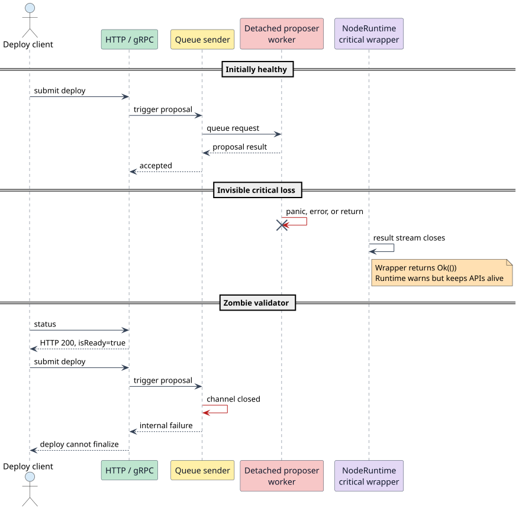
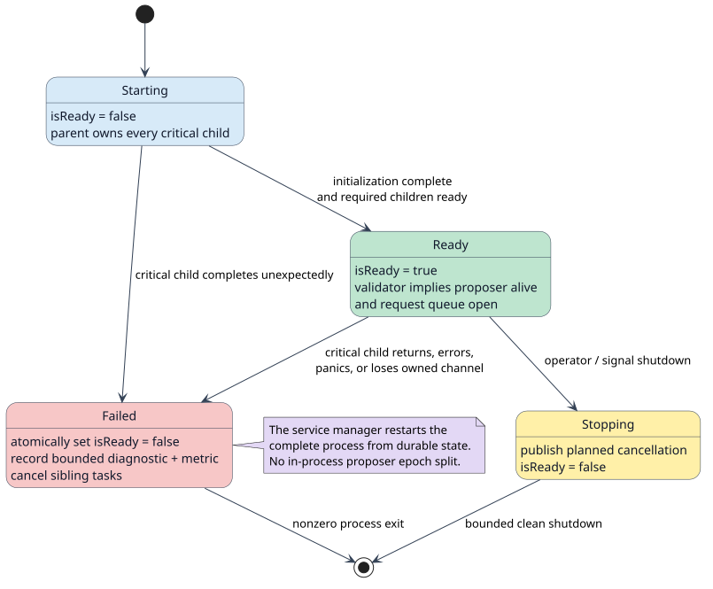

# Supervised Proposer Liveness and Truthful Node Readiness

| Field         | Value                                                                                        |
| ------------- | -------------------------------------------------------------------------------------------- |
| Status        | Under review                                                                                 |
| Created       | 2026-08-02                                                                                   |
| Target        | `f1r3node-rust` validator runtime                                                            |
| Compatibility | Additive status semantics; no Rholang syntax or tuplespace change                            |
| Motivation    | A validator can retain live HTTP and gRPC servers after its proposer receiver has terminated |

## Abstract

This F1r3fly Improvement Process Submission (FIPS) requires the validator proposer to be a structurally supervised, critical child of the node runtime. A validator MUST NOT report itself ready after the proposer worker or its queue receiver terminates unexpectedly. Unexpected completion MUST atomically revoke readiness and cause the node process to exit unsuccessfully, allowing an external service supervisor to restart the complete runtime from persisted state.

The proposal also defines observable lifecycle states, bounded failure propagation, metrics, fault-injection tests, and compatibility behavior. It does not alter consensus rules, block contents, RSpace, Rholang, or MeTTaIL.

## Motivation and observed failure

The current Rust runtime constructs a proposer queue in `node/src/rust/runtime/setup.rs`. `ProposerInstance::create` then starts the queue consumer with a detached `tokio::spawn` and returns only a result receiver. `NodeRuntime` drains that receiver in a nominally critical task. When the detached worker stops, the result receiver closes, the outer critical task returns `Ok(())`, and the runtime logs that the critical task completed unexpectedly without leaving its monitoring loop.

The queue sender remains available to the deploy and heartbeat paths. Subsequent sends fail with:

```text
Failed to send to proposer queue: channel closed
```

HTTP and gRPC status calls can remain successful and `isReady` can remain true because current readiness is an initialization latch rather than a live conjunction of critical-service health. The result is a _zombie validator_: reachable, but unable to turn accepted deploys into blocks.

The failure was reproduced against `f1r3node-rust` 0.4.15 at commit `c95595a`. A local stack watchdog successfully detected the log signal and restarted the process. That watchdog remains useful defense in depth, but the node itself is the only component that owns enough lifecycle state to make readiness truthful and failure propagation race-free.



## Terminology

- **Critical child**: an asynchronous task whose unexpected termination makes the parent runtime unable to satisfy its advertised service contract.
- **Liveness**: the ability of a bonded validator to continue accepting proposal triggers and eventually attempt block production when consensus preconditions hold.
- **Readiness**: an externally observable claim that the node can serve the complete role selected by its configuration. Readiness differs from process liveness: an HTTP socket can be live while the validator role is not ready.
- **Planned shutdown**: termination initiated by the runtime's explicit cancellation/shutdown protocol.
- **Unexpected completion**: a critical child returning, panicking, losing an owned channel, or being cancelled before planned shutdown begins.
- **Structured supervision**: parent-child task ownership in which child lifetimes cannot outlive or become invisible to the parent that depends on them.
- **Zombie validator**: a process whose network APIs remain reachable while its critical proposer path is permanently unavailable.

## Scope

This proposal governs:

1. ownership of the proposer worker and its queue;
2. propagation of proposer termination to `NodeRuntime`;
3. validator readiness semantics in HTTP and gRPC status responses;
4. metrics and structured lifecycle events;
5. normal-shutdown discrimination; and
6. deterministic unit, integration, and process-level fault-injection tests.

This proposal does not change:

- consensus validation or fork choice;
- block proposal eligibility or timing;
- deploy replay, cost accounting, or finality;
- Rholang grammar, reduction semantics, system processes, or RSpace;
- MeTTaIL or Foreign Language Terms; or
- the behavior of a configured read-only node, which has no proposer child.

## Theoretical model

Let $`V`$ mean that the node is configured as a validator. Let $`I(t)`$ mean initialization has completed at time $`t`$, and let $`C_i(t)`$ mean critical service $`i`$ is alive and accepting work at that time. The readiness predicate is:

```math
R(t) = I(t) \land \bigwedge_{i \in C(V)} C_i(t)
```

where $`C(V)`$ includes the proposer and heartbeat proposer only when $`V`$ is true. Readiness is therefore a live predicate, not a monotone initialization bit.

For proposer worker $`P`$, the required fail-stop propagation property is:

```math
\neg P(t_f) \land \neg Shutdown(t_f)
\Longrightarrow
\Diamond_{\leq \Delta}\bigl(\neg R \land Exit_{nonzero}\bigr)
```

Here $`t_f`$ is the first observed unexpected termination time and $`\Delta`$ is the implementation's bounded local propagation interval. The acceptance tests set $`\Delta = 2\,\mathrm{s}`$ under an idle test runtime; production scheduling can make observation slower, but no retry loop or network timeout may be required for propagation.

The principal safety property is:

```math
R(t) \land V \Longrightarrow P(t) \land QueueOpen(t)
```

This property prevents a truthful status endpoint from describing the observed zombie state. It does not claim that a ready validator must produce a block: consensus state, bonds, deploy availability, and timing can legitimately prevent a proposal.

This design follows the fail-stop intuition of dependable systems: a component that cannot perform its advertised role should become observably unavailable rather than silently provide partial service. It also applies structured task ownership so that a parent cannot lose the completion status of a critical child. These principles align with the dependability taxonomy of Avizienis et al. and with Dijkstra's use of explicit state predicates in self-stabilizing systems [1, 2].

## Required lifecycle semantics

### Proposer ownership

`NodeRuntime` MUST own a join handle or directly await a proposer worker future. `ProposerInstance` MUST NOT detach its sole queue consumer while returning only a secondary result stream whose closure erases the worker's exit reason.

Either of the following API shapes is conforming:

```rust
async fn run(self) -> Result<(), CasperError>;
```

or:

```rust
struct ProposerTask {
    results: Receiver<ProposerEvent>,
    worker: JoinHandle<Result<(), CasperError>>,
}
```

The first form is preferred because a single future has the smallest ownership surface. If result events are needed concurrently, the runtime can select over a supervised worker and a separately owned event receiver without discarding the worker handle.

### Critical completion

Every critical task outcome MUST be terminal unless planned shutdown is already active:

| Child outcome                          | Runtime action                                                                      |
| -------------------------------------- | ----------------------------------------------------------------------------------- |
| `Ok(())` before shutdown               | Revoke readiness, record `unexpected_completion`, initiate shutdown, return nonzero |
| `Err(error)` before shutdown           | Revoke readiness, record the error chain, initiate shutdown, return nonzero         |
| Panic or cancelled join                | Revoke readiness, record the join error, initiate shutdown, return nonzero          |
| Completion after shutdown cancellation | Continue bounded graceful shutdown; preserve the original process exit reason       |

The existing behavior that only warns when a critical task returns `Ok(())` is non-conforming. A forever-service returning successfully is still a failure of its lifecycle contract.

### Queue closure

The proposer queue has exactly one live receiver while the validator is ready. Closure of that receiver before shutdown MUST be treated as a critical proposer failure. A send that discovers a closed queue MUST:

1. return a typed unavailable/internal error to the caller;
2. revoke readiness idempotently;
3. notify the runtime supervisor through an in-process signal that cannot block on the failed queue; and
4. allow the critical-task supervisor to terminate the process.

The send path is a secondary detector. The primary detector remains the owned worker completion, so recovery does not depend on another deploy or heartbeat arriving.

### Planned shutdown

The runtime MUST establish a one-way shutdown phase before closing critical queues. A cancellation token or watch channel SHOULD carry this phase to every critical child. The child MUST report whether it observed planned cancellation, and the parent MUST distinguish that report from spontaneous queue exhaustion.

The protocol is literately specified below. The prose at each step states the invariant the action preserves.

```text
SUPERVISE CRITICAL CHILDREN
  state := Starting
  start every critical child under the parent's owned task set

  when initialization completes and every required child reports Ready:
    state := Ready

  select the first event from:
    - shutdown request:
        state := Stopping
        publish planned cancellation
        await children within the graceful-shutdown bound
        return the requested clean exit result

    - any critical child completion while state != Stopping:
        state := Failed(child, outcome)
        atomically publish not-ready
        publish planned cancellation to sibling children
        await children within the graceful-shutdown bound
        return an error naming child and outcome
```

This ordering guarantees that normal queue closure follows the `Stopping` transition, while spontaneous closure precedes it and is therefore classified as failure.



## Readiness and diagnostics

The existing HTTP and gRPC `isReady` fields MUST use the live readiness predicate. On a validator, proposer failure MUST change `isReady` to false before process exit begins. On a read-only node, absence of a proposer MUST NOT affect readiness.

Status APIs SHOULD add an optional, additive diagnostic collection named `criticalServices`. Each entry has:

| Field             | Meaning                                                 |
| ----------------- | ------------------------------------------------------- |
| `name`            | Stable service identifier such as `proposer`            |
| `state`           | `starting`, `ready`, `stopping`, or `failed`            |
| `reason`          | Stable machine-readable reason; omitted outside failure |
| `changedAtMillis` | Unix epoch milliseconds of the most recent transition   |

Older clients can ignore the additive field. New clients MUST continue to treat `isReady` as authoritative and MUST NOT infer readiness solely from diagnostic entries.

The process MUST emit one structured error event for the first critical failure with fields `critical_service`, `outcome`, `planned_shutdown`, and `exit_code`. Repeated queue-send failures MUST be rate-limited or deduplicated so a single failure cannot flood logs.

The metrics surface MUST include:

- `node_critical_service_ready{service="proposer"}` as a `0`/`1` gauge;
- `node_critical_service_failures_total{service="proposer",reason="..."}` as a counter; and
- the existing proposer queue depth/rejection metrics, reset consistently on shutdown.

Metric labels MUST come from a bounded enumeration. Error strings, deploy signatures, and peer identifiers MUST NOT become labels.

## Error and restart policy

The node process MUST exit unsuccessfully after an unexpected proposer failure. It MUST NOT reconstruct a proposer in place because the proposer shares consensus engine state, queue accounting, heartbeat triggers, and mutable observability state. Restarting a subset risks split ownership and stale senders. A process supervisor can restart the complete dependency graph from durable block and RSpace state using the same configuration.

Implementations MAY apply a bounded service-manager restart policy. Backoff belongs outside the node process, where repeated failures remain visible and operators can cap restart bursts.

## Compatibility

- **Wire compatibility**: changing the calculation of existing `isReady` is a correctness fix. The optional diagnostic collection is additive. Protobuf field numbers MUST be newly allocated and never reuse a reserved or removed number.
- **Configuration compatibility**: no new required setting is introduced. A diagnostic-field feature flag is unnecessary because unknown JSON fields and protobuf fields are already ignorable.
- **Consensus compatibility**: no serialized consensus data, hashing rule, deploy, block, or RSpace behavior changes.
- **Read-only nodes**: their critical-service set excludes proposer services, preserving current readiness after initialization.
- **Service supervisors**: deployments that already use `Restart=on-failure` gain automatic recovery. Deployments without a supervisor gain truthful non-readiness and a nonzero exit for operator detection.

## Security and abuse analysis

Silently accepting work when the proposer is dead is an availability and monitoring-integrity defect. Truthful readiness prevents load balancers and automation from routing deploys to an incapable validator.

Fail-fast behavior can amplify a remotely triggerable panic into a restart loop. Therefore, parser and deploy errors MUST remain ordinary request failures; only termination of the already-classified critical worker is process-fatal. Fault-injection tests MUST use an internal test hook or dependency injection, never an unauthenticated production endpoint.

Error diagnostics MUST not expose private keys, deploy source, continuation payloads, or full internal error backtraces through public status endpoints. Detailed causal chains belong in protected logs; the public reason field is a bounded identifier.

## Acceptance tests

All Rust tests for this change MUST use `cargo nextest run`. The implementation is conforming only when each case passes deterministically:

1. **Unexpected successful return**: force the proposer worker to return `Ok(())`; readiness becomes false and the node exits nonzero within $`\Delta`$.
2. **Worker error**: inject `Err(CasperError)`; the process exit identifies `proposer` and preserves the causal error in logs.
3. **Worker panic**: inject a panic; the supervisor observes the join failure and exits nonzero.
4. **Closed result stream**: prove that closing a secondary result receiver cannot hide a still-owned worker outcome.
5. **Closed request receiver**: drop the receiver before shutdown; a sender reports unavailability, readiness falls, and the runtime exits.
6. **Normal shutdown**: request shutdown first; queue closure is classified as planned and the process exits cleanly.
7. **Read-only node**: run without validator identity; no proposer health entry is required and initialization can reach ready.
8. **Status parity**: HTTP and gRPC report identical readiness and critical-service states throughout every transition.
9. **Metrics boundedness**: repeated send attempts after closure increment a bounded-reason counter without creating unbounded labels.
10. **Process restart**: run under `Restart=on-failure`, inject proposer termination, and verify a new process restores peer connectivity and resumes block production from existing state.
11. **No false readiness window**: capture state transitions and prove that `isReady=false` is published no later than the first externally observable critical-failure event.
12. **Regression load**: exercise concurrent deploy and heartbeat proposal triggers across queue capacity without losing the supervised worker or misclassifying saturation as termination.

The process-level test MUST assert block-height progress after restart, not merely HTTP availability. This distinguishes a genuinely restored proposer from the original zombie state.

## Implementation impact

Expected implementation sites are:

- `node/src/rust/instances/proposer_instance.rs` for a non-detached worker API;
- `node/src/rust/runtime/node_runtime.rs` for fatal critical completion and owned supervision;
- `node/src/rust/runtime/setup.rs` for shared live readiness and secondary queue-failure notification;
- HTTP/gRPC status models for additive diagnostics; and
- node runtime, proposer, status, and process-level test modules.

No change may be merged into `f1r3node-rust` for this proposal until the FIPS is approved according to the repository's review process.

## Alternatives considered

### Log-only external watchdog

An external watchdog can restore service and is valuable defense in depth. It is not sufficient as the primary design because it parses presentation text, detects only known error strings, and cannot atomically revoke the node's readiness claim.

### Restart only the proposer worker

In-process restart has a larger proof surface: every sender, heartbeat trigger, pending counter, consensus reference, and state observer must switch epochs consistently. Complete process restart reuses the existing durable-state boundary and makes stale ownership impossible.

### Leave APIs live but set readiness false

This avoids a restart, but the validator cannot self-repair and callers may still reach mutation endpoints. A critical fail-stop exit is clearer and composes with established service supervisors.

## References

1. Algirdas Avizienis, Jean-Claude Laprie, Brian Randell, and Carl Landwehr, “Basic Concepts and Taxonomy of Dependable and Secure Computing,” _IEEE Transactions on Dependable and Secure Computing_ 1(1), 2004. [https://doi.org/10.1109/TDSC.2004.2](https://doi.org/10.1109/TDSC.2004.2)
2. Edsger W. Dijkstra, “Self-stabilizing Systems in Spite of Distributed Control,” _Communications of the ACM_ 17(11), 1974. [https://doi.org/10.1145/361179.361202](https://doi.org/10.1145/361179.361202)
